# Bayesian Machine Learning

An Introduction to the Unit

**Author:** Edward Milsom  
**Date:** 2026-09-29  
**Source:** [1.pdf](1.pdf)

## Page 1

### Slide 1: In this Episode ...

Welcome to “Bayesian Machine Learning” — CM32024 & CM52037

- Logistics and unit overview
  - Plan of lectures & labs (Semester 1)
  - Assessment
- Introduction to Bayesian statistics
  - The “What?” and the “Why?”
  - Historical development
  - Philosophy
  - ... and, finally, Bayes’ rule!
- Suggested background reading
- Looking ahead

Original page 1 (figures and equation layout)

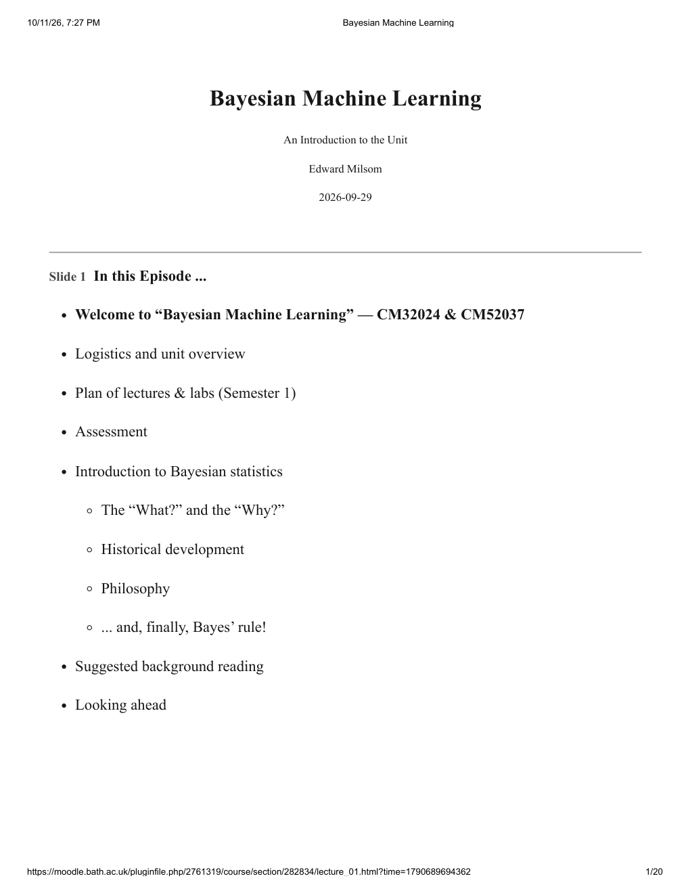

## Page 2

### Course Overview

### Slide 2: Lectures and Labs (Semester 1)

**Lectures**

- Lecture ‘A’ (1 hour): Tuesday, 12.15am, 8W 2.5
- Lecture ‘B’ (1 hour): Thursday, 11.15pm, 1WN 3.11
- 18 lectures of content overall, in weeks 1–10
- No lectures or labs planned in focus week (week 6) (Nov 2–6) or week 11 (Dec 7–11)

**Labs**

- 2 hours per week, Wednesday, 10:15am, 3E 3.1
- 9 labs, 1 drop-in session (no lab this week or in focus week. Last week is a drop-in session for catching up)
- Labs consist of a mixture of written exercises and Jupyter notebook implementation exercises.
- Assistance: Lecturer (me), and (hopefully) a teaching assistant (TA) will be present in the lab each week.

Original page 2 (figures and equation layout)

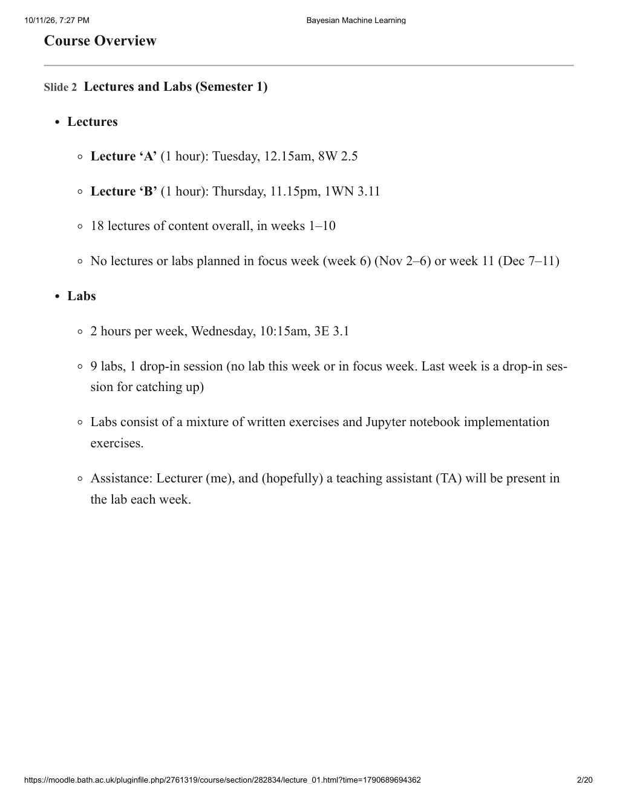

## Page 3

### Slide 3: Semester 1 Timetable (Details Subject to Change)

| Week No. | W/C | No. | Topic | Date | Time | Room |
| --- | --- | --- | --- | --- | --- | --- |
| 1 | Sep 28 | Lecture 1 | Bayesian Machine Learning | Tue Sep 29 | 12:15pm | 8W 2.5 |
| 1 | Sep 28 | No Lab | — | — | — | — |
| 1 | Sep 28 | Lecture 2 | Probabilistic Thinking | Thu Oct 01 | 11:15am | 1WN 3.11 |
| 2 | Oct 05 | Lecture 3 | Bayesian Statistical Inference | Tue Oct 06 | 12:15pm | 8W 2.5 |
| 2 | Oct 05 | Labsheet 1 | Bayesian Bandit Exercise | Wed Oct 07 | 10:15am | 3E 3.1 |
| 2 | Oct 05 | Lecture 4 | Adventures in Inference | Thu Oct 08 | 11:15am | 1WN 3.11 |
| 3 | Oct 12 | Lecture 5 | Bayesian Linear Regression | Tue Oct 13 | 12:15pm | 8W 2.5 |
| 3 | Oct 12 | Labsheet 2 | Regression Exercise | Wed Oct 14 | 10:15am | 3E 3.1 |
| 3 | Oct 12 | Lecture 6 | Marginalisation & Occam’s Razor I | Thu Oct 15 | 11:15am | 1WN 3.11 |
| 4 | Oct 19 | Lecture 7 | Marginalisation & Occam’s Razor II | Tue Oct 20 | 12:15pm | 8W 2.5 |
| 4 | Oct 19 | Labsheet 3 | Marginal Likelihood Exercise | Wed Oct 21 | 10:15am | 3E 3.1 |
| 4 | Oct 19 | Lecture 8 | Markov Chain Monte Carlo (MCMC) | Thu Oct 22 | 11:15am | 1WN 3.11 |
| 5 | Oct 26 | Lecture 9 | Hamiltonian Monte Carlo (HMC) | Tue Oct 27 | 12:15pm | 8W 2.5 |
| 5 | Oct 26 | Labsheet 4 | Prediction Exercise | Wed Oct 28 | 10:15am | 3E 3.1 |
| 5 | Oct 26 | Lecture 10 | Probabilistic Programming | Thu Oct 29 | 11:15am | 1WN 3.11 |
| 6 | Nov 02 | Focus Week | — | — | — | — |
| 7 | Nov 09 | Lecture 11 | Hierarchical Models I | Tue Nov 10 | 12:15pm | 8W 2.5 |
| 7 | Nov 09 | Labsheet 5 | MCMC Exercise | Wed Nov 11 | 10:15am | 3E 3.1 |
| 7 | Nov 09 | Lecture 12 | Hierarchical Models II | Thu Nov 12 | 11:15am | 1WN 3.11 |
| 8 | Nov 16 | Lecture 13 | Automatic Relevance Determination (ARD) | Tue Nov 17 | 12:15pm | 8W 2.5 |
| 8 | Nov 16 | Labsheet 6 | Hierarchical Models Exercise | Wed Nov 18 | 10:15am | 3E 3.1 |
| 8 | Nov 16 | Lecture 14 | Sparse Bayesian Learning and Inverse Models | Thu Nov 19 | 11:15am | 1WN 3.11 |
| 9 | Nov 23 | Lecture 15 | Bayesian Models for Time Series (SMC) | Tue Nov 24 | 12:15pm | 8W 2.5 |
| 9 | Nov 23 | Labsheet 7 | Sparsity Exercise | Wed Nov 25 | 10:15am | 3E 3.1 |
| 9 | Nov 23 | Lecture 16 | Bayesian Anomaly Detection | Thu Nov 26 | 11:15am | 1WN 3.11 |
| 10 | Nov 30 | Lecture 17 | Model Criticism and Calibration | Tue Dec 01 | 12:15pm | 8W 2.5 |
| 10 | Nov 30 | Labsheet 8 | Time Series Exercise | Wed Dec 02 | 10:15am | 3E 3.1 |
| 10 | Nov 30 | Lecture 18 | Seven Pillars of Bayesian Wisdom | Thu Dec 03 | 11:15am | 1WN 3.11 |
| 11 | Dec 07 | No Lecture | — | — | — | — |
| 11 | Dec 07 | Drop-in | Drop-in Session | Wed Dec 09 | 10:15am | 3E 3.1 |
| 11 | Dec 07 | No Lecture | — | — | — | — |

### Slide 4: Assessment

- **100% In-Person Exam (Summer)**
  - All content from lectures and labs is examinable (unless stated otherwise)
  - The exam will be held in the summer exam period, in-person.
  - Mixture of theory and practical questions.

Original page 3 (figures and equation layout)

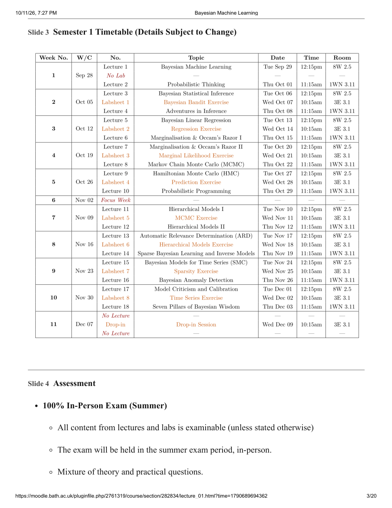

## Page 4

*Assessment (continued)*

- Lectures, labs, and practice questions will prepare you for the exam.
- Some differentiation between CM32024 and CM52037

### Slide 5: Course Materials

**Media**

- PDF of lecture slides available in advance (at least 24h before)
- Accessibile HTML version of slides (e.g. for screen readers)
- Slides source code (LaTeX)
- Occasional code from demos
- Lecture videos made available within 24 hours (ideally)
- No separate lectures notes

**Further help**

- Ask at the Wednesday labs
- Ask your peers
- Post in the Moodle general discussion forum
- As a last resort, email me!

### Motivation: Why “Bayesian”?

### Slide 6: Motivation: Bayesian Statistics — What, and Why?

**What is it?**

Original page 4 (figures and equation layout)

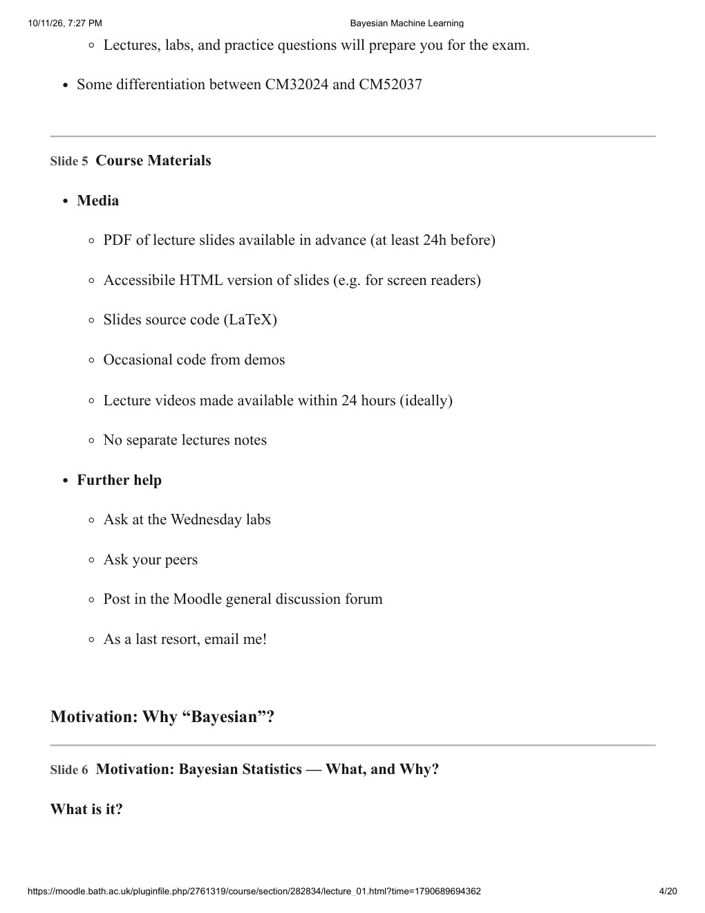

## Page 5

*Motivation: Bayesian Statistics — What, and Why? (continued)*

- “Bayesian” implies that the rules of probability may be applied to model **all sources of uncertainty**
- By contrast, in orthodox or frequentist statistics, only intrinsically random variables are treated probabilistically

**Why is this distinction important?**

- This is more than a philosophical distinction!
- The Bayesian viewpoint is consistent with the nature of real-world uncertainty
  - It also offers a range of advantageous features when “learning” from data
- But there is a drawback: many of the necessary calculations are problematic to undertake and must be approximated

Original page 5 (figures and equation layout)

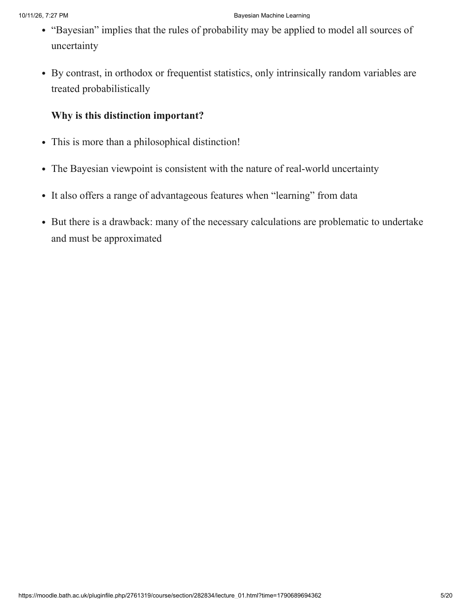

## Page 6

### A Brief History

### Slide 7: A Brief History

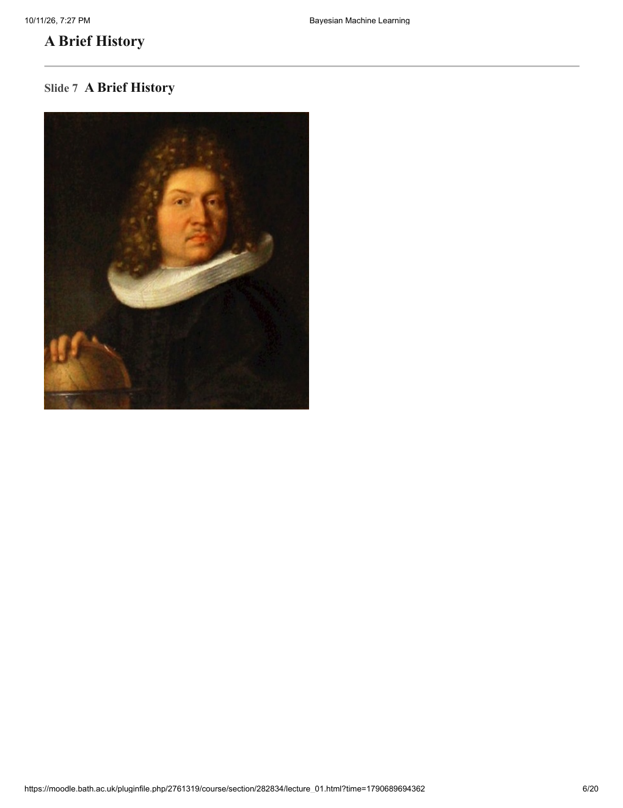

Original page 6 (figures and equation layout)

## Page 7

*A Brief History (continued): facsimile of the opening of Bayes’ essay.*

> [370] quodque solum, certa nitri signa præbere, sed plura concurrere debere, ut de vero nitro producto dubium non relinquatur.
>
> LII. *An Essay towards solving a Problem in the Doctrine of Chances. By the late Rev. Mr. Bayes, F. R. S. communicated by Mr. Price, in a Letter to John Canton, A. M. F. R. S.*
>
> Dear Sir,
>
> Read Dec. 23, 1763.
>
> I now send you an essay which I have found among the papers of our deceased friend Mr. Bayes, and which, in my opinion, has great merit, and well deserves to be preserved. Experimental philosophy, you will find, is nearly interested in the subject of it; and on this account there seems to be particular reason for thinking that a communication of it to the Royal Society cannot be improper.
>
> He had, you know, the honour of being a member of that illustrious Society, and was much esteemed by many in it as a very able mathematician. In an introduction which he has writ to this Essay, he says, that his design at first in thinking on the subject of it was, to find out a method by which we might judge concerning the probability that an event has to happen, in given circumstances, upon supposition that we know nothing concerning it but that, under the same circum-

*The facsimile is cut off at this point in the source page; long-s letterforms above are transcribed as s.*

Original page 7 (figures and equation layout)

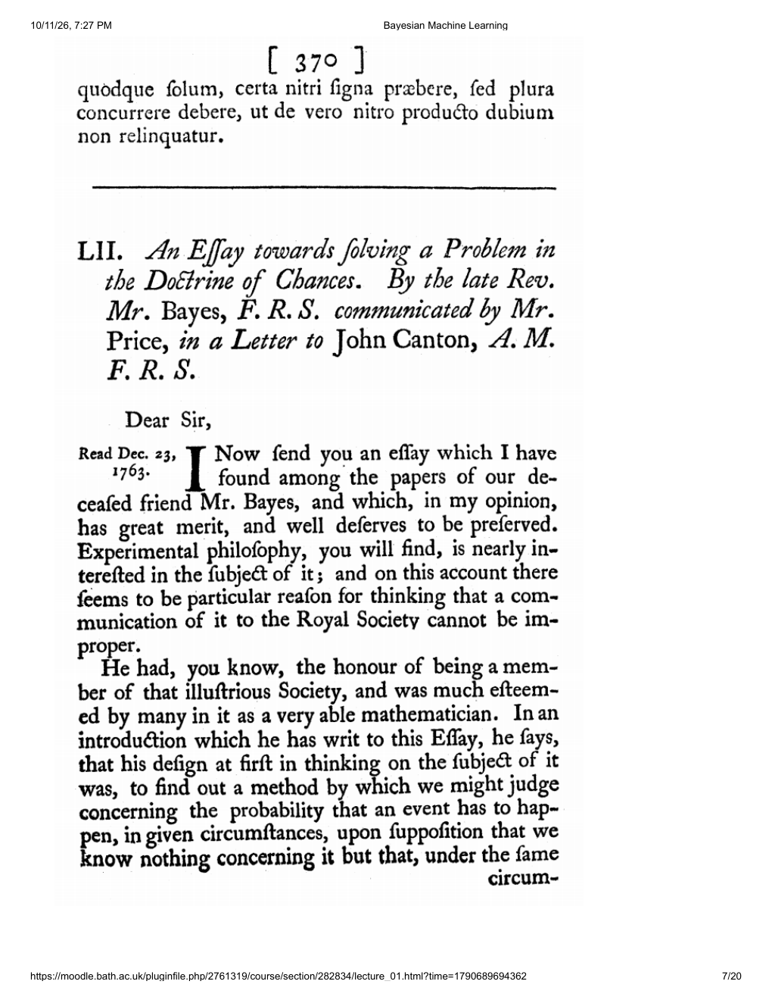

## Page 8

*A Brief History (continued): historical portrait.*

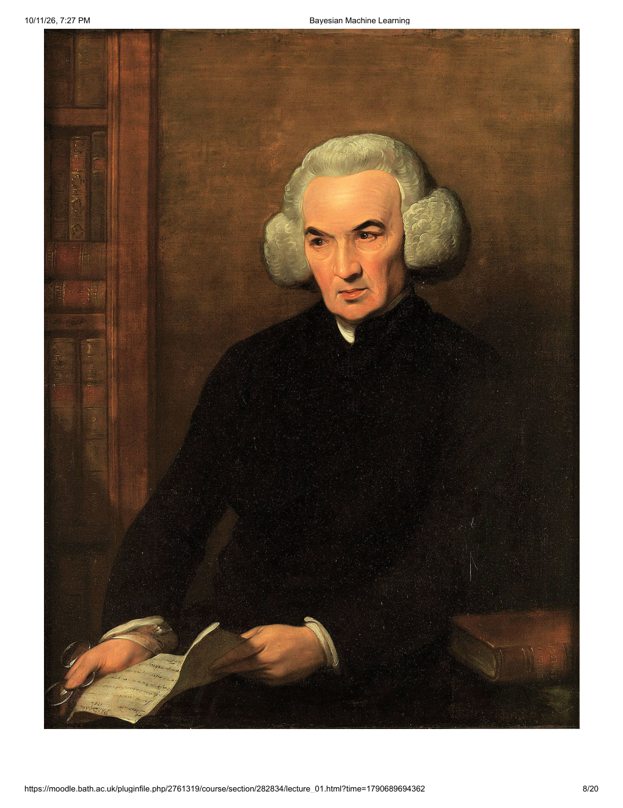

Original page 8 (figures and equation layout)

## Page 9

*A Brief History (continued): historical portrait.*

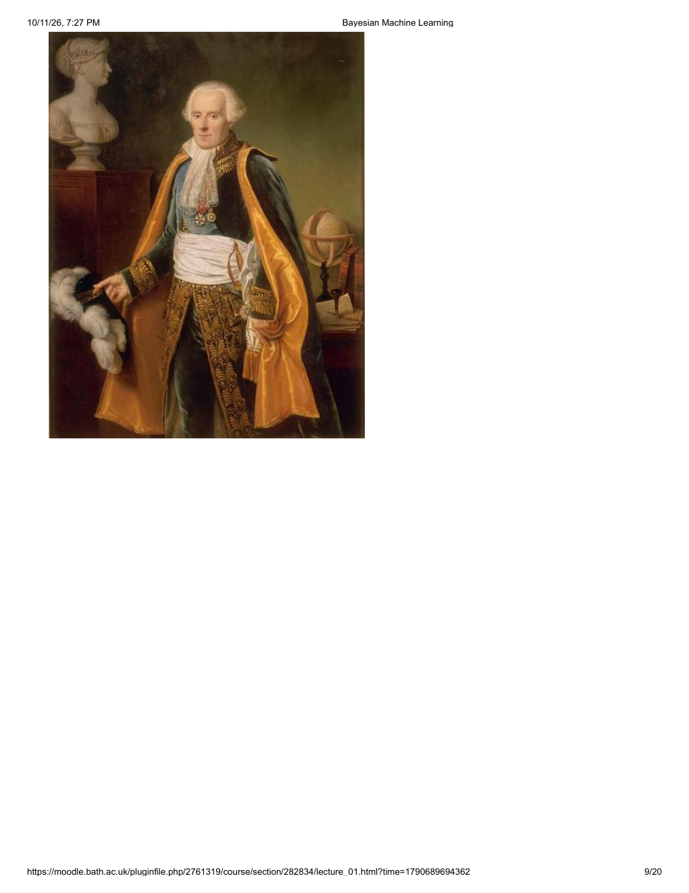

Original page 9 (figures and equation layout)

## Page 10

*A Brief History (continued): Richard T. Cox book-jacket photograph and text.*

Photo by Jack Engeman

**Richard T. Cox** is Professor of Physics and was formerly Dean of Arts and Sciences at The Johns Hopkins University. He was Professor of Physics at New York University before coming to Johns Hopkins. He is the author of *Time, Space and Atoms* and *Statistical Mechanics of Irreversible Change* and papers in journals of physics and biology.

> “[This book] is, in my opinion, one of the most important ever written on the foundations of probability theory, and the greatest advance in the conceptual, as opposed to the purely mathematical, formulation of the theory since Laplace.”
>
> — E. T. Jaynes, American Journal of Physics

The Johns Hopkins Press — Baltimore 18, Maryland  
ISBN 0-8018-6982-X

Original page 10 (figures and equation layout)

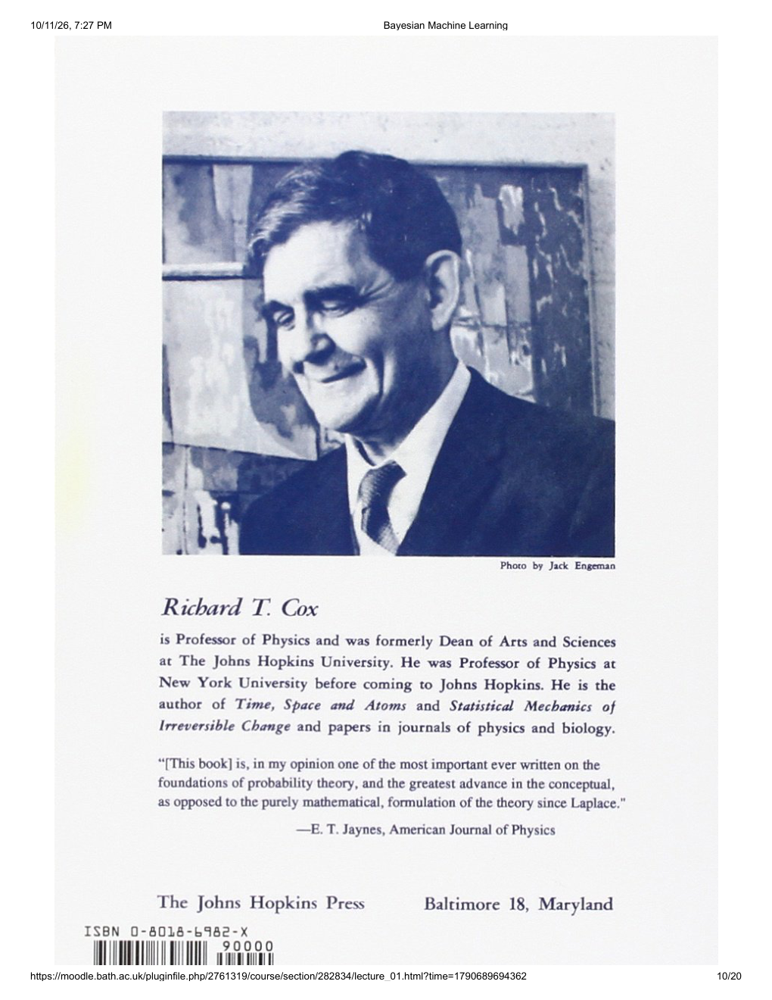

## Page 11

*Book-jacket barcode (continued): 9780801869822.*

### Slide 8: A Brief History of Probability: Jacob Bernoulli

- Jacob Bernoulli (1655–1705)
- In *Ars Conjectandi* (1713), he developed a theory of the relationship between the number of occurrences $n$ of a binary event with probability $p$ across $N$ trials

### Slide 9: Practical Illustration

At this point, a bowl of red and blue balls is typically introduced …

Original page 11 (figures and equation layout)

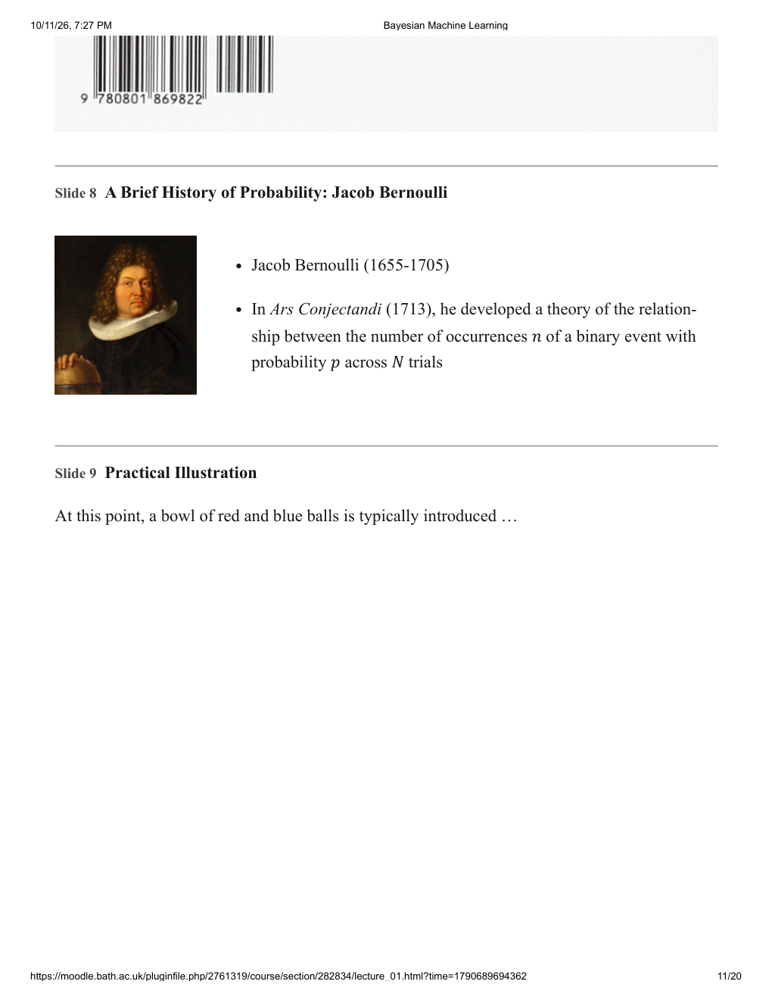

## Page 12

*Practical Illustration (continued): a bowl of red and blue balls.*

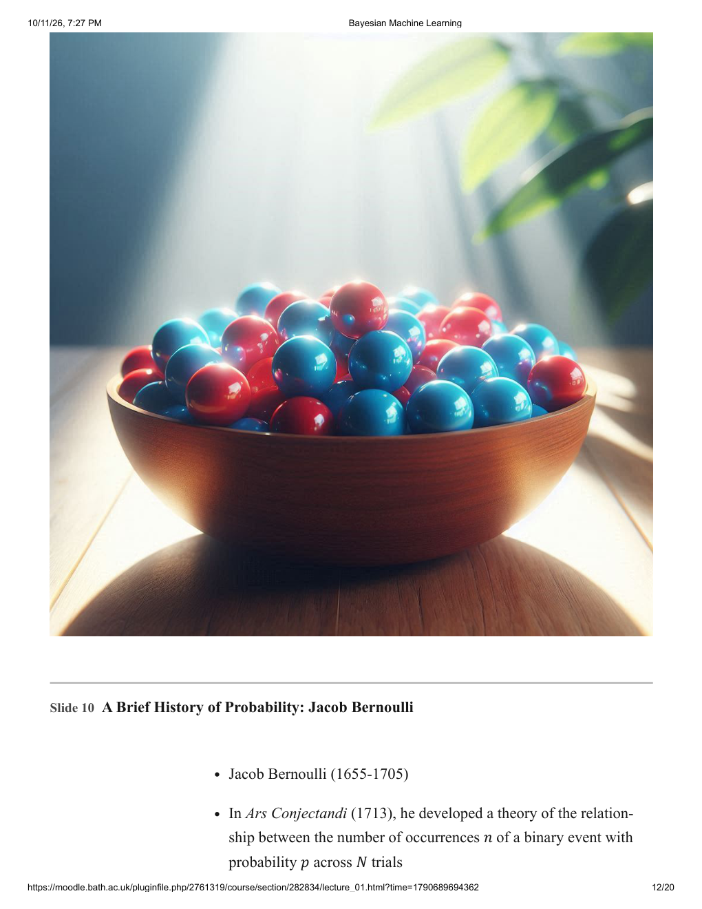

### Slide 10: A Brief History of Probability: Jacob Bernoulli

- Jacob Bernoulli (1655–1705)
- In *Ars Conjectandi* (1713), he developed a theory of the relationship between the number of occurrences $n$ of a binary event with probability $p$ across $N$ trials

Original page 12 (figures and equation layout)

## Page 13

*Jacob Bernoulli (continued)*

- He also recognised that the inverse of this problem was of interest: i.e. when $n$ and $N$ are known, what is $p$?
- This is the problem we now call **statistical inference**

### Slide 11: Inverse Probability

- I have a bowl of $N=6$ balls, an unknown mix of red and blue
- You draw a red one
- What is the proportion of red balls in the bowl?

| In the bag of 6 | Draw | Probability $p$ |
| --- | --- | --- |
| 1 red, 5 blue | Red | $1/6$ |
| 2 red, 4 blue | Red | $1/3$ |
| 3 red, 3 blue | Red | $1/2$ |
| 4 red, 2 blue | Red | $2/3$ |
| 5 red, 1 blue | Red | $5/6$ |
| 6 red, 0 blue | Red | $1$ |

### Slide 12: A Brief History of Probability: The Reverend Thomas Bayes

- Thomas Bayes (1701–1761) developed the first workable theory of “inverse probability” (in rather non-general form)
- It was edited and published posthumously (1763) by his literary executor Richard Price (1723–1791)

Original page 13 (figures and equation layout)

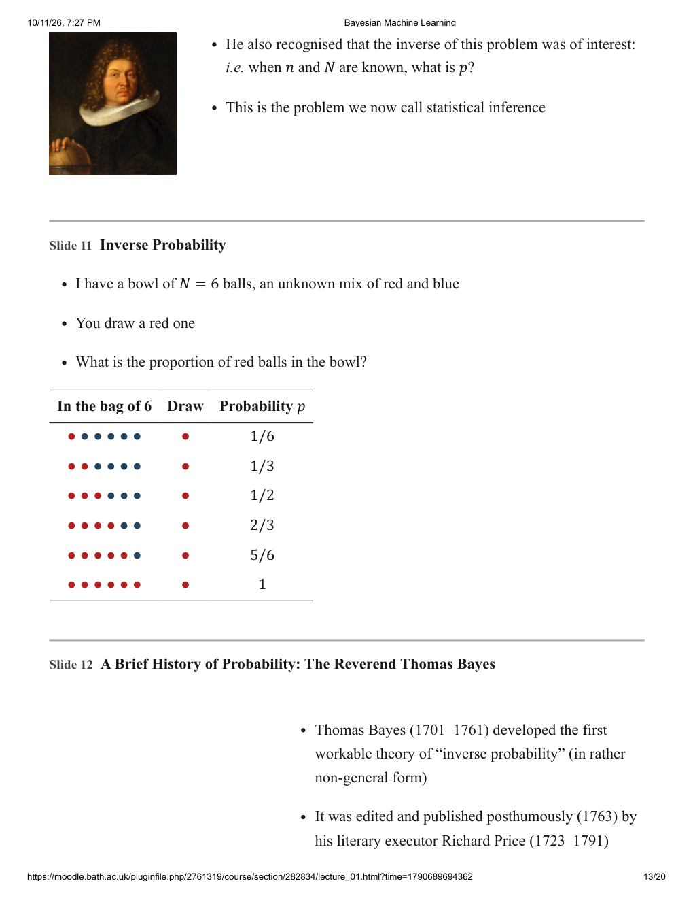

## Page 14

### Slide 13: A Brief History of Probability: Pierre-Simon Laplace

- Pierre-Simon Laplace (1749–1827)
- In *Essai Philosophique sur les Probabilités* (1814), Pierre-Simon Laplace formalised (independently of Bayes) a mathematical, probabilistic, system of inductive reasoning
  - It is recognisably “Bayesian”
- He famously said: “The theory of probability is simply common sense reduced to calculus.”
- He was also Napoleon’s examiner at the École Militaire, and later Minister of the Interior of France (though he only lasted 6 weeks!)

Original page 14 (figures and equation layout)

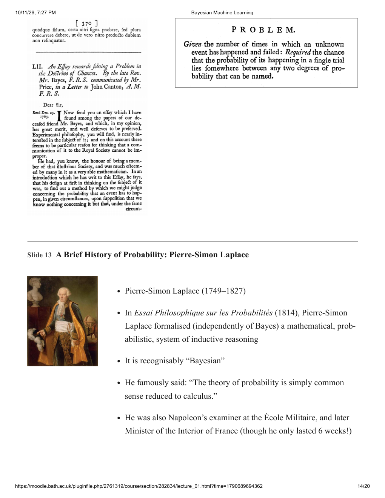

## Page 15

### Slide 14: Probability According to Laplace

In Laplace’s system (simplified), if $A$ and $B$ are binary propositions (either true or false), and $\bar A$ denotes “not $A$” ($\bar B$ is “not $B$”), then just two axioms are required:

- The sum rule:

$$P(A)=P(A,B)+P(A,\bar B)$$

- The product rule:

$$P(A,B)=P(A\mid B)P(B)=P(B\mid A)P(A)$$

- From these, we can derive Bayes’ rule:

$$P(B\mid A)=\frac{P(A\mid B)P(B)}{P(A)}$$

$$P(\mathrm{Unknowns}\mid\mathrm{Data})=\frac{P(\mathrm{Data}\mid\mathrm{Unknowns})P(\mathrm{Unknowns})}{P(\mathrm{Data})}$$

### Slide 15: Orthodox, or “Frequentist”, Statistics

- To Laplace et al, the probability $P(B)$ represented the degree of belief in, or plausibility of, the proposition (or hypothesis) $B$
- This interpretation was soon rejected as being too subjective
- Instead, probability came to be defined as the **long run relative frequency** of $B$ occurring in an infinite set of trials
  - the implication is that $B$ must intrinsically be a random variable
  - this is the orthodox or frequentist viewpoint
- The Bayesian view of probability (as plausibility) fell out of favour and, in the early 1900s, was rejected entirely ...

### Slide 16: A Brief History of Probability: Richard T. Cox

- Richard T. Cox (1898–1991)

Original page 15 (figures and equation layout)

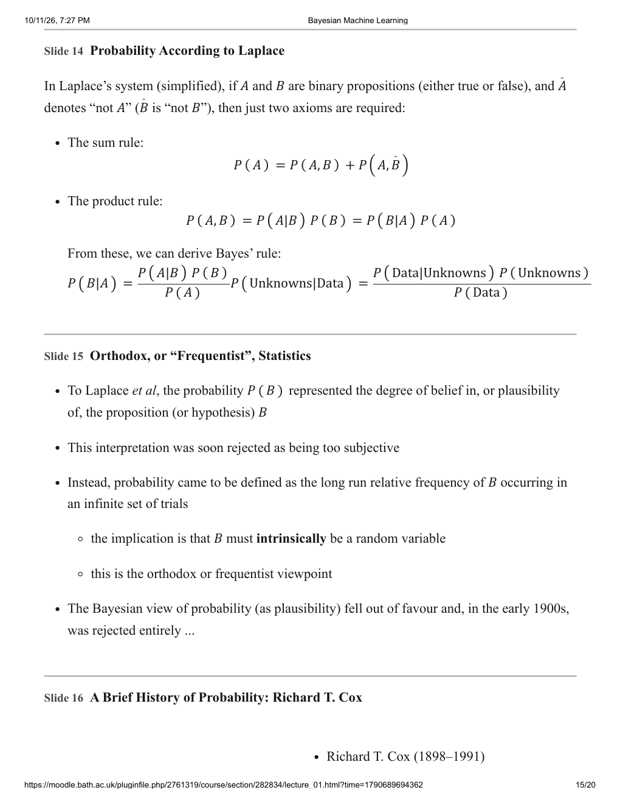

## Page 16

*Richard T. Cox (continued)*

- *Probability, Frequency and Reasonable Expectation* (1946): Back to first principles
- Assumption: degrees of belief or plausibility can be represented by (any) real numbers
- Based on minimal desiderata, he sought a logically consistent system of rules for manipulating plausibilities
- Demonstrated that there was a single, unique, such system — and this was isomorphic to probability theory

### The Modern Bayesian Viewpoint

### Slide 17: Conclusion: Probability Can Represent Plausibility

- Cox showed that belief functions were entirely consistent with probability theory, and its associated tool-set:
  - the sum and product rules
  - Bayes’ theorem
- The Bayesian viewpoint is consequently that probability may be safely applied to model **all forms of uncertainty**, not just explicitly “random” variables
- For example, uncertainty such as:
  - the outcome of a flip of a coin

Original page 16 (figures and equation layout)

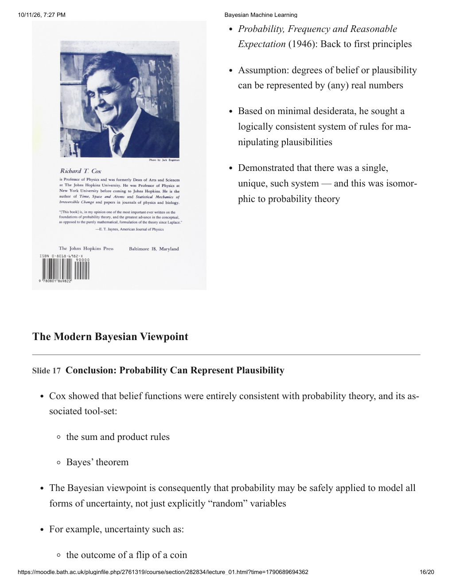

## Page 17

*Conclusion: Probability Can Represent Plausibility (continued)*

- whether a given patient has COVID-19
- whether it will rain during the next hour
- the value of a measured physical constant (e.g. the mass of the moon)
- the values a model parameter might take
- the choice of model itself

### Slide 18: The Bayesian View in One Slide

If $\mathcal D$ is our observed data set, and $\boldsymbol\theta$ encapsulates all the unknowns associated with a model $\mathcal M$ intended to describe that data, then Bayesian Inference is:

$$p(\boldsymbol\theta\mid\mathcal D,\mathcal M)=\frac{p(\mathcal D\mid\boldsymbol\theta,\mathcal M)\,p(\boldsymbol\theta\mid\mathcal M)}{p(\mathcal D\mid\mathcal M)}$$

- Posterior: $p(\boldsymbol\theta\mid\mathcal D,\mathcal M)$
- Likelihood: $p(\mathcal D\mid\boldsymbol\theta,\mathcal M)$
- Prior: $p(\boldsymbol\theta\mid\mathcal M)$
- Marginal Likelihood or “Evidence”:

$$p(\mathcal D\mid\mathcal M)=\int p(\mathcal D\mid\boldsymbol\theta,\mathcal M)\,p(\boldsymbol\theta\mid\mathcal M)\,d\boldsymbol\theta$$

### Suggested Reading

### Slide 19: Reading: Bayesian Statistics & Machine Learning

- (Bishop 2006) <https://www.microsoft.com/en-us/research/people/cmbishop/#!prml-book>
- (MacKay 2003) <http://www.inference.org.uk/itprnn/book.html>
- (Barber 2012) <http://www.cs.ucl.ac.uk/staff/d.barber/brml/>
- (Murphy 2022) <http://probml.github.io/book1>

Original page 17 (figures and equation layout)

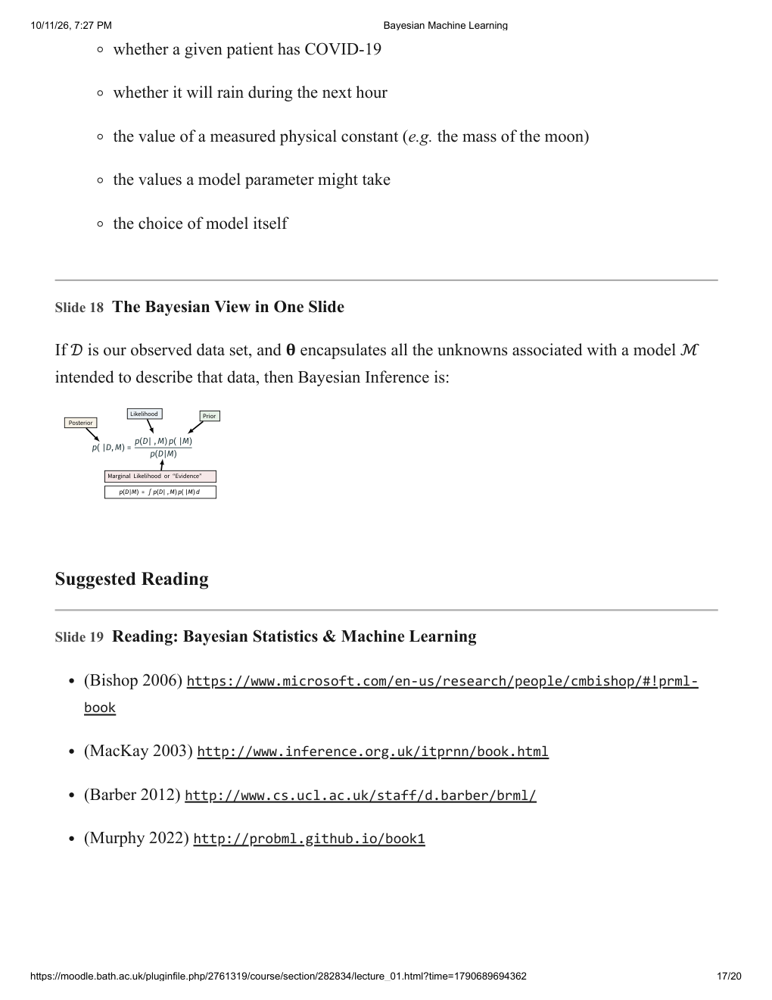

## Page 18

### Slide 20: Reading: Bayesian Probability and Statistics

- (Jaynes 2003)
- (Sivia and Skilling 2006)
- (Gelman et al. 2014)
- “Statistics — it’s just uncertainty laundering!” (Andrew Gelman). Watch his lecture “Crimes against data” at the University of Bath in 2016: <https://www.youtube.com/watch?v=fc1hkFC2c1E>
- (McElreath 2023). Note: this book is unfortunately focused on “R”, but has much good content.

### Slide 21: Reading: Papers (Mainly of Historic Interest)

- (Cox 1946) [Formulation of Bayesian statistics: available at Google Scholar]
- (Loredo 1990) [Excellent review: accessible at Cornell]
- (Bretthorst 1990) [Excellent introductory review: Google Scholar]
- (Lindley 2000) [Interesting philosophical overview and discussion: Google Scholar]
- (Gelman 2008)

These recommended examples cover Bayesian inference in general. References to other introductory papers relevant to specific Bayesian sub-topics will appear in future lectures and notes.

### Slide 22: Looking Ahead (Semester 1) ...

- Bayesian inference
- Linear regression
- Model selection

Original page 18 (figures and equation layout)

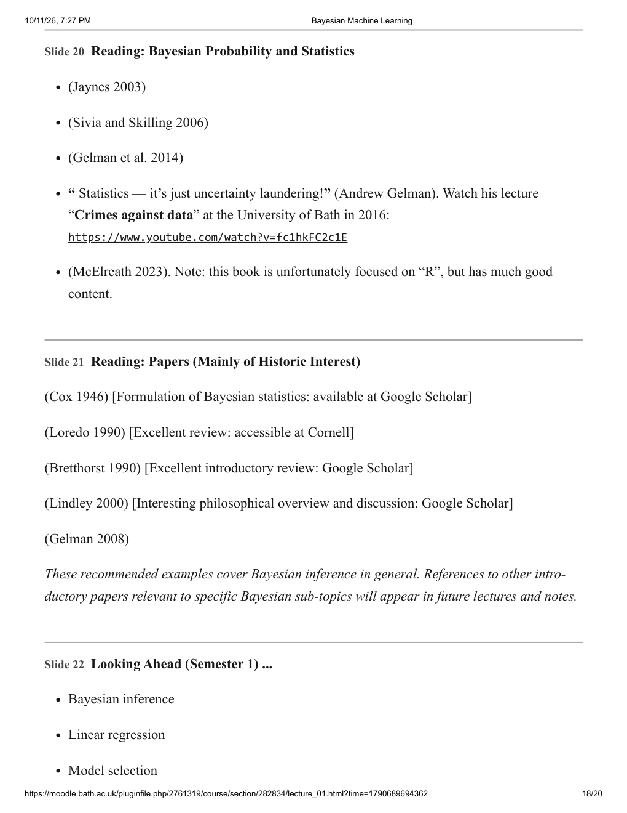

## Page 19

*Looking Ahead (Semester 1) (continued)*

- Markov Chain Monte Carlo (MCMC)
- Probabilistic programming (NumPyro, PyMC, Stan)
- Hierarchical models
- Sparse models
- Time series
- Calibration and model evaluation

### Slide 23: Looking Ahead (Semester 2, With Some Uncertainty) ...

- Deterministic approximation (variational methods)
- The Gaussian Process (GP)
- Bayesian neural networks and deep learning
- Amortised Inference and Simulation-based Inference
- Bayesian optimisation
- Variational Autoencoders (VAE)
- Normalising flows

### References

- Barber, David. 2012. *Bayesian Reasoning and Machine Learning*. Cambridge University Press.
- Bishop, Christopher M. 2006. *Pattern Recognition and Machine Learning*. Springer.
- Bretthorst, G Larry. 1990. “An Introduction to Parameter Estimation Using Bayesian Probability Theory.” In *Maximum Entropy and Bayesian Methods*, 53–79. Springer.
- Cox, Richard T. 1946. “Probability, Frequency and Reasonable Expectation.” *American Journal of Physics* 14 (1): 1–13.
- Gelman, Andrew. 2008. “Objections to Bayesian Statistics.” *Bayesian Analysis* 3 (3): 445–49.
- Gelman, Andrew, John B Carlin, Hal S Stern, and Donald B Rubin. 2014. *Bayesian Data Analysis (Third Edition)*. CRC Press.
- Jaynes, Edward T. 2003. *Probability Theory: The Logic of Science*. Cambridge University Press.
- Lindley, Dennis V. 2000. “The Philosophy of Statistics.” *The Statistician* 49 (3): 293–337.
- Loredo, Thomas J. 1990. “From Laplace to Supernova SN 1987A: Bayesian Inference in Astrophysics.” In *Maximum Entropy and Bayesian Methods*, 81–142. Springer.
- MacKay, David J. C. 2003. *Information Theory, Inference and Learning Algorithms*. Cambridge University Press.

Original page 19 (figures and equation layout)

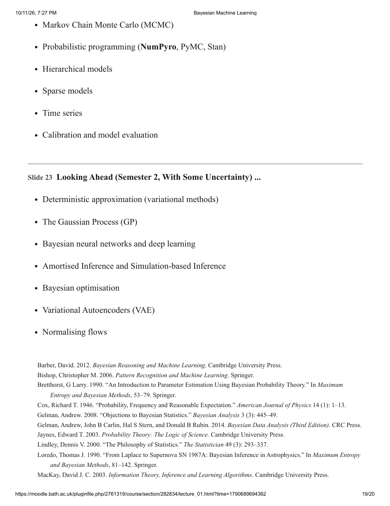

## Page 20

*References (continued)*

- McElreath, Richard. 2023. *Statistical Rethinking (Second Edition)*. CRC Press.
- Murphy, Kevin P. 2022. *Probabilistic Machine Learning: An Introduction*. MIT Press.
- Sivia, Devinderjit, and John Skilling. 2006. *Data Analysis: A Bayesian Tutorial*. Oxford University Press.

Original page 20 (figures and equation layout)

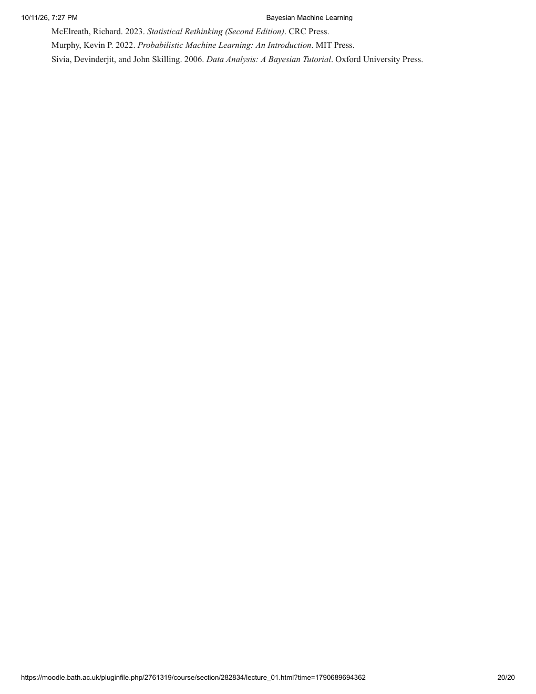

