# Probabilistic Programming

## Modern Software for Bayesian Modelling

**Author:** Edward Milsom  
**Date:** 2026-10-15  
**Source:** [Lecture 10 PDF](10.pdf)

Transcription preserves all 21 numbered slides across 15 PDF pages. PDF line wraps in code are rejoined; clipped output, source claims and supplemental qualifications are marked explicitly. Printed demo outputs are not newly executed results.

## Page 1

### Slide 1: In this Episode ...

- Quick recap of Hamiltonian Monte Carlo (HMC), with a hand-coded implementation demo.
- Applying HMC in practice: software library options and introduction to NumPyro.
- A new paradigm: probabilistic programming, a step-by-step basic walk-through and another demo.
- Looking ahead to hierarchical probabilistic graphical models.

<details>
<summary>Original page 1 (figures and equation layout)</summary>

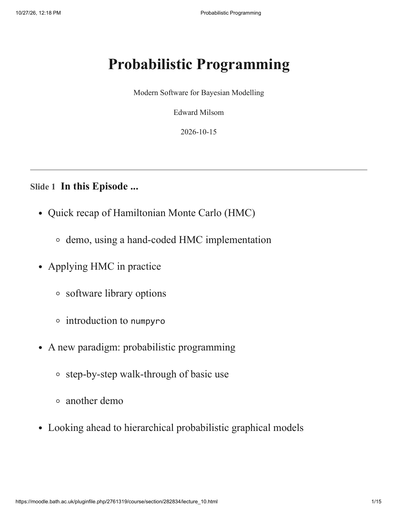

</details>

## Page 2

### Slide 2: Recap: Hamiltonian Monte Carlo (HMC)

The source calls HMC the “state of the art” in MCMC and stochastic approximation. It exploits gradient information:

$$\frac{\partial\log P^*(\boldsymbol\theta)}{\partial\boldsymbol\theta}.$$

Introduce momentum variables $\rho_i=\partial\theta_i/\partial t$ and embed the unnormalised target in

$$H(\boldsymbol\theta,\boldsymbol\rho)=-\log P^*(\boldsymbol\theta)+\frac12\|\boldsymbol\rho\|^2.$$

Propose a new state by randomly sampling momentum and numerically iterating Hamiltonian dynamics several steps. Accept or reject with probability

$$\min\{1,\exp[H(\boldsymbol\theta,\boldsymbol\rho)-H(\boldsymbol\theta',\boldsymbol\rho')]\}.$$

The source says “The new state should be independent (no sub-sampling)” and gives the intuition of kicking a ball around the $\log P^*$ landscape.

**Qualification:** HMC transitions are not guaranteed independent. Their dependence and numerical accuracy still require assessment; automatic thinning is not required. The potential-energy landscape is $-\log P^*$, not $+\log P^*$. The momentum-equals-velocity expression assumes the identity mass matrix used here. The superlative describes the source, not a universal or updated ranking of inference methods.

### Slide 3: Want to Know More About How HMC Works?

- Radford M. Neal, “MCMC using Hamiltonian Dynamics”: <https://arxiv.org/abs/1206.1901>.

<details>
<summary>Original page 2 (figures and equation layout)</summary>

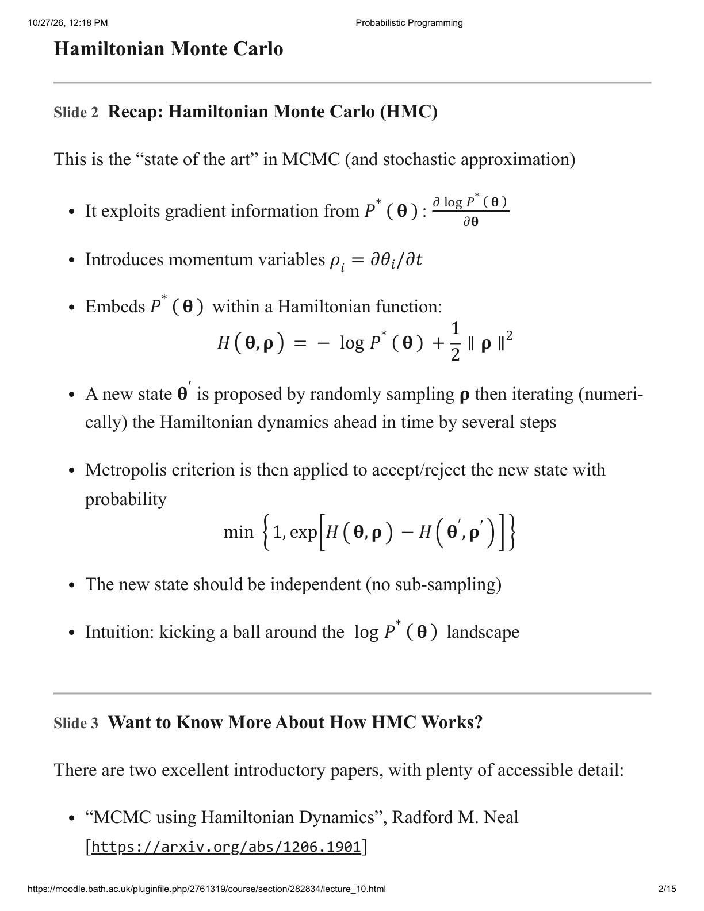

</details>

## Page 3

Slide 3 continues:

- M. Betancourt, “A Conceptual Introduction to Hamiltonian Monte Carlo”: <https://arxiv.org/abs/1701.02434>.

### Slide 4: Hamiltonian Monte Carlo — Correlated Gaussian

The original figure shows green HMC sample positions against correlated Gaussian contours on axes theta_1 and theta_2. Its title says “Hamiltonian Monte Carlo (100 Samples)” and an annotation says “1 rejected sample”. The original page retains the points and contours; no exact covariance, trajectory settings or independence claim is inferred from this scatter plot.

### Slide 5: Demo

Sampling from a Gaussian (and another distribution) with a hand-coded HMC implementation.

**Source boundary:** this is a demo agenda, not supplied Python implementation or numerical output. No missing demonstration is reconstructed.

<details>
<summary>Original page 3 (figures and equation layout)</summary>

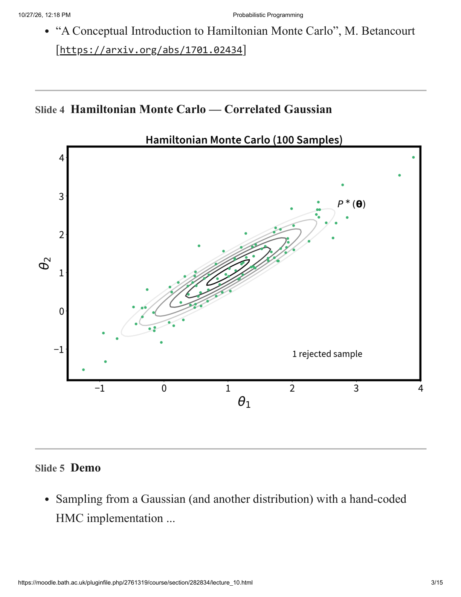

</details>

## Page 4

### Slide 6: Hamiltonian Monte Carlo — Linear Regression

The mean predictor is averaged over $p(\alpha,\sigma^2,r\mid\mathbf y)$. The plotted predictor is retained on the original page; a mean curve alone does not display the full predictive uncertainty.

### Slide 7: Hamiltonian Monte Carlo — Things to Note

HMC can be very effective, but the source describes implementation choices as “voodoo”:

- How many steps of dynamics simulation $L$?
- What simulation step size (time-step) $\epsilon$?

<details>
<summary>Original page 4 (figures and equation layout)</summary>

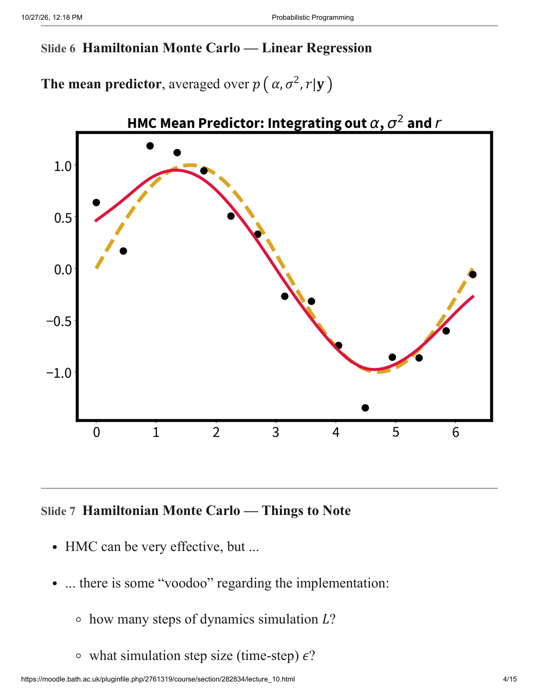

</details>

## Page 5

Slide 7 continues:

- Simulation time $\tau=L\epsilon$, described as the distance travelled across the $\log p(\boldsymbol\theta)$ landscape.
- Large $\epsilon$ gives less accurate dynamics and more rejected samples.
- Small random perturbations to $\epsilon$?
- Resampling momentum and using momentum persistence?
- Random inversion of the direction of time?
- Desired acceptance rate: 65%?

These factors may require tuning. Alternatively, use a library implementation incorporating NUTS, the No U-turn Sampler.

**Qualification:** $\tau$ is integration time, not geometric distance in general. The acceptance target is not a universal requirement. NUTS adapts trajectory construction; it does not eliminate model/parameterisation checks.

### Slide 8: Software for Bayesian Inference & MCMC?

The source says standard Python data-science distributions contain no MCMC software, then lists other libraries to consider. This is a source ecosystem statement rather than a dependency/install instruction or updated software comparison.

<details>
<summary>Original page 5 (figures and equation layout)</summary>

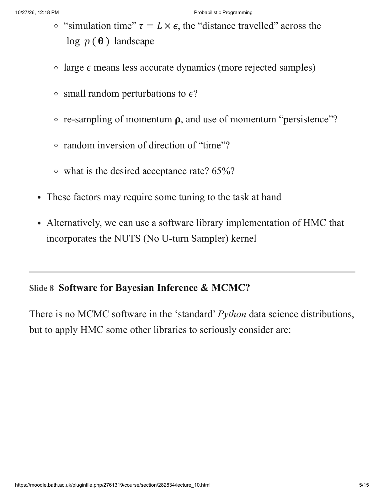

</details>

## Page 6

Slide 8 continues, with library screenshots:

- Stan, with Python interface PyStan: <https://pystan.readthedocs.io>.
- PyMC: <http://pymc.io/>.

<details>
<summary>Original page 6 (figures and equation layout)</summary>


</details>

## Page 7

Slide 8 continues:

- NumPyro: <https://num.pyro.ai>.

### Slide 9: A Quick Look at ... Probabilistic Graphical Model Representation

Probabilistic graphical models (PGMs) can help visualise probabilistic models. The displayed chain specifies

$$p(y,\mathbf x,\theta)=p(y\mid\mathbf x)p(\mathbf x\mid\theta)p(\theta).$$

- Shaded node $y$ is observed.

<details>
<summary>Original page 7 (figures and equation layout)</summary>

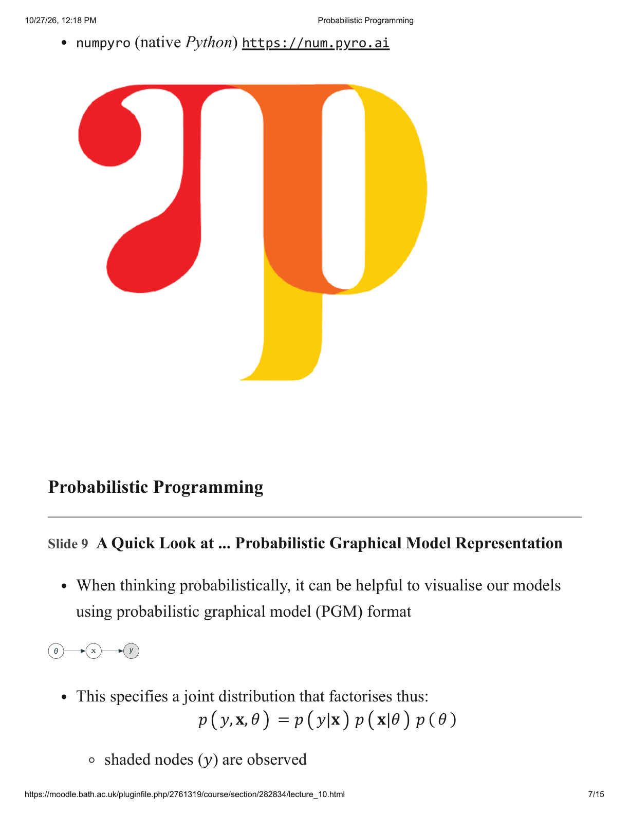

</details>

## Page 8

Slide 9 continues:

- Clear nodes $\mathbf x,\theta$ are unknown or latent variables.
- Arrows indicate conditional dependencies.
- More detail is deferred to hierarchical models in Week 7.

### Slide 10: What is “Probabilistic Programming”?

A model is defined declaratively within a function, for example in Python. Generally this specifies conditional distributions of latent variables, priors and observation models (likelihoods).

The function is then treated as a pseudo-object passed to an inference engine for:

- sampling from the prior;
- sampling from the posterior given observations;
- making predictions.

This enables bespoke models, especially PGM-derived models, to be implemented rapidly while saving manual coding.

<details>
<summary>Original page 8 (figures and equation layout)</summary>

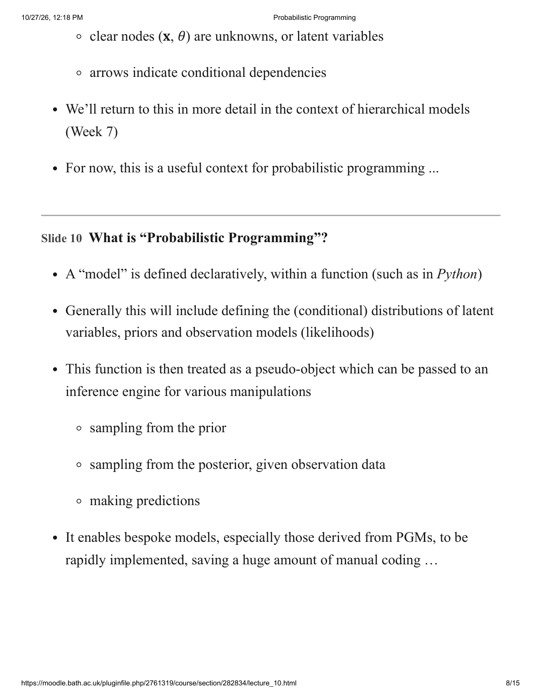

</details>

## Page 9

### Slide 11: Simple Bayesian Model: Bernoulli with Beta Prior

For one trial,

$$P(y\mid\theta)=\theta^y(1-\theta)^{1-y},\qquad y\in\{0,1\},$$

where $\theta$ is the probability of success ($y=1$). For data $\mathcal D=\{y_1,\ldots,y_N\}$, assumed iid conditional on $\theta$,

$$P(\mathcal D\mid\theta)=\theta^{n_1}(1-\theta)^{n_0},\qquad n_0+n_1=N.$$

Here $n_0,n_1$ count failures/successes. The conjugate prior is

$$p_0(\theta\mid\alpha,\beta)=\frac{\Gamma(\alpha+\beta)}{\Gamma(\alpha)\Gamma(\beta)}\theta^{\alpha-1}(1-\theta)^{\beta-1},\qquad\alpha,\beta>0.$$

The hyperparameters are often called prior sample sizes or pseudo-counts.

**Qualification:** the Bernoulli expression is a discrete probability mass function, although the source calls it a p.d.f. The product is for the observed sequence; a count-only Binomial probability also includes a combinatorial coefficient. “Pseudo-count” conventions differ: prior density exponents are $\alpha-1,\beta-1$, whereas the posterior update adds counts to $\alpha,\beta$.

### Slide 12: Probabilistic Programming in Numpyro

```python
import numpyro
import numpyro.distributions as dist
from numpyro.infer import MCMC, NUTS, Predictive
import jax
import jax.numpy as jnp
import arviz as az
```

We can then:

1. Define models (specify joint distributions).

<details>
<summary>Original page 9 (figures and equation layout)</summary>

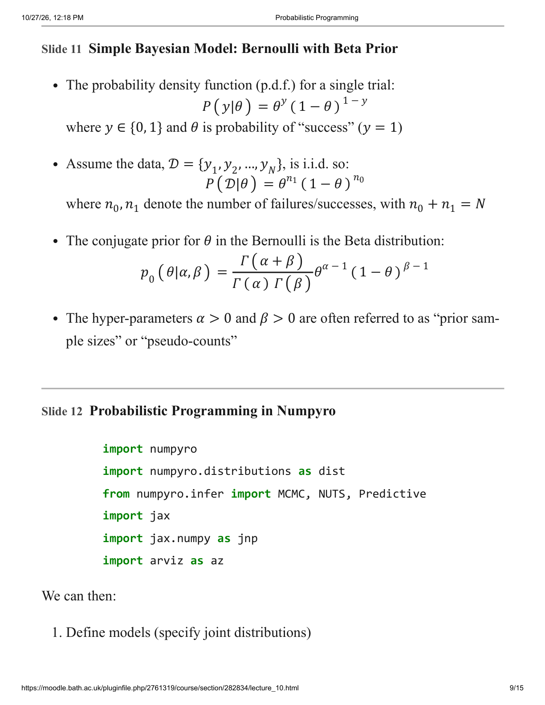

</details>

## Page 10

Slide 12 continues:

2. Render them as a PGM (optional).
3. Sample from the prior (think generatively!).
4. Sample from the posterior given observations (and maybe predict).
5. Diagnose and visualise.

### Slide 13: 1. Define Model: Bernoulli with Beta Prior

“This is the main event!” Source code, with PDF-wrapped lines rejoined:

```python
def model_bernoulli(hypers, y):
    theta = numpyro.sample("theta", dist.Beta(hypers[1], hypers[0]))
    numpyro.sample("obs", dist.BernoulliProbs(theta), obs=y)
```

**Notation:** source indexing places the success shape at `hypers[1]` and failure shape at `hypers[0]`. Thus the code's array convention is `[beta, alpha]` relative to slide 11. The all-ones example hides the distinction. The printed code does not include an explicit observation plate.

### Slide 14: 2. Render the Model

```python
dummy_hyper = jnp.ones(2)
dummy_data = jnp.ones(1)
numpyro.render_model(model_bernoulli, model_args=(dummy_hyper, dummy_data))
```

<details>
<summary>Original page 10 (figures and equation layout)</summary>

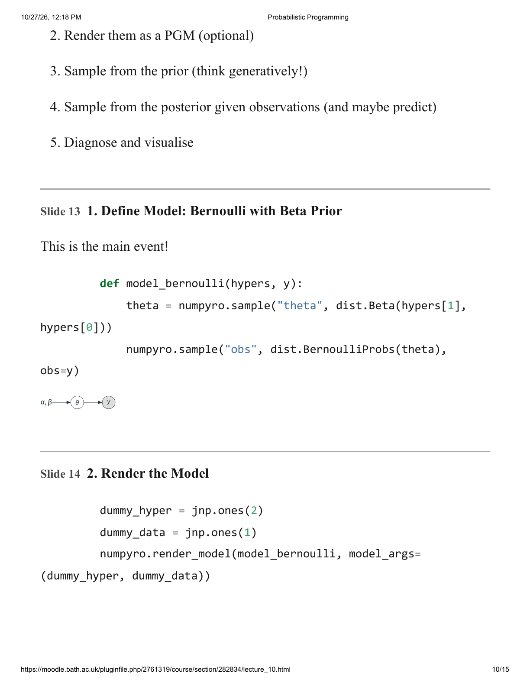

</details>

## Page 11

Slide 14 continues with the rendered graph. This is useful functionality but requires an additional software installation; the source refers to Moodle. Rendering is not posterior fitting.

### Slide 15: 3. Sample from the Prior

```python
beta_hyper = jnp.array([1, 1])
predict = Predictive(model_bernoulli, num_samples=5)
rng_key = jax.random.key(seed=0)
samples = predict(rng_key, hypers=beta_hyper, y=None) # Note we pass y=None to sample from the prior predictive distribution
print("Theta:", samples["theta"])
print("Observations:", samples["obs"])
```

Printed output (source, not rerun):

```text
Theta: [0.21130666 0.31980485 0.3934319  0.5034159  0.66317576]
Observations: [1 0 0 1 0]
```

### Slide 16: 4. Sample from the Posterior

Make data (code continues on the next page).

<details>
<summary>Original page 11 (figures and equation layout)</summary>

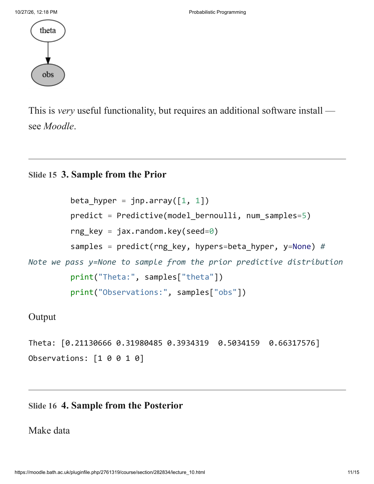

</details>

## Page 12

Slide 16 continues. Source code with wrapped lines rejoined:

```python
num_data = 25
rng_key = jax.random.key(seed=0)
y_train = jax.random.bernoulli(rng_key, p=0.7, shape=(num_data,))
print(f"Empirical theta: {sum(y_train)/ num_data:.3f}")
```

Printed output:

```text
Empirical theta: 0.600
```

Run NUTS (HMC) sampler:

```python
kernel = NUTS(model_bernoulli)
mcmc = MCMC(kernel, num_samples=1000, num_warmup=500)
rng_key = jax.random.key(0)
mcmc.run(rng_key, hypers=beta_hyper, y=y_train)
```

A runtime progress display is printed but clipped in the PDF; the extract begins `sample: 100`. The source page preserves the available display rather than reconstructing missing timing or iteration details.

### Slide 17: 5a. Diagnose

Summary diagnostics:

```python
mcmc.print_summary()
```

The printed table is horizontally clipped/wrapped; the visible values in order are retained:

```text
       mean   std   median   5.0...
theta  0.59   0.09  0.60     0.45   0.74   471.81   1.00
```

Slide 19 subsequently explains the intended diagnostics. These are printed source results, not a fresh run or proof of convergence.

<details>
<summary>Original page 12 (figures and equation layout)</summary>

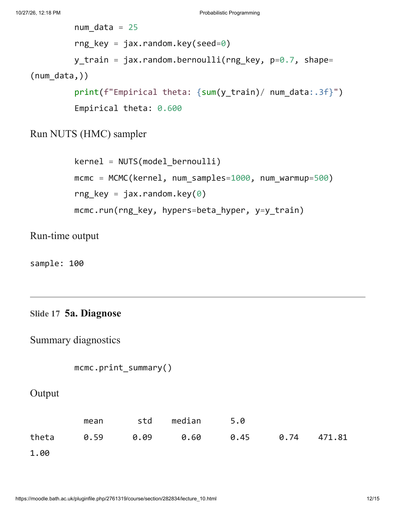

</details>

## Page 13

Slide 17 continues:

```text
Number of divergences: 0
```

### Slide 18: 5b. Visualise Use “arviz”

```python
data = az.from_numpyro(mcmc)
az.plot_trace(data, figsize=(10,8))
```

The source displays the posterior-density and trace panels. The original page retains the plotted labels and trace; numerical readings beyond the supplied summary are not invented.

### Slide 19: 5a. (again): What did those numbers mean?

The same clipped diagnostic table and divergence count are repeated:

```text
       mean   std   median   5.0...
theta  0.59   0.09  0.60     0.45   0.74   471.81   1.00
Number of divergences: 0
```

<details>
<summary>Original page 13 (figures and equation layout)</summary>

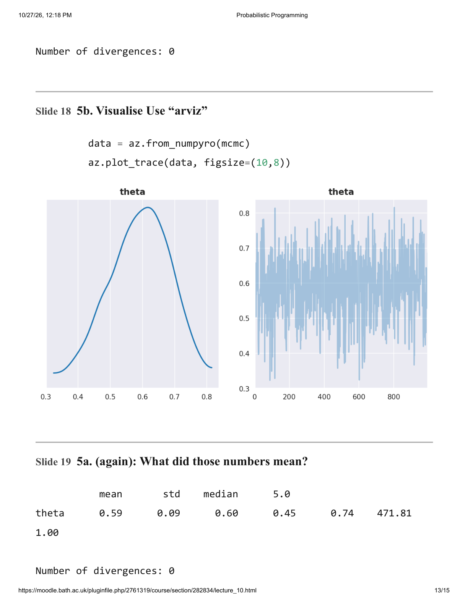

</details>

## Page 14

Slide 19 continues:

- `mean`, `std`, `median`: posterior mean, standard deviation and median of $\theta$.
- The source describes `5.0%` and `95.0%` as the 5th and 95th posterior percentiles.
- `n_eff`: effective sample size; high correlation reduces it.
- `r_hat`: Gelman–Rubin statistic comparing between-chain and within-chain variance; it should be close to one.
- Divergences count numerical issues and should be zero for a well-behaved model.

**Qualifications:** numerical summaries are Monte Carlo estimates, not exact posterior quantities. NumPyro's `print_summary` reports highest-posterior-density interval bounds; the source percentile description should not automatically be applied to these columns ([official diagnostic documentation](https://num.pyro.ai/en/stable/diagnostics.html#summary)). One displayed chain and rounded `r_hat=1.00` do not establish agreement among multiple independently initialised chains. Zero observed divergences is desirable but not a proof of correct sampling. These implementation/diagnostic distinctions are developed separately in the tutor lessons.

### Slide 20: Quick Live Run-through

“Back to Jupyter ...” No notebook or additional output is supplied here.

### Slide 21: Summary, and Looking Ahead

Probabilistic programming changes how models are implemented by abstracting implementation details and incorporating stochastic approximation. It harmonises with PGMs, which the source schedules for Week 7 (Lectures 11 and 12).

<details>
<summary>Original page 14 (figures and equation layout)</summary>

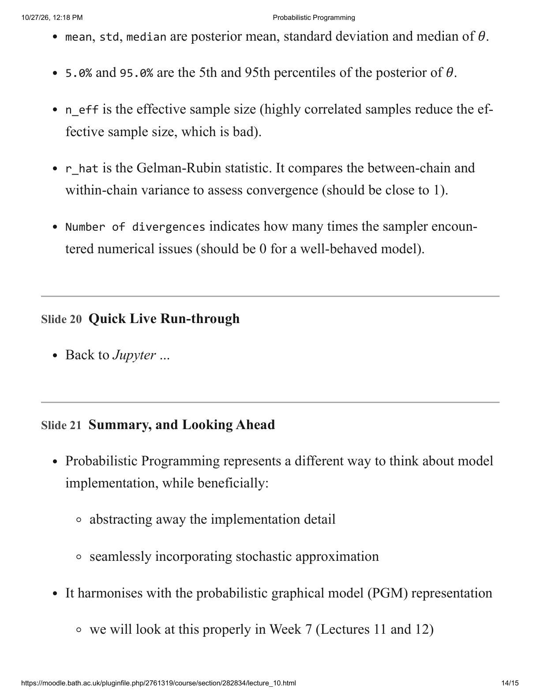

</details>

## Page 15

Slide 21 continues:

- Probabilistic programming is especially convenient for hierarchical models, the primary focus of the following week.
- Care is still required with MCMC/HMC/NUTS, particularly the parameterisation of models.

**Source boundary:** future lectures and live demonstrations are previews, not materials supplied in this PDF. Preparing these notes and lessons does not establish learning or mastery.

<details>
<summary>Original page 15 (figures and equation layout)</summary>


</details>
