# Probabilistic Thinking

A Primer

**Author:** Edward Milsom  
**Date:** 2026-09-24  
**Source:** [2.pdf](2.pdf)

## Page 1

### Slide 1: In this Episode ...

- A little motivation
- Definitions of probability
  - discrete and continuous
  - univariate and multivariate
- The two rules ... and Bayes
- Concepts in multivariate probability
- Probabilistic modelling and machine learning
- Some useful probability distributions

### Introduction & Motivation

### Slide 2: Theory

- Laplace’s *Théorie Analytique des Probabilités* (Analytic Theory of Probability), was first published in 1812
  - his *Essai Philosophique sur les Probabilités* (1814) from Lecture 1 was intended as an “accessible” summary for the general public
- Depending on the edition, the *Théorie Analytique* can total 846 pages
- We’ll just cover the main bits ...

### Slide 3: Alternative Reading

- A more formal 50-page introduction: Chapter 6 of (Marc Peter Deisenroth and Ong 2020)
- For a more succinct primer, see: Appendix C of (Prince 2023)

<details>
<summary>Original page 1 (figures and equation layout)</summary>

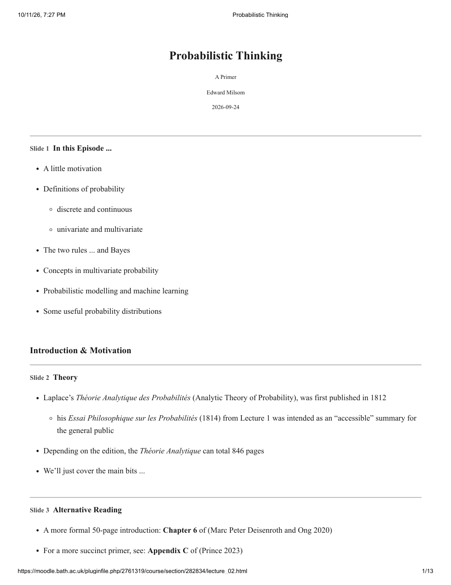

</details>

## Page 2

*Alternative Reading (continued)*

- Also, Section 1.2 of: (Bishop 2006)

### Slide 4: Motivation: January 28, 1986 ...


### Slide 5: “Nature Cannot Be Fooled” (Richard Feynman)

> “A logarithmic plot suggested a straight line, so it was supposed that the erosion varied as the .58 power of the heat, the .58 being determined by a nearest fit. At any rate, adjusting some other numbers, it was determined that the model agreed with the erosion (to depth of one-third the radius of the ring).
>
> There is nothing much so wrong with this as believing the answer!
>
> Uncertainties appear everywhere …
>
> When using a mathematical model, careful attention must be given to uncertainties in the model.”

Professor Richard Feynman — excerpt from Appendix F of the Report of the Presidential Commission on the Space Shuttle Challenger Accident (1986).

<details>
<summary>Original page 2 (figures and equation layout)</summary>


</details>

## Page 3

### Slide 6: It Isn’t Rocket Science ...

Thomas Bayes’ original question, published in 1763:

> **PROBLEM.**
>
> Given the number of times in which an unknown event has happened and failed: Required the chance that the probability of its happening in a single trial lies somewhere between any two degrees of probability that can be named.

### Probability

### Slide 7: Discrete Probability

- A discrete random variable $x$ takes on a fixed set of values. e.g.
  - $\{0,1\}$ — perhaps the output of a binary classifier
  - $\{A_1,A_2,A_3,A_4,A_5\}$ — perhaps some categorical input feature
- We can define the probability $P(x=A_j)=\theta_j$, with:

$$0\leq\theta_j\leq1,\qquad\sum_j\theta_j=1$$

- The quantity $P(x)$ is referred to as the **probability mass function**
- Informally, an upper-case $P(\cdot)$ is often adopted to denote probability *mass*

### Slide 8: Continuous Probability

- A continuous random variable $x$ is typically defined over (a subset of) the real line
- It is characterised by its **probability density function** (p.d.f.) $p(x)$, where:

$$p(x)\geq0,\qquad\int_{-\infty}^{+\infty}p(x)\,dx=1$$

- from which a desired probability mass can be calculated:

$$P(a\leq x\leq b)=\int_a^b p(x)\,dx$$

- Note that $P(x=a)=0$ and $p(x)$ can be greater than one!

<details>
<summary>Original page 3 (figures and equation layout)</summary>

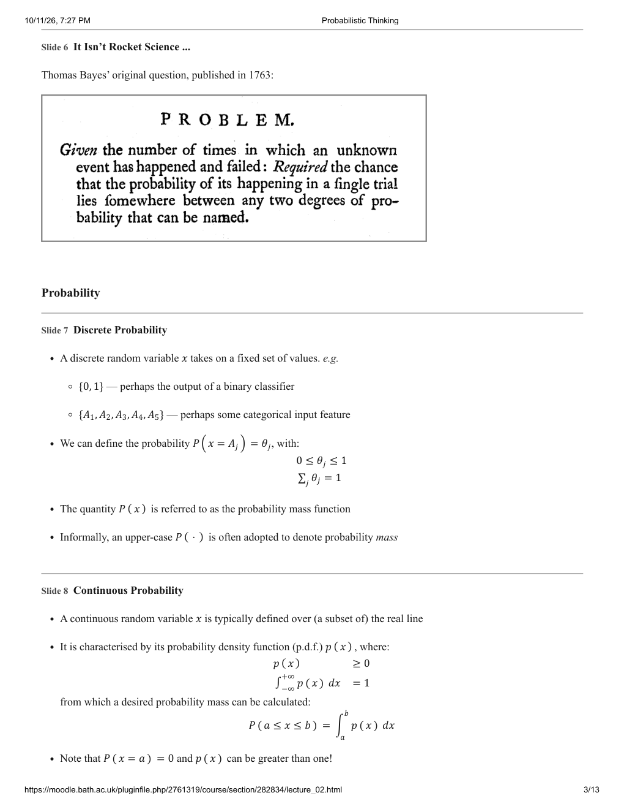

</details>

## Page 4

*Continuous Probability (continued)*

- Informally, a lower-case $p(\cdot)$ is often adopted to denote probability *density*

### Slide 9: Joint Probability: Multiple Variables

- In general, the interesting scenarios are where we wish to manipulate (and infer!) multiple random variables: e.g. $x_1$ and $x_2$ in the simplest case
- The joint distribution (joint p.d.f.) characterises the propensity for multiple variables to take on particular combinations of values: $p(x_1,x_2)$
- For succinctness, when handling many joint variables, we adopt vector notation:

$$\mathbf x\equiv(x_1,x_2)\quad\text{and so}\quad p(x_1,x_2)\to p(\mathbf x)$$

- In this case:

$$\iint p(x_1,x_2)\,dx_1\,dx_2=1$$

$$\text{or}\qquad\int p(\mathbf x)\,d\mathbf x=1$$

- Note: $\mathbf x$ may contain a mix of continuous and discrete variables

### Slide 10: An Example Joint Continuous Distribution

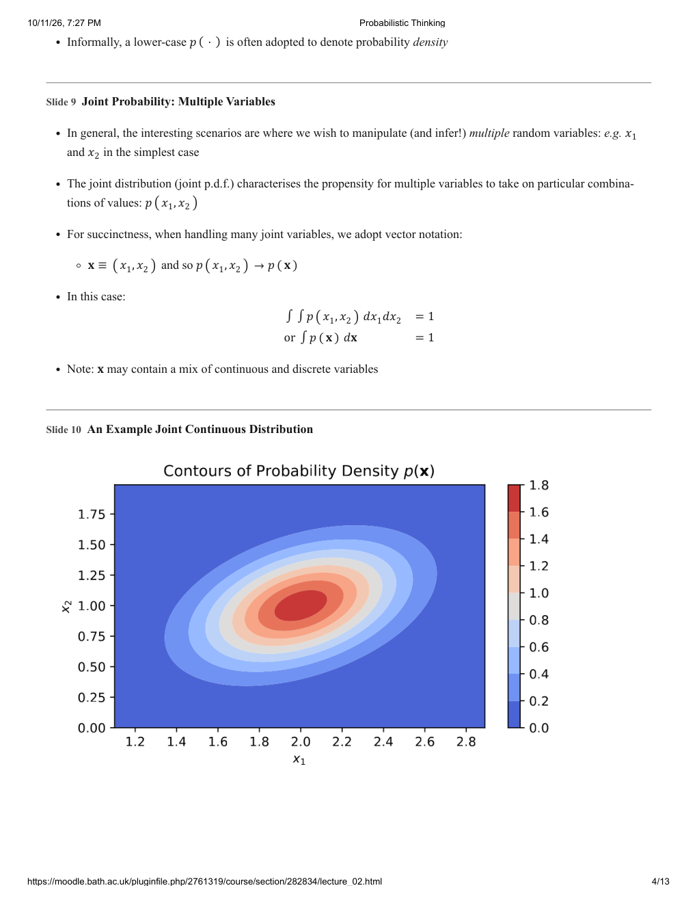

<details>
<summary>Original page 4 (figures and equation layout)</summary>


</details>

## Page 5

### Slide 11: The Two Rules of Probability

**The sum rule (marginalisation or integrating out):**

- If variable $x_2$ is an element of some discrete set $\mathcal X$ then:

$$P(x_1)=\sum_{x_2\in\mathcal X}P(x_1,x_2)$$

- If $x_2$ is continuous in $\mathcal R$ then:

$$p(x_1)=\int_{\mathcal R}p(x_1,x_2)\,dx_2$$

**The product rule:**

$$p(x_1,x_2)=p(x_1\mid x_2)p(x_2),\quad\text{or equivalently}\quad=p(x_2\mid x_1)p(x_1)$$

As a consequence of the product rule we get Bayes’ rule ...

### Slide 12: Bayes’ Rule: A Corollary of The Two Rules of Probability

**Bayes’ Rule**

$$p(x_2\mid x_1)=\frac{p(x_1\mid x_2)p(x_2)}{p(x_1)}$$

In the context of machine learning models, this will often be applied and interpreted as:

$$p(\mathrm{Unknown}\mid\mathrm{Data})=\frac{p(\mathrm{Data}\mid\mathrm{Unknown})p(\mathrm{Unknown})}{p(\mathrm{Data})}$$

### Slide 13: Key Concepts in Joint Probability

As well as the joint distribution, we are also interested in two further quantities.

**Marginal Distribution**

- If we “ignore” $x_2$, then the distribution of $x_1$ alone is the marginal distribution $p(x_1)$
  - it is obtained from the joint by applying the sum rule

**Conditional Distribution**

- The distribution of $x_1$ values given a fixed value of $x_2$ is the conditional distribution $p(x_1\mid x_2)$
  - it is effectively a normalised “slice” across the joint distribution

**Also ... Independence**

- If $x_1$ does not depend on $x_2$, then $p(x_1\mid x_2)=p(x_1)$ and $p(x_1,x_2)=p(x_1)p(x_2)$

<details>
<summary>Original page 5 (figures and equation layout)</summary>

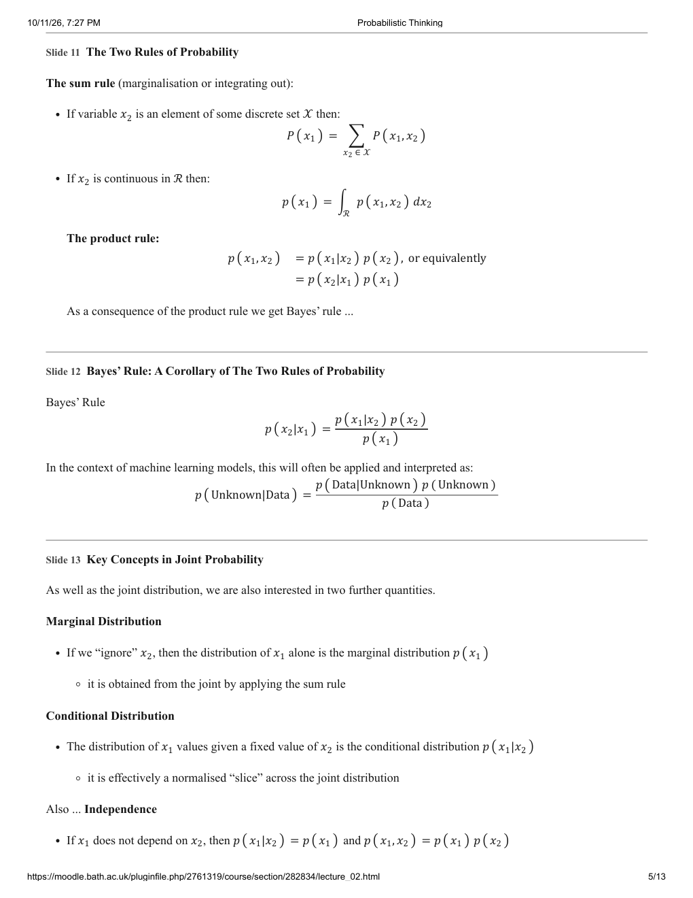

</details>

## Page 6

*The next four slides illustrate these concepts ...*

### Slide 14: Marginals & Conditionals for Discrete Distributions

The figure displays the joint $P(x_1,x_2)$, marginals $P(x_1)$ and $P(x_2)$, and conditional distributions $P(x_1\mid\mathrm{Success})$ and $P(x_1\mid\mathrm{Failure})$.

| $x_2$ / $x_1$ | A | B | C | D | E | F | G | H |
| --- | --- | --- | --- | --- | --- | --- | --- | --- |
| Success (counts) | 7 | 7 | 8 | 8 | 5 | 3 | 1 | 1 |
| Success (joint probability) | 0.07 | 0.07 | 0.08 | 0.08 | 0.05 | 0.03 | 0.01 | 0.01 |
| Failure (counts) | 1 | 2 | 5 | 8 | 12 | 7 | 13 | 12 |
| Failure (joint probability) | 0.01 | 0.02 | 0.05 | 0.08 | 0.12 | 0.07 | 0.13 | 0.12 |

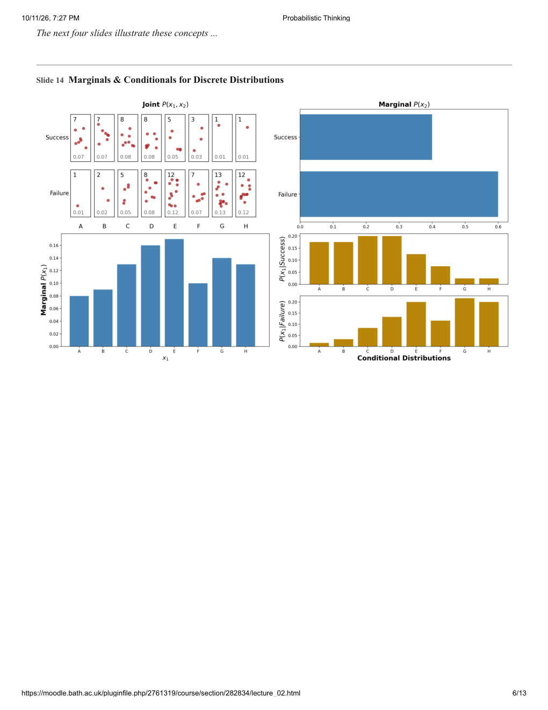

<details>
<summary>Original page 6 (figures and equation layout)</summary>


</details>

## Page 7

### Slide 15: Marginals (“Understanding Deep Learning”, Appendix C)

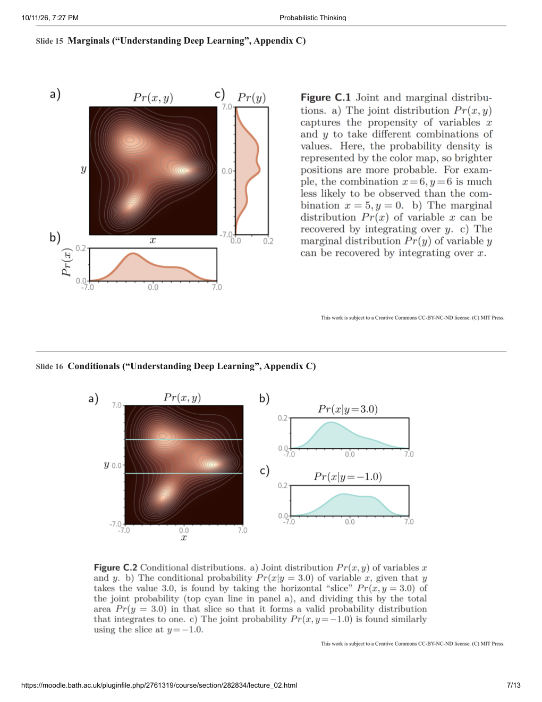

### Slide 16: Conditionals (“Understanding Deep Learning”, Appendix C)


<details>
<summary>Original page 7 (figures and equation layout)</summary>


</details>

## Page 8

### Slide 17: Independence (“Understanding Deep Learning”, Appendix C)

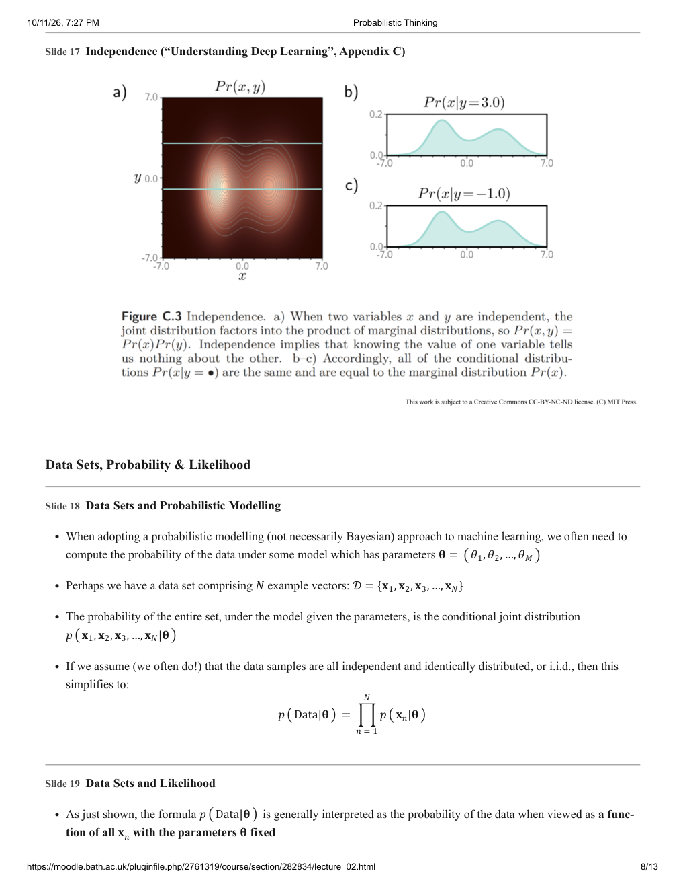

### Data Sets, Probability & Likelihood

### Slide 18: Data Sets and Probabilistic Modelling

- When adopting a probabilistic modelling (not necessarily Bayesian) approach to machine learning, we often need to compute the probability of the data under some model which has parameters $\boldsymbol\theta=(\theta_1,\theta_2,\ldots,\theta_M)$
- Perhaps we have a data set comprising $N$ example vectors: $\mathcal D=\{\mathbf x_1,\mathbf x_2,\mathbf x_3,\ldots,\mathbf x_N\}$
- The probability of the entire set, under the model given the parameters, is the conditional joint distribution

$$p(\mathbf x_1,\mathbf x_2,\mathbf x_3,\ldots,\mathbf x_N\mid\boldsymbol\theta)$$

- If we assume (we often do!) that the data samples are all **independent and identically distributed**, or **i.i.d.**, then this simplifies to:

$$p(\mathrm{Data}\mid\boldsymbol\theta)=\prod_{n=1}^{N}p(\mathbf x_n\mid\boldsymbol\theta)$$

### Slide 19: Data Sets and Likelihood

- As just shown, the formula $p(\mathrm{Data}\mid\boldsymbol\theta)$ is generally interpreted as the **probability of the data** when viewed as a function of all $\mathbf x_n$ with the parameters $\boldsymbol\theta$ fixed

<details>
<summary>Original page 8 (figures and equation layout)</summary>


</details>

## Page 9

*Data Sets and Likelihood (continued)*

- However, the exact same expression is referred to as the **likelihood of the parameters** when viewed as a function of all $\boldsymbol\theta$ with the data $\mathbf x_n$ fixed
- It is important to be aware that:

$$\int\cdots\int\prod_{n=1}^{N}p(\mathbf x_n\mid\boldsymbol\theta)\,d\mathbf x_1\cdots d\mathbf x_N=1,$$

$$\text{but}\qquad\int\prod_{n=1}^{N}p(\mathbf x_n\mid\boldsymbol\theta)\,d\boldsymbol\theta\ne1$$

### Slide 20: Machine Learning, Maximum Likelihood & Logarithms

- When fitting models (both in statistics and machine learning), we often apply the principle of **maximum likelihood**:
  - that is, maximising $p(\mathrm{Data}\mid\boldsymbol\theta)=\prod_{n=1}^{N}p(\mathbf x_n\mid\boldsymbol\theta)$ with respect to $\boldsymbol\theta$
- When modelling data, and particularly for maximising likelihood, it is often more mathematically convenient to work with the **log-likelihood**:

$$\log p(\mathrm{Data}\mid\boldsymbol\theta)=\sum_{n=1}^{N}\log p(\mathbf x_n\mid\boldsymbol\theta)$$

- A key point to note is that the logarithm function is monotonic (increasing)
  - “monotonic increasing” implies that $\log(z_2)>\log(z_1)$ if $z_2>z_1$
  - and so the value of $\boldsymbol\theta$ that maximises $\log p(\mathrm{Data}\mid\boldsymbol\theta)$ is therefore identical to that which maximises $p(\mathrm{Data}\mid\boldsymbol\theta)$

### Examples of Some Common Distributions

### Slide 21: Gaussian, or Normal, Distribution: Continuous in $[-\infty,+\infty]$

$$p(x\mid\mu,\sigma^2)=(2\pi\sigma^2)^{-1/2}\exp\left\{-\frac{(x-\mu)^2}{2\sigma^2}\right\}$$

```python
gaussian = scipy.stats.norm(loc=1.0, scale=0.75)
x = np.linspace(start=-3, stop=5, num=100)
plt.figure(figsize=(4, 1.75))
plt.plot(x, gaussian.pdf(x))
plt.ylabel('$p(x)$')
```

<details>
<summary>Original page 9 (figures and equation layout)</summary>

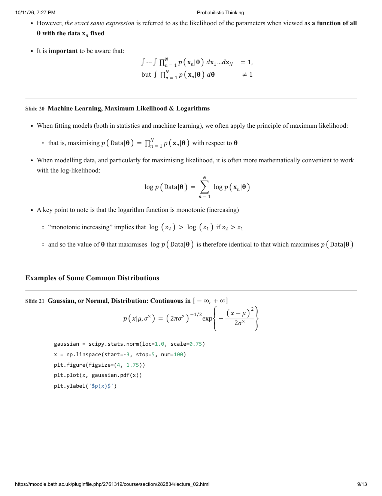

</details>

## Page 10

*Gaussian distribution plot (continued; see original page).* 

### Slide 22: The Multivariate Gaussian (Normal)

$$p(x\mid\boldsymbol\mu,\boldsymbol\Sigma)=(2\pi)^{-D/2}|\boldsymbol\Sigma|^{-1/2}\exp\left\{-\frac12(\mathbf x-\boldsymbol\mu)^\mathrm T\boldsymbol\Sigma^{-1}(\mathbf x-\boldsymbol\mu)\right\}$$

```python
mg = scipy.stats.multivariate_normal(mean=[2, 1], cov=[[1,0.3],[0.3,1]])
x, y = np.mgrid[-0.5:4.5:0.1, -2:4:0.1]
plt.figure(figsize=(4, 1.75))
plt.contour(x, y, mg.pdf(np.dstack((x, y))), levels=8, cmap="coolwarm")
plt.ylabel('$p(\\mathbf{x})$')
```

### Slide 23: Gamma Distribution: Continuous in $[0,+\infty]$

$$p(x\mid a,\lambda)=\frac{\lambda^a}{\Gamma(a)}x^{a-1}e^{-\lambda x}$$

```python
gamma = scipy.stats.gamma(a=2.5, scale=1)
x = np.linspace(start=0, stop=5, num=100)
plt.figure(figsize=(4, 1.75))
plt.plot(x, gamma.pdf(x))
plt.ylabel('$p(x)$')
```

<details>
<summary>Original page 10 (figures and equation layout)</summary>

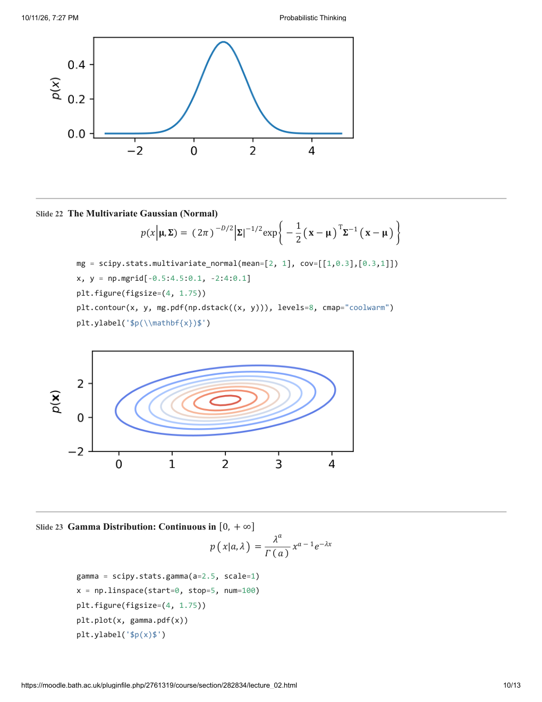

</details>

## Page 11

*Gamma distribution plot (continued; see original page).* 

### Slide 24: Bernoulli Distribution: Discrete in $\{0,1\}$

- The Bernoulli is used to describe binary variables, e.g. classifier outputs:

$$P(x\mid\theta)=\begin{cases}\theta&\text{if }x=1\\1-\theta&\text{if }x=0\end{cases}$$

- This can be more concisely written as:

$$P(x\mid\theta)=\theta^x(1-\theta)^{1-x}$$

- The generalisation of the Bernoulli distribution to a variable with more than two outcomes is the **categorical distribution**, where $P(x=A_j)\equiv\theta_j$

### Slide 25: Beta Distribution: Continuous in $[0,1]$

$$p(\theta\mid a,b)=\frac{\Gamma(a+b)}{\Gamma(a)\Gamma(b)}\theta^{a-1}(1-\theta)^{b-1}$$

```python
beta = scipy.stats.beta(a=3, b=6)
x = np.linspace(start=0, stop=1, num=100)
plt.figure(figsize=(4, 1.75))
plt.plot(x, beta.pdf(x))
plt.ylabel(r'$p(\theta)$')
```

<details>
<summary>Original page 11 (figures and equation layout)</summary>

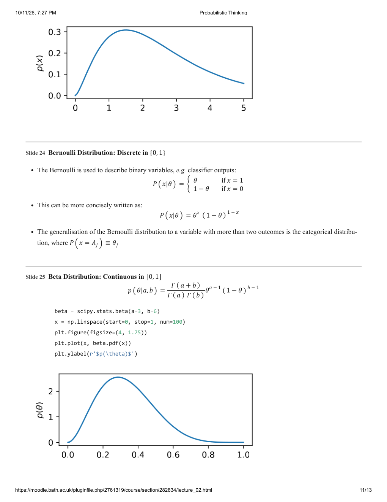

</details>

## Page 12

### If Time Allows ...

### Slide 26: Looking Ahead ... Conjugacy of Distributions

- The Beta distribution will prove useful in Bayesian analysis
- It is the conjugate prior distribution for the $\theta$ parameter in the Bernoulli distribution
- What does this mean?
- Find out in next Tuesday’s lecture ...

### Slide 27: Looking Further Ahead ... Probabilistic Graphical Models

- When thinking probabilistically, it can be helpful to visualise our models using probabilistic graphical model (PGM) format

$$\theta\longrightarrow\mathbf x\longrightarrow y$$

- This specifies a joint distribution that factorises thus:

$$p(y,\mathbf x,\theta)=p(y\mid\mathbf x)p(\mathbf x\mid\theta)p(\theta)$$

  - shaded nodes ($y$) are observed
  - clear nodes ($\mathbf x,\theta$) are unknowns, or latent variables
  - arrows indicate conditional dependencies
- We’ll return to this in more detail in the context of hierarchical models

### Slide 28: Underlying Principles of Dependence Between Variables

**Independence**

Observed $x$ and $y$ are independent:

$$p(x,y)=p(x)p(y)$$

**Direct Dependence**

Let’s say we know $y$ depends on $x$ directly:

Observed $x$ and $y$ are dependent:

$$p(x,y)=p(y\mid x)p(x)$$

**Indirect Dependence**

*The right-hand column is clipped by the PDF page boundary. Only fragments beginning “Observe…”, “ally inde…” and $p(x,y,\theta\ldots$ are visible. The original layout is preserved in the page image below; the missing text has not been invented.*

### References

- Bishop, Christopher M. 2006. *Pattern Recognition and Machine Learning*. Springer. <https://www.microsoft.com/en-us/research/people/cmbishop/#!prml-book>.
- Marc Peter Deisenroth, A. Aldo Faisal, and Cheng Soon Ong. 2020. *Mathematics for Machine Learning*. Cambridge University Press. <https://mml-book.com/>.
- Prince, Simon J. D. 2023. *Understanding Deep Learning*. MIT Press. <http://udlbook.com>.

<details>
<summary>Original page 12 (figures and equation layout)</summary>

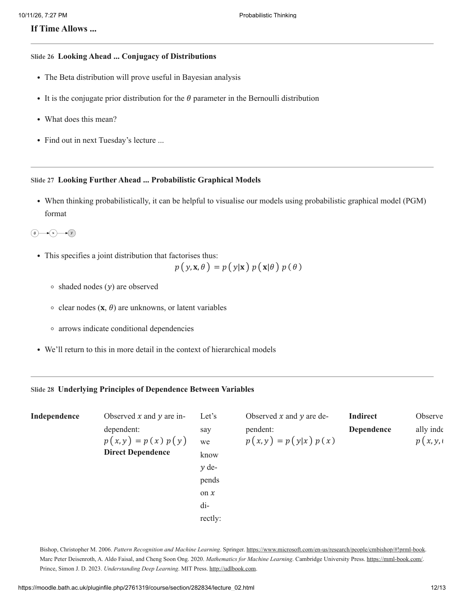

</details>

## Page 13

*This source page contains no lecture content (only the browser print header/footer).*

<details>
<summary>Original page 13 (figures and equation layout)</summary>


</details>
