# Bayesian Statistical Inference

**Introductory Examples**

Edward Milsom  
2026-10-02

Source: [Lecture 3 PDF](3.pdf)

## Page 1

### Slide 1: In this Episode ...

- Recap of probability rules
- Parametric statistical inference: the “orthodox” approach
- Outline of the Bayesian approach
- Examples of Bayesian inference:
  - the mean of the Gaussian distribution
  - the mean of the Bernoulli distribution
- Preview of the lab exercise

Original page 1 (figures and equation layout)

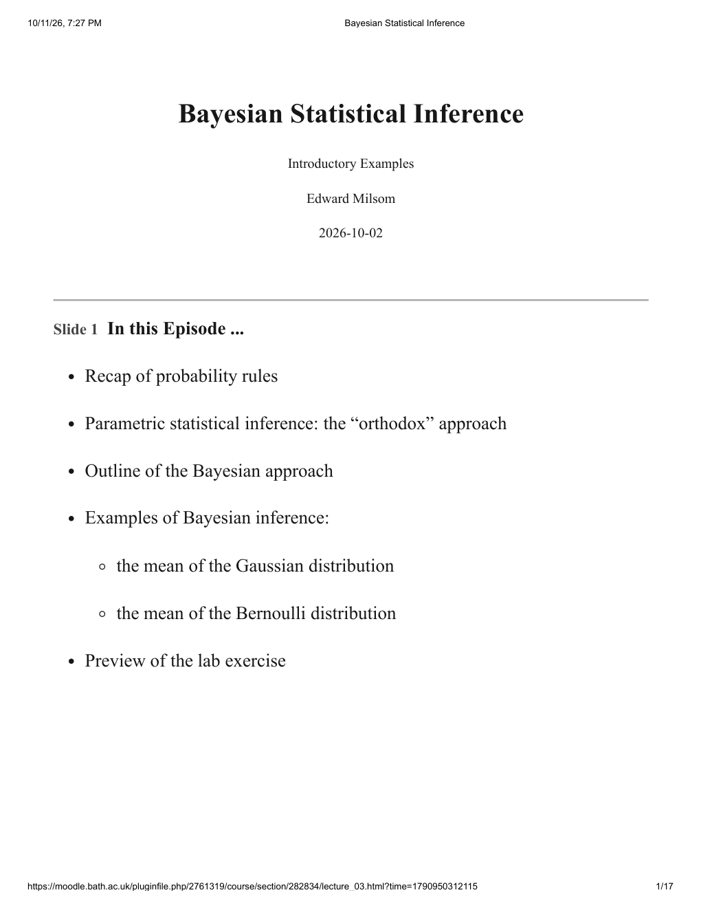

## Page 2

### Recap: Probability and Bayes’ Rule

### Slide 2: Recap: Joint & Conditional Probability

**Joint probability:**

The probability density (or mass) over the combinations of both values of two variables $\theta_1$ and $\theta_2$ is expressed as: $p(\theta_1,\theta_2)$.

**Conditional probability:**

The probability density (or mass) over the values of $\theta_1$ given the known value of $\theta_2$ is expressed as: $p(\theta_1\mid\theta_2)$.

Variables $\theta_1$ and $\theta_2$ may be either discrete (mass) or continuous (density).

In the context of joint modelling of variables, the quantities $p(\theta_1)$ and $p(\theta_2)$ are referred to as the **marginal distributions**.

### Slide 3: Recap: The Rules of Probability

**The sum rule (marginalisation):**

- If variable $\theta_2$ is an element of some discrete set $\mathcal S$ then:

$$P(\theta_1)=\sum_{\theta_2\in\mathcal S}P(\theta_1,\theta_2).$$

- If $\theta_2$ is continuous in $\mathcal R$ then:

$$p(\theta_1)=\int_{\mathcal R}p(\theta_1,\theta_2)\,d\theta_2.$$

**The product rule:** (continued on the next page)

Original page 2 (figures and equation layout)

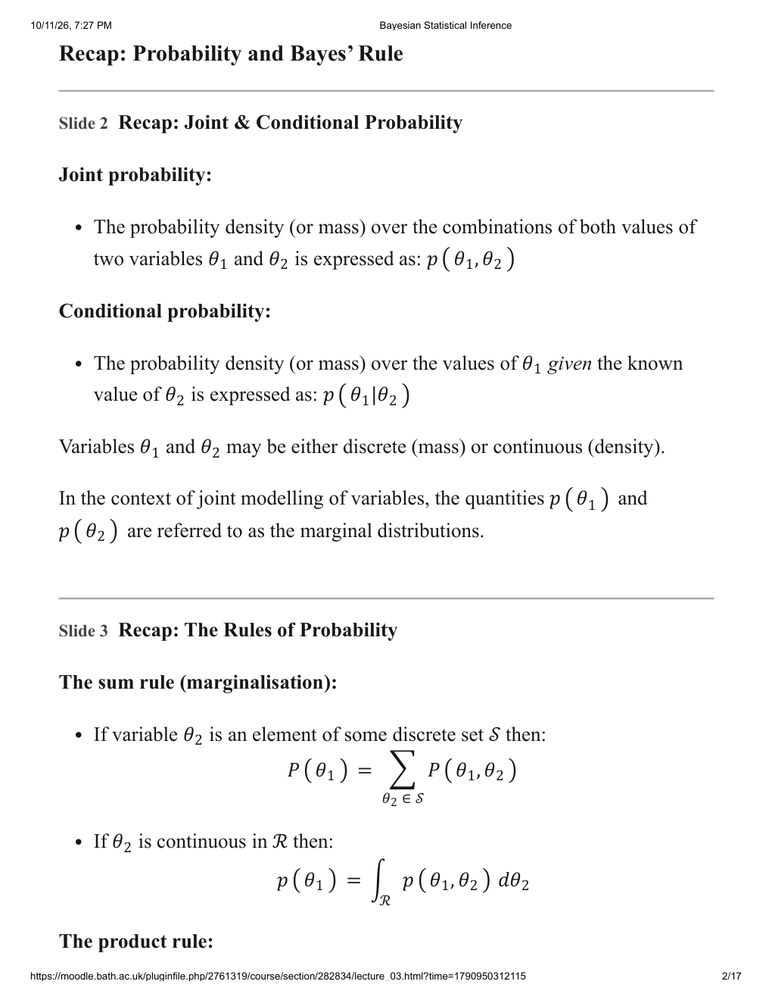

## Page 3

$$p(\theta_1,\theta_2)=p(\theta_1\mid\theta_2)p(\theta_2)=p(\theta_2\mid\theta_1)p(\theta_1).$$

As a consequence of the product rule we get Bayes’ rule ...

### Slide 4: Recap: The Bayesian Approach

If $\mathcal D$ is our observed data, and $\boldsymbol\theta$ is the parameter set of a model $\mathcal M$ intended to describe it, then the Bayesian approach to “learning” is characterised as:

$$p(\boldsymbol\theta\mid\mathcal D,\mathcal M)=\frac{p(\mathcal D\mid\boldsymbol\theta,\mathcal M)p(\boldsymbol\theta\mid\mathcal M)}{p(\mathcal D\mid\mathcal M)}.$$

Diagram labels: **Posterior**, **Likelihood**, **Prior**, and **Marginal Likelihood or “Evidence”**.

$$p(\mathcal D\mid\mathcal M)=\int p(\mathcal D\mid\boldsymbol\theta,\mathcal M)p(\boldsymbol\theta\mid\mathcal M)\,d\boldsymbol\theta.$$

### Parametric Statistical Inference

### Slide 5: General (“Orthodox”) Parametric Statistical Inference

- A model $\mathcal M$ has parameters $\boldsymbol\theta$ and we observe a data set $\mathcal D$.
- We define the **likelihood (or observation) model** $p(\mathcal D\mid\boldsymbol\theta,\mathcal M)$.
- Orthodox approach to estimating $\boldsymbol\theta$: **maximum likelihood**

$$\widehat{\boldsymbol\theta}=\operatorname*{argmax}_{\boldsymbol\theta}\log p(\mathcal D\mid\boldsymbol\theta,\mathcal M).$$

- The “knowledge” gleaned from the data is encapsulated in this single optimised (vector) value, or **point estimate**, $\widehat{\boldsymbol\theta}$.
- Predictions for new data $\mathcal D_*$ can be made by “plugging in” $\widehat{\boldsymbol\theta}$: (continued on the next page)

Original page 3 (figures and equation layout)

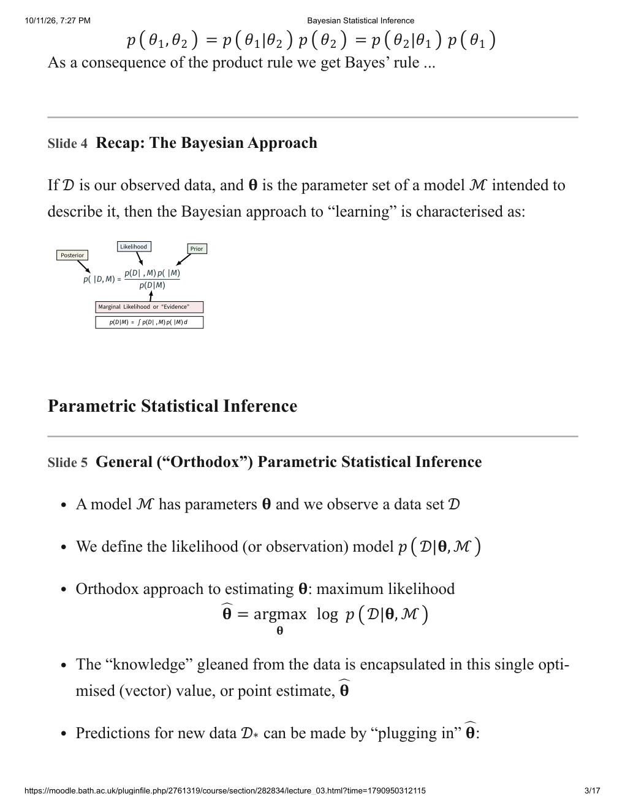

## Page 4

$$p(\mathcal D_*\mid\mathcal D,\mathcal M)=p(\mathcal D_*\mid\widehat{\boldsymbol\theta},\mathcal M).$$

### Bayesian Statistical Inference

### Slide 6: Bayesian Statistical Inference ... on One (Busy) Slide

- A model $\mathcal M$ has parameters $\boldsymbol\theta$ and we observe data $\mathcal D$.
- We define the **likelihood (or observation) model** $p(\mathcal D\mid\boldsymbol\theta,\mathcal M)$.
- The Bayesian approach requires us to define a **prior distribution** over parameters, $p(\boldsymbol\theta\mid\mathcal M)$, and perhaps a prior over possible models $p(\mathcal M)$.
- Inference (“learning”) is then the computing of the **posterior probability** of the parameters given the data via Bayes’ rule:

$$p(\boldsymbol\theta\mid\mathcal D,\mathcal M)=\frac{p(\mathcal D\mid\boldsymbol\theta,\mathcal M)p(\boldsymbol\theta\mid\mathcal M)}{p(\mathcal D\mid\mathcal M)}.$$

- The normalising factor $p(\mathcal D\mid\mathcal M)$ is called the **marginal likelihood** or the **evidence** (for $\mathcal M$).
  - To calculate, we must integrate out $\boldsymbol\theta$:

$$p(\mathcal D\mid\mathcal M)=\int p(\mathcal D\mid\boldsymbol\theta,\mathcal M)p(\boldsymbol\theta\mid\mathcal M)\,d\boldsymbol\theta.$$

- We can then make predictions for new data $\mathcal D_*$ by averaging over the posterior to give the **predictive distribution**:

$$p(\mathcal D_*\mid\mathcal D,\mathcal M)=\int p(\mathcal D_*\mid\boldsymbol\theta,\mathcal M)p(\boldsymbol\theta\mid\mathcal D,\mathcal M)\,d\boldsymbol\theta.$$

Original page 4 (figures and equation layout)

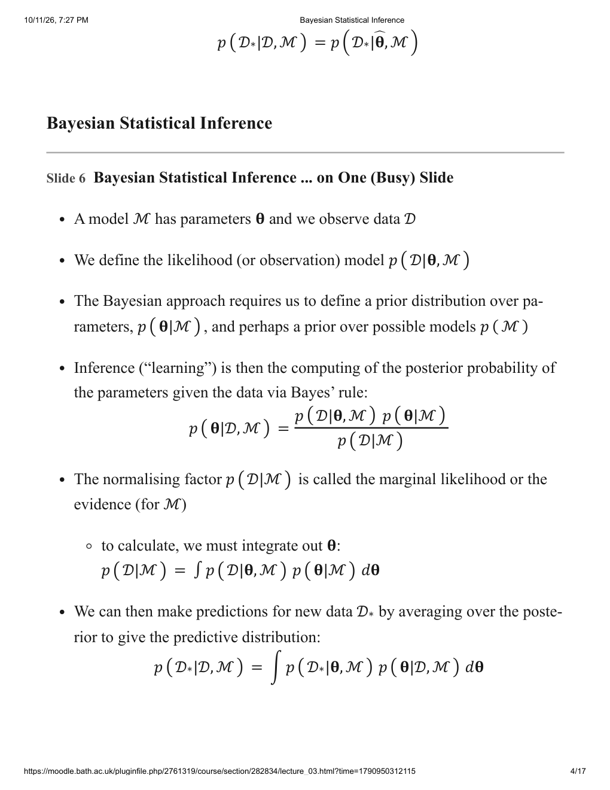

## Page 5

### Slide 7: Bayesian Statistical Inference — Integrating out

Common manipulation of probability distributions in Bayesian inference …

- Perhaps we wish to compute the marginal likelihood $p(\mathcal D\mid\mathcal M)$.
- We can write this as:

$$\begin{aligned}
p(\mathcal D\mid\mathcal M)&=\int p(\mathcal D,\boldsymbol\theta\mid\mathcal M)\,d\boldsymbol\theta &&\text{(sum rule)}\\
&=\int p(\mathcal D\mid\boldsymbol\theta,\mathcal M)p(\boldsymbol\theta\mid\mathcal M)\,d\boldsymbol\theta &&\text{(product rule)}.
\end{aligned}$$

- The latter integrand is the product of the likelihood and the prior, both of which we have specified.

### Inference: the Gaussian Mean

### Slide 8: Example: Mean of the Gaussian Distribution

- The probability density function (p.d.f.) for a single datum:

$$p(x\mid\mu,\sigma^2)=\frac{1}{(2\pi\sigma^2)^{1/2}}\exp\left\{-\frac{(x-\mu)^2}{2\sigma^2}\right\}.$$

- Assume that $\sigma^2$ is fixed and known, and $\mu$ is to be estimated.
- Assume the data, $\mathcal D=\{x_1,x_2,\ldots,x_N\}$, is i.i.d. so:

$$\begin{aligned}
p(\mathcal D\mid\mu,\sigma^2)&=\prod_{n=1}^{N}p(x_n\mid\mu,\sigma^2)\\
&=(2\pi\sigma^2)^{-N/2}\exp\left\{-\sum_{n=1}^{N}\frac{(x_n-\mu)^2}{2\sigma^2}\right\}.
\end{aligned}$$

Original page 5 (figures and equation layout)

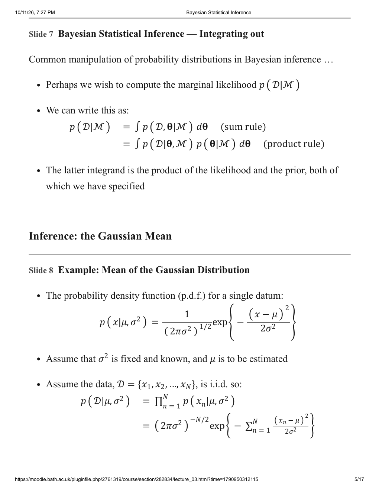

## Page 6

- The maximum likelihood approach to parameter estimation would result in us finding a point estimate for $\mu$, given by $\widehat\mu=\bar x=\frac1N\sum_nx_n$.

### Slide 9: Mean of the Gaussian Distribution — Bayesian Approach

- We need to define a prior distribution over $\mu$ — what form should this take?
- Criteria we might consider:
  - Actual prior knowledge (e.g. $\mu>0$)
  - Model structural preference (e.g. sparsity)
  - Indifference: a non-informative prior (e.g. uniform)
  - Analytic, or computational, convenience (e.g. a conjugate prior)
- A **conjugate prior** is one where the posterior distribution, after applying Bayes’ rule for a given likelihood, has the **same parametric form** as the prior.
  - This depends on both the form of the likelihood and the particular parameter being inferred.
  - A conjugate prior may not exist!
  - Wikipedia has a useful summary table: <https://en.wikipedia.org/wiki/Conjugate_prior>

Original page 6 (figures and equation layout)

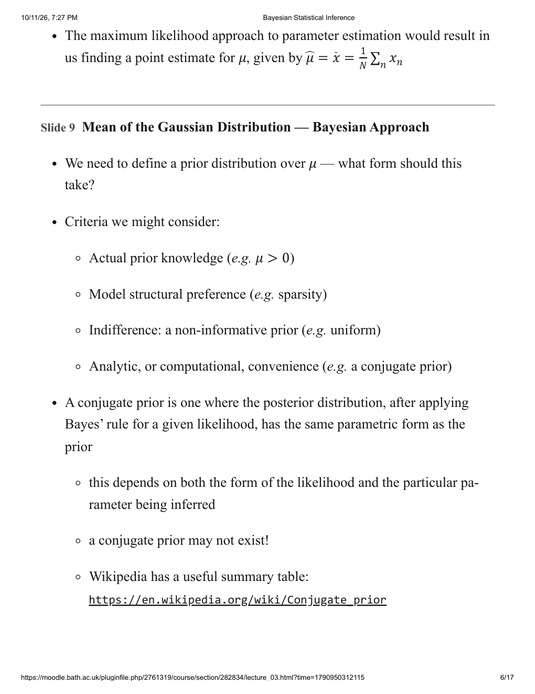

## Page 7

### Slide 10: Mean of the Gaussian Distribution — Prior & Inference

For this model, we prefer the conjugate prior for $\mu$, which is also Gaussian and depends on **hyper-parameters** $\mu_0$ and $\sigma_0^2$:

$$p_0(\mu\mid\mu_0,\sigma_0^2)=(2\pi\sigma_0^2)^{-1/2}\exp\left\{-\frac{(\mu-\mu_0)^2}{2\sigma_0^2}\right\}.$$

Then, having observed $\mathcal D=\{x_1,x_2,\ldots,x_N\}$, we apply Bayes’ rule to find the posterior $p_N(\mu\mid\mathcal D)$:

$$p_N(\mu\mid\mathcal D,\mu_0,\sigma_0^2)=\frac{p(\mathcal D\mid\mu)p_0(\mu\mid\mu_0,\sigma_0^2)}{p(\mathcal D\mid\mu_0,\sigma_0^2)}.$$

Due to conjugacy, the posterior is also Gaussian.

Useful resource: “Conjugate Bayesian Analysis of the Gaussian Distribution”, K. P. Murphy: <https://www.cs.ubc.ca/~murphyk/Papers/bayesGauss.pdf>

### Slide 11: Mean of the Gaussian Distribution — The Posterior

The posterior is:

$$p_N(\mu\mid\mathcal D)=\mathcal N(\mu\mid\mu_N,\sigma_N^2)$$

with

$$\begin{aligned}
\text{Posterior mean:}\quad\mu_N&=\frac{N\sigma_0^2}{N\sigma_0^2+\sigma^2}\bar x+\frac{\sigma^2}{N\sigma_0^2+\sigma^2}\mu_0\\
\text{Posterior variance:}\quad\frac1{\sigma_N^2}&=\frac N{\sigma^2}+\frac1{\sigma_0^2}\\
\text{or precision:}\quad\beta_N&=N\beta+\beta_0,\quad\text{where }\beta_0=1/\sigma_0^2\text{ etc.}
\end{aligned}$$

Note: (continued on the next page)

Original page 7 (figures and equation layout)

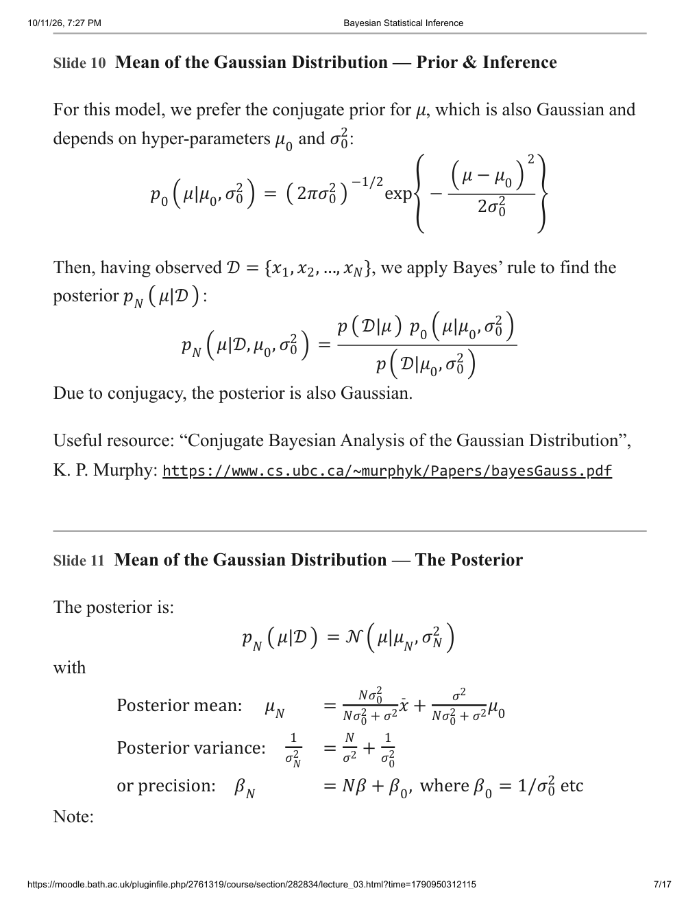

## Page 8

- When $N=0$: $\mu_N=\mu_0$ and $\sigma_N^2=\sigma_0^2$.
- When $N\to\infty$: $\mu_N\to\bar x$ and $\sigma_N^2\to0$.

### Slide 12: Illustration: Bayesian Estimation of Gaussian Mean

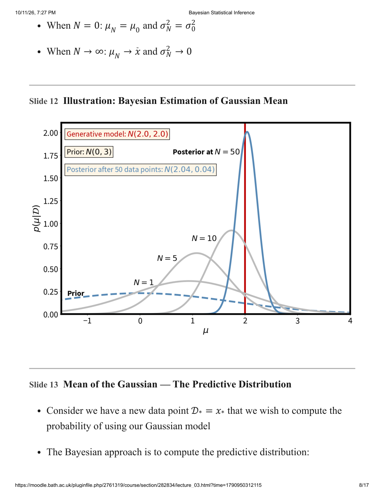

Figure labels:

- Generative model: $\mathcal N(2.0,2.0)$
- Prior: $\mathcal N(0,3)$
- Posterior after 50 data points: $\mathcal N(2.04,0.04)$
- Curves: Prior; $N=1$; $N=5$; $N=10$; Posterior at $N=50$
- Axes: $\mu$ and $p(\mu\mid\mathcal D)$

### Slide 13: Mean of the Gaussian — The Predictive Distribution

- Consider we have a new data point $\mathcal D_*=x_*$ that we wish to compute the probability of using our Gaussian model.
- The Bayesian approach is to compute the predictive distribution: (continued on the next page)

Original page 8 (figures and equation layout)

## Page 9

$$p(x_*\mid\mathcal D)=\int p(x_*\mid\mu)p_N(\mu\mid\mathcal D)\,d\mu.$$

- The observation model is: $p(x_*\mid\mu)=\mathcal N(x\mid\mu,\sigma^2)$.
- The posterior is: $p_N(\mu\mid\mathcal D)=\mathcal N(\mu\mid\mu_N,\sigma_N^2)$.
- It follows that the predictive distribution is also Gaussian:

$$p(x_*\mid\mathcal D)=\mathcal N(x_*\mid\mu_N,\sigma^2+\sigma_N^2).$$

### Inference: the Bernoulli Mean

### Slide 14: Example: Bernoulli Distribution Probability

- The probability density function (p.d.f.) for a single trial:

$$P(x\mid\theta)=\theta^x(1-\theta)^{1-x}$$

where $x\in\{0,1\}$ and $\theta$ is probability of “success” ($x=1$).

- Assume the data, $\mathcal D=\{x_1,x_2,\ldots,x_N\}$, is i.i.d. so:

$$\begin{aligned}P(\mathcal D\mid\theta)&=\prod_{n=1}^{N}P(x_n\mid\theta)\\&=\theta^{n_1}(1-\theta)^{n_0},\end{aligned}$$

where $n_0,n_1$ denote the number of failures/successes ($x_n=0,1$) respectively, with $n_0+n_1=N$.

- The maximum likelihood estimate is $\widehat\theta=\frac{n_1}{n_1+n_0}$, i.e. the observed frequency of “successes”.

Original page 9 (figures and equation layout)

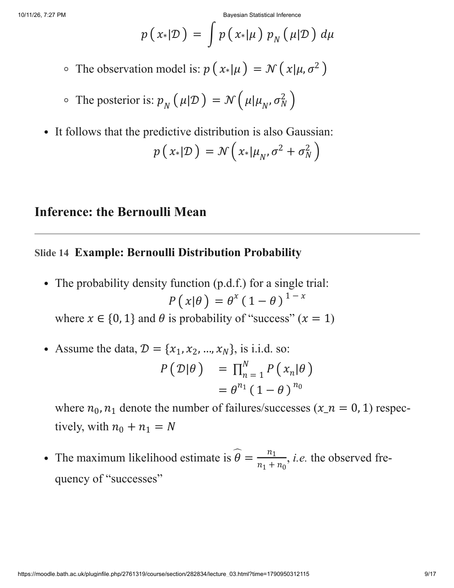

## Page 10

### Slide 15: Bernoulli Distribution — the Conjugate Bayesian Prior

The conjugate prior for $\theta$ in the Bernoulli is the **Beta distribution**:

$$p_0(\theta\mid\alpha,\beta)=\frac{\Gamma(\alpha+\beta)}{\Gamma(\alpha)\Gamma(\beta)}\theta^{\alpha-1}(1-\theta)^{\beta-1}.$$

- $\Gamma(\alpha)$ is the Gamma function which appears often in normalisation terms in probability distributions.
- The hyper-parameters $\alpha>0$ and $\beta>0$ are often referred to as “prior sample sizes” or “pseudo-counts”.
- The mean is (intuitively):

$$E_0[\theta]=\frac\alpha{\alpha+\beta}.$$

- The variance is:

$$\frac{\alpha\beta}{(\alpha+\beta)^2(\alpha+\beta+1)}.$$

Original page 10 (figures and equation layout)

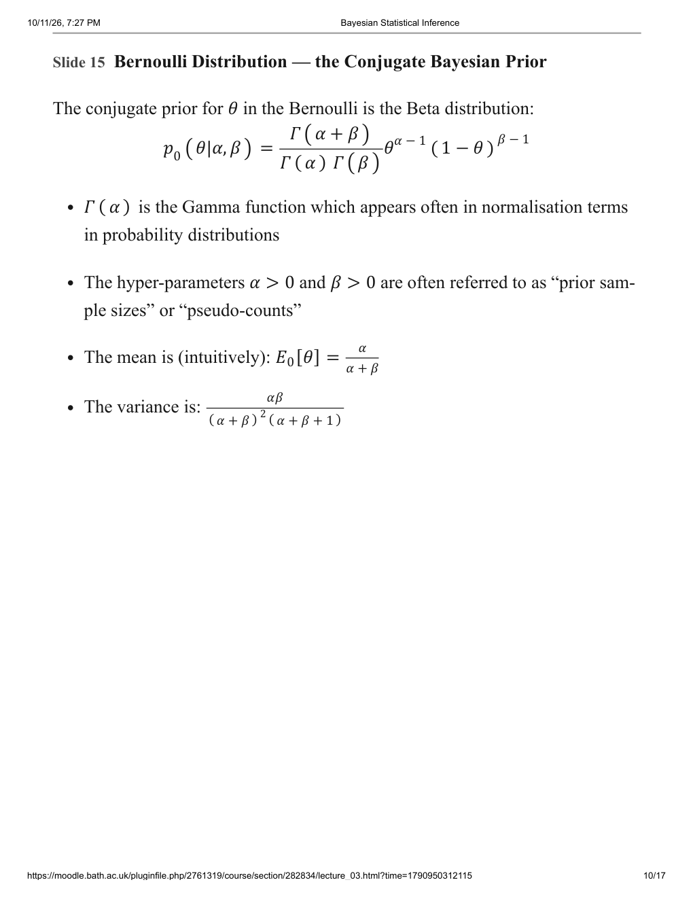

## Page 11

### Slide 16: The Beta Distribution

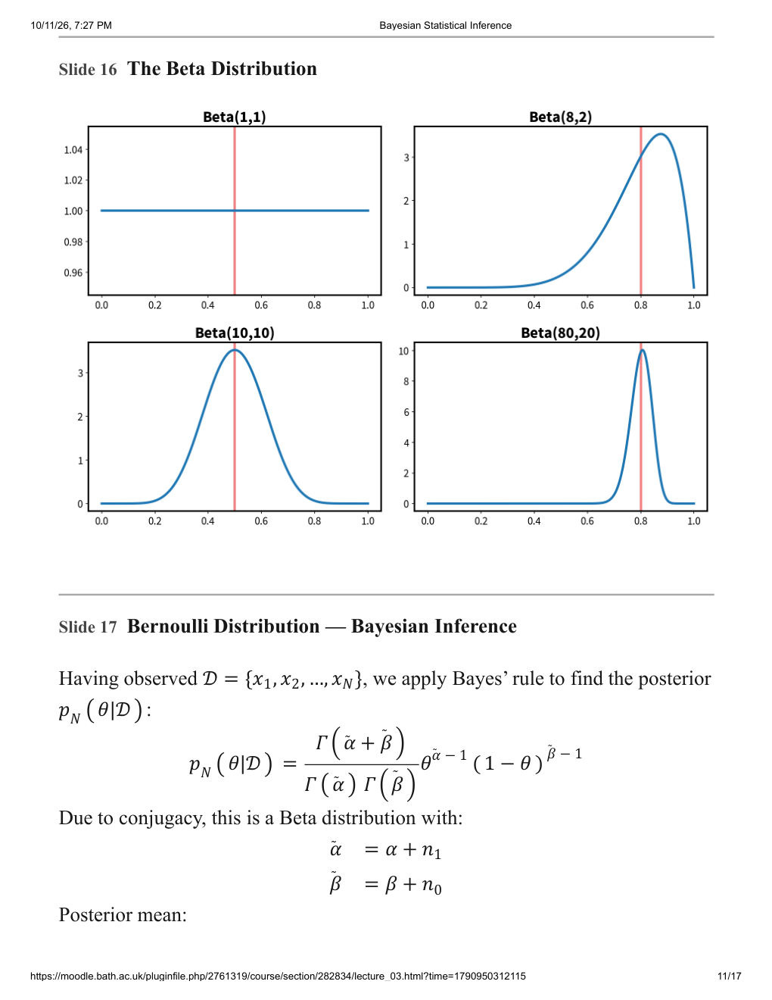

The four plotted distributions are $\operatorname{Beta}(1,1)$, $\operatorname{Beta}(8,2)$, $\operatorname{Beta}(10,10)$, and $\operatorname{Beta}(80,20)$.

### Slide 17: Bernoulli Distribution — Bayesian Inference

Having observed $\mathcal D=\{x_1,x_2,\ldots,x_N\}$, we apply Bayes’ rule to find the posterior $p_N(\theta\mid\mathcal D)$:

$$p_N(\theta\mid\mathcal D)=\frac{\Gamma(\widetilde\alpha+\widetilde\beta)}{\Gamma(\widetilde\alpha)\Gamma(\widetilde\beta)}\theta^{\widetilde\alpha-1}(1-\theta)^{\widetilde\beta-1}.$$

Due to conjugacy, this is a Beta distribution with:

$$\begin{aligned}\widetilde\alpha&=\alpha+n_1\\\widetilde\beta&=\beta+n_0.\end{aligned}$$

Posterior mean: (continued on the next page)

Original page 11 (figures and equation layout)

## Page 12

$$E_N[\theta]=\frac{\widetilde\alpha}{\widetilde\alpha+\widetilde\beta}=\frac{\alpha+n_1}{\alpha+\beta+(n_1+n_0)}.$$

See: <https://en.wikipedia.org/wiki/Conjugate_prior>

### Slide 18: Bernoulli Distribution — The Posterior

Posterior mean:

$$E_N[\theta]=\frac{\alpha+n_1}{\alpha+\beta+(n_1+n_0)}.$$

So:

- When $n_1$ and $n_0=0$:

$$E_N[\theta]=\frac\alpha{\alpha+\beta}.$$

- When $(n_1+n_0)\to\infty$:

$$E_N[\theta]\to\frac{n_1}{n_1+n_0}.$$

Original page 12 (figures and equation layout)

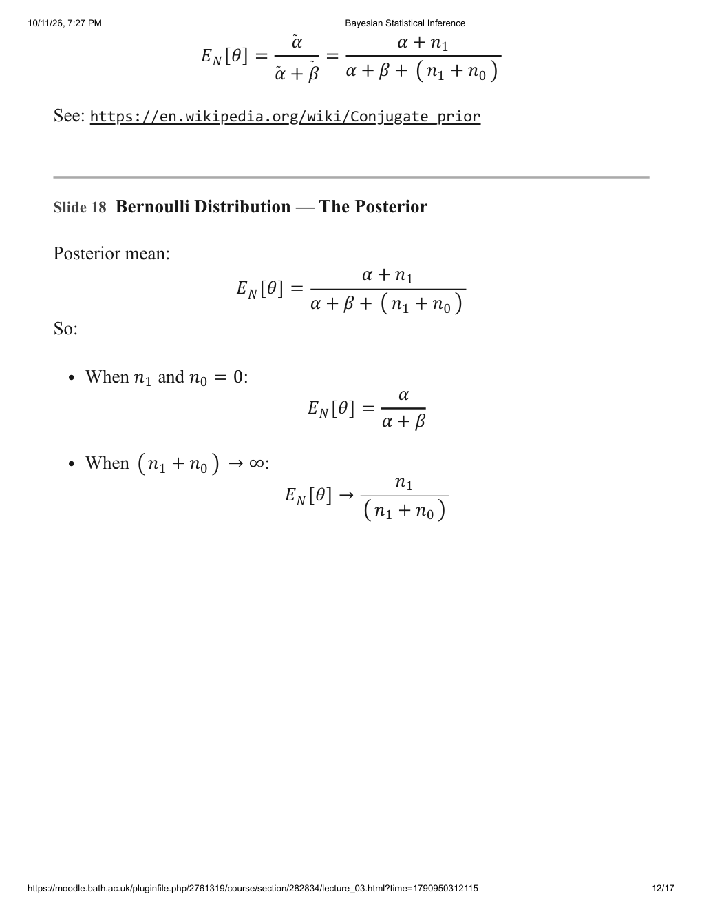

## Page 13

### Slide 19: Illustration: Bayesian Estimation of Bernoulli Mean (1)

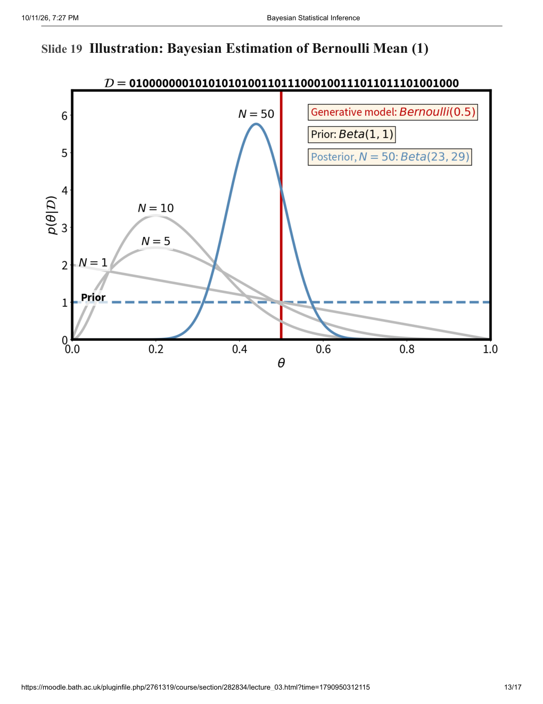

Figure labels:

- $\mathcal D=$ `01000000010101010100110111000100111011011101001000`
- Generative model: $\operatorname{Bernoulli}(0.5)$
- Prior: $\operatorname{Beta}(1,1)$
- Posterior, $N=50$: $\operatorname{Beta}(23,29)$
- Curves: Prior; $N=1$; $N=5$; $N=10$; $N=50$
- Axes: $\theta$ and $p(\theta\mid\mathcal D)$

Original page 13 (figures and equation layout)

## Page 14

### Slide 20: Illustration: Bayesian Estimation of Bernoulli Mean (2)

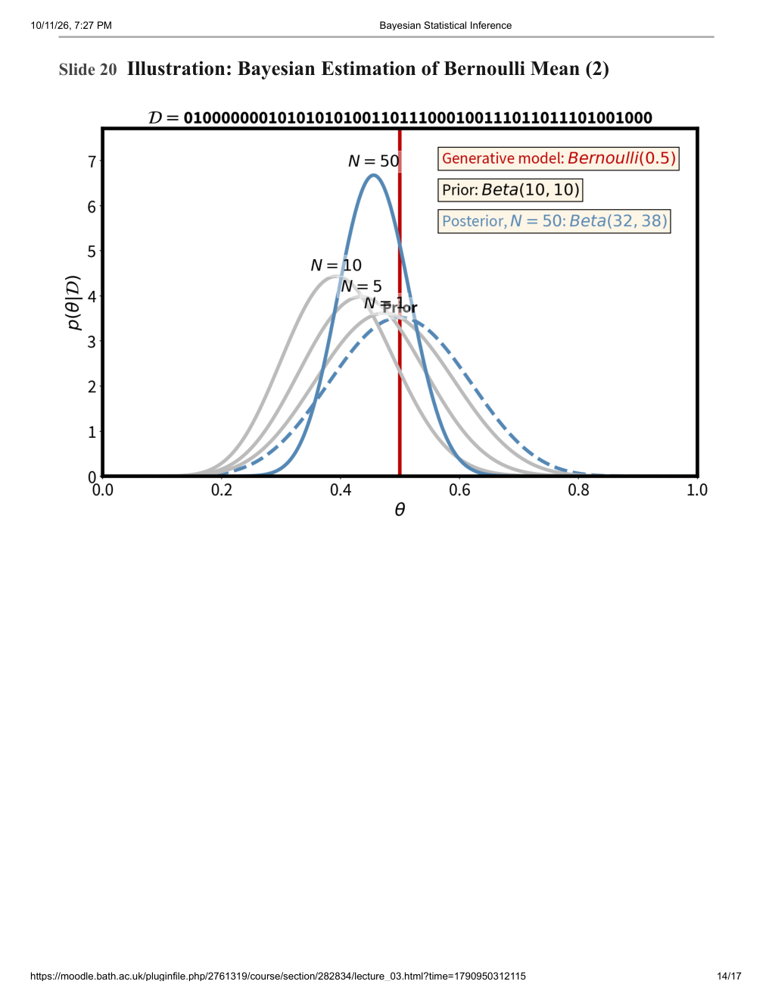

Figure labels:

- $\mathcal D=$ `01000000010101010100110111000100111011011101001000`
- Generative model: $\operatorname{Bernoulli}(0.5)$
- Prior: $\operatorname{Beta}(10,10)$
- Posterior, $N=50$: $\operatorname{Beta}(32,38)$
- Curves: Prior; $N=1$; $N=5$; $N=10$; $N=50$
- Axes: $\theta$ and $p(\theta\mid\mathcal D)$

Original page 14 (figures and equation layout)

## Page 15

### Slide 21: Illustration: Bayesian Estimation of Bernoulli Mean (3)

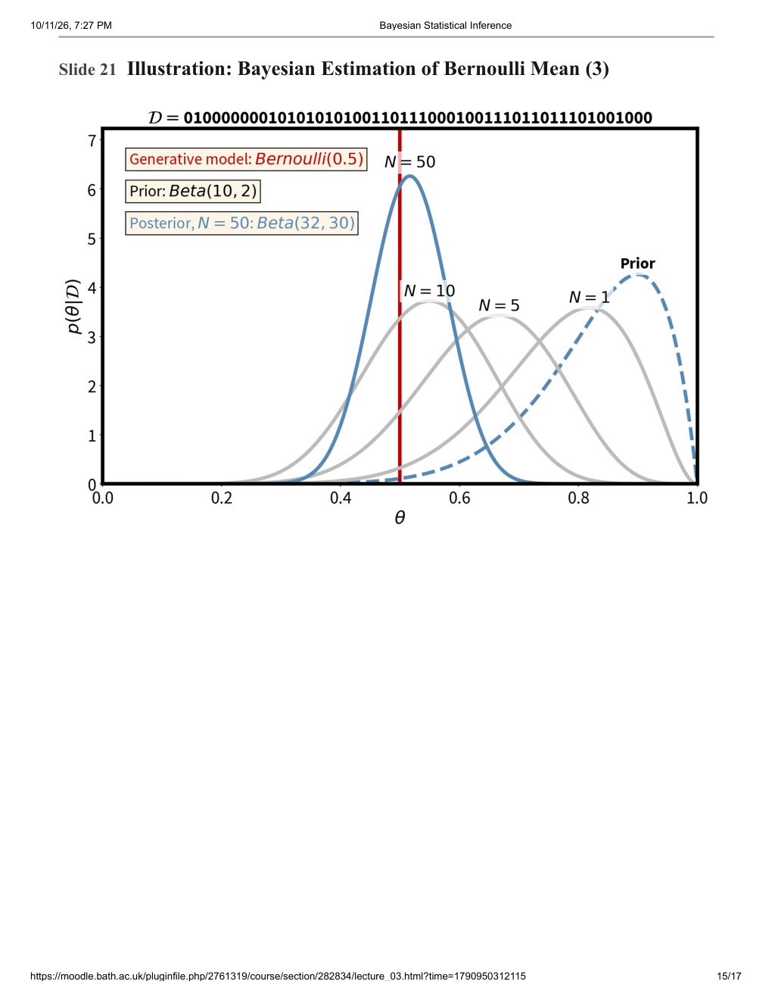

Figure labels:

- $\mathcal D=$ `01000000010101010100110111000100111011011101001000`
- Generative model: $\operatorname{Bernoulli}(0.5)$
- Prior: $\operatorname{Beta}(10,2)$
- Posterior, $N=50$: $\operatorname{Beta}(32,30)$
- Curves: Prior; $N=1$; $N=5$; $N=10$; $N=50$
- Axes: $\theta$ and $p(\theta\mid\mathcal D)$

Original page 15 (figures and equation layout)

## Page 16

### Slide 22: Illustration: Bayesian Estimation of Bernoulli Mean (4)

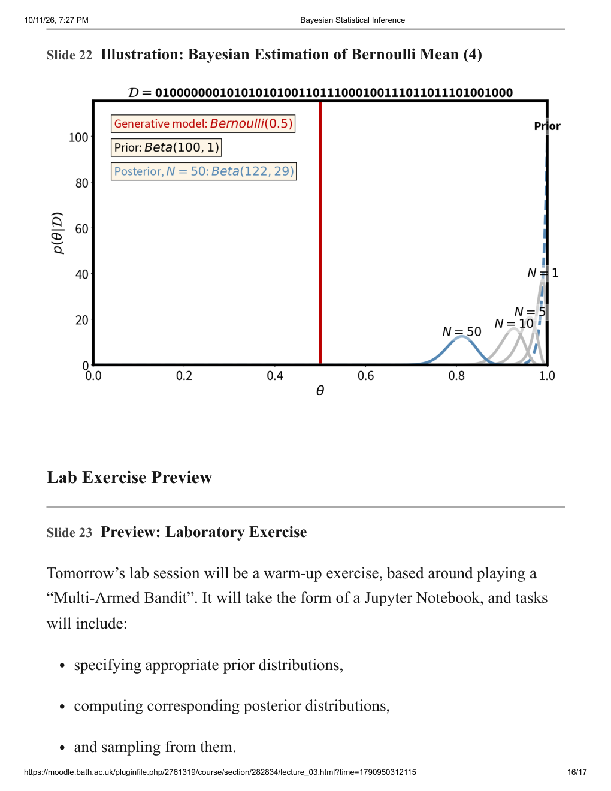

Figure labels:

- $\mathcal D=$ `01000000010101010100110111000100111011011101001000`
- Generative model: $\operatorname{Bernoulli}(0.5)$
- Prior: $\operatorname{Beta}(100,1)$
- Posterior, $N=50$: $\operatorname{Beta}(122,29)$
- Curves: Prior; $N=1$; $N=5$; $N=10$; $N=50$
- Axes: $\theta$ and $p(\theta\mid\mathcal D)$

### Lab Exercise Preview

### Slide 23: Preview: Laboratory Exercise

Tomorrow’s lab session will be a warm-up exercise, based around playing a “Multi-Armed Bandit”. It will take the form of a Jupyter Notebook, and tasks will include:

- specifying appropriate prior distributions,
- computing corresponding posterior distributions,
- and sampling from them.

Original page 16 (figures and equation layout)

## Page 17

Featured observation models will be the Bernoulli and Gamma distributions.

Some familiarity with the Python modules `scipy.stats` or `numpy.random` will be useful.

Original page 17 (figures and equation layout)

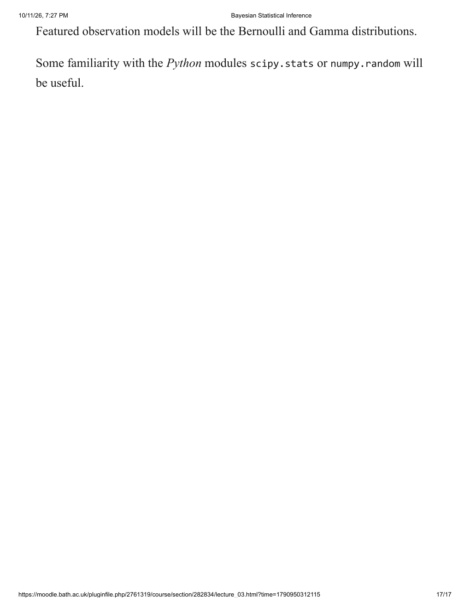

