# Adventures in Inference

**Why We Need Probability**

Edward Milsom  
2026-10-02

Source: [Lecture 4 PDF](4.pdf)

## Page 1

### Slide 1: In this Episode ...

- Why We Need Probability
  - and why we need to know how to use it correctly!
- The importance of the separation of inference and decision
- Exploiting probabilistic knowledge in classification scenarios
- There be dragons! Some cautionary scenarios ...
  - False independence
  - Selective data gathering and multiple testing
  - Causal inference
  - Simpson’s paradox

Original page 1 (figures and equation layout)

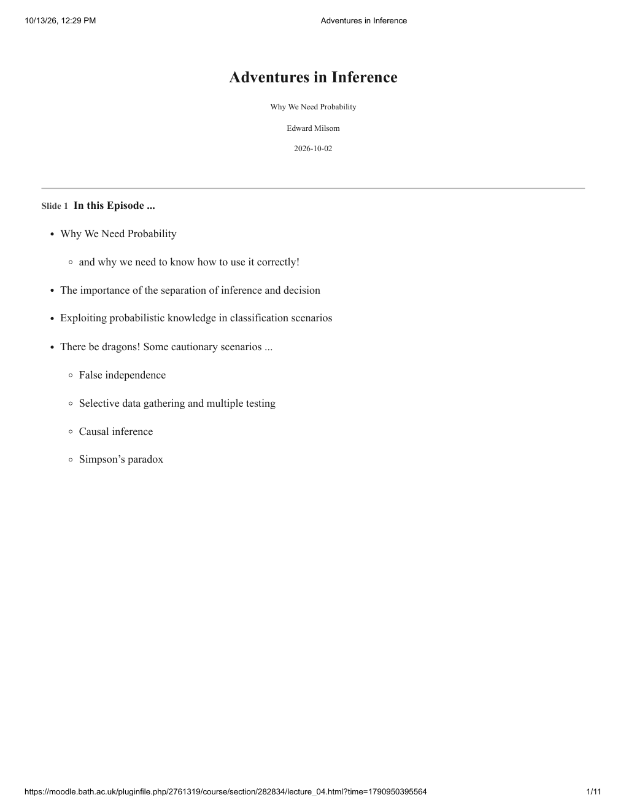

## Page 2

### Slide 2: What Can Probability Do For Us?

> It is seen in this essay that the theory of probabilities is only common sense reduced to calculus;
>
> … it leaves no arbitrariness in the choice of opinions and sides to be taken;
>
> … it supplements most happily the ignorance and the weakness of the human mind.
>
> … it gives the surest hints which can guide us in our judgements,
>
> … it teaches us to avoid the illusions which ofttimes confuse us,
>
> … no more useful [theory] could be incorporated in the system of public instruction.

Pierre-Simon Laplace — extracts from the closing paragraph of “A Philosophical Essay on Probabilities” (1814)

### Separation of Inference & Decision

### Slide 3: Making Probabilistic Predictions

- Providing predictions in probabilistic form should be an important universal principle of data science and machine learning.
- Decompose real-world decision-making systems into two stages:
  1. probabilistic inference of all relevant unknowns and uncertainties
  2. application of decision theory based upon those probabilities
- For example, considering two common scenarios:
  - classification models: should output a probability
  - regression (real-valued) models: should output a predictive distribution (or at least, an expected value with meaningful error-bars)
- Bayesian (and many other statistical) models do this by default.

Original page 2 (figures and equation layout)

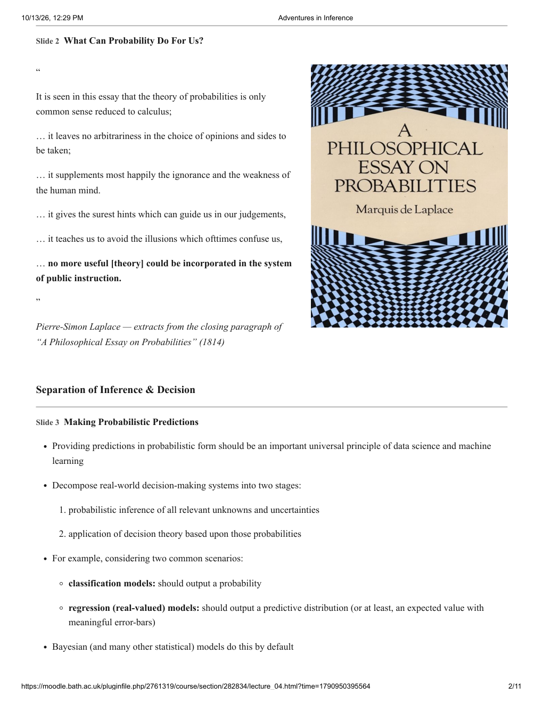

## Page 3

- Some popular machine learning classification models don’t output a probability! (e.g. the Support Vector Machine)

### Slide 4: Probabilistic Predictions: Separation of Inference and Decision

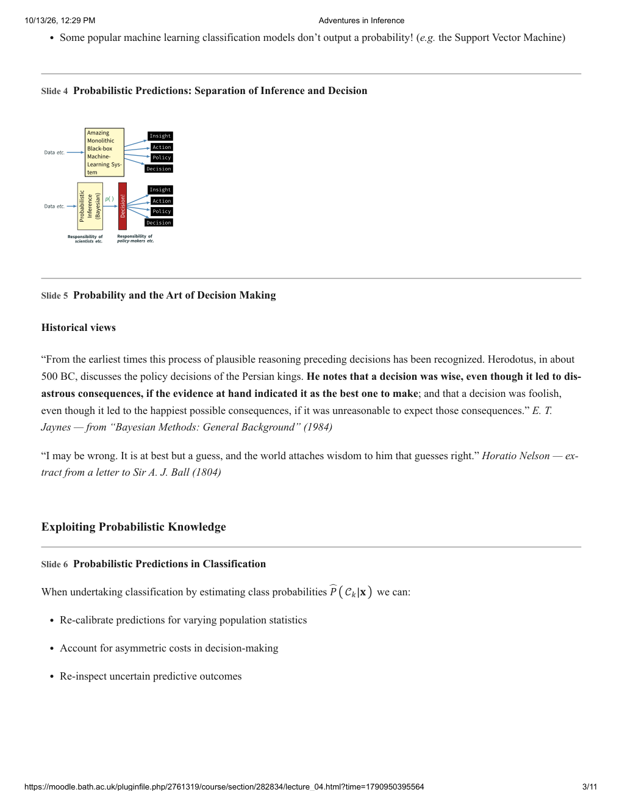

Diagram labels:

- Data etc. → Amazing Monolithic Black-box Machine-Learning System → Insight / Action / Policy / Decision
- Data etc. → Probabilistic Inference (Bayesian) → $p(\cdot)$ → Decision → Insight / Action / Policy / Decision
- Inference: Responsibility of scientists etc.
- Decision: Responsibility of policy-makers etc.

### Slide 5: Probability and the Art of Decision Making

**Historical views**

> From the earliest times this process of plausible reasoning preceding decisions has been recognized. Herodotus, in about 500 BC, discusses the policy decisions of the Persian kings. He notes that **a decision was wise, even though it led to disastrous consequences, if the evidence at hand indicated it as the best one to make**; and that a decision was foolish, even though it led to the happiest possible consequences, if it was unreasonable to expect those consequences.

E. T. Jaynes — from “Bayesian Methods: General Background” (1984)

> I may be wrong. It is at best but a guess, and the world attaches wisdom to him that guesses right.

Horatio Nelson — extract from a letter to Sir A. J. Ball (1804)

### Exploiting Probabilistic Knowledge

### Slide 6: Probabilistic Predictions in Classification

When undertaking classification by estimating class probabilities $\widehat P(\mathcal C_k\mid\mathbf x)$ we can:

- Re-calibrate predictions for varying population statistics
- Account for asymmetric costs in decision-making
- Re-inspect uncertain predictive outcomes

Original page 3 (figures and equation layout)

## Page 4

### Slide 7: Example: Probabilistic Prediction & Varying Population Statistics

- In a medical trial ($T$), a classification model outputs an estimate of the probability of disease (class $\mathcal C_1$) as distinct from being healthy (class $\mathcal C_0$), based on inputs $\mathbf x$:

$$\widehat P(\mathcal C_1\mid\mathbf x)=\frac{p(\mathbf x\mid\mathcal C_1)P_T(\mathcal C_1)}{p_T(\mathbf x)}.$$

- In the trial, the training data set was “balanced”: $P_T(\mathcal C_1)=P_T(\mathcal C_0)=0.5$.
- But in the general population ($G$) where the model is to be applied, the disease is relatively rare: $P_G(\mathcal C_1)=0.001$.
- For a new patient presenting with data $\mathbf x_*$ our model predicts $\widehat P(\mathcal C_1\mid\mathbf x_*)=0.95$.

**Do they have the disease? (Or more usefully, what is the probability?)**

### Slide 8: Example: Probabilistic Prediction & Varying Population Statistics

- For the general population, the “correct” probability would be:

$$P(\mathcal C_1\mid\mathbf x)=\frac{p(\mathbf x\mid\mathcal C_1)P_G(\mathcal C_1)}{p_G(\mathbf x)}.$$

- The quantity $p(\mathbf x\mid\mathcal C_1)$ is common across both the trial and the population, so we substitute it:

$$\begin{aligned}
P(\mathcal C_1\mid\mathbf x)&=\frac{\widehat P(\mathcal C_1\mid\mathbf x)p_T(\mathbf x)}{P_T(\mathcal C_1)}\frac{P_G(\mathcal C_1)}{p_G(\mathbf x)}\\
&=\widehat P(\mathcal C_1\mid\mathbf x)\left[\frac{P_G(\mathcal C_1)}{P_T(\mathcal C_1)}\right]\frac{p_T(\mathbf x)}{p_G(\mathbf x)}.
\end{aligned}$$

- For $\widehat P(\mathcal C_1\mid\mathbf x_*)=0.95$ it turns out that $P(\mathcal C_1\mid\mathbf x_*)=0.02$.

**We can (and should) recalibrate our predictions for varying population statistics.**

### Slide 9: Example: Probabilistic Prediction & Asymmetric Costs

**Medical Diagnosis:** $P=$ Patient has disease?

| Actual | Predicted $P$ | Predicted $N$ |
| --- | ---: | ---: |
| $P$ | 0 | 24 |
| $N$ | 1 | 0 |

**Credit Card Fraud Detection:** $P=$ Transaction is fraudulent?

| Actual | Predicted $P$ | Predicted $N$ |
| --- | ---: | ---: |
| $P$ | \$0.02 | \$275 |
| $N$ | \$9 | \$0.02 |

Original page 4 (figures and equation layout)

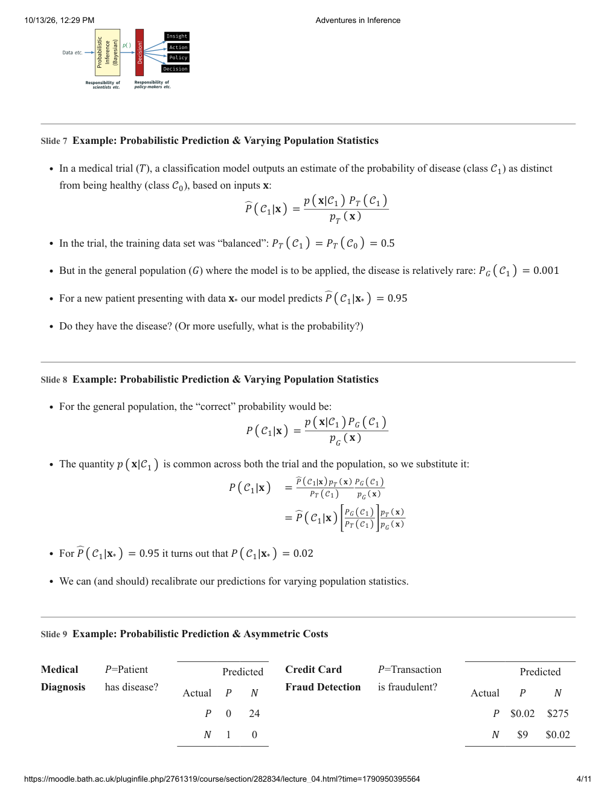

## Page 5

- Our classifier predicts disease with probability $p=\widehat P(\mathcal C_1\mid\mathbf x)$.
- We apply a threshold $\kappa$ such that if $p>\kappa$ we classify the patient as diseased.
- Our expected cost (or loss) is:

$$\begin{cases}
1\times(1-p)&\text{if }p>\kappa\text{ (false positive)}\\
24\times p&\text{if }p\le\kappa\text{ (false negative)}.
\end{cases}$$

- We can minimise this with respect to $\kappa$.

### Slide 10: Quick Demo

The separation of inference and decision with asymmetric costs ...

### Caution! Problems at Trial

### Slide 11: False Independence: The Unfortunate Case of Sally Clark

- Sally Clark was mother to two children, in 1996 and 1997, both of whom were sadly lost to “cot death” not long after birth.
- After a pathologist’s report raised unsubstantiated suspicions, she was arrested and charged with two counts of murder.
- Despite almost no medical evidence, she was found guilty at the end of 1999 and sentenced to life imprisonment.
- Significant weight at the trial was given to the evidence of Prof. Roy Meadow, who had a “pet theory”: Munchausen’s Syndrome by Proxy.
- Key to this evidence was a statistical argument:
  - the incidence of cot death is 1 in every 8,543 births
  - so, the chance of two coincident cases is about 73 million to one (once per century)

### Slide 12: This Reasoning is False!

- The probability calculation presumed that the deaths were independent events.
- It is easy to see why this may not be the case ...

**Presumption of independence:** If the deaths are denoted $D_1$ and $D_2$, then graphically we express independence as two unconnected nodes $D_1$ and $D_2$:

$$P(D_1,D_2)=1\text{ in }8{,}543^2=1\text{ in }73{,}000{,}000.$$

**Likely reality:** There is some underlying medical or genetic condition $z$ (text continues on the next page). The graph has $z\to D_1$ and $z\to D_2$.

$$P(D_1,D_2)\ll1\text{ in }1{,}500\quad??$$

Original page 5 (figures and equation layout)

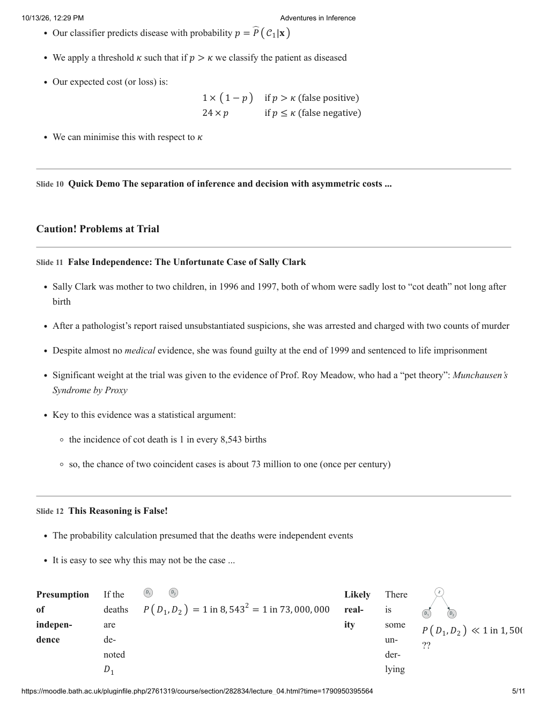

## Page 6

Continuation of Slide 12’s diagram text: “If the deaths are denoted $D_1$ and $D_2$, then graphically we express independence as:” and “There is some underlying medical or genetic condition $z$.”

### Slide 13: A Fictional Experiment Concerning Independence

**Consider this contrived thought experiment ...**

- Imagine a data set with 10,000 examples
  - for 9,990 cases, there are no events
  - in 10 cases, there are two events
- If there are 20 events in 10,000 examples, we might expect $P(\mathit{event})=0.002$.
- Presumption of independence: $P(2\times\mathit{events})=0.002^2=4$ in a million.
- Truth: $P(2\times\mathit{events})=1$ in a thousand.
  - **250 times more frequent!**

### Slide 14: Sally Clark: Ultimate Outcome

- Subsequent to the trial, plenty of folks pointed out this flaw and campaigned on her behalf, notably David MacKay: <https://www.inference.org.uk/sallyclark/>
- The data around cot deaths was scrutinised in more detail.
- (Also, over time, other questions had been raised about Meadow’s theory ...)
- Sally Clark’s conviction was quashed, and she was freed, in 2003.
- Sadly, she never recovered from the experience, and died in 2007 (age 42).

Original page 6 (figures and equation layout)

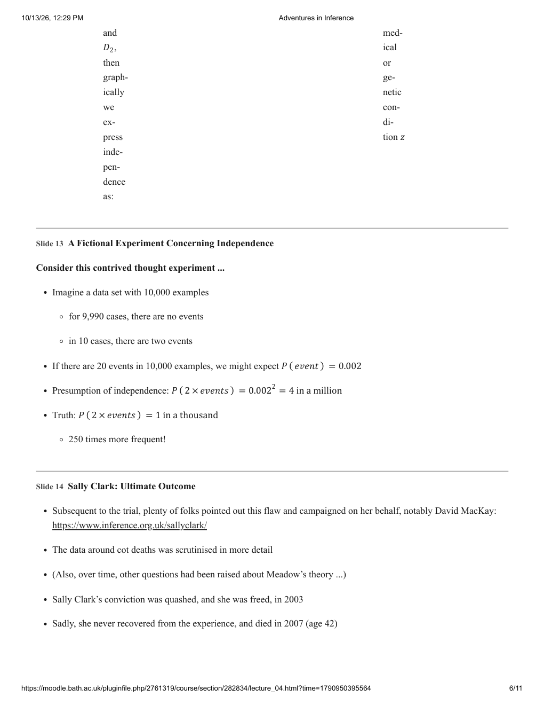

## Page 7

- There is another conviction in the public eye in the U.K. right now, which also depends in part on some controversial statistical evidence ...

### Slide 15: “The Worst Serial Killer in Holland’s History”: Lucia de Berk

- In 2001, Lucia de Berk (LdB), a Dutch paediatric nurse, was on duty at the time of the death of a baby in a hospital in The Hague.
- At the time, the death was recorded as natural.
- A day later, another nurse raised a suspicion: she had noticed that Lucia had been present at 5 incidents in two years.
- The “authorities” went back over the records, and (details abridged) LdB was subsequently charged with 13 murders and 4 attempted murders.
- In 2003, she was sentenced to life imprisonment (4 murders and 3 attempted).
- In 2004, she appealed, but was instead convicted of 3 further murders!
- Some details taken from: (Schneps and Colmez 2013).

### Slide 16: Lucia de Berk: Statistical Evidence

- Again, there was no medical evidence, but ...

| Hospital Shift | No problem | Incident! | Total |
| --- | ---: | ---: | ---: |
| Without Lucia | 887 | 0 | 887 |
| Lucia present | 134 | 8 | 142 |
| Total | 1,021 | 8 | 1,029 |

A law professor calculated a $p$-value using Fisher’s exact test of $0.000000110572$.

- In other words, around in 9 million chance it was coincidental.
- He then incorrectly multiplied this along with two other $p$-values calculated for other hospitals where LdB had worked, to ultimately give a in 342 million probability that the deaths were accidental.

### Slide 17: Lucia de Berk: Statistical Evidence

An impartial re-review of the original hospital data resulted in:

| Hospital Shift | No problem | Incident! | Total |
| --- | ---: | ---: | ---: |
| Without Lucia | 883 | 4 | 887 |

*Table continues on the next page.*

Original page 7 (figures and equation layout)

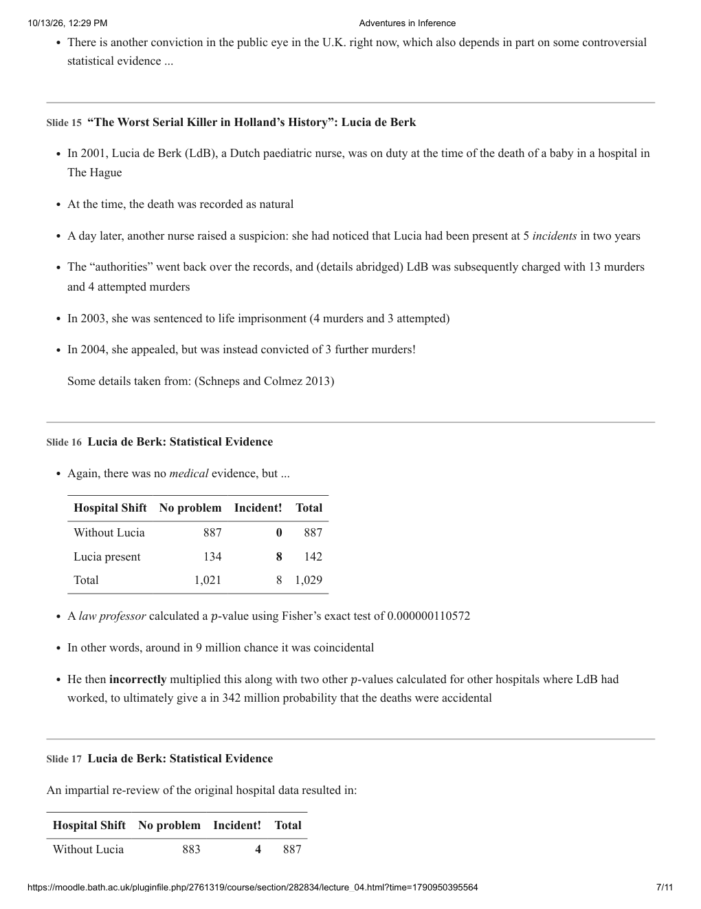

## Page 8

| Hospital Shift | No problem | Incident! | Total |
| --- | ---: | ---: | ---: |
| Lucia present | 136 | 6 | 142 |
| Total | 1,019 | 10 | 1,029 |

- This gives a $p$-value of about in 1,230 (somewhat less than 1 in 9 million!).
- There are 250,000 nurses in the Netherlands — if you looked, you would therefore expect to find around 200 nurses exhibiting “serial killer” statistics!
- Long story short: Lucia de Berk was eventually released in 2010.

### Caution! Causal Inference

### Slide 18: Causal Inference

- You are probably aware that:
  - **Correlation Does Not Imply Causation!**
- Wikipedia has a whole page devoted to this:
  - <https://en.wikipedia.org/wiki/Correlation_does_not_imply_causation>
- But it can be even more extreme than that ...
- **There may be a genuine cause in the reverse direction to the observed correlation!**

The following example is based on material in: (Gelman and Nolan 2008).

### Slide 19: (Fictional) Example: Correlation & Causation

A class of University of Bath students was set a test to complete with no time limit. It was recorded how much time each student spent on the test, and what mark they achieved.

Original page 8 (figures and equation layout)

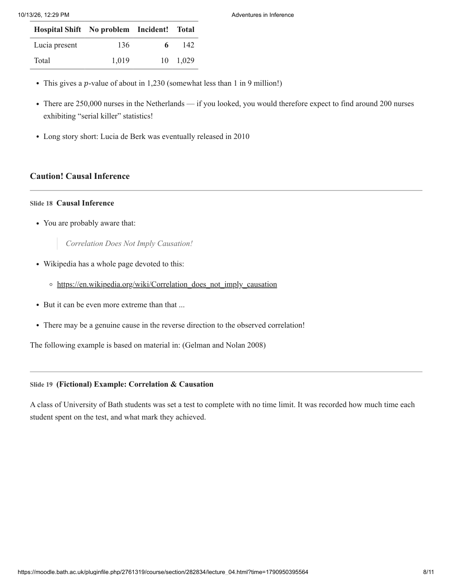

## Page 9

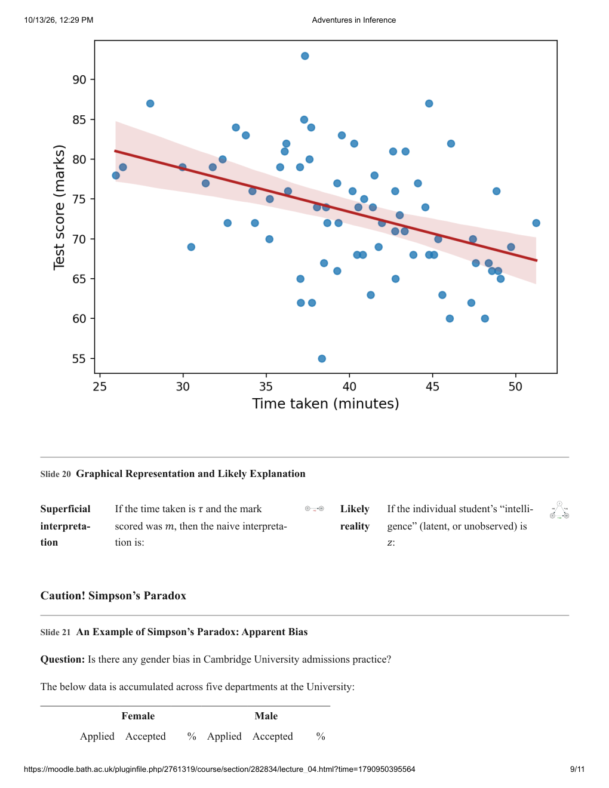

Figure axes: Time taken (minutes); Test score (marks).

### Slide 20: Graphical Representation and Likely Explanation

**Superficial interpretation:** If the time taken is $\tau$ and the mark scored was $m$, then the naive interpretation is: $\tau\to m$.

**Likely reality:** If the individual student’s “intelligence” (latent, or unobserved) is $z$: $z\to\tau$ and $z\to m$.

### Caution! Simpson’s Paradox

### Slide 21: An Example of Simpson’s Paradox: Apparent Bias

**Question:** Is there any gender bias in Cambridge University admissions practice?

The below data is accumulated across five departments at the University:

| | Female: Applied | Female: Accepted | Female: % | Male: Applied | Male: Accepted | Male: % |
| --- | ---: | ---: | ---: | ---: | ---: | ---: |

*Table continues on the next page.*

Original page 9 (figures and equation layout)

## Page 10

| | Female: Applied | Female: Accepted | Female: % | Male: Applied | Male: Accepted | Male: % |
| --- | ---: | ---: | ---: | ---: | ---: | ---: |
| Total | 1,184 | 274 | 23% | 2,470 | 584 | **24%** |

**Bold** percentages indicate highest acceptance rate.

This data, from 1996, is taken from: (Spiegelhalter 2019). See also: the Wikipedia page on *Simpson’s Paradox* for similar data on UC Berkeley from 1973, which shows an apparent 9% gender bias!

### Slide 22: Which Departments Might Be Guilty?

| | Female: Applied | Female: Accepted | Female: % | Male: Applied | Male: Accepted | Male: % |
| --- | ---: | ---: | ---: | ---: | ---: | ---: |
| Computer Science | 26 | 7 | **27%** | 228 | 58 | 25% |
| Economics | 240 | 63 | **26%** | 512 | 112 | 22% |
| Engineering | 164 | 52 | **32%** | 972 | 252 | 26% |
| Medicine | 416 | 99 | 24% | 578 | 140 | 24% |
| Veterinary Medicine | 338 | 53 | **16%** | 180 | 22 | 12% |
| Total | 1,184 | 274 | 23% | 2,470 | 584 | **24%** |

Every department has a higher acceptance rate for female applicants than for male applicants! How can this be?

This is a classic example of **Simpson’s Paradox**.

### Slide 23: Graphical Explanation: Confounding Variables

The problem is the presence of a **confounding variable** (or, unobserved confounder), that has a **causal influence on both** dependent and independent variables.

Diagram labels:

- First data table (accumulated): Gender → Accept
- Second data table: Dept → Gender; Dept → Accept

Female applicants apply disproportionately to departments with lower acceptance rates, causing their overall acceptance rate to be lower.

### Slide 24: And Finally ... Some (decreasingly) Contemporary Relevance (2021)

The Office for National Statistics (ONS) published some data in September 2021, that was (wilfully?) misinterpreted as showing that being vaccinated against COVID-19 made you more likely to die from the disease!

Original page 10 (figures and equation layout)

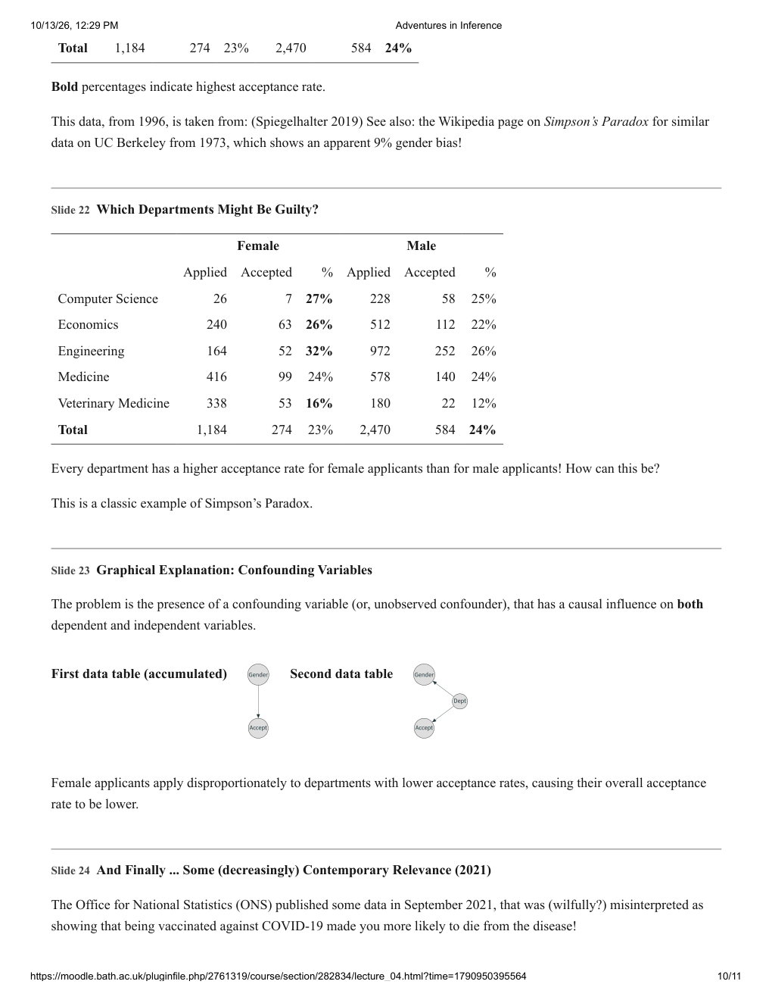

## Page 11

Continuation of Slide 24’s graphical illustration:

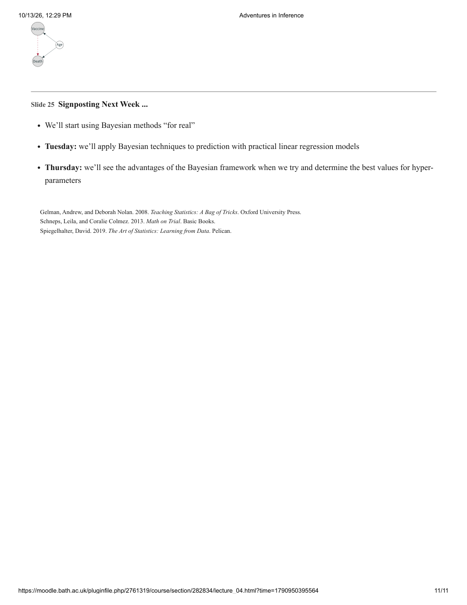

Diagram labels: Vaccine, Age, Death. Arrows: Age → Vaccine; Age → Death; Vaccine → Death (red dashed arrow).

### Slide 25: Signposting Next Week ...

- We’ll start using Bayesian methods “for real”.
- **Tuesday:** we’ll apply Bayesian techniques to prediction with practical linear regression models.
- **Thursday:** we’ll see the advantages of the Bayesian framework when we try and determine the best values for hyper-parameters.

### References

- Gelman, Andrew, and Deborah Nolan. 2008. *Teaching Statistics: A Bag of Tricks*. Oxford University Press.
- Schneps, Leila, and Coralie Colmez. 2013. *Math on Trial*. Basic Books.
- Spiegelhalter, David. 2019. *The Art of Statistics: Learning from Data*. Pelican.

Original page 11 (figures and equation layout)

