# Bayesian Linear Regression

## A First Really Useful Bayesian Model

**Author:** Edward Milsom  
**Date:** 2026-10-02  
**Source:** [Lecture 5 PDF](5.pdf)

## Page 1

### Slide 1: In this Episode ...

- An example “regression” (real-value prediction) problem.
- Starting non-Bayesian:
  - Linear (in the parameter) models and least-squares.
  - Penalised least-squares and regularisation.
  - The probabilistic framework.
- Going Bayesian:
  - Maximum a posteriori (MAP) estimation.
  - Step-by-step demo of Bayesian “learning”.

### Example Data Set

### Slide 2: Example Regression Problem: Data Set

Example data set $\mathcal{D}$ of $N=15$ points generated from the function $f(x)=\sin(x)$ with added Gaussian noise of $\sigma=0.25$:

Original page 1 (figures and equation layout)

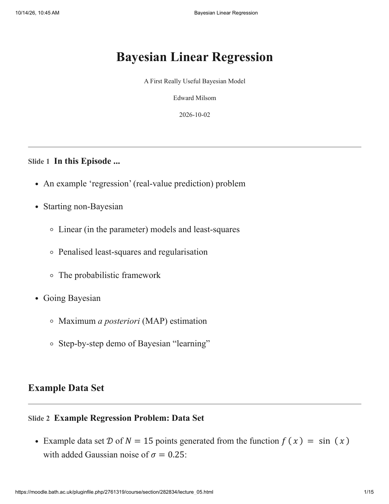

## Page 2

- Input variables are denoted $x_n$ and observation (“target”) values are denoted $y_n$.
- Ultimate objective: infer the underlying function $f(x)$ from the data set.

### Linear Models

### Slide 3: Linear (in-the-parameters) Regression

- We will model $f(x)$ with a parameterised function $\hat{f}(x;\mathbf{w})$.
- Here, we consider models which are a linearly-weighted sum of $M$ fixed basis functions $\phi_m(x)$:

$$
\hat{f}(x;\mathbf{w})=\sum_{m=1}^{M}w_m\phi_m(x).
$$

$\mathbf{w}=(w_1,w_2,\ldots,w_M)$ is the vector of adjustable model parameters (“weights”).

Original page 2 (figures and equation layout)

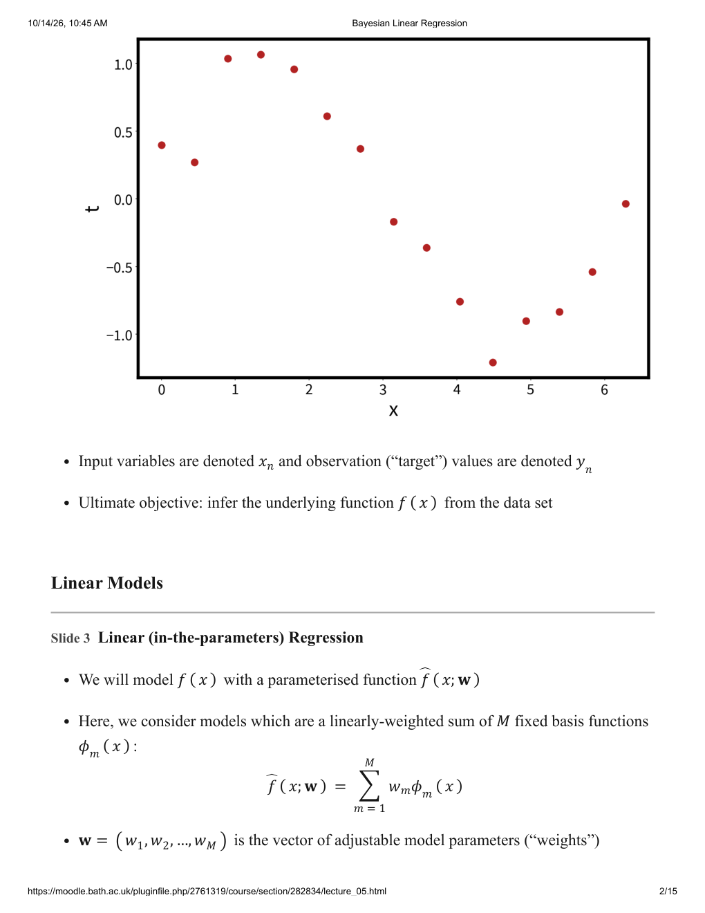

## Page 3

- $\hat{f}(x)$ can be non-linear in $x$, but is a linear function of $\mathbf{w}$.
  - Sometimes referred to as “linear in the parameters” (L.I.T.P.).

### Slide 4: Basis Functions

Many possible choices for basis functions:

- Linear: $\phi(x)=x$ (makes more sense in higher dimensions).
- Polynomial: $\phi_m(x)=x^m$.
- Hand-crafted, bespoke, features $\phi_m(x)$.
- General-purpose “Gaussians”, with fixed centres $c_m$ and common radius $r$:

$$
\phi_m(x)=\exp\left\{-\frac{(x-c_m)^2}{r^2}\right\}.
$$

  E.g. a radial basis function, RBF, model.

Here we adopt Gaussian radial basis functions, centred on the data, with $c_m=x_m$.

Original page 3 (figures and equation layout)

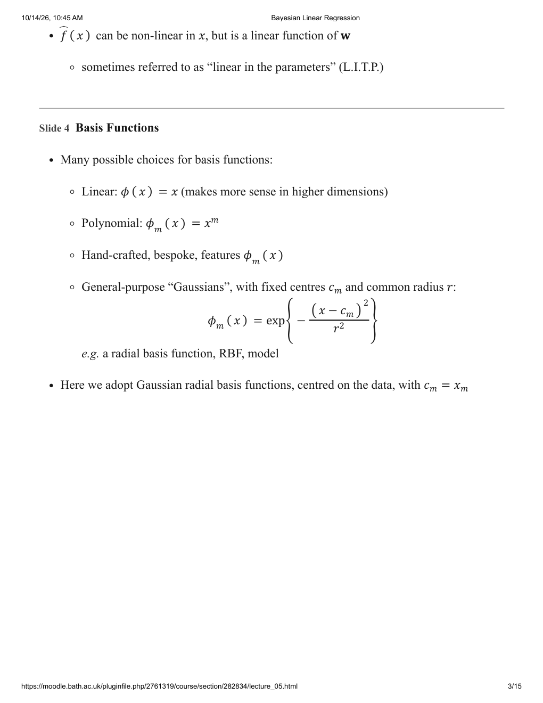

## Page 4

### Slide 5: Basis Functions Illustrated

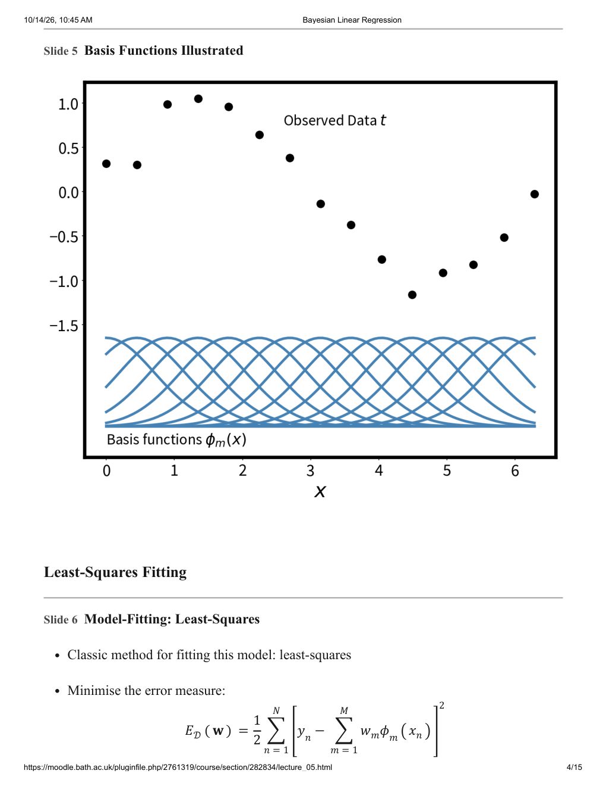

### Least-Squares Fitting

### Slide 6: Model-Fitting: Least-Squares

- Classic method for fitting this model: **least-squares**.
- Minimise the error measure:

$$
E_{\mathcal{D}}(\mathbf{w})=\frac12\sum_{n=1}^{N}\left[y_n-\sum_{m=1}^{M}w_m\phi_m(x_n)\right]^2.
$$

Original page 4 (figures and equation layout)

## Page 5

If we define:

- Target vector $\mathbf{y}=(y_1,\ldots,y_N)^{\mathsf{T}}$.
- Design matrix $\boldsymbol{\Phi}$, $N\times M$, such that $\Phi_{nm}=\phi_m(x_n)$.

Then $E_{\mathcal{D}}(\mathbf{w})=\frac12\lVert\mathbf{y}-\boldsymbol{\Phi}\mathbf{w}\rVert^2$ and the least-squares parameter estimate is:

$$
\hat{\mathbf{w}}_{LS}=(\boldsymbol{\Phi}^{\mathsf{T}}\boldsymbol{\Phi})^{-1}\boldsymbol{\Phi}^{\mathsf{T}}\mathbf{y}.
$$

Since $M=N=15$ here, this model should be capable of perfectly interpolating all the data points.

### Slide 7: Least-Squares Fit

With $M=15$ basis functions and only $N=15$ samples, minimisation of squared-error leads to over-fitting (or ... does it?).

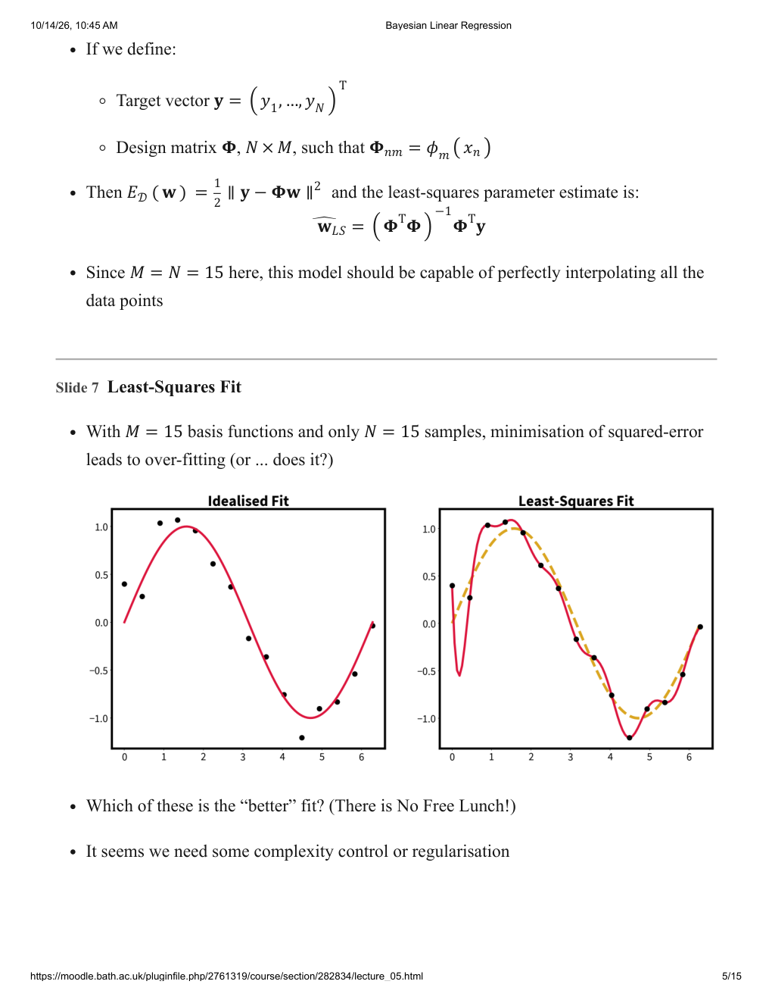

Which of these is the “better” fit? (There is No Free Lunch!)

- It seems we need some complexity control or regularisation.

Original page 5 (figures and equation layout)

## Page 6

### Penalised Least-Squares

### Slide 8: Complexity Control: Regularisation

- We typically think that smoother functions are more realistic, and these generally have smaller weight values $\mathbf{w}$.
- Add a weight penalty term to the error function:

$$
E_{PLS}(\mathbf{w})=E_{\mathcal{D}}(\mathbf{w})+\lambda\cdot E_W(\mathbf{w}).
$$

A standard choice of regulariser is the squared-weight penalty:

$$
E_W(\mathbf{w})=\frac12\sum_{m=1}^{M}w_m^2.
$$

This gives the penalised least-squares (PLS) estimate:

$$
\hat{\mathbf{w}}_{PLS}=(\boldsymbol{\Phi}^{\mathsf{T}}\boldsymbol{\Phi}+\lambda\mathbf{I})^{-1}\boldsymbol{\Phi}^{\mathsf{T}}\mathbf{y}.
$$

Also referred to as **ridge regression**.

### Slide 9: Regularisation: Effect of $\lambda$

The hyper-parameter $\lambda$ balances the trade-off between $E_{\mathcal{D}}$ and $E_W$: between how well the function fits the data and how smooth it is.

Original page 6 (figures and equation layout)

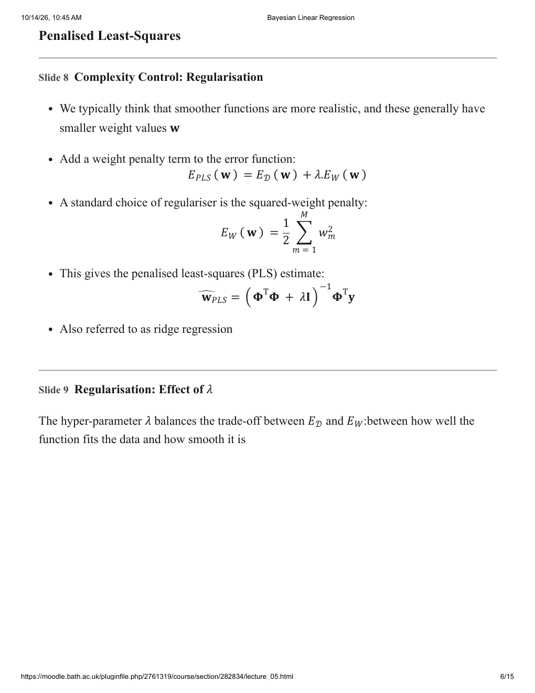

## Page 7

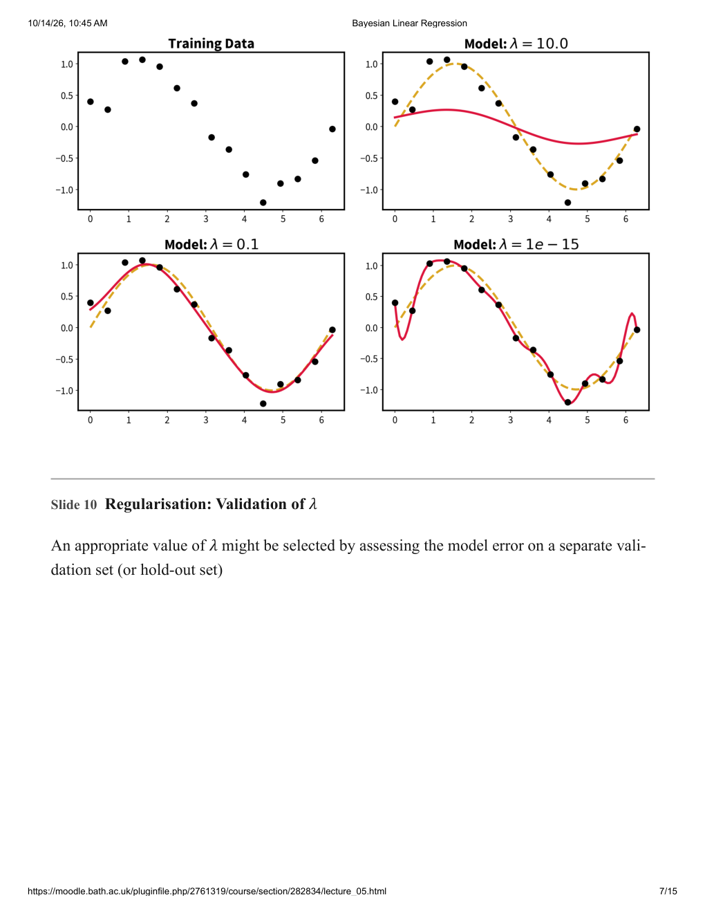

### Slide 10: Regularisation: Validation of $\lambda$

An appropriate value of $\lambda$ might be selected by assessing the model error on a separate **validation set** (or **hold-out set**).

Original page 7 (figures and equation layout)

## Page 8

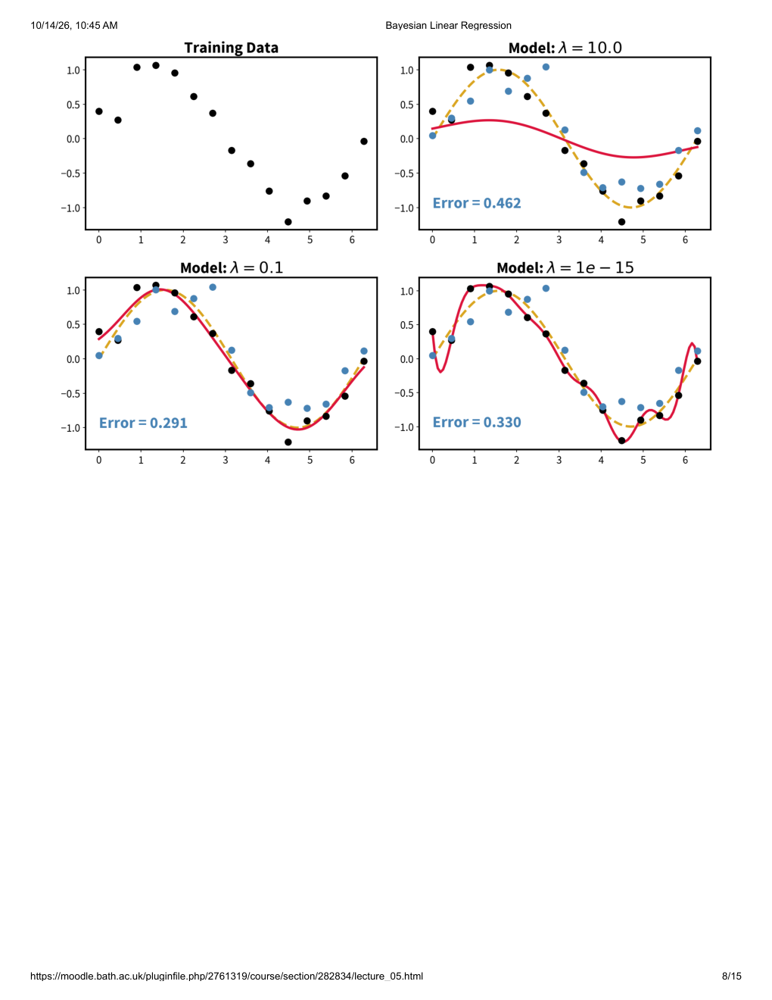

Original page 8 (figures and equation layout)

## Page 9

### Slide 11: Regularisation: Validation of $\lambda$ (Over a broad range)

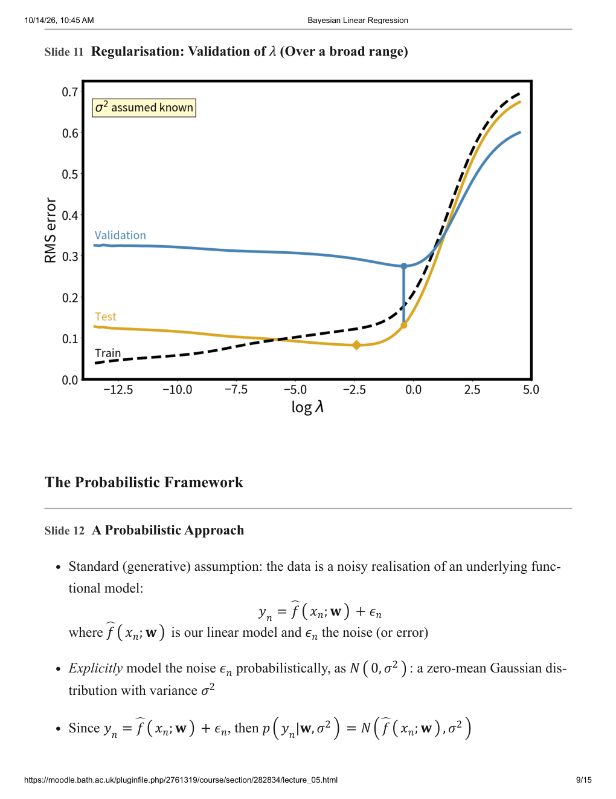

### The Probabilistic Framework

### Slide 12: A Probabilistic Approach

- Standard (generative) assumption: the data is a noisy realisation of an underlying functional model:

$$
y_n=\hat{f}(x_n;\mathbf{w})+\epsilon_n,
$$

where $\hat{f}(x_n;\mathbf{w})$ is our linear model and $\epsilon_n$ the noise (or error).

- Explicitly model the noise $\epsilon_n$ probabilistically, as $N(0,\sigma^2)$: a zero-mean Gaussian distribution with variance $\sigma^2$.
- Since $y_n=\hat{f}(x_n;\mathbf{w})+\epsilon_n$, then $p(y_n\mid\mathbf{w},\sigma^2)=N(\hat{f}(x_n;\mathbf{w}),\sigma^2)$.

Original page 9 (figures and equation layout)

## Page 10

Assuming i.i.d. data (as usual), the observation model (or likelihood) is:

$$
\begin{aligned}
p(\mathbf{y}\mid\mathbf{w},\sigma^2)
&=\prod_{n=1}^{N}p(y_n\mid\mathbf{w},\sigma^2)\\
&=(2\pi\sigma^2)^{-N/2}\prod_{n=1}^{N}\exp\left\{-\frac{[y_n-\hat{f}(x_n;\mathbf{w})]^2}{2\sigma^2}\right\}.
\end{aligned}
$$

### Slide 13: Maximum Likelihood and Least-Squares

- The maximum-likelihood estimate (M.L.E.) for $\mathbf{w}$ is that value which maximises $p(\mathbf{y}\mid\mathbf{w},\sigma^2)$.
- This is identical to the least-squares solution $\hat{\mathbf{w}}_{LS}$ (unregularised).
- To see this, note that:
  - Maximising the likelihood is equivalent to minimising the negative logarithm of the likelihood as $\log(p)$ is monotonic.
  - And this is equivalent to minimising squared-error:

$$
-\log p(\mathbf{y}\mid\mathbf{w},\sigma^2)
=\frac{N}{2}\log(2\pi\sigma^2)+\frac{1}{2\sigma^2}\sum_{n=1}^{N}[y_n-\hat{f}(x_n;\mathbf{w})]^2.
$$

The quantity $-\log p(\mathbf{y}\mid\mathbf{w},\sigma^2)$ is the **negative log-likelihood**.

### Bayesian Regression Framework

### Slide 14: The Bayesian Framework: Incorporating Priors

- Instead of the regularisation weight penalty $E_W(\mathbf{w})$, we now control the model’s complexity via a prior distribution which expresses our degree of belief, or our preference, over values that $\mathbf{w}$ might take.
- A convenient (conjugate) choice is:

$$
p(\mathbf{w}\mid\alpha)=\prod_{m=1}^{M}\left(\frac{\alpha}{2\pi}\right)^{1/2}\exp\left\{-\frac{\alpha}{2}w_m^2\right\}.
$$

Original page 10 (figures and equation layout)

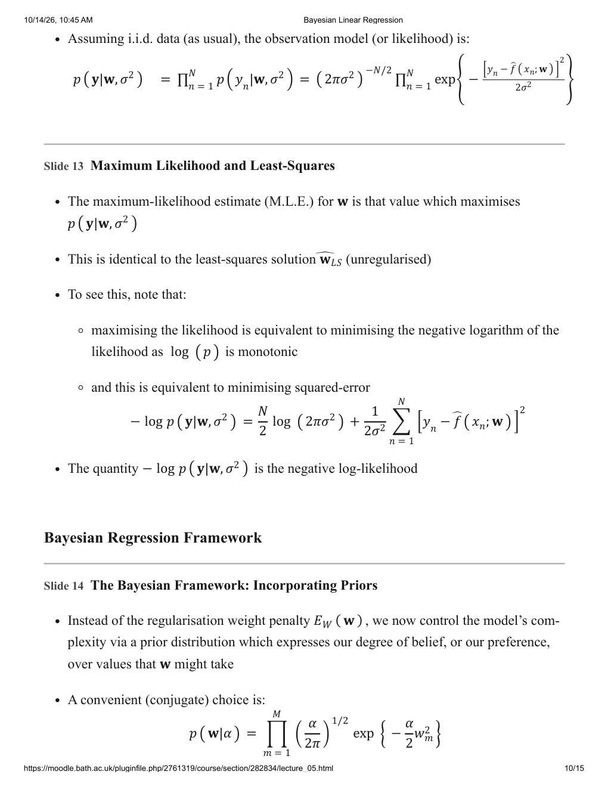

## Page 11

This is a zero-mean Gaussian prior, independent for each weight, with common inverse variance (precision) hyper-parameter $\alpha$.

**Key feature of the Bayesian framework:** Rather than penalising larger weights, we express a preference for smoother models by declaring smaller weights to be *a priori* more probable.

### Slide 15: Bayesian Inference

Given the likelihood and the prior, rather than computing a single point estimate $\hat{\mathbf{w}}_{PLS}$ for the weights, we compute the posterior distribution via Bayes’ rule:

$$
p(\mathbf{w}\mid\mathbf{y},\alpha,\sigma^2)
=\frac{\text{likelihood}\times\text{prior}}{\text{normalising factor}}
=\frac{p(\mathbf{y}\mid\mathbf{w},\sigma^2)p(\mathbf{w}\mid\alpha)}{p(\mathbf{y}\mid\alpha,\sigma^2)}.
$$

Here, since the prior is conjugate, the posterior is conveniently also Gaussian: $p(\mathbf{w}\mid\mathbf{y},\alpha,\sigma^2)=N(\boldsymbol{\mu},\boldsymbol{\Sigma})$ with

$$
\begin{aligned}
\boldsymbol{\mu}&=(\boldsymbol{\Phi}^{\mathsf{T}}\boldsymbol{\Phi}+\sigma^2\alpha\mathbf{I})^{-1}\boldsymbol{\Phi}^{\mathsf{T}}\mathbf{y},\\
\boldsymbol{\Sigma}&=\sigma^2(\boldsymbol{\Phi}^{\mathsf{T}}\boldsymbol{\Phi}+\sigma^2\alpha\mathbf{I})^{-1}.
\end{aligned}
$$

### “Bayesian” MAP Estimation

### Slide 16: MAP Estimation — a “Bayesian” Short-cut

- The maximum a posteriori (MAP) estimate for $\mathbf{w}$ is the single most probable value under the posterior $p(\mathbf{w}\mid\mathbf{y},\alpha,\sigma^2)$.
- Since the denominator in Bayes’ rule earlier is independent of $\mathbf{w}$, this is equivalent to minimising:

$$
E_{MAP}(\mathbf{w})=-\log p(\mathbf{y}\mid\mathbf{w},\sigma^2)-\log p(\mathbf{w}\mid\alpha).
$$

Retaining only terms which depend on $\mathbf{w}$:

$$
E_{MAP}(\mathbf{w})=\frac{1}{2\sigma^2}\sum_{n=1}^{N}\{y_n-\hat{f}(x_n;\mathbf{w})\}^2+\frac{\alpha}{2}\sum_{m=1}^{M}w_m^2.
$$

Original page 11 (figures and equation layout)

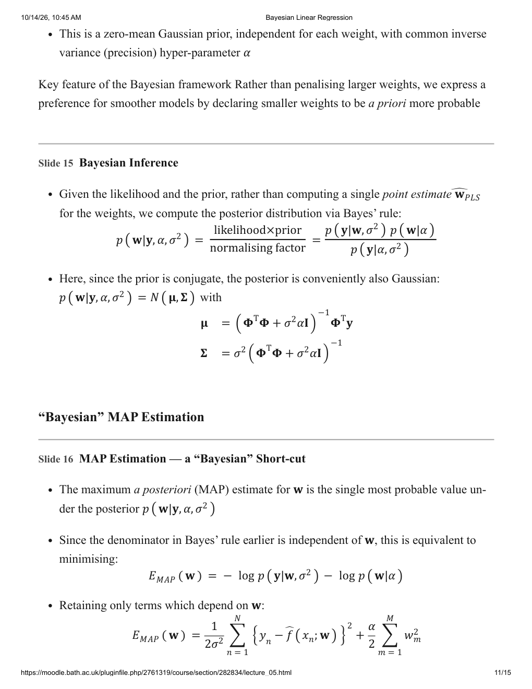

## Page 12

The MAP estimate is therefore identical to the PLS estimate with $\lambda=\sigma^2\alpha$. As a result: $\boldsymbol{\mu}=\hat{\mathbf{w}}_{PLS}$.

### Step-by-Step Example of Bayesian Learning

### Slide 17: Example: Bayesian “Learning”

- Let’s look at how the posterior $p(\mathbf{w}\mid\mathbf{y},\alpha,\sigma^2)$ evolves as we observe data $y_n$.
  - For demonstration purposes, $\alpha$ and $\sigma^2$ are set to some fixed values here.
- Note that we can compute the posterior incrementally if the data are assumed independent (given $\mathbf{w}$). E.g. for $\mathbf{y}=(y_1,y_2,y_3)$:

$$
\begin{aligned}
p(\mathbf{w}\mid y_1,y_2,y_3)
&\propto p(y_1,y_2,y_3\mid\mathbf{w})p(\mathbf{w})\\
&\propto p(y_2,y_3\mid\mathbf{w})p(y_1\mid\mathbf{w})p(\mathbf{w})\\
&\propto \text{Likelihood of }(y_2,y_3)\times\text{posterior given }y_1.
\end{aligned}
$$

So, more generally, we can treat the posterior having observed $(y_1,\ldots,y_K)$ as the “prior” for the remaining data $(y_{K+1},\ldots,y_N)$.

### Slide 18: Sequential Bayesian Learning

The prior distribution, before observing data.

We focus on weights 9 and 10 (basis functions highlighted in blue).

Original page 12 (figures and equation layout)

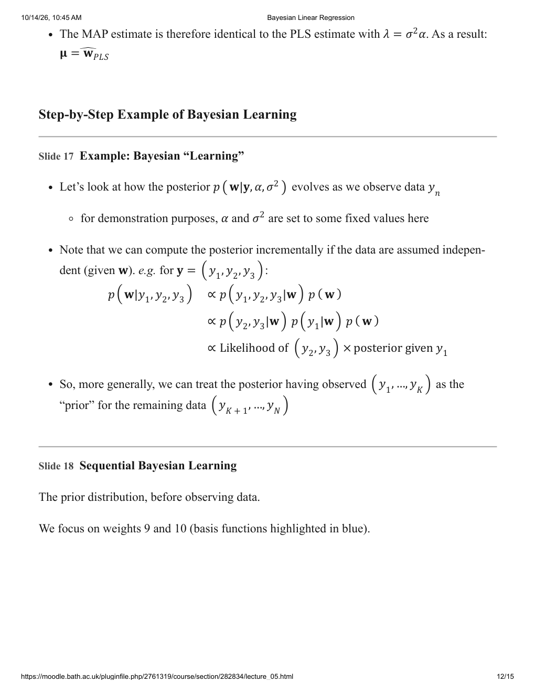

## Page 13

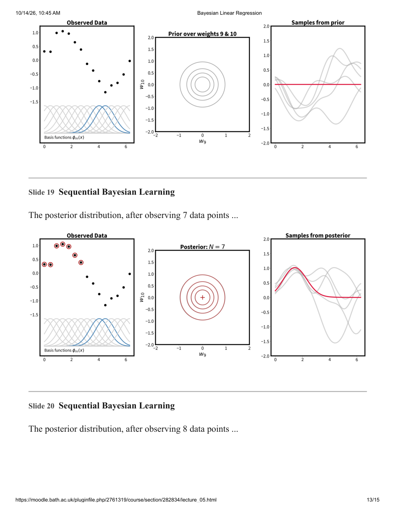

### Slide 19: Sequential Bayesian Learning

The posterior distribution, after observing 7 data points ...

### Slide 20: Sequential Bayesian Learning

The posterior distribution, after observing 8 data points ...

Original page 13 (figures and equation layout)

## Page 14

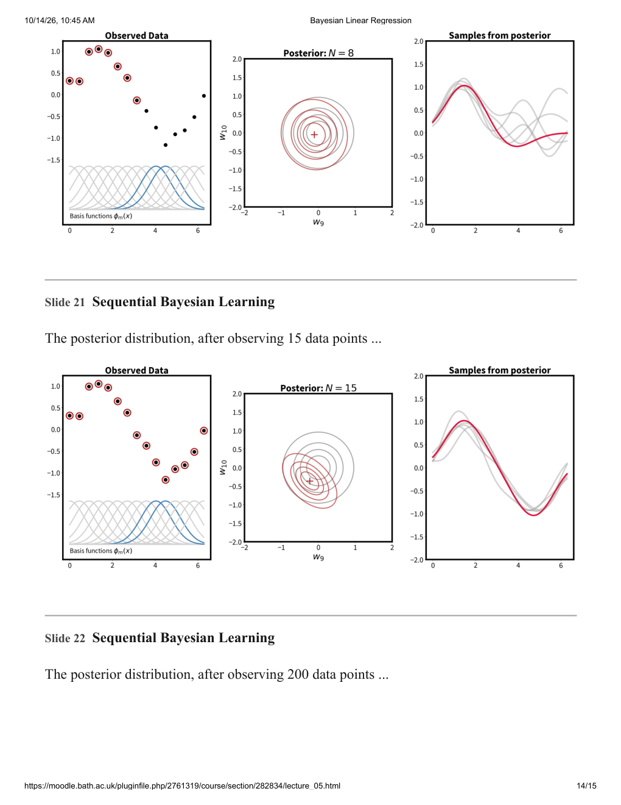

### Slide 21: Sequential Bayesian Learning

The posterior distribution, after observing 15 data points ...

### Slide 22: Sequential Bayesian Learning

The posterior distribution, after observing 200 data points ...

Original page 14 (figures and equation layout)

## Page 15

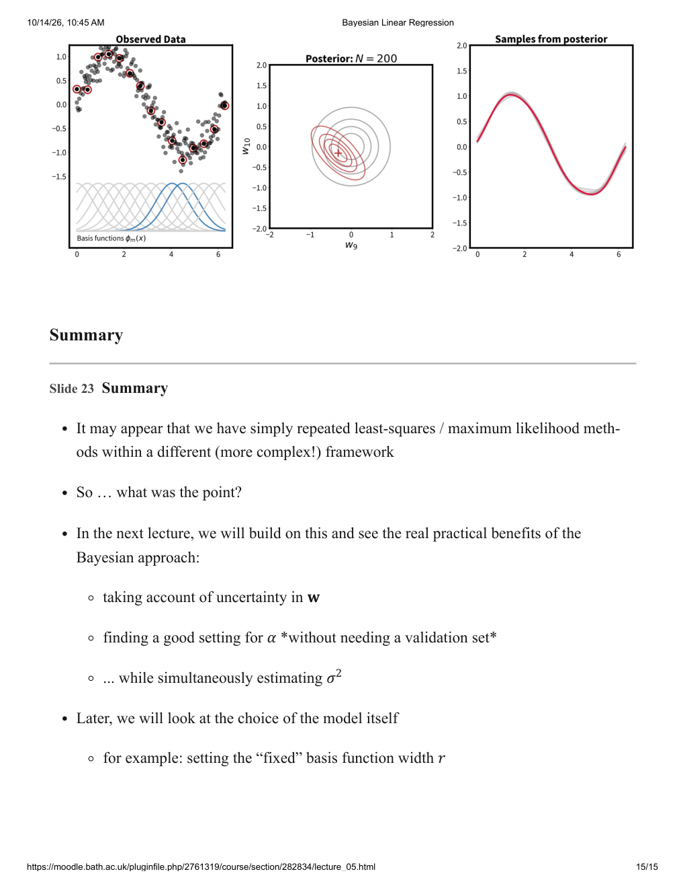

### Summary

### Slide 23: Summary

- It may appear that we have simply repeated least-squares / maximum likelihood methods within a different (more complex!) framework.
- So … what was the point?
- In the next lecture, we will build on this and see the real practical benefits of the Bayesian approach:
  - Taking account of uncertainty in $\mathbf{w}$.
  - Finding a good setting for $\alpha$ *without needing a validation set*.
    - ... while simultaneously estimating $\sigma^2$.
- Later, we will look at the choice of the model itself.
  - For example: setting the “fixed” basis function width $r$.

Original page 15 (figures and equation layout)

