# Marginalisation & Type-II Maximum Likelihood

## Realising the Power of Bayesian Inference

**Author:** Edward Milsom

**Date:** 2026-10-02

**Source:** [Lecture 6 PDF](6.pdf)

## Page 1

### Slide 1: In this Episode ...

- Maximum a posteriori (MAP) estimation — brief review.
- Marginalisation: the Bayesian way to make predictions.
- Type-II maximum likelihood: approximate inference in the Bayesian linear regression model.
- The marginal likelihood and “Occam’s razor”.
- Inferring both hyper-parameter $\alpha$ and noise level $\sigma^2$ from the training data.
- Prediction revisited.

Original page 1 (figures and equation layout)

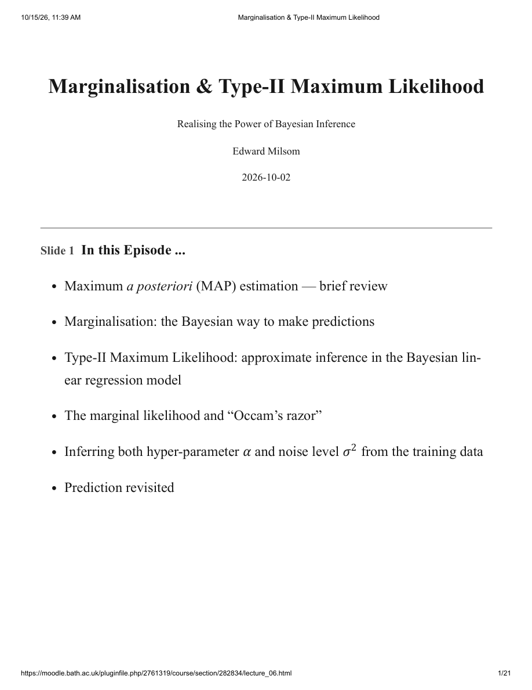

## Page 2

## Recap

### Slide 2: Recap: Bayesian MAP Estimation

The posterior distribution, and posterior mean (MAP) predictor (right), after observing the 15 data points are shown in the original page: observed data and basis functions, weight-posterior contours, and a fitted curve with posterior samples.

**Note:** We had assumed we knew the generative noise variance $\sigma^2$ and arbitrarily chose a “reasonable value” of $\alpha$.

### Slide 3: MAP -vs- Marginalisation

- In linear regression, the maximum a posteriori (MAP) estimate is equivalent to the penalised least-squares (PLS) estimate: $\boldsymbol\mu=\widehat{\mathbf w}_{PLS}$.
- It might be thought that the Bayesian framework is simply a probabilistic reinterpretation of classical methods.
- This is not the case!

Original page 2 (figures and equation layout)

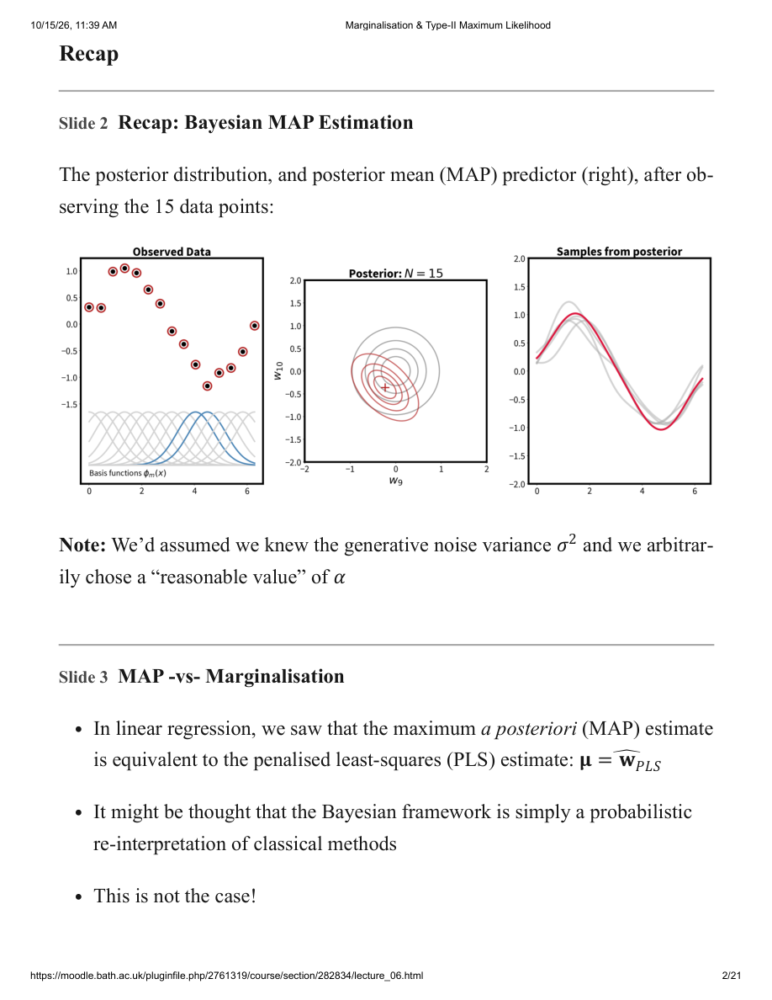

## Page 3

- The distinguishing element of Bayesian methods is marginalisation: integrating out all nuisance variables.
- This is a powerful component of the Bayesian framework.

**Key point (source wording):** Maximum a posteriori (MAP) parameter estimation is not “Bayesian”!!

**Interpretive caveat:** MAP is obtained from a Bayesian posterior, but a point estimate alone does not propagate posterior uncertainty. The emphasis is on marginalisation, not a denial of MAP’s Bayesian derivation.

### Slide 4: Recap: The Bayesian Linear Regression Framework

Likelihood model (same as orthodox):

$$p(\mathbf y\mid\mathbf w,\sigma^2)=(2\pi\sigma^2)^{-N/2}\prod_{n=1}^{N}\exp\left\{-\frac{[y_n-\widehat f(x_n;\mathbf w)]^2}{2\sigma^2}\right\}.$$

Prior, incorporating precision hyper-parameter $\alpha$:

$$p(\mathbf w\mid\alpha)=\prod_{m=1}^{M}\left(\frac\alpha{2\pi}\right)^{1/2}\exp\left\{-\frac\alpha2w_m^2\right\}.$$

Posterior from Bayes’ rule: $p(\mathbf w\mid\mathbf y,\alpha,\sigma^2)=\mathcal N(\boldsymbol\mu,\boldsymbol\Sigma)$, with

$$\boldsymbol\mu=(\boldsymbol\Phi^{\mathsf T}\boldsymbol\Phi+\sigma^2\alpha\mathbf I)^{-1}\boldsymbol\Phi^{\mathsf T}\mathbf y=\widehat{\mathbf w}_{PLS},$$

$$\boldsymbol\Sigma=\sigma^2(\boldsymbol\Phi^{\mathsf T}\boldsymbol\Phi+\sigma^2\alpha\mathbf I)^{-1}.$$

Original page 3 (figures and equation layout)

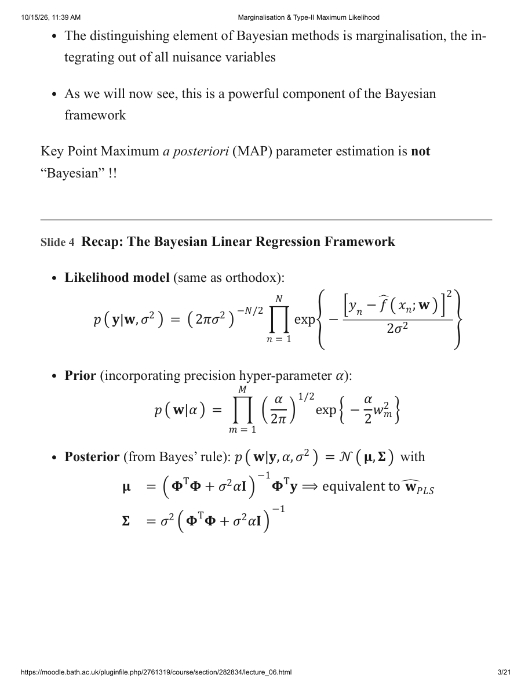

## Page 4

## Being “Strictly Bayesian”

### Slide 5: Strictly Bayesian: the Full Predictive Framework (1)

For any model, to predict $y_*$ at $x_*$ given training data $\mathbf y$, what we really want is

$$p(y_*\mid x_*,\mathbf y).$$

The slide subsequently suppresses the input and writes $p(y_*\mid\mathbf y)$.

### Slide 6: Strictly Bayesian: the Full Predictive Framework (2)

So far, we have only placed a prior over weights $\mathbf w$. To be strictly Bayesian we should define:

- $p(\alpha)$: a hyper-prior over the hyper-parameter;
- $p(\sigma^2)$: a prior over the noise variance.

Compute the full posterior over all nuisance variables $p(\mathbf w,\alpha,\sigma^2\mid\mathbf y)$ and use it for prediction:

$$p(y_*\mid\mathbf y)=\int p(y_*\mid\mathbf w,\alpha,\sigma^2)p(\mathbf w,\alpha,\sigma^2\mid\mathbf y)\,d\mathbf w\,d\alpha\,d\sigma^2.$$

This incorporates uncertainty over all unknown parameters by averaging over their likely values after seeing the data.

Original page 4 (figures and equation layout)

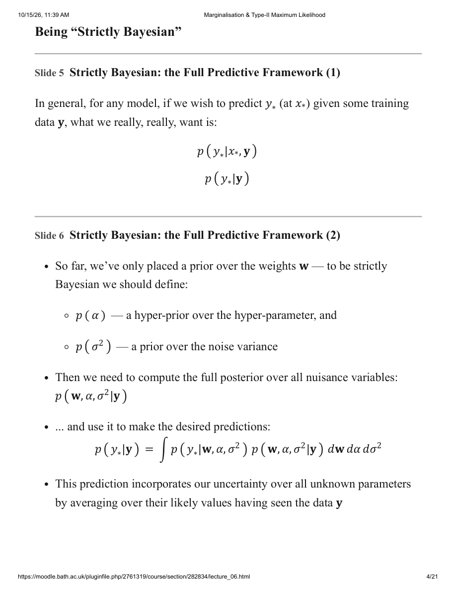

## Page 5

### Slide 7: Strictly Bayesian: the Full Predictive Framework (3)

The joint posterior over all unknowns follows from Bayes’ rule:

$$p(\mathbf w,\alpha,\sigma^2\mid\mathbf y)=\frac{p(\mathbf y\mid\mathbf w,\sigma^2)p(\mathbf w\mid\alpha)p(\alpha)p(\sigma^2)}{p(\mathbf y)}.$$

The normalising factor is the “fully marginalised” likelihood:

$$p(\mathbf y)=\int p(\mathbf y\mid\mathbf w,\sigma^2)p(\mathbf w\mid\alpha)p(\alpha)p(\sigma^2)\,d\mathbf w\,d\alpha\,d\sigma^2.$$

It is nearly always analytically intractable, but is extremely useful even when approximated.

### Slide 8: Making Predictions: Summary of Approaches

The source presents these in increasing order of “morality” (pedagogical wording):

| Framework | Learned quantity | Prediction | Lecture(s) |
| --- | --- | --- | --- |
| Orthodox | $\widehat{\mathbf w}_{PLS}$ | $\widehat f(x_*;\widehat{\mathbf w}_{PLS})$ | 5 |
| MAP | $p(\mathbf w\mid\mathbf y,\alpha,\sigma^2)$ | $p(y_*\mid\widehat{\mathbf w}_{MAP},\sigma^2)$ | 5 |
| Basic Bayesian | $p(\mathbf w\mid\mathbf y,\alpha,\sigma^2)$ | $p(y_*\mid\mathbf y,\alpha,\sigma^2)$ | 5 |
| Type-II Bayesian | $p(\mathbf w\mid\mathbf y,\widehat\alpha_{MP},\widehat\sigma^2_{MP})$, $\widehat\alpha_{MP},\widehat\sigma^2_{MP}$ | $p(y_*\mid\mathbf y,\widehat\alpha_{MP},\widehat\sigma^2_{MP})$ | 6 |

The strict Bayesian row continues on page 6.

Original page 5 (figures and equation layout)

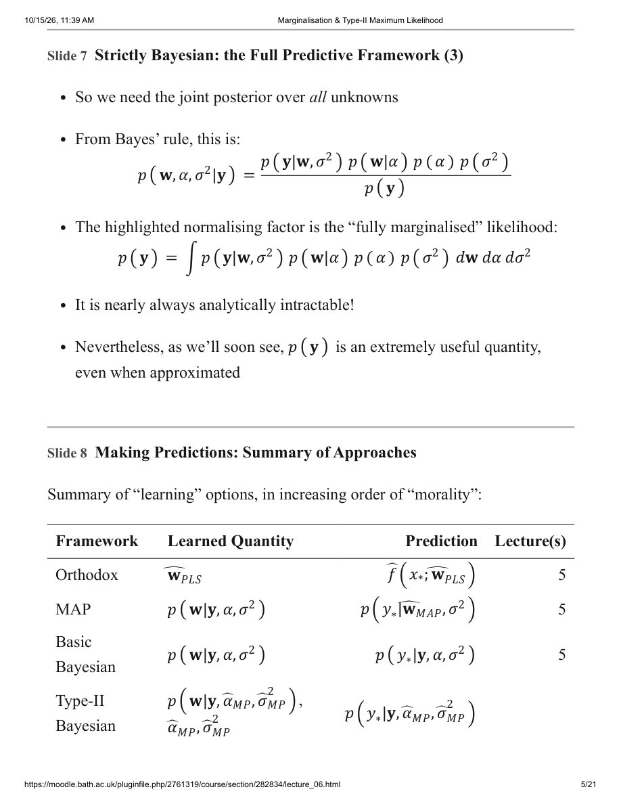

## Page 6

| Framework | Learned quantity | Prediction | Lecture(s) |
| --- | --- | --- | --- |
| Strict Bayesian | $p(\mathbf w,\alpha,\sigma^2\mid\mathbf y)$ | $p(y_*\mid\mathbf y)$ | 7–10 |

Colour in the source indicates whether parameter uncertainty is fully modelled, approximately captured, or ignored.

### Slide 9: The Analytic Roadblock

Strict Bayesian inference in this model would be

$$p(y_*\mid\mathbf y)=\int p(y_*\mid\mathbf w,\sigma^2)p(\mathbf w,\alpha,\sigma^2\mid\mathbf y)\,d\mathbf w\,d\alpha\,d\sigma^2.$$

The source says neither the joint posterior nor predictive distribution can be computed analytically. Alternative approach:

1. Perform analytically computable integrations (in some very specific cases, one or two hyperparameters can also be marginalised).
2. Approximate remaining terms or entire integrals, perhaps by Type-II maximum likelihood ...

Original page 6 (figures and equation layout)

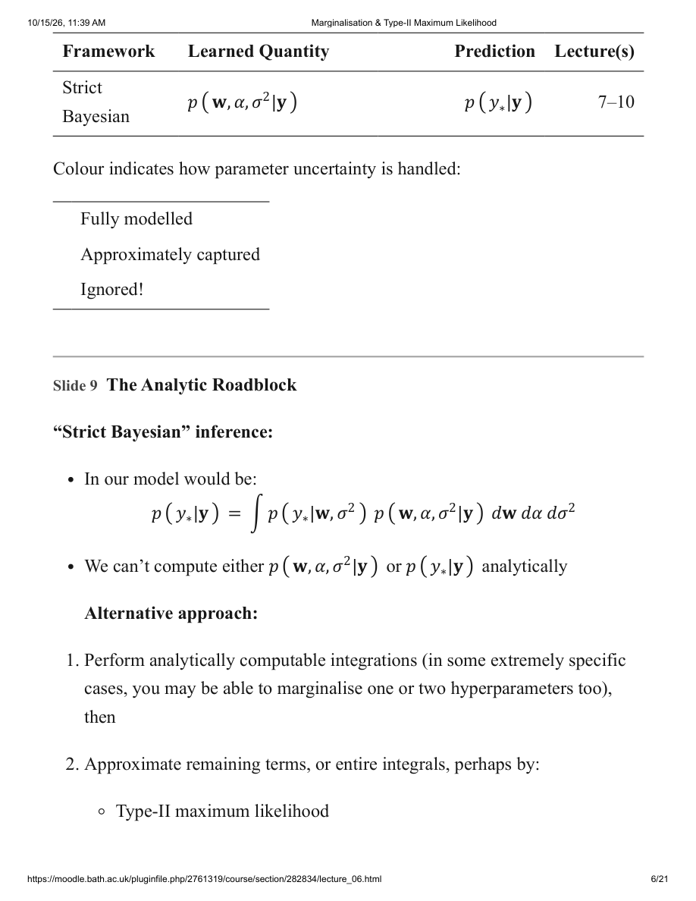

## Page 7

... Laplace’s method, Monte-Carlo sampling, or variational techniques.

## Type-II Maximum Likelihood

### Slide 10: Type-II Maximum Likelihood (1)

By the product rule,

$$p(\mathbf w,\alpha,\sigma^2\mid\mathbf y)=p(\mathbf w\mid\mathbf y,\alpha,\sigma^2)p(\alpha,\sigma^2\mid\mathbf y).$$

The first term is the Gaussian weight posterior $\mathcal N(\mathbf w;\boldsymbol\mu,\boldsymbol\Sigma)$. The second term is intractable: approximate it very coarsely by a delta function at its mode. Find most probable values $\widehat\alpha_{MP},\widehat\sigma^2_{MP}$ maximising

$$p(\alpha,\sigma^2\mid\mathbf y)=\frac{p(\mathbf y\mid\alpha,\sigma^2)p(\alpha)p(\sigma^2)}{p(\mathbf y)}.$$

### Slide 11: Type-II Maximum Likelihood (2)

We want to maximise this hyperparameter posterior:

$$p(\alpha,\sigma^2\mid\mathbf y)=\frac{p(\mathbf y\mid\alpha,\sigma^2)p(\alpha)p(\sigma^2)}{p(\mathbf y)}.$$

Original page 7 (figures and equation layout)

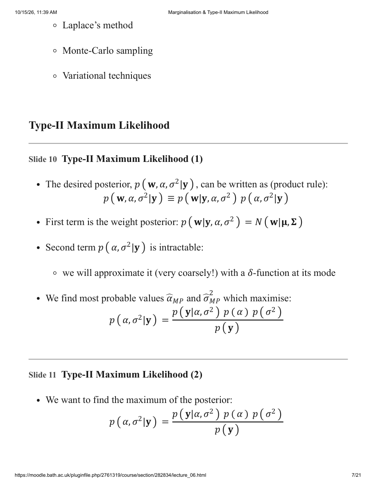

## Page 8

- The source states that flat uninformative priors over $\log\alpha$ and $\log\sigma$ make this equivalent to maximising $p(\mathbf y\mid\alpha,\sigma^2)$.
- This is the marginal likelihood (or “evidence”).
- The procedure is known as Type-II maximum likelihood, or in certain contexts the evidence procedure.

**Parameterisation caveat (supporting clarification):** Flat density in log coordinates is not flat density in positive scale coordinates. Evidence maximisation corresponds to a posterior mode in log coordinates under flat log-priors, not generally the mode of the density $p(\alpha,\sigma^2\mid\mathbf y)$ as written on slide 11. MAP depends on parameterisation. Such improper priors also need care for fully normalised evidence.

### Slide 12: The Marginal Likelihood (1)

To find the most probable hyperparameters, maximise

$$p(\mathbf y\mid\alpha,\sigma^2)=\int p(\mathbf y\mid\mathbf w,\sigma^2)p(\mathbf w\mid\alpha)\,d\mathbf w$$

$$=(2\pi)^{-N/2}|\sigma^2\mathbf I+\alpha^{-1}\boldsymbol\Phi\boldsymbol\Phi^{\mathsf T}|^{-1/2}\exp\left\{-\frac12\mathbf y^{\mathsf T}(\sigma^2\mathbf I+\alpha^{-1}\boldsymbol\Phi\boldsymbol\Phi^{\mathsf T})^{-1}\mathbf y\right\}.$$

This is a zero-mean Gaussian density over the single $N$-dimensional dataset vector $\mathbf y$, with $N\times N$ covariance

$$\sigma^2\mathbf I+\alpha^{-1}\boldsymbol\Phi\boldsymbol\Phi^{\mathsf T}.$$

It gives a probability density for the entire dataset conditional on $\alpha,\sigma^2$ (the source calls this a “probability”).

### Slide 13: The Marginal Likelihood (2)

Computing the marginal likelihood is straightforward: it is a Gaussian p.d.f., although high-dimensional.

Original page 8 (figures and equation layout)

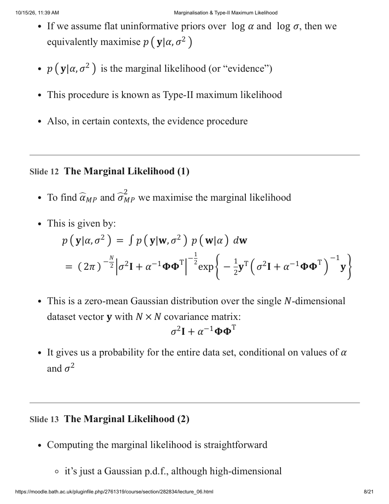

## Page 9

Having computed it, we can evaluate it over a range of $\alpha,\sigma^2$ or apply iterative gradient methods to maximise it directly.

We can use all the training data to determine $\widehat\alpha_{MP},\widehat\sigma^2_{MP}$ without reserving a separate validation set for this selection criterion: marginal likelihood already accounts for model complexity (Occam’s razor).

This is not “strictly Bayesian”, but is more faithful to uncertainty propagation and practically useful than MAP estimation of weights alone.

### Slide 14: Recap: Impact of Regularisation Parameter $\lambda$

An appropriate PLS regularisation value can be selected by holding out a separate validation set. The demonstration continues on page 10.

Original page 9 (figures and equation layout)

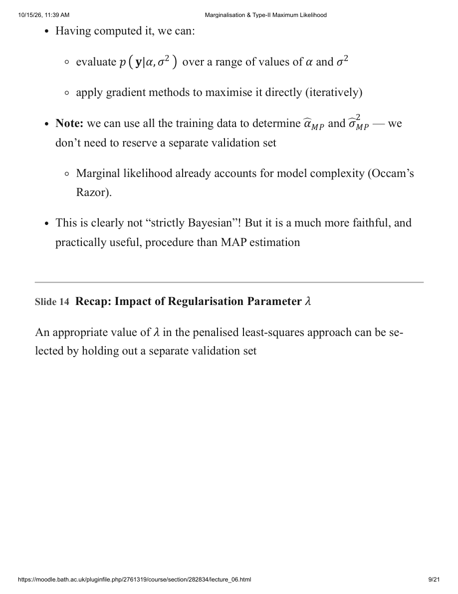

## Page 10

Continuation of slide 14: the figure compares training data and three fits. The displayed models have $\lambda=10.0$, $\lambda=0.1$, and $\lambda=10^{-15}$; their displayed errors are 0.462, 0.291, and 0.330 respectively. Strong regularisation gives a smooth underfit; near-zero regularisation produces a wiggly fit. The original figure retains the data, curves, and labels.

Original page 10 (figures and equation layout)

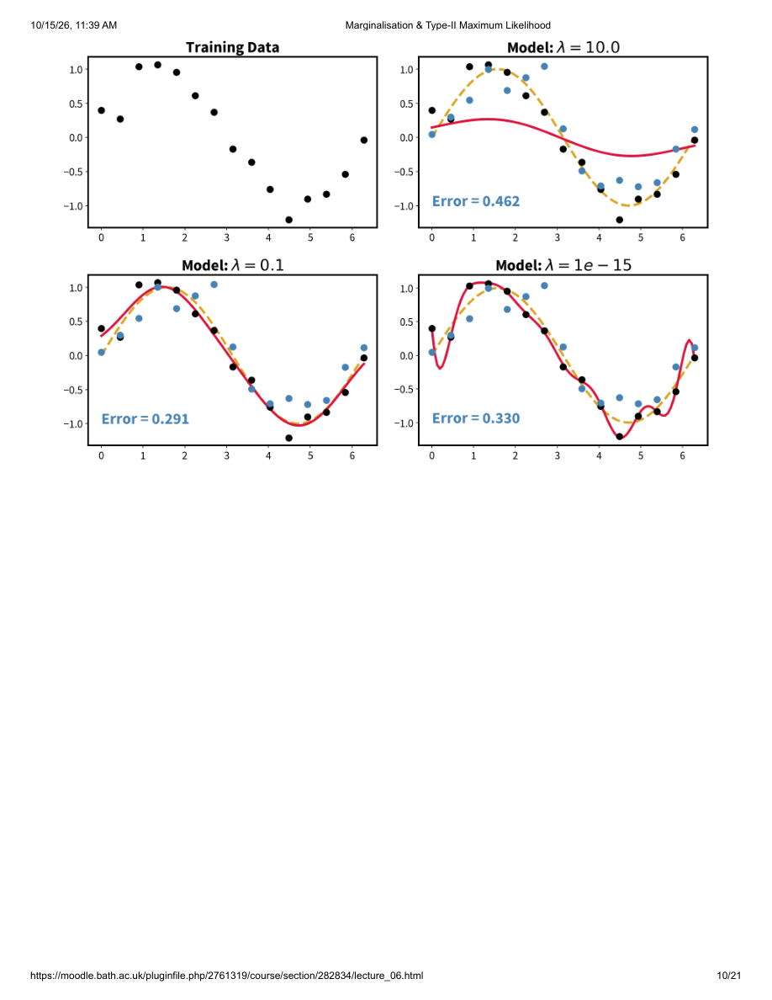

## Page 11

### Slide 15: Recap: Validation of Regularisation Parameter $\lambda$

The plot shows RMS error versus $\log\lambda$, with training (black dashed), validation (blue), and test (orange) curves. Noise variance is assumed known. The validation curve selects a regularisation strength; the test curve is shown for comparison, not used to select the validation optimum.

Original page 11 (figures and equation layout)

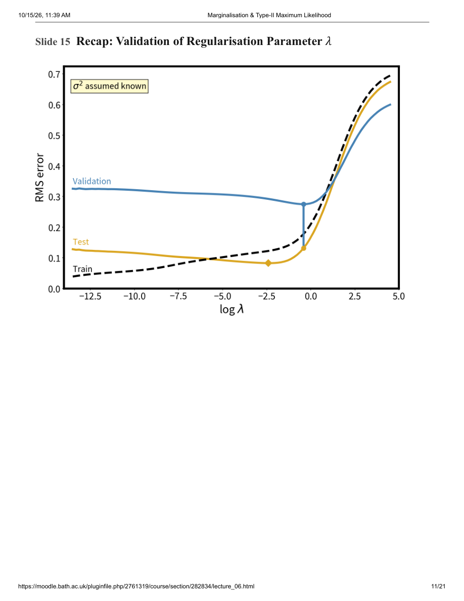

## Page 12

### Slide 16: Marginal Likelihood to Estimate Hyper-parameter $\widehat\alpha_{MP}$

The previous error curves are overlaid with a red dashed $-\log p(\mathbf y\mid\alpha,\sigma^2)$ curve on a separate right axis. Noise variance is assumed known. Minimising negative log evidence is equivalent to maximising evidence. The horizontal axis is still labelled $\log\lambda$; here $\lambda=\sigma^2\alpha$.

### Slide 17: The Bottom Line

Using only 15 examples and no validation data, the Bayesian approach for setting $\alpha$ finds a closer model to the “oracle” in this demonstration:

| | Orthodox | Bayesian | Oracle |
| --- | --- | --- | --- |
| Test error | 0.132 | 0.110 | 0.083 |

The source states that marginal likelihood penalises models both too simple and too complex, and that this is “not due to the prior”.

Original page 12 (figures and equation layout)

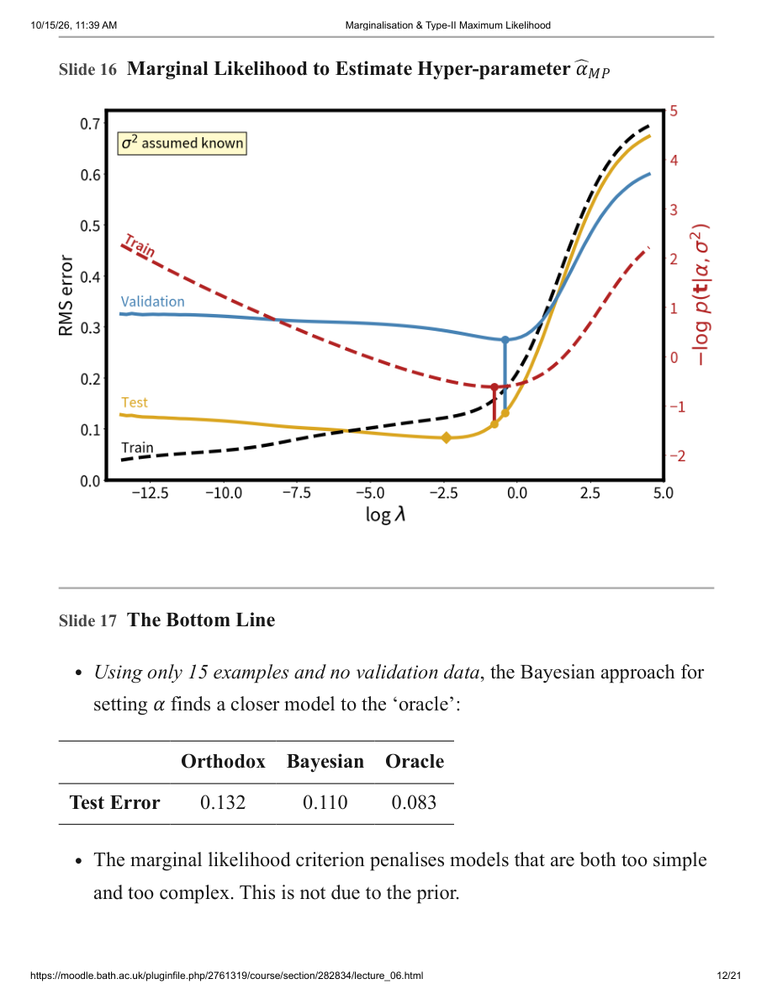

## Page 13

Reminder from slide 17: the source assumes an uninformative flat hyper-prior over $\log\alpha$, described as expressing no preference for model complexity. This effect is often referred to as Occam’s (or Ockham’s) razor.

**Qualification (supporting explanation):** There is no added hyper-prior preference for a particular log-scale value, but evidence still averages the likelihood under the weight prior $p(\mathbf w\mid\alpha)$. Its Occam effect depends on that prior and on the model; “not due to the prior” must not be read as prior independence.

## Occam’s Razor

### Slide 18: Yes, There Really is Such a Place as “Occam”

Photograph of two cyclists beside a road sign reading “Occam”. This is an illustrative aside, not a mathematical argument.

Original page 13 (figures and equation layout)

## Page 14

### Slide 19: Occam’s Razor

“Pluralitas non est ponenda sine neccesitate.” — William of Occam, 14th century (source spelling).

Literally: “entities should not be multiplied unnecessarily”. In machine learning and data science, models should be no more complex than sufficient to explain the data.

The Bayesian procedure implicitly implements Occam’s razor: it assigns lower probability to models too simple or too complex in this example.

**Key question:** Why is an intermediate value of $\alpha$ marginally more probable?

Original page 14 (figures and equation layout)

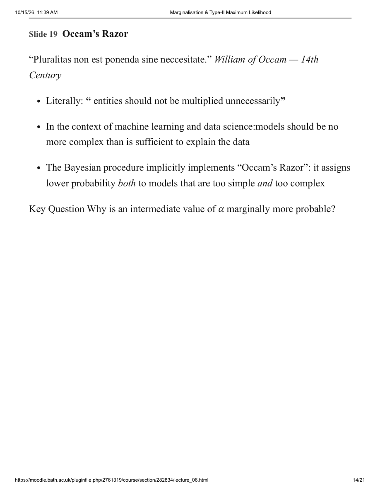

## Page 15

### Slide 20: Preference for the “Just Right” Model

The diagram has vertical axis “Marginal Model Probability $p(\mathbf t\mid\alpha)$” and horizontal axis “Space of all data sets $\mathbf t$ (increasing complexity)”. High $\alpha$ concentrates probability on a narrow set of simple datasets; medium $\alpha$ covers the noisy sine dataset indicated by a vertical dashed marker; low $\alpha$ spreads probability thinly across many possible datasets. It is a conceptual schematic, not a computed probability curve. The source uses $\mathbf t$ here for the target dataset otherwise called $\mathbf y$.

### Slide 21: Next Steps: The Noise Variance

For simplicity the noise variance had been assumed known: $\sigma=0.25$ (so $\sigma^2=0.0625$).

In the Type-II framework, concurrently optimise marginal likelihood to find both $\widehat\alpha_{MP}$ and $\widehat\sigma^2_{MP}$.

Original page 15 (figures and equation layout)

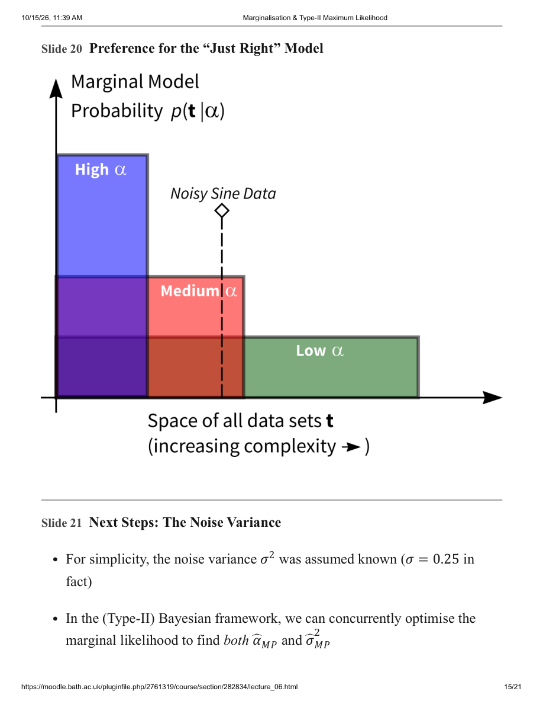

## Page 16

Again, gradient methods are possible; here the source computes $\log p(\mathbf y\mid\alpha,\sigma^2)$ over a range of both values.

**Key point (source claim):** Joint minimisation of the PLS measure $E_{PLS}(\mathbf w,\lambda,\sigma^2)$ would lead to $\lambda\to0$ and $\sigma^2\to0$ and badly overfit.

**Qualification:** This warning concerns naively tuning penalties/noise with the training-fit criterion. It is not an impossibility theorem for every non-Bayesian method; proper likelihoods include noise normalisation, and validation can tune hyperparameters.

### Slide 22: Concurrent Estimation of $\lambda$ and Observation Noise $\sigma^2$

Heat map labelled “Marginal Likelihood PDF (No Logarithm!)”, with horizontal axis $\log\lambda$ and vertical axis $\log\sigma^2$. A small bright region marks the large-density area; most of the plot appears dark. The displayed colour scale has multiplier $10^{19}$.

Original page 16 (figures and equation layout)

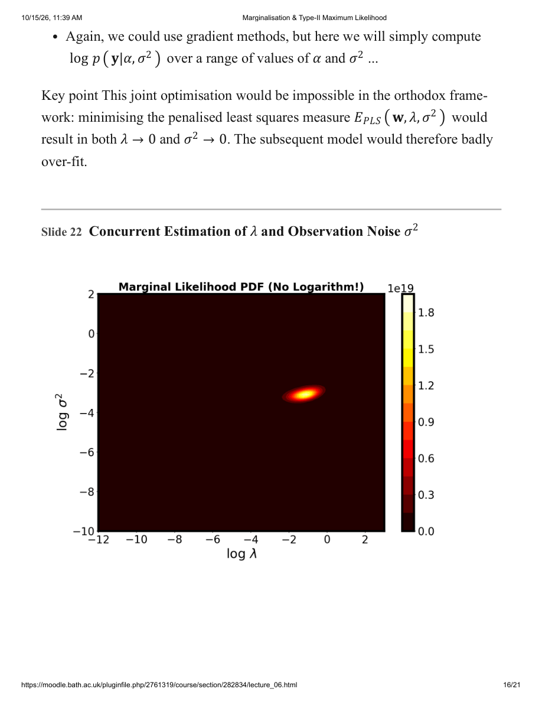

## Page 17

### Slide 23: Concurrent Estimation of $\lambda$ and Observation Noise $\sigma^2$

Heat map labelled “Log Marginal Likelihood”, now showing a much wider range of density values. The horizontal axis is labelled $\log\lambda$ and the vertical axis $\log\sigma^2$; contours reveal the joint structure hidden on the raw-density scale.

Original page 17 (figures and equation layout)

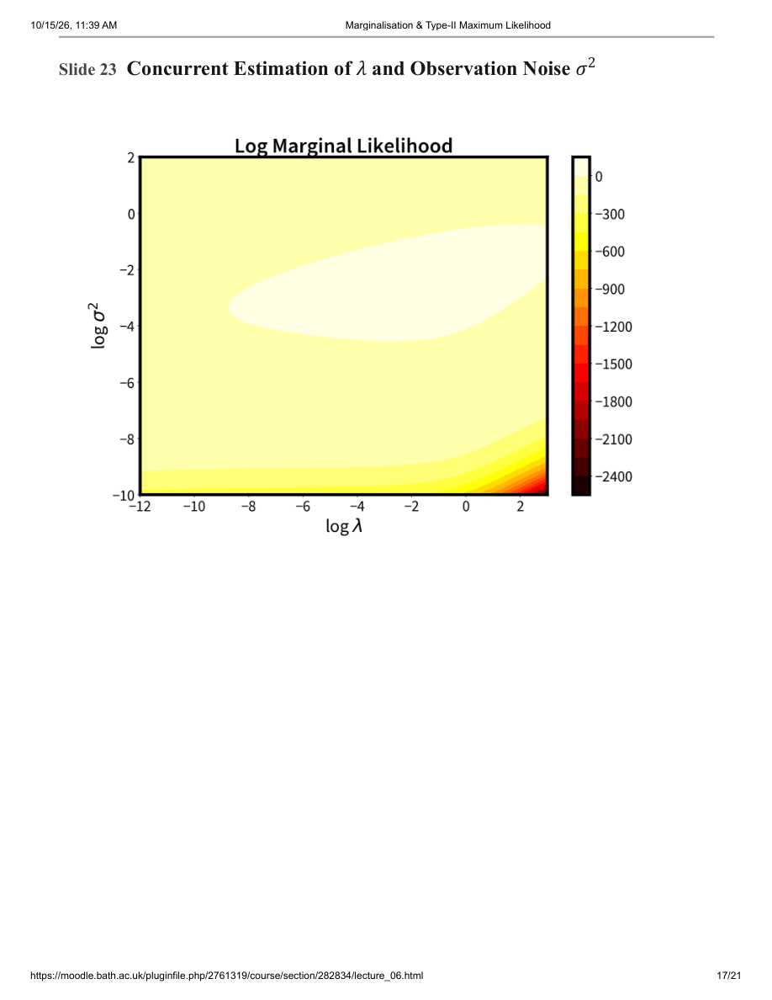

## Page 18

### Slide 24: Concurrent Estimation (Zoomed In)

A zoomed log-marginal-likelihood contour plot uses horizontal label $\log\lambda$ and vertical label $\log\sigma^2$. It marks $\widehat\sigma_{MP}=0.212$ and the true value $0.250$. These are standard deviations, despite the vertical axis being log variance.

**Supporting explanation:** All three plots (slides 22–24) use $\log\lambda$ horizontally. Under the Lecture 5 convention, $\lambda=\sigma^2\alpha$, so $\log\lambda=\log\alpha+\log\sigma^2$. This relation connects the displayed regularisation coordinate to the prior precision.

## The Predictive Distribution

### Slide 25: The Predictive Distribution: Type-II Approach

Ideally,

$$p(y_*\mid\mathbf y)=\int p(y_*\mid\mathbf w,\sigma^2)p(\mathbf w,\alpha,\sigma^2\mid\mathbf y)\,d\mathbf w\,d\alpha\,d\sigma^2.$$

Instead compute

$$p(y_*\mid\mathbf y,\widehat\alpha_{MP},\widehat\sigma^2_{MP})=\int p(y_*\mid\mathbf w,\widehat\sigma^2_{MP})p(\mathbf w\mid\mathbf y,\widehat\alpha_{MP},\widehat\sigma^2_{MP})\,d\mathbf w$$

$$=\mathcal N\bigl(y_*;\boldsymbol\phi(x_*)^{\mathsf T}\boldsymbol\mu,\sigma_*^2\bigr).$$

Original page 18 (figures and equation layout)

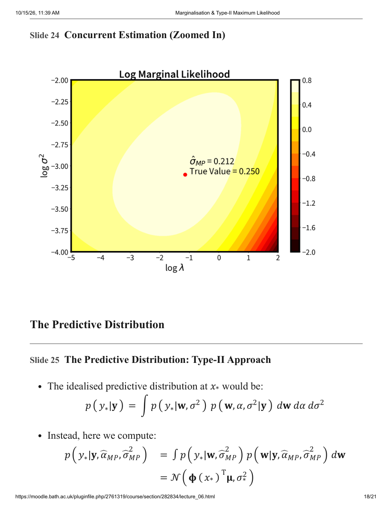

## Page 19

Continuation of slide 25: the predictive variance splits into data noise and parameter uncertainty:

$$\sigma_*^2=\widehat\sigma^2_{MP}+\boldsymbol\phi(x_*)^{\mathsf T}\boldsymbol\Sigma\boldsymbol\phi(x_*).$$

**Transcription clarification:** Some mathematical glyphs in the PDF’s small variance annotation are missing/clipped. The expression above restores the standard predictive-variance formula consistent with the labelled noise/parameter contributions and the surrounding Gaussian model; the original page remains available below.

### Slide 26: The Predictive Distribution: Type-II Approach

“Predictive Distribution with 1-$\sigma$ Error-Bars”: black training observations, a red predictive mean, a dashed reference curve, a darker band for parameter uncertainty and a lighter outer band including observation noise. The legend identifies contributions due to $\widehat\sigma^2$ and $\boldsymbol\phi^{\mathsf T}\boldsymbol\Sigma\boldsymbol\phi$.

Original page 19 (figures and equation layout)

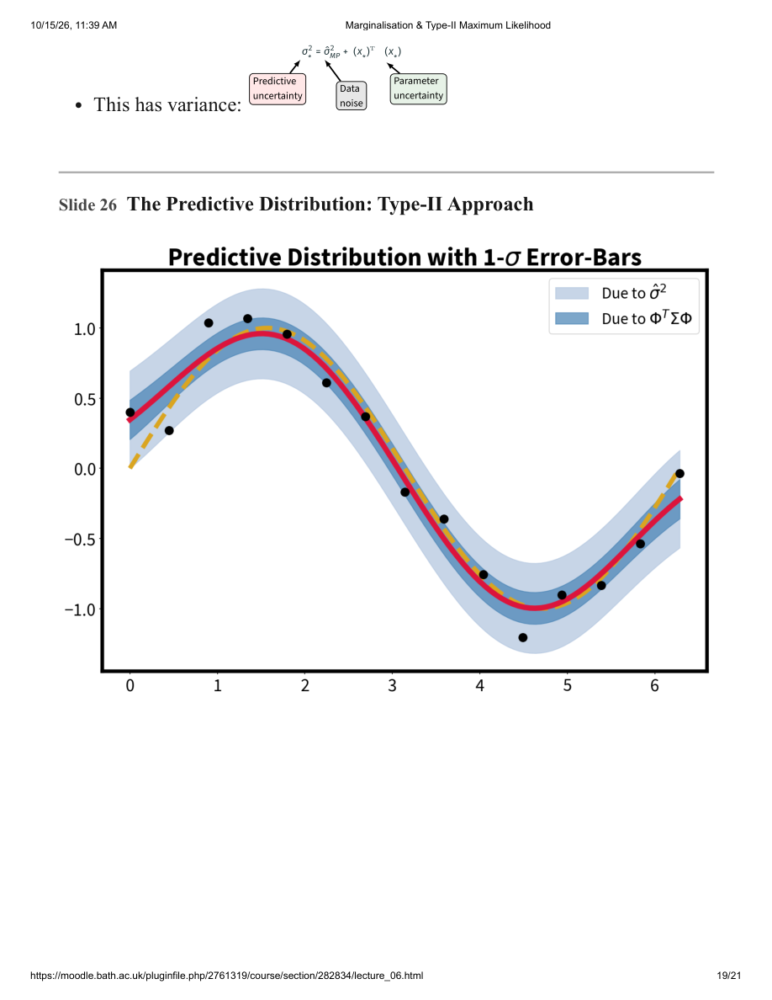

## Page 20

### Slide 27: The Predictive Distribution: Type-II Approach

A second plot with the same uncertainty decomposition is annotated “Trained on 7 out of 15 data points”. In the region without training observations, the mean differs from the dashed reference and the parameter-uncertainty band grows wider.

## Next Steps

### Slide 28: Next Steps: Other Unknowns and Model Selection

The model is also conditioned on variables ignored so far: the choice of basis set $\phi$ and its associated parameters (for Gaussian RBFs, width $r$).

Ideally define priors $P(\phi)$ and $p(r)$ and integrate those variables out when predicting.

Original page 20 (figures and equation layout)

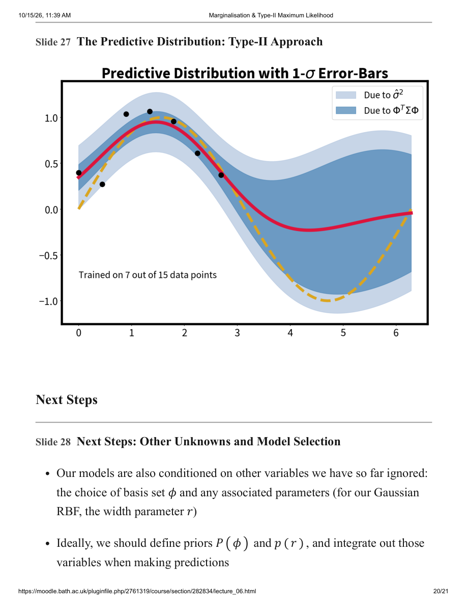

## Page 21

More simply, use $p(\mathbf y\mid\phi,r)$ as a model-selection criterion.

For this model it is feasible to integrate out $\alpha$ and $\sigma^2$ numerically to compute $p(\mathbf y\mid\phi,r)$; Lecture 7 will explore this.

Original page 21 (figures and equation layout)

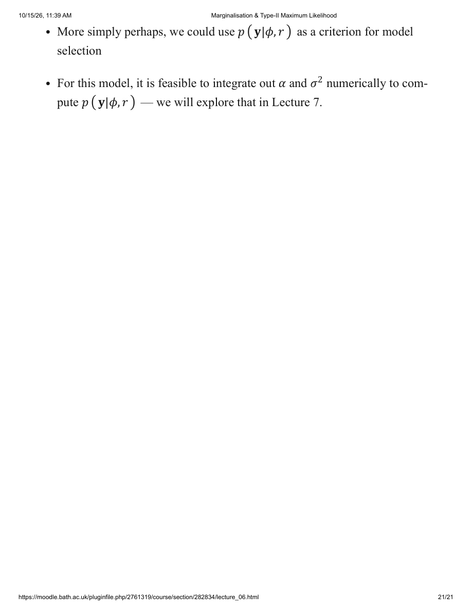

