# Fully-Bayesian Inference

## Marginalising Over All Hyperparameters

**Author:** Edward Milsom  
**Date:** 2026-10-06  
**Source:** [Lecture 7 PDF](7.pdf)

Source transcription with original-page figures. Paragraphs labelled supplemental clarify notation or interpretation rather than silently changing the source.

## Page 1

### Slide 1: In this Episode ...

- Recap: the implicit Occam’s Razor effect for $\alpha$ (and $\sigma$).
- Extending the analysis to more parameters: basis width $r$.
- Mixing marginalisation and Type-II maximum likelihood for different hyperparameters.
- Demo: not only estimating $r$, but also the predictive distribution, and selection of basis function type $\phi(\cdot)$.
- This works pretty nicely, but even in this simple model becomes a complicated mess!

Original page 1 (figures and equation layout)

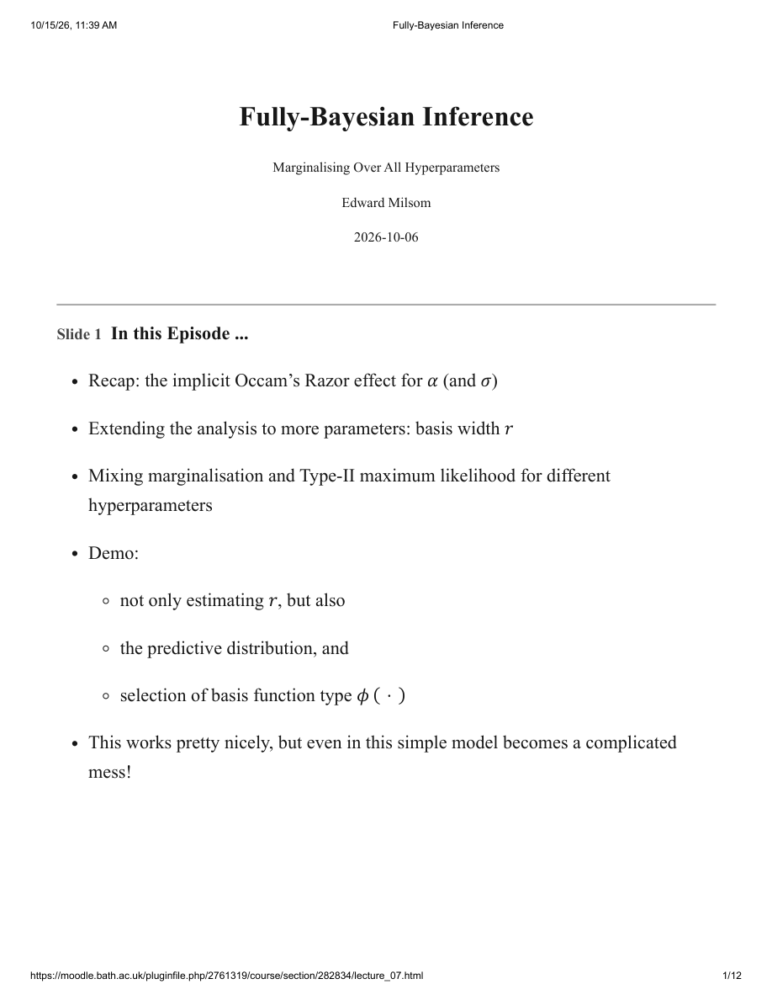

## Page 2

### Recap

### Slide 2: Implicit Implementation of “Occam’s Razor” in $p(\mathbf y\mid\alpha)$

The source schematic plots marginal model probability $p(\mathbf t\mid\alpha)$ against the space of all datasets $\mathbf t$ (increasing complexity). High $\alpha$ covers a narrow region with high density; medium $\alpha$ covers a wider region; low $\alpha$ spreads probability across a broad region. A dashed marker identifies “Noisy Sine Data”.

“Entities should not be multiplied unnecessarily.” William of Occam — 14th Century.

**Figure notation:** the title uses $\mathbf y$; the figure uses $\mathbf t$ for the dataset.

Original page 2 (figures and equation layout)

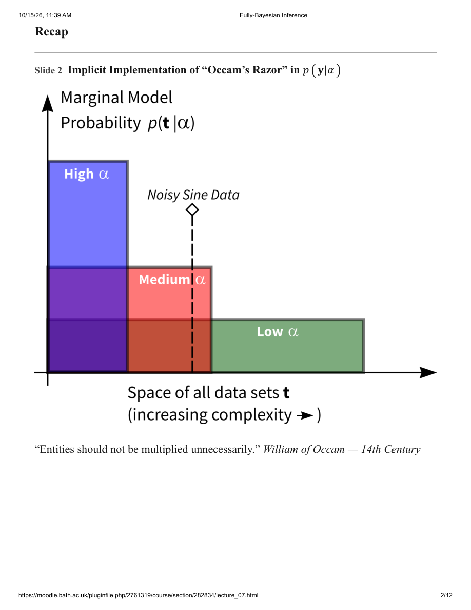

## Page 3

### Slide 3: Marginal Likelihood to Estimate Hyper-parameter $\widehat\alpha_{MP}$

The original plot assumes $\sigma^2$ known. Horizontal axis: $\log\lambda$. Left axis: RMS error, showing Train, Validation and Test curves. Right axis: $-\log p(\mathbf t\mid\alpha,\sigma^2)$ (red dashed curve). Markers indicate selected locations. This is a visual comparison, not a table of exact optimum values.

### Slide 4: Strictly Bayesian: the Ideal Approach

In general, for any model, if we wish to predict $y_*$ (at $x_*$) given some training data $\mathbf y$, what we ideally should compute is:

$$p(y_*\mid\mathbf y).$$

### Slide 5: Being Strictly Bayesian for Linear Regression (So Far)

We placed a prior over the weights $p(\mathbf w\mid\alpha)$, and defined:

- $p(\alpha)$ — a hyper-prior over the hyper-parameter, and

Original page 3 (figures and equation layout)

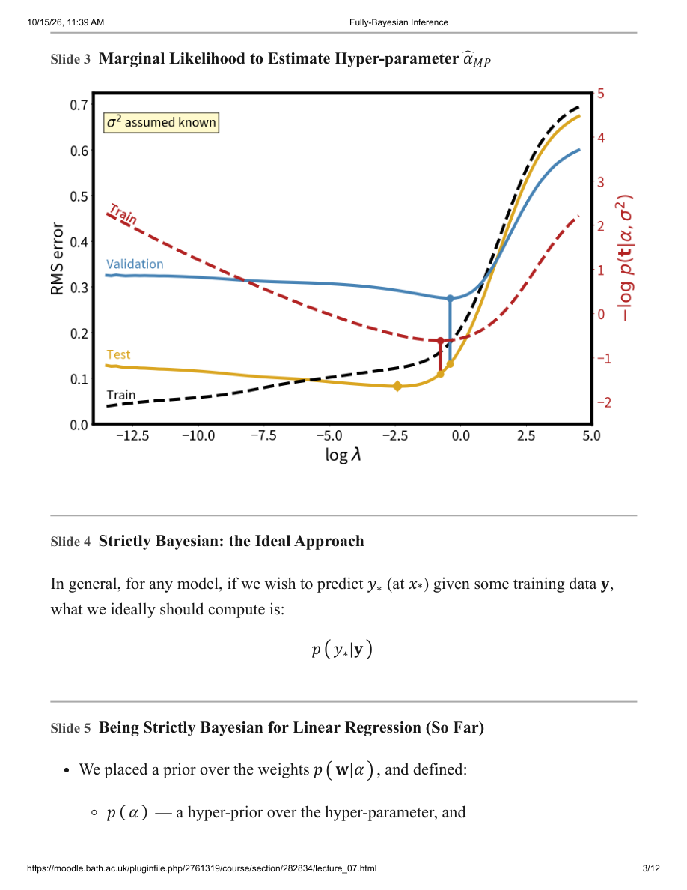

## Page 4

- $p(\sigma^2)$ — a prior over the noise variance in the observation model.
- We would then ideally have computed the full posterior: $p(\mathbf w,\alpha,\sigma^2\mid\mathbf y)$.
- ... and used it to make the desired predictions:

$$p(y_*\mid\mathbf y)=\int p(y_*\mid\mathbf w,\alpha,\sigma^2)\,p(\mathbf w,\alpha,\sigma^2\mid\mathbf y)\,d\mathbf w\,d\alpha\,d\sigma^2.$$

This prediction incorporates our uncertainty over all unknown parameters by averaging over their likely values having seen the data $\mathbf y$.

### Slide 6: The Analytic Roadblock

“Strict Bayesian” inference in our model would ideally be:

$$p(y_*\mid\mathbf y)=\int p(y_*\mid\mathbf w,\alpha,\sigma^2)\,p(\mathbf w,\alpha,\sigma^2\mid\mathbf y)\,d\mathbf w\,d\alpha\,d\sigma^2.$$

We can’t compute either $p(\mathbf w,\alpha,\sigma^2\mid\mathbf y)$ or $p(y_*\mid\mathbf y)$ analytically.

One alternative approach:

1. Perform analytically computable integrations (over $\mathbf w$), then
2. Approximate remaining terms and integrals using Type-II maximum likelihood.

Other approximations are available ... see the next lecture and also next semester.

### Slide 7: Type-II Maximum Likelihood (1)

The desired posterior can be written as (product rule):

$$p(\mathbf w,\alpha,\sigma^2\mid\mathbf y)\equiv p(\mathbf w\mid\mathbf y,\alpha,\sigma^2)\,p(\alpha,\sigma^2\mid\mathbf y).$$

First term is the weight posterior:

$$p(\mathbf w\mid\mathbf y,\alpha,\sigma^2)=N(\mathbf w\mid\boldsymbol\mu,\boldsymbol\Sigma).$$

Original page 4 (figures and equation layout)

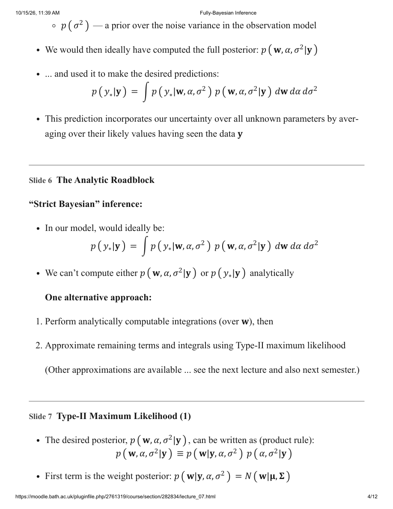

## Page 5

Second term $p(\alpha,\sigma^2\mid\mathbf y)$ is intractable: we approximated it (very coarsely!) with a $\delta$-function at its mode.

We found most probable values $\widehat\alpha_{MP}$ and $\widehat\sigma^2_{MP}$ which maximised:

$$p(\alpha,\sigma^2\mid\mathbf y)=\frac{p(\mathbf y\mid\alpha,\sigma^2)\,p(\alpha)\,p(\sigma^2)}{p(\mathbf y)}.$$

### Slide 8: Type-II Maximum Likelihood (2)

The posterior to be maximised was:

$$p(\alpha,\sigma^2\mid\mathbf y)=\frac{p(\mathbf y\mid\alpha,\sigma^2)\,p(\alpha)\,p(\sigma^2)}{p(\mathbf y)}.$$

We assumed flat uninformative priors over $\log\alpha$ and $\log\sigma$:

- They are scale parameters: this is a very reasonable assumption!
- And so, we only needed to maximise $p(\mathbf y\mid\alpha,\sigma^2)$.

$p(\mathbf y\mid\alpha,\sigma^2)$ is the marginal likelihood (or “evidence”). This procedure is known as Type-II maximum likelihood.

**Source qualification (supplemental):** flat density in logs is not flat density in $\alpha,\sigma^2$. The stated conclusion corresponds to a posterior density in log coordinates with flat log-coordinate priors, or directly to an evidence-maximisation criterion. A mode in $d\alpha\,d\sigma^2$ generally differs; density modes depend on coordinates.

### Slide 9: Type-II Maximum Likelihood (3)

To find $\widehat\alpha_{MP}$ and $\widehat\sigma^2_{MP}$ we maximised the marginal likelihood, given by:

$$\begin{aligned}
p(\mathbf y\mid\alpha,\sigma^2)&=\int p(\mathbf y\mid\mathbf w,\sigma^2)\,p(\mathbf w\mid\alpha)\,d\mathbf w\\
&=(2\pi)^{-N/2}|\sigma^2\mathbf I+\alpha^{-1}\boldsymbol\Phi\boldsymbol\Phi^{\mathsf T}|^{-1/2}\exp\left\{-\frac12\mathbf y^{\mathsf T}(\sigma^2\mathbf I+\alpha^{-1}\boldsymbol\Phi\boldsymbol\Phi^{\mathsf T})^{-1}\mathbf y\right\}.
\end{aligned}$$

This is a zero-mean Gaussian distribution over the single $N$-dimensional dataset vector $\mathbf y$ with $N\times N$ covariance matrix:

Original page 5 (figures and equation layout)

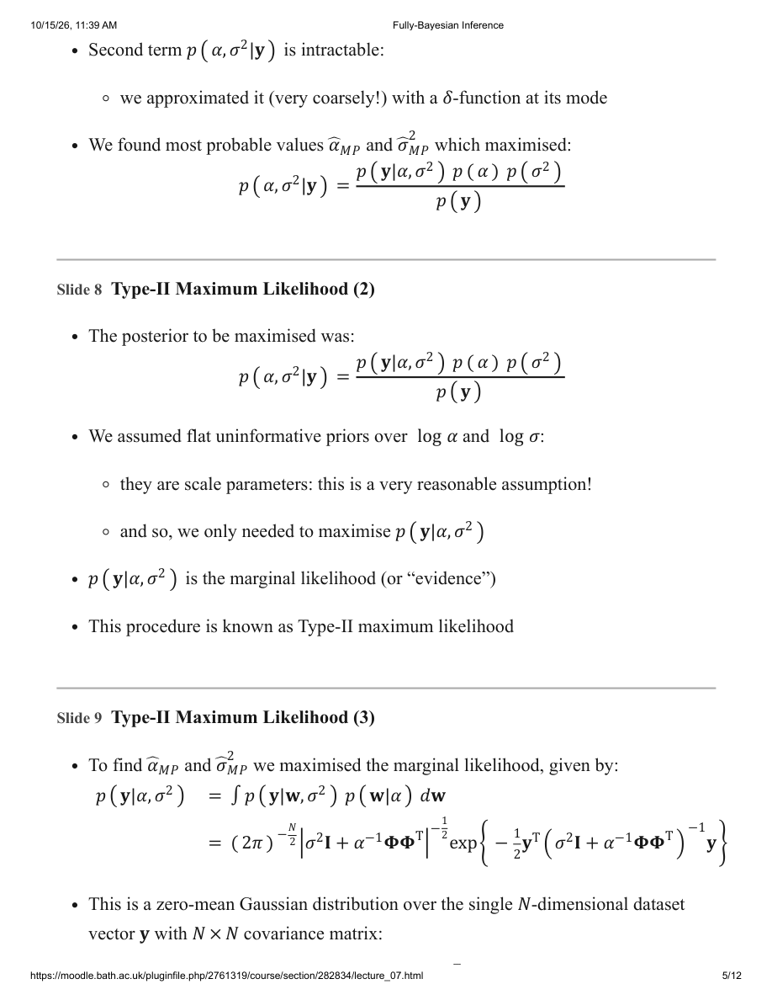

## Page 6

$$\sigma^2\mathbf I+\alpha^{-1}\boldsymbol\Phi\boldsymbol\Phi^{\mathsf T}.$$

It gave us a probability for the entire dataset, conditional on values of $\alpha$ and $\sigma^2$.

**Density clarification (supplemental):** for continuous targets this is a probability density at the observed dataset, not positive probability of that exact vector.

### Slide 10: In Summary: What We Did

- We exploited the “Occam’s Razor” property of the marginal likelihood $p(\mathbf y\mid\alpha,\sigma^2)$ as a criterion first for “setting” $\alpha$, then later for setting $\sigma$.
- Advantage: this seemed to work rather well!
- Disadvantage: this only gave us point estimates $\widehat\alpha_{MP}$ and $\widehat\sigma^2_{MP}$ for the hyperparameters.
- Also, other uncertainties were ignored.

Original page 6 (figures and equation layout)

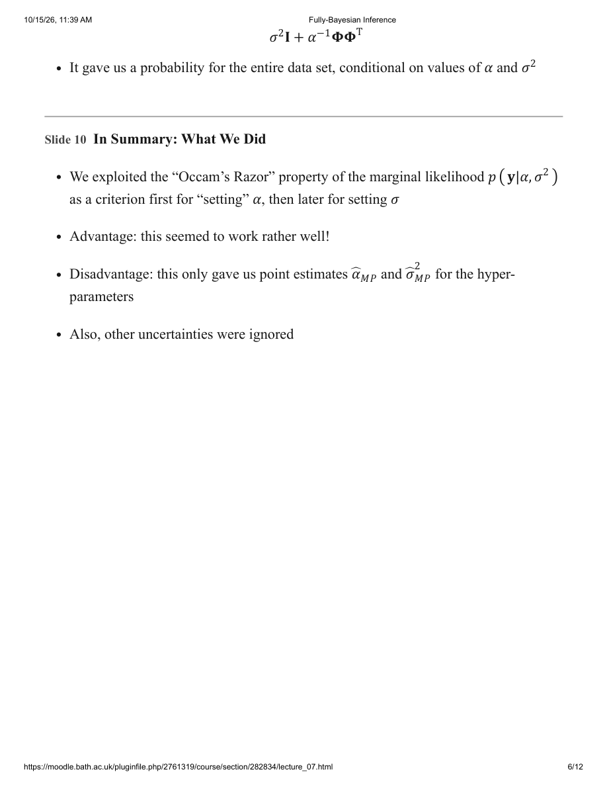

## Page 7

### Slide 11: Concurrent Estimation (Zoomed In)

The source contour plot “Log Marginal Likelihood” has axes $\log\lambda$ and $\log\sigma^2$ and a colour bar. It annotates $\widehat\sigma_{MP}=0.212$ and True Value $=0.250$. The broad high-likelihood region shows that the optimum is not the entire distribution.

### Extending the Analysis

### Slide 12: A Possible Next Step

Our estimates of $\widehat\alpha_{MP}$ and $\widehat\sigma^2_{MP}$ seemed effective. But other uncertainties were ignored:

- The choice of model (linear in the parameters).
- Gaussian data-centred basis functions $\phi$:

$$\phi_m(x)=\exp\{-(x-x_m)^2/r^2\}.$$

Original page 7 (figures and equation layout)

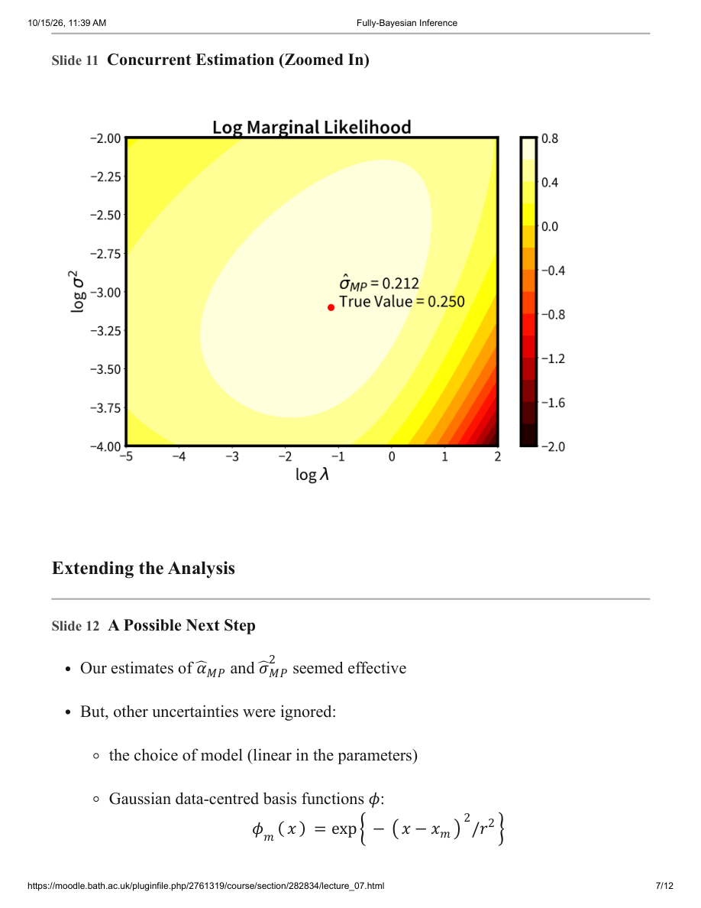

## Page 8

- Radius (length scale) of the basis functions was fixed at $r=1.0$.
- We can be more Bayesian! Here, it is feasible to numerically integrate out $\alpha$ and $\sigma^2$ using straightforward sampling techniques (gridding the space).
- We now utilise this approach to find a most probable value for basis scale $r$.

### Slide 13: Effect of the Basis Function Scale Parameter $r$

Illustration of effect of basis scale $r$ ($\alpha$ set to 0.1, noise = 0.4). Four original panels use basis scales $r=0.25$, $0.5$, $1.5$ and $4$. Each shows observed points, reference and fitted curves, and the basis functions below. Narrow bases give local, more wiggly fits; wide bases overlap strongly and give broader variations. These are source illustrations, not newly executed experiments.

Original page 8 (figures and equation layout)

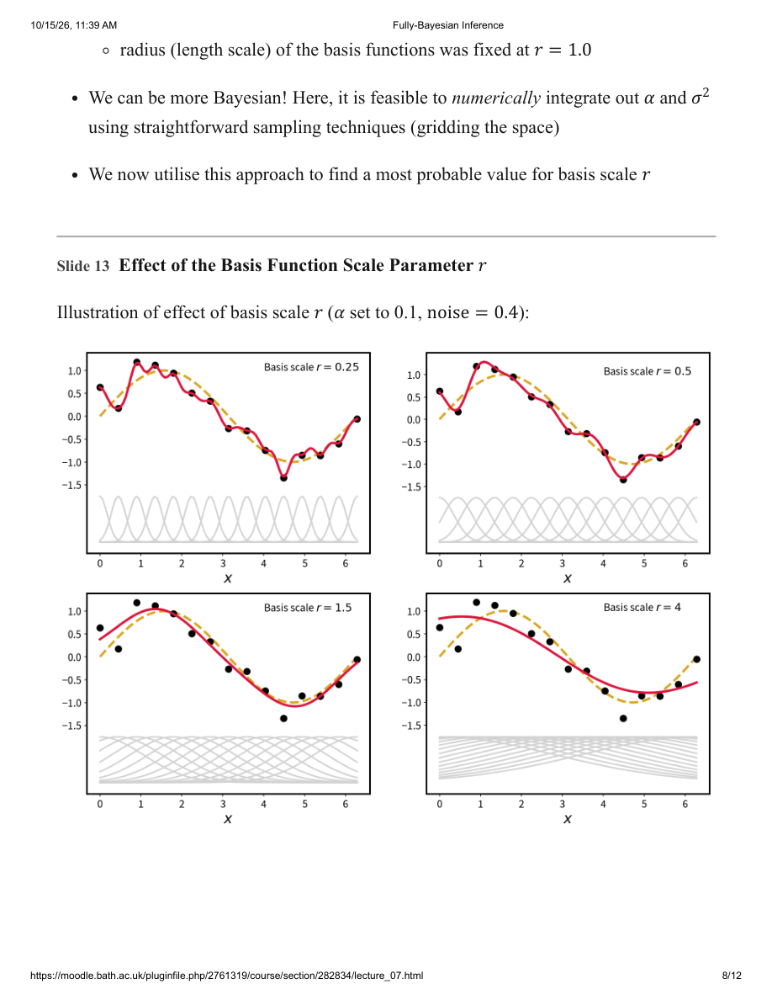

## Page 9

### Slide 14: Type-II Again: Marginalising Further to Take Account of $r$

We need to integrate out everything but $r$:

$$\begin{aligned}
p(\mathbf y\mid r)&=\iiint p(\mathbf y\mid\mathbf w,\alpha,\sigma^2,r)\,p(\mathbf w\mid\alpha)\,p(\alpha)\,p(\sigma)\,d\mathbf w\,d\alpha\,d\sigma\\
&=\iint p(\mathbf y\mid\alpha,\sigma^2,r)\,p(\alpha)\,p(\sigma)\,d\alpha\,d\sigma.
\end{aligned}$$

Where:

- $p(\mathbf y\mid\alpha,\sigma^2,r)$ is the marginal likelihood previously calculated by analytically integrating out $\mathbf w$.
- $p(\alpha)$ is a non-informative scale-parameter hyper-prior: constant over $\log\alpha$ for $\alpha\in[10^{-12},10^{+12}]$.
- $p(\sigma)$ is a non-informative scale-parameter hyper-prior: constant over $\log\sigma$ for $\sigma\in[10^{-6},10^{+2}]$.

**Measure clarification (supplemental):** these are bounded log-uniform priors: densities with respect to $d\alpha$ and $d\sigma$ are proportional to $1/\alpha$ and $1/\sigma$, not constants. In $v=\sigma^2$, the corresponding density is proportional to $1/v$, with transformed bounds $[10^{-12},10^4]$ and the normalisation/Jacobian accounted for.

### Slide 15: Approximating That Integral!

We now approximate:

$$p(\mathbf y\mid r)=\int\!\int p(\mathbf y\mid\alpha,\sigma^2,r)\,p(\alpha)\,p(\sigma)\,d\alpha\,d\sigma.$$

The integrations over $\alpha$ and $\sigma^2$ are performed numerically (and approximately) by a simple Monte-Carlo average (more on these next lecture), e.g.:

$$\int p(\mathbf y\mid\alpha,\sigma^2,r)\,p(\alpha)\,p(\sigma)\,d\alpha\,d\sigma\approx\frac1S\sum_{s=1}^S p(\mathbf y\mid\alpha_s,\sigma_s^2,r),$$

where $\alpha_s$ and $\sigma_s^2$ are representative samples from $p(\alpha,\sigma^2)=p(\alpha)\,p(\sigma^2)$.

In this case, we can simply sample over a regular (uniform) grid of $\log\alpha$ and $\log\sigma$.

**Source qualification (supplemental):** the slide switches between $\sigma$ and $\sigma^2$ notation. Use one consistent integration measure and transform its density. A regular log grid is deterministic quadrature, not independent random Monte-Carlo sampling. Equal midpoint cells in log coordinates give the displayed equal-weight prior average; endpoints or unequal cells need quadrature weights.

Original page 9 (figures and equation layout)

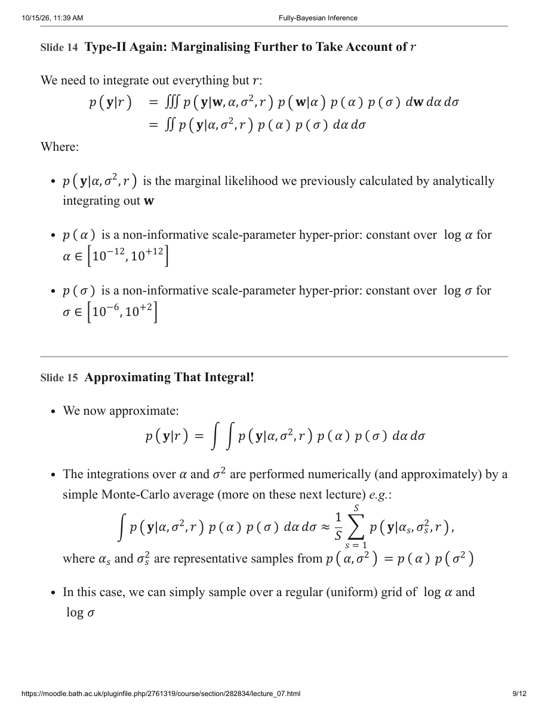

## Page 10

### Slide 16: Computing the Approximation Over a Range of $r$

The source plot compares RMS Test Error (gold, left axis) and $-\log P(\mathbf t\mid r)$ (red dashed, right axis) against basis scale $r$. Both have interior minima, but not at the same $r$: the evidence criterion is not a guarantee of minimising realised test error. No exact optimum is tabulated.

### Slide 17: How Can We Predict Using this Approximation?

The following preserves the printed sequence:

$$\begin{aligned}
p(y_*\mid\mathbf y)&=\int\!\int\!\int\!\int p(y_*\mid\mathbf w,\sigma^2,r)\,p(\mathbf w,\alpha,\sigma^2,r\mid\mathbf y)\,d\mathbf w\,d\alpha\,d\sigma^2\,dr\\
&\approx\iiint p(y_*\mid\mathbf w,\sigma^2,\widehat r_{MP})\,p(\mathbf w,\alpha,\sigma^2\mid\mathbf y,\widehat r_{MP})\,d\mathbf w\,d\alpha\,d\sigma^2\\
&=\iint p(y_*\mid\alpha,\sigma^2,\widehat r_{MP})\,p(\alpha,\sigma^2\mid\mathbf y,\widehat r_{MP})\,d\alpha\,d\sigma^2\\
&\approx\frac1S\sum_{s=1}^S p(y_*\mid\alpha_s,\sigma_s^2,\widehat r_{MP})\,p(\alpha_s,\sigma_s^2\mid\mathbf y,\widehat r_{MP})\\
&\propto\frac1S\sum_{s=1}^S p(y_*\mid\alpha_s,\sigma_s^2,\widehat r_{MP})\,p(\mathbf y\mid\alpha_s,\sigma_s^2,\widehat r_{MP})\,p(\alpha_s)\,p(\sigma_s^2)\\
&=\frac1S\sum_{s=1}^S p(y_*\mid\alpha_s,\sigma_s^2,\widehat r_{MP})\,p(\mathbf y\mid\alpha_s,\sigma_s^2,\widehat r_{MP}).
\end{aligned}$$

The mean of $p(y_*\mid\mathbf y)$ is thus a weighted sum of individual predictive means.

**Source qualification (supplemental):** the conditional component predictive should also condition on training data $\mathbf y$, which is suppressed in the printed notation. The last equality is not a normalised density as written. On a log-uniform prior grid, normalise likelihood-times-prior-cell masses to posterior weights; do not multiply by an additional raw-coordinate prior or use uniform predictive weights. A raw-coordinate grid instead requires its prior densities and cell volumes. $r$ is still a plug-in estimate here.

Original page 10 (figures and equation layout)

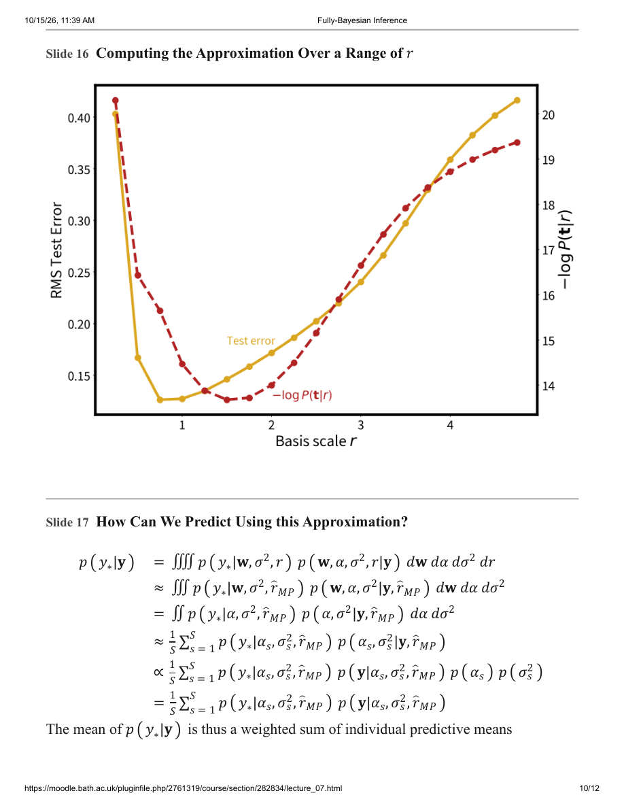

## Page 11

### Slide 18: Predicting with Optimised $r$

The original plot “Mean Prediction for Optimised $r$” shows observed points, a solid red mean prediction and a gold dashed reference curve against $x$. The plot shows a mean, not a full uncertainty band or a new independent evaluation.

### Demonstration and Wrap-Up

### Slide 19: Demo: Occam’s Razor (and Again)

Three aspects:

1. Estimation of $r$ — repeating the above.

Original page 11 (figures and equation layout)

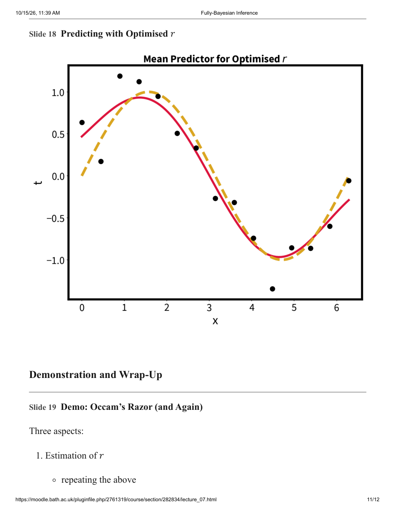

## Page 12

2. Being a little more strictly Bayesian by adding $r$ to the numerical integration loop, giving the predictive integral:

$$\begin{aligned}
p(y_*\mid\mathbf y)&=\iiint p(y_*\mid\mathbf w,\sigma^2,r)\,p(\mathbf w,\alpha,\sigma^2,r\mid\mathbf y)\,d\mathbf w\,d\alpha\,d\sigma^2\,dr\\
&\approx\frac1S\sum_{s=1}^S p(y_*\mid\alpha_s,\sigma_s^2,r_s)\,p(\alpha_s,\sigma_s^2,r_s\mid\mathbf y).
\end{aligned}$$

3. Choosing the type of basis function? Approximating $p(\mathbf y\mid\phi)$.

**Source qualification (supplemental):** the printed first line has a triple integral symbol but four differentials (with $\mathbf w$ itself a vector). It denotes integration over all listed unknowns. Component predictions also depend on $\mathbf y$. The grid mixture needs normalised posterior cell masses; if samples are instead drawn from the posterior, average the components without another posterior-density factor. The static PDF states a demo agenda, not its unseen outputs or a winning basis family.

### Slide 20: Summary

- For three hyperparameters, it was just about reasonable to compute analytically intractable integrals numerically (summing over a grid).
- This worked pretty well!
  - It was possible to obtain accurate estimates of the underlying function and handle the uncertainties in $\alpha$, $\sigma$ and $r$ without need for cross-validation.
- But this won’t work when models become more complex (more parameters and non-linearity).
- Obvious reason: gridding higher-dimensional parameter spaces will become too computationally complex.
- Less-obvious reason: the curse of dimensionality.

**Scope clarification (supplemental):** the success statement is the lecture’s assessment of its example, not a universal guarantee or a reason to discard independent evaluation. Evidence/model comparison requires proper, explicitly specified priors and comparable model assumptions.

Original page 12 (figures and equation layout)

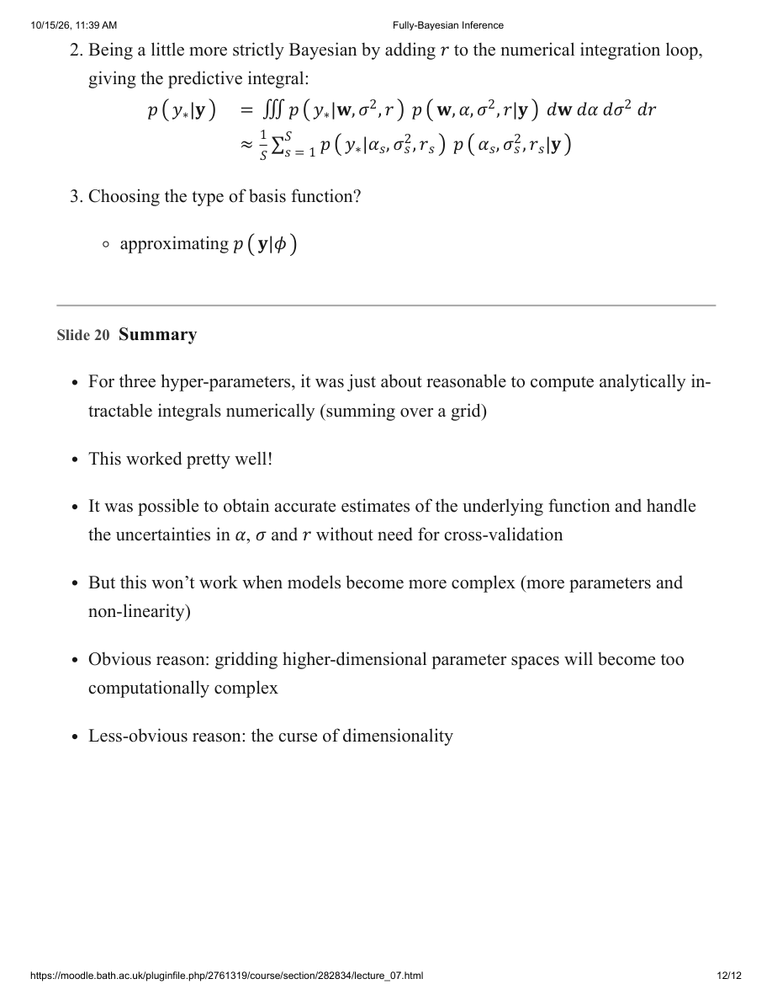

