# Monte Carlo and Importance Sampling

## Approximating Intractable Integrals Stochastically

**Author:** Edward Milsom  
**Date:** 2026-10-06  
**Source:** [Lecture 8 PDF](8.pdf)

Transcription preserves all 26 numbered slides across 27 PDF pages. Figure-only continuations remain with their original slide; source notation and qualifications are marked explicitly.

## Page 1

### Slide 1: Recap — Bayesian Marginalisation Scenarios

Given observed data $\mathbf y$ and an assumed model $\mathcal M$ with variables $\boldsymbol\theta$, three main scenarios require marginalising variables:

- Predicting a new data point $y_*$:

$$p(y_*\mid\mathbf y,\mathcal M)=\int p(y_*\mid\boldsymbol\theta,\mathcal M)p(\boldsymbol\theta\mid\mathbf y,\mathcal M)\,d\boldsymbol\theta.$$

- Quantifying a specific parameter's uncertainty:

$$p(\theta_1\mid\mathbf y,\mathcal M)=\int p(\theta_1,\theta_2\mid\mathbf y,\mathcal M)\,d\theta_2.$$

- Computing model evidence:

$$p(\mathbf y\mid\mathcal M)=\int p(\mathbf y\mid\boldsymbol\theta,\mathcal M)p(\boldsymbol\theta\mid\mathcal M)\,d\boldsymbol\theta.$$

Original page 1 (figures and equation layout)

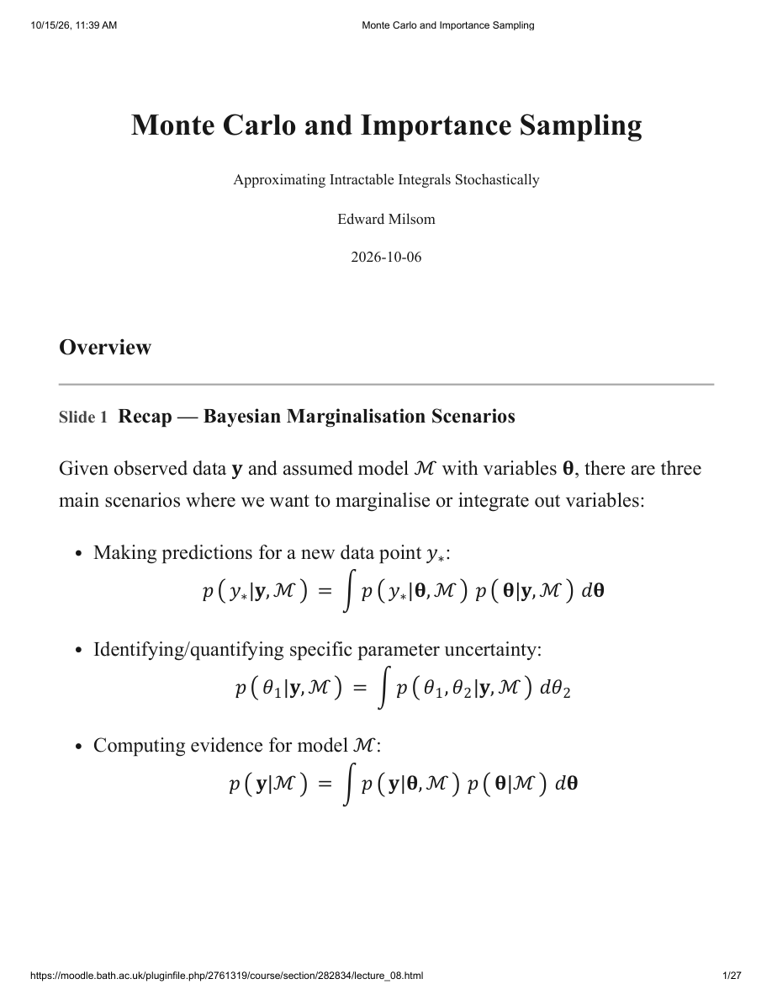

## Page 2

### Slide 2: Recap — Bayesian Marginalisation Scenarios

**Inconvenient truth:** most of these integrals are analytically intractable: closed-form solutions generally cannot be found. Lectures 8 and 9 focus on stochastic approximations; deterministic techniques are deferred to next semester.

### Slide 3: In this Episode ...

- Computing expectations; the general Monte Carlo sampling principle.
- Sampling in one dimension: inverse-CDF.
- The curse of dimensionality, with a demo.
- Low-dimensional sampling: importance sampling.
- Higher-dimensional sampling: a first introduction to Markov Chain Monte Carlo (MCMC).

Original page 2 (figures and equation layout)

## Page 3

### Slide 4: Computing Expectations

Many Bayesian integrals are special cases of computing an expectation of a function over a probability distribution:

$$F=\int f(\theta)p(\theta)\,d\theta=\langle f(\theta)\rangle_{p(\theta)}.$$

For example, a predictive distribution is

$$p(y_*\mid\mathbf y)=\int p(y_*\mid\boldsymbol\theta)p(\boldsymbol\theta\mid\mathbf y)\,d\boldsymbol\theta=\langle p(y_*\mid\boldsymbol\theta)\rangle_{p(\boldsymbol\theta\mid\mathbf y)}.$$

When the integral cannot be evaluated analytically, a workable approximation is needed. This lecture introduces stochastic Monte Carlo approximations.

### Slide 5: The “Monte Carlo” Sampling Principle

Approximate

$$F=\langle f(\boldsymbol\theta)\rangle_{p(\boldsymbol\theta)}=\int f(\boldsymbol\theta)p(\boldsymbol\theta)\,d\boldsymbol\theta$$

with a random Monte Carlo sample:

$$\widehat F=\frac1R\sum_{r=1}^R f(\boldsymbol\theta^{(r)}),$$

where $\boldsymbol\theta^{(r)}$ is an independent random sample from $p(\boldsymbol\theta)$.

Original page 3 (figures and equation layout)

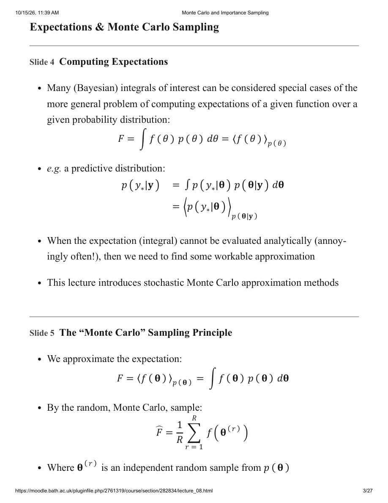

## Page 4

Slide 5 continues: as $R\to\infty$, $\widehat F\to F$.

### Slide 6: Monte Carlo Sampling — Expected Accuracy

How accurate is the approximation for realistic $R$? The source writes the expected error (variance) of $\widehat F$ as

$$\epsilon^2=\int(\widehat F-F)^2p(\boldsymbol\theta)\,d\boldsymbol\theta.$$

If the variance of $f$ is

$$\sigma_f^2=\int\{f(\boldsymbol\theta)-F\}^2p(\boldsymbol\theta)\,d\boldsymbol\theta,$$

then the error variance decreases proportionally to $\sigma_f^2/R$.

**Source key result:** accuracy does not depend on the dimensionality of $\boldsymbol\theta$.

**Notation/qualification:** the first integral is reproduced as printed, but the random estimator depends on the entire sample; its variance is an expectation over that sample's joint distribution. Under IID sampling and finite $\sigma_f^2$, $\operatorname{Var}(\widehat F)=\sigma_f^2/R$; standard error scales as $R^{-1/2}$. The exponent is dimension-independent, not necessarily the variance constant or the sampling cost.

### Slide 7: Monte Carlo Sampling in Practice

The problem is obtaining samples from $p(\boldsymbol\theta)$, which may be non-trivial:

1. We know $p(\boldsymbol\theta)$ but cannot sample directly, for example with an available Python library function.
2. The distribution is non-standard or unnormalised.

Original page 4 (figures and equation layout)

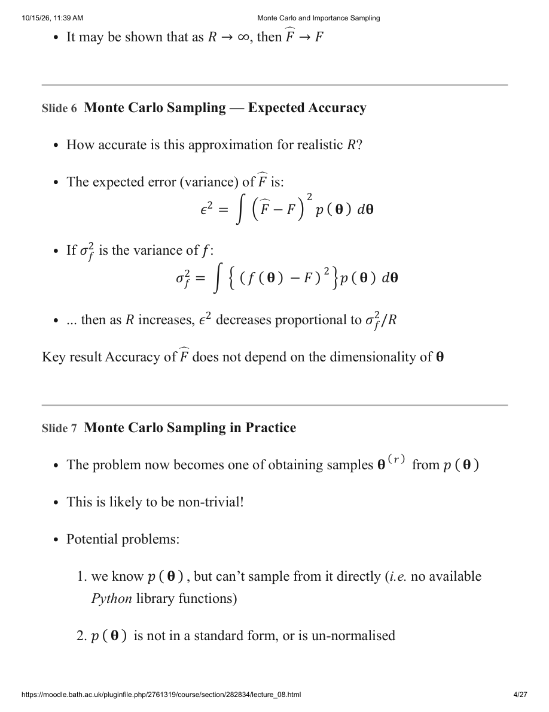

## Page 5

Slide 7 continues: certain univariate distributions admit a method for the first problem; the unnormalised-distribution problem is central to Bayesian inference. **Source limitation:** the two problem-number references are blank in the printed PDF; this connection is inferred from the preceding numbered list.

### Slide 8: The Inverse-CDF Method

We would like samples from $p(\theta)$ but cannot obtain them directly. Assume its cumulative distribution function and inverse are known. The source's CDF line is:

$$F(\theta)=P(\theta\le x)=\int_{-\infty}^{x}p(\theta)\,d\theta.$$

Its inverse is $F_\theta^{-1}(z)$ for $z\in[0,1]$. Sample $z$ uniformly on $[0,1]$ and transform:

$$y=F_\theta^{-1}(z).$$

The change-of-variables argument is

$$p(y)=p(z)\left|\frac{dz}{dy}\right|=p(\theta).$$

**Source notation:** the first formula mixes $\theta$ and $x$ as the CDF argument, and the last equality uses $\theta$ for the output variable. A consistent reading is $F_\Theta(x)=P(\Theta\le x)$ and $p_Y(y)=p_\Theta(y)$. The CDF is called a “cumulative density function” in the source. Infinite endpoint values need care in computation; continuous uniform draws hit the exact endpoints with probability zero in ideal mathematics.

### Slide 9: The Inverse-CDF Method — Cauchy Example

The inverse CDF of a standard Cauchy is

$$F_\theta^{-1}(z)=\tan\left[\pi\left(z-\frac12\right)\right].$$

Original page 5 (figures and equation layout)

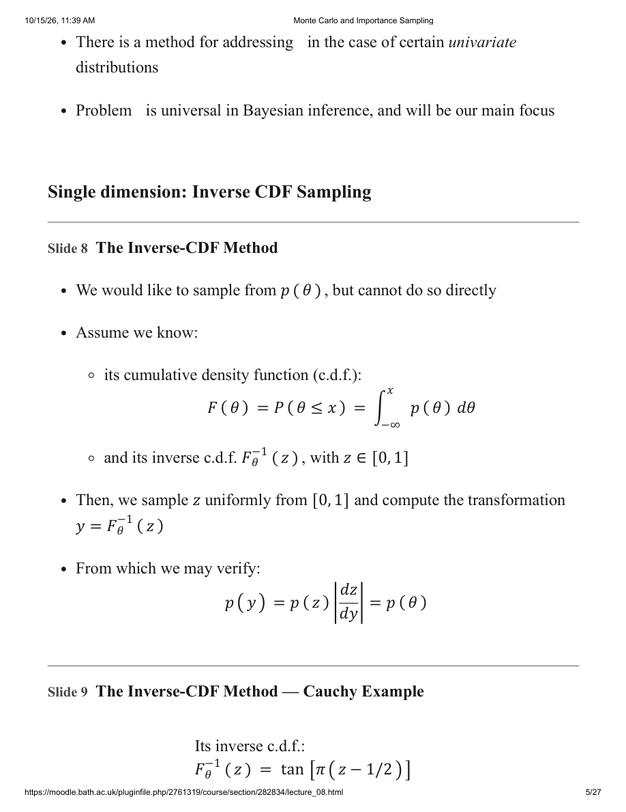

## Page 6

Slide 9 continues: the Cauchy distribution is

$$p(\theta)=\frac1\pi\frac1{\theta^2+1}.$$

The original plot shows the density and cumulative distribution, illustrating the inverse transformation.

### Slide 10: Typical Scenario: Un-normalised Distributions

Write the target as

$$p(\boldsymbol\theta)=\frac{P^*(\boldsymbol\theta)}Z,\qquad Z=\int P^*(\boldsymbol\theta)\,d\boldsymbol\theta.$$

The numerator specifies the shape; the denominator is the normalising constant. Often $P^*$ is known but $Z$ is not. Several sampling methods require only $P^*$ to approximate expectations under $p$.

### Slide 11: Example of Identifying $P^*(\boldsymbol\theta)$: Bayesian Linear Regression

The parameter posterior over weights is likelihood times prior divided by a normalising factor:

$$p(\mathbf w\mid\mathbf y,\alpha,\sigma^2)=\frac{p(\mathbf y\mid\mathbf w,\sigma^2)p(\mathbf w\mid\alpha)}{p(\mathbf y\mid\alpha,\sigma^2)}.$$

Original page 6 (figures and equation layout)

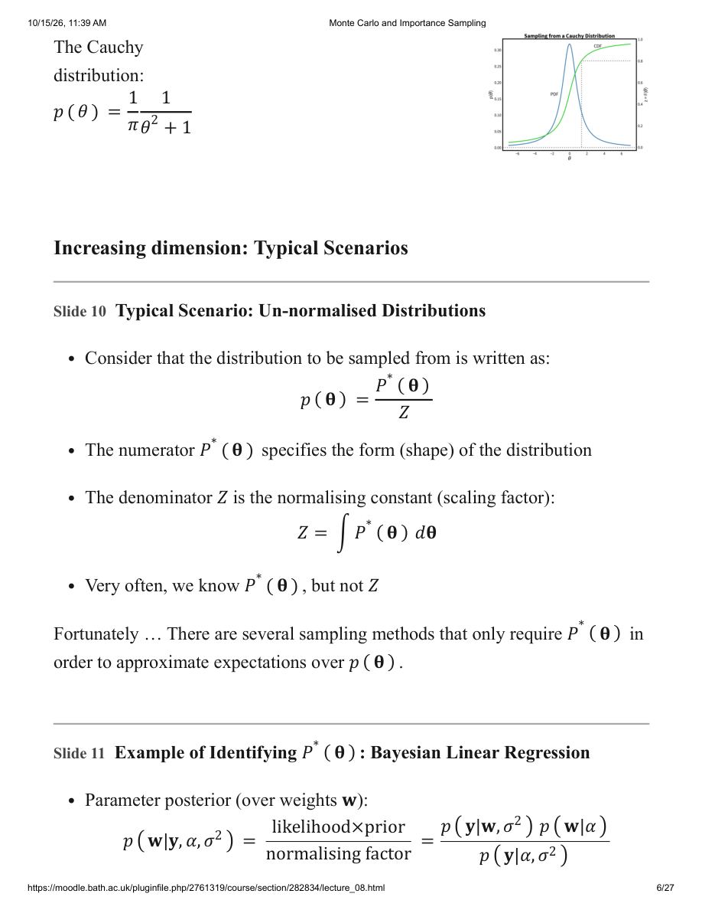

## Page 7

Slide 11 continues: both the weight posterior and its normalising factor (marginal likelihood) are analytically computable. Extending to hyperparameters gives

$$p(\alpha,\sigma^2\mid\mathbf y)=\frac{p(\mathbf y\mid\alpha,\sigma^2)p(\alpha)p(\sigma^2)}{p(\mathbf y)}.$$

The lecture says this posterior is not computable in closed form because its normalisation integral $p(\mathbf y)$ has no closed-form solution. We can still define

$$P^*(\alpha,\sigma^2)=p(\mathbf y\mid\alpha,\sigma^2)p(\alpha)p(\sigma^2).$$

**Scope:** this is the lecture's hyperparameter setting, not a claim that no choice of model and hyperprior ever has an analytic solution.

### Slide 12: Sampling in High Dimensions — Caution!

The previous lecture estimated a good basis radius $r$ by approximating $p(\mathbf y\mid\alpha,\sigma^2,r)$ using a Monte Carlo sample evaluated over a regular grid in $\log\alpha$ and $\log\sigma$.

This works in low dimensions, computation aside. To benefit from the $1/R$ reduction in error variance, samples must represent all regions of significant probability mass. Finding those regions by exhaustive grid search becomes impractical in high dimensions: the curse of dimensionality.

**Terminology:** regular-grid evaluation is not itself IID Monte Carlo. The source's “error” here refers to variance, not standard error.

Original page 7 (figures and equation layout)

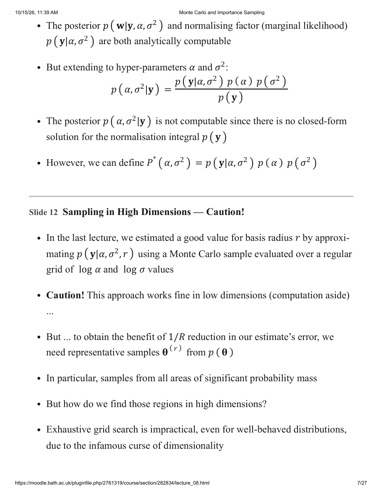

## Page 8

### Slide 13: The “Curse of Dimensionality”

Our intuitions often fail in higher dimensions. For uniform sampling from a circular PDF in two dimensions, the green circle occupies 78.5% of the square data space. This volume fraction becomes vanishingly small as dimension increases.

### Slide 14: The “Curse of Dimensionality”

How much volume lies in the corners of the hypercube, outside its inscribed hypersphere?

| $D$ | Sphere volume (fraction of cube) | Corner proportion |
| --- | --- | --- |
| 2 | 0.785 | 21.5% |
| 3 | 0.524 | 47.6% |
| 4 | 0.308 | 69.2% |

Original page 8 (figures and equation layout)

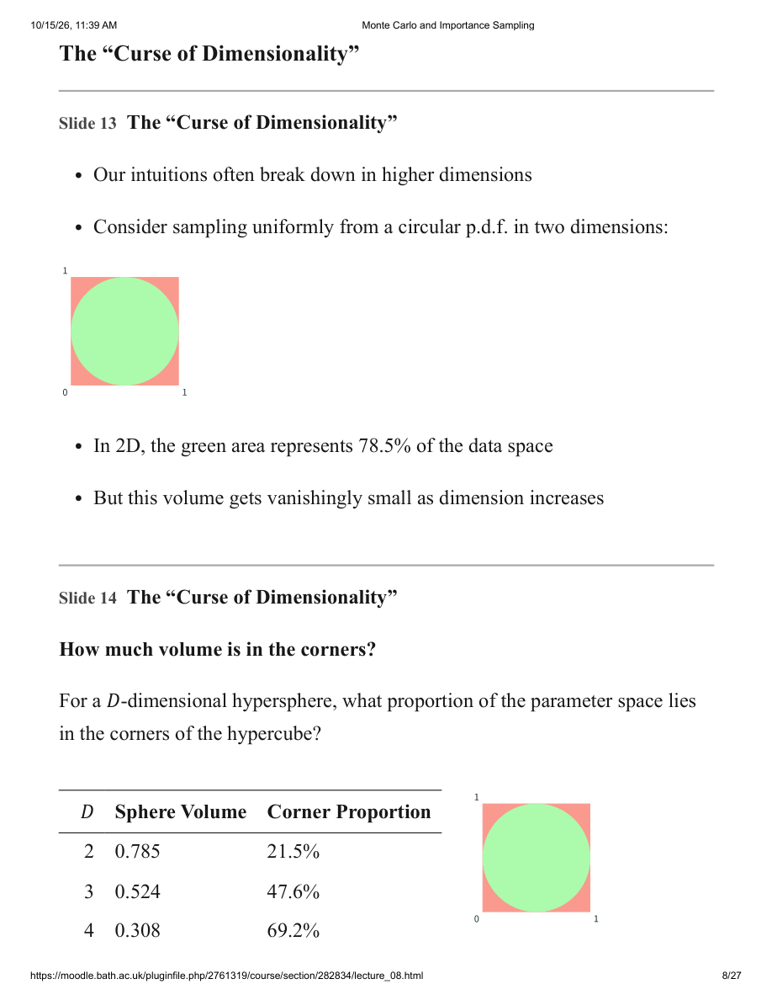

## Page 9

Slide 14 table continues:

| $D$ | Sphere volume (fraction of cube) | Corner proportion |
| --- | --- | --- |
| 5 | 0.164 | 83.6% |
| … | … | … |
| 10 | 0.002 | 99.8% |

### Slide 15: Next …

Two principal methods attempt to localise high-probability regions of $P^*(\boldsymbol\theta)$:

1. Rejection sampling (not covered here).
2. Importance sampling.

Both introduce a proposal distribution that is “close” to $P^*$ in some sense.

### Slide 16: Importance Sampling — Overview

This is not a method for directly sampling from $p(\theta)$, but for computing expectations of functions with respect to it:

$$\langle f(\theta)\rangle_{p(\theta)}=\int f(\theta)p(\theta)\,d\theta.$$

Again assume $p(\boldsymbol\theta)=P^*(\boldsymbol\theta)/Z$ and that $P^*$ can be computed.

Original page 9 (figures and equation layout)

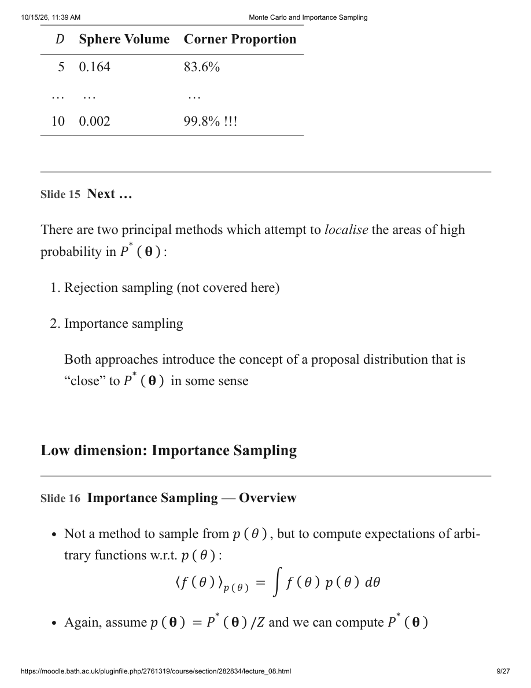

## Page 10

Slide 16 continues: define a proposal, ideally close to the target,

$$Q(\theta)=\frac{Q^*(\boldsymbol\theta)}{Z_Q}.$$

We need to generate samples from $Q$ and evaluate $Q^*$ (the source alternates scalar and vector notation).

### Slide 17: Importance Sampling — Procedure

Generate $R$ samples $\theta^{(r)}$ from $Q(\theta)$. Define importance weights

$$w_r=\frac{P^*(\theta^{(r)})}{Q^*(\theta^{(r)})}.$$

Compute the weighted Monte Carlo expectation:

$$\widehat F=\frac{1}{\sum_r w_r}\sum_{r=1}^R w_r f(\theta^{(r)}).$$

“Done!” This is the self-normalised importance estimator; finite-sample unbiasedness is not asserted by the source.

Original page 10 (figures and equation layout)

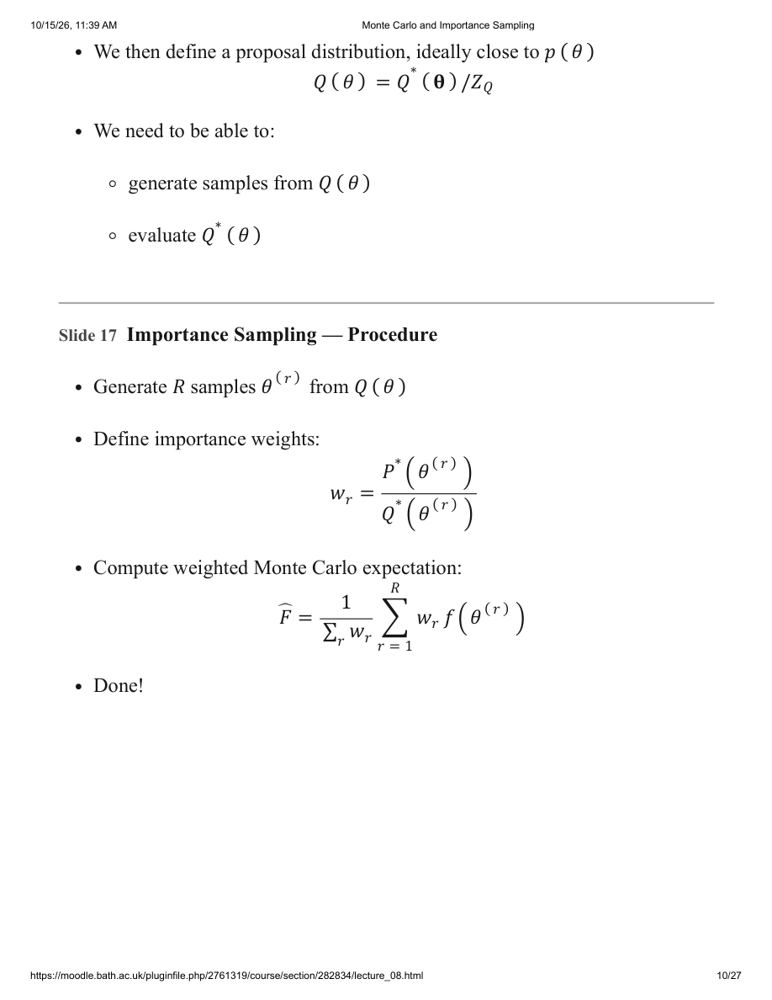

## Page 11

### Slide 18: Importance Sampling — Illustration

The original figure compares blue target $P^*(\theta)$, red dashed Gaussian proposal $Q^*(\theta)$, and grey function $f(\theta)$. The target has a taller mode left of zero and a smaller right-hand hump. The broad proposal overlaps both regions. The grey function rises from negative values toward approximately one. No analytic definitions of these plotted curves are supplied.

Original page 11 (figures and equation layout)

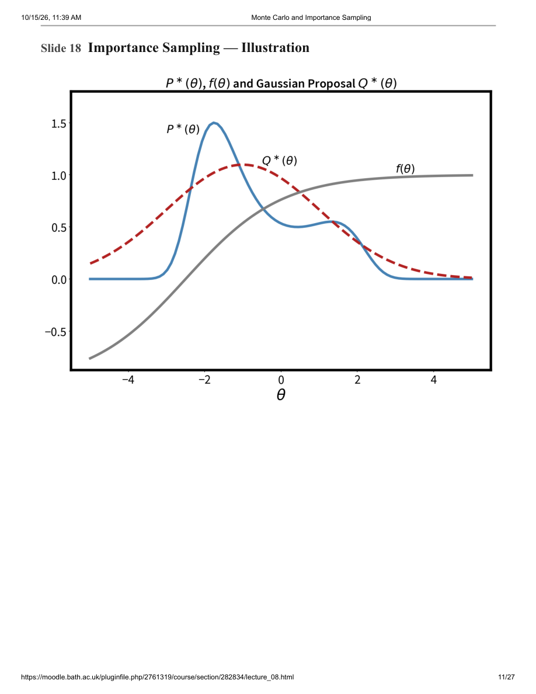

## Page 12

### Slide 19: Importance Sampling — Expectation Estimate

The figure shows a running estimate of the expectation with a Gaussian proposal and 5,000 samples. The horizontal dashed reference is approximately 0.52. The estimate fluctuates initially and is closer to the reference later; a single plotted run is not a convergence guarantee.

Original page 12 (figures and equation layout)

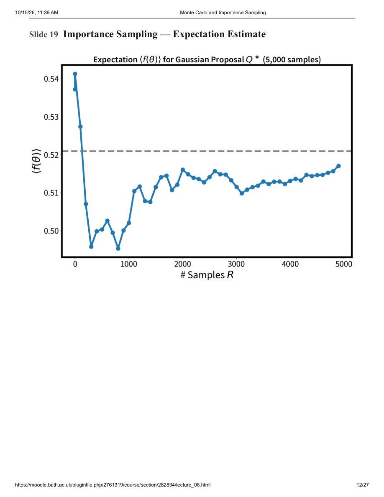

## Page 13

Slide 19 continues with the same type of running-estimate plot extended to 50,000 samples. The displayed estimate approaches the dashed reference near 0.52. The original plot is preserved below; no additional numbered slide begins on this page.

Original page 13 (figures and equation layout)

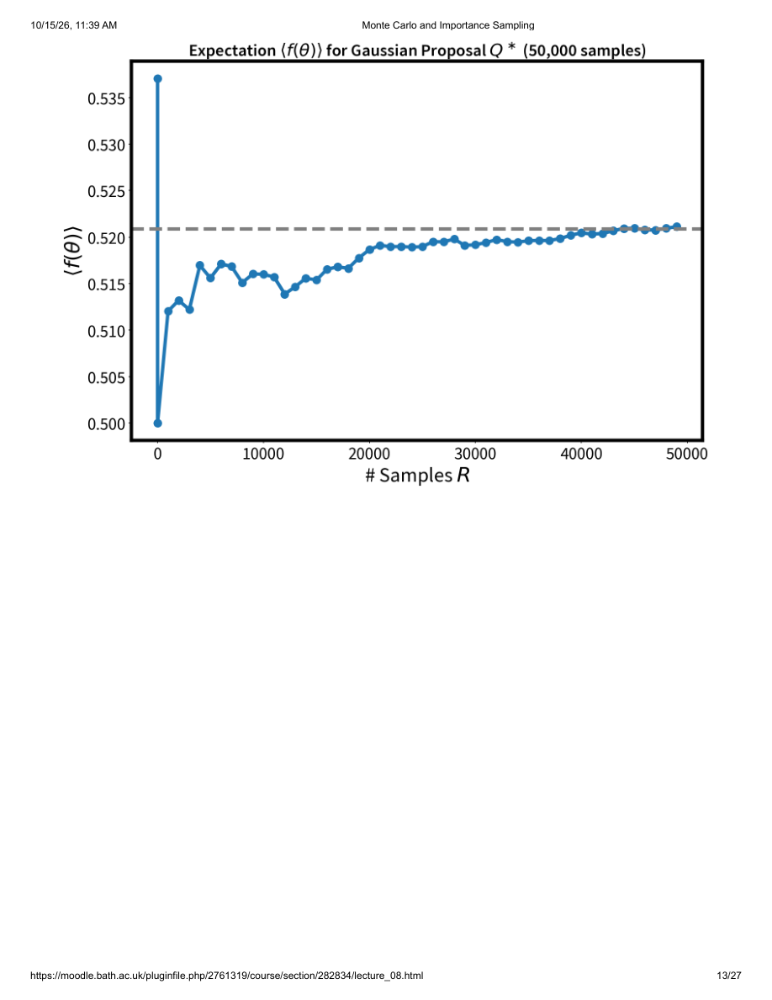

## Page 14

### Slide 20: Importance Sampling — A Bad Proposal!

The blue target and grey function are shown with a narrower red dashed Gaussian proposal concentrated to the right of the dominant left mode. The proposal is very small where the target is large, making large importance weights rare but influential.

Original page 14 (figures and equation layout)

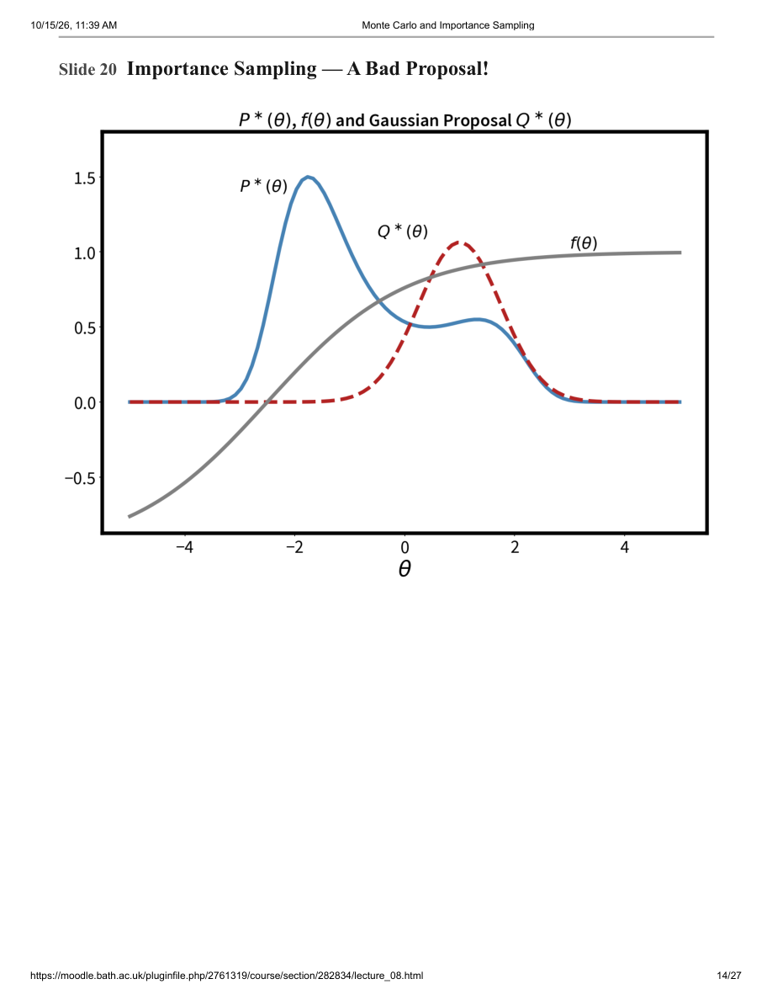

## Page 15

### Slide 21: Importance Sampling — Non-converging Estimate

With the bad Gaussian proposal, the 5,000-sample running estimate is far from the dashed reference near 0.52. Long apparently stable stretches are interrupted by jumps. “Non-converging” is the source title: the finite trace alone does not prove mathematical inconsistency as $R\to\infty$.

Original page 15 (figures and equation layout)

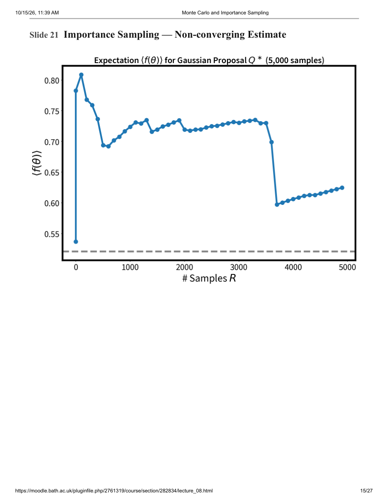

## Page 16

Slide 21 continues: the 50,000-sample plot still shows large jumps and an estimate far from the reference. This is a figure-only continuation, not a new numbered slide.

Original page 16 (figures and equation layout)

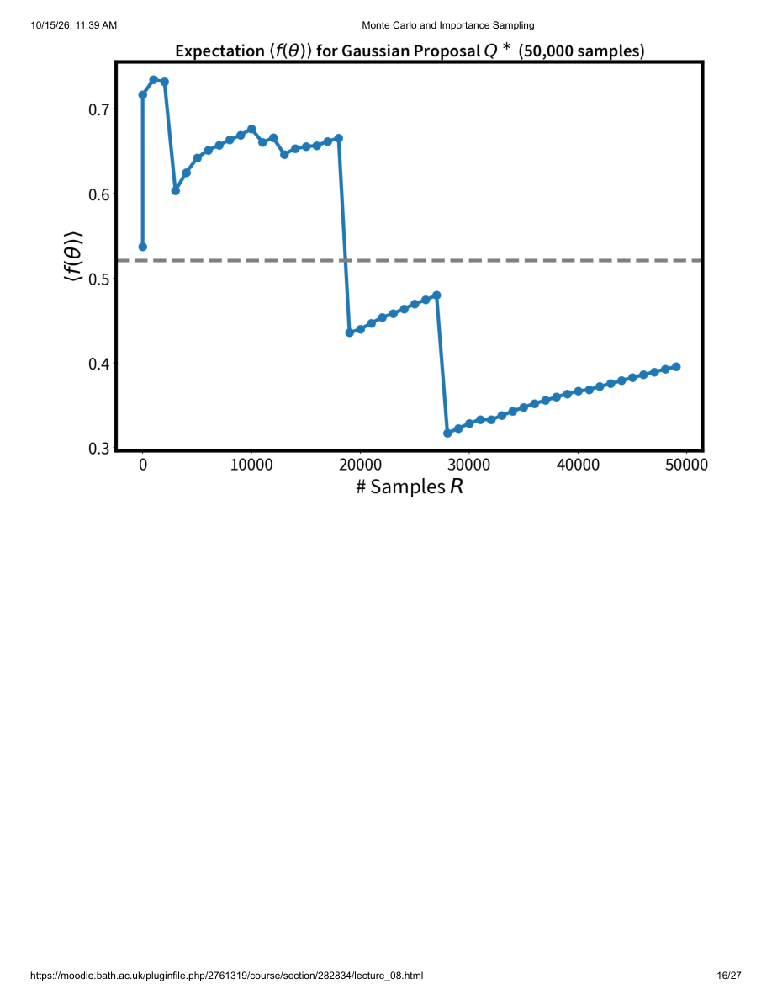

## Page 17

### Slide 22: Importance Sampling — Cauchy Proposal Distribution

The red dashed proposal is now Cauchy, with broader tails than the bad Gaussian. The target and function retain the shapes from the earlier illustrations. The figure suggests why heavier tails can improve coverage; no proposal parameters or target formula are printed.

Original page 17 (figures and equation layout)

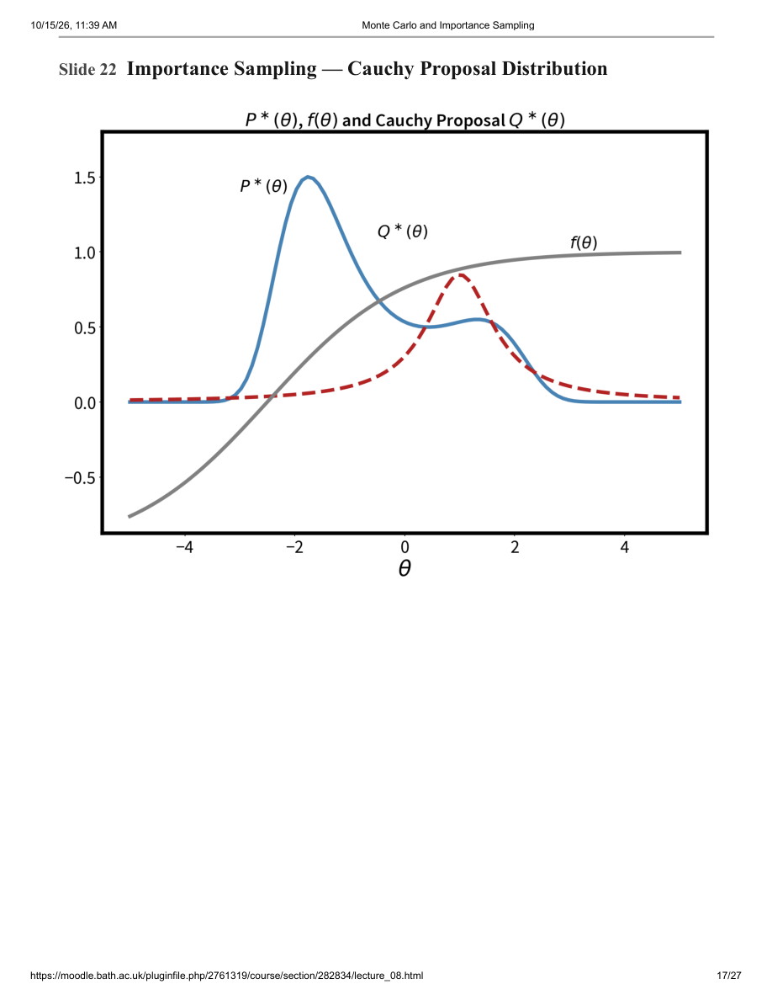

## Page 18

### Slide 23: Importance Sampling — Better Estimate

The 5,000-sample Cauchy-proposal running estimate fluctuates around the dashed expectation reference. Compared with the bad proposal, it avoids the same conspicuous long-run displacement. It does not establish a universal sample-by-sample improvement.

Original page 18 (figures and equation layout)

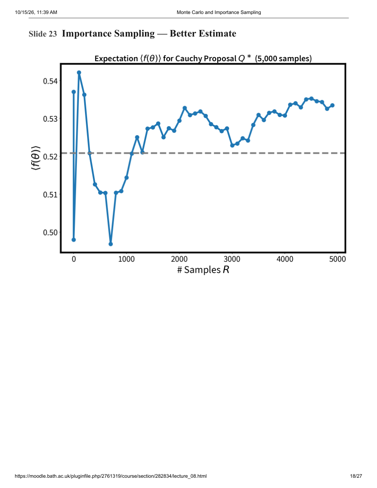

## Page 19

Slide 23 continues: the Cauchy-proposal plot extends to 50,000 samples and settles closer to the reference near 0.52.

### Slide 24: Importance Sampling — Summary

- Efficiency and accuracy require a proposal $Q(\theta)$ that approximates the target $P(\theta)$ well.
- A good proposal is hard to find.
- In particular, $Q$ should not be small where $P$ has significant probability mass.
- Generally, $Q$ should be heavy-tailed.
- The lecture concludes that importance sampling is not practical in high dimensions.

The source now writes $P$ rather than the earlier $p$/$P^*$; this is target-distribution notation, not a new explicitly defined quantity.

Original page 19 (figures and equation layout)

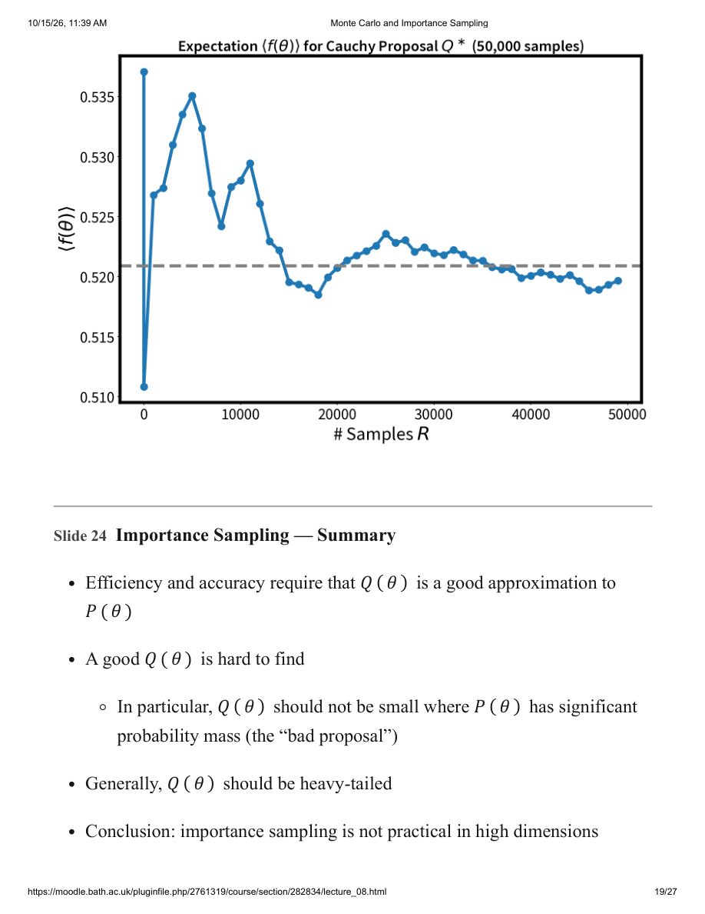

## Page 20

Slide 24 continues: importance sampling still has applications in certain lower-dimensional settings. For higher dimensions the lecture turns to Markov Chain Monte Carlo.

### Slide 25: Further Motivation: The “Curse of Dimensionality” Again!

**Where is the Gaussian probability mass?** The original figure starts with a bell-shaped Gaussian curve labelled $\sigma=1$. The following six pages continue this slide with dimension-labelled shaded figures.

Original page 20 (figures and equation layout)

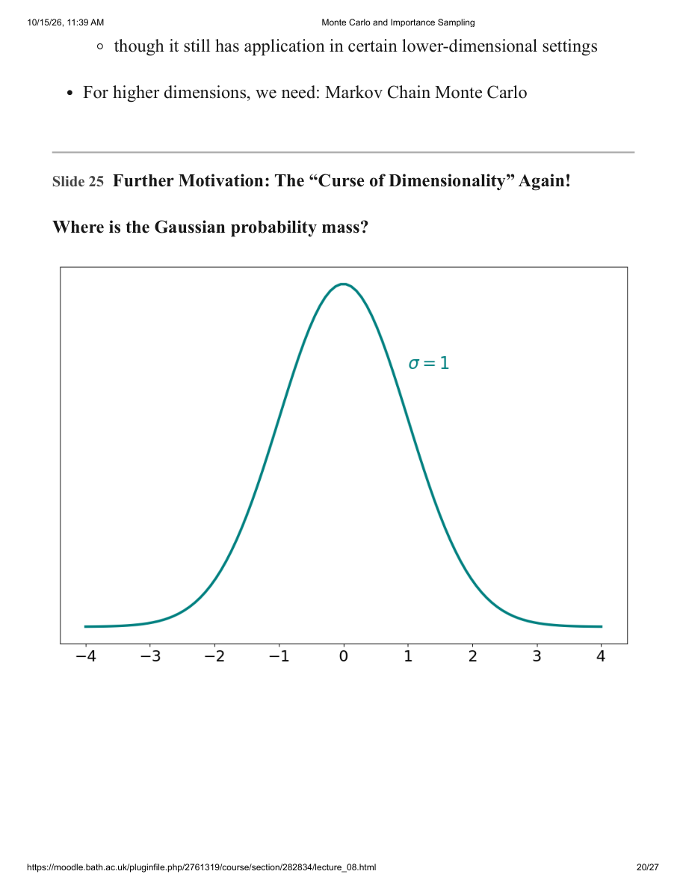

## Page 21

Slide 25 continues: **Dimension = 1**, $\sigma=1$. The shaded Gaussian figure labels three regions **87%**, **12%**, and **1%**. Vertical boundaries appear near $\pm1.5$ and $\pm2.5$.

Original page 21 (figures and equation layout)

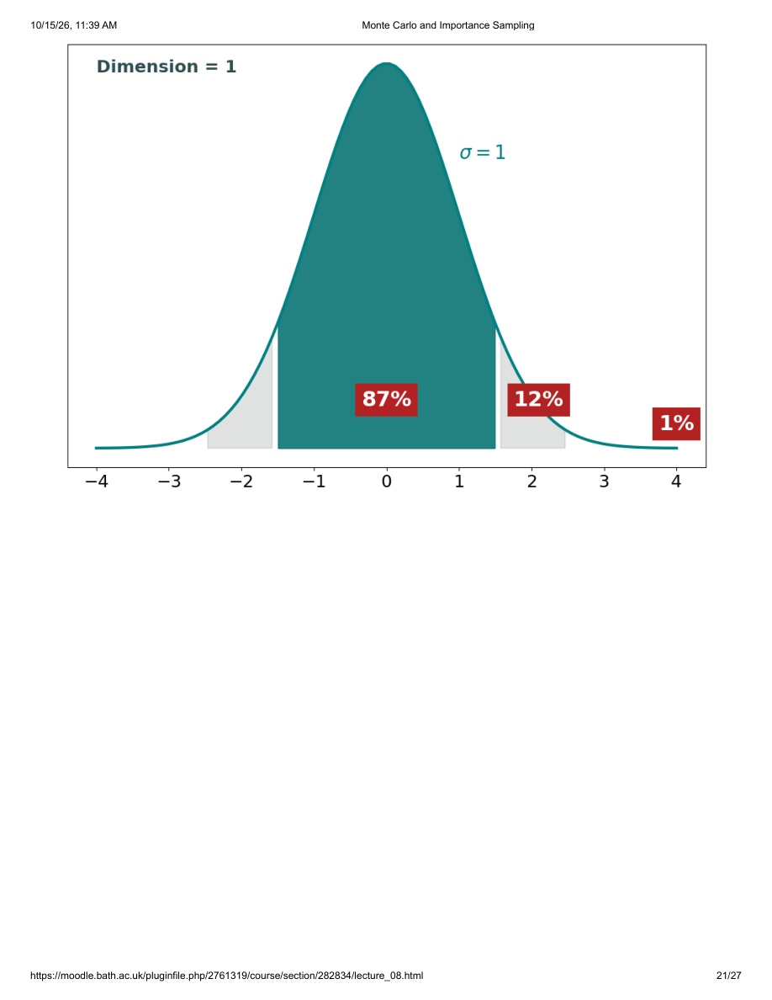

## Page 22

Slide 25 continues: **Dimension = 2**, $\sigma=1$. The region labels change to **75%**, **22%**, and **2%** (rounded values). The same one-dimensional Gaussian outline is retained.

Original page 22 (figures and equation layout)

## Page 23

Slide 25 continues: **Dimension = 3**, $\sigma=1$. The three region labels are **65%**, **31%**, and **4%**.

Original page 23 (figures and equation layout)

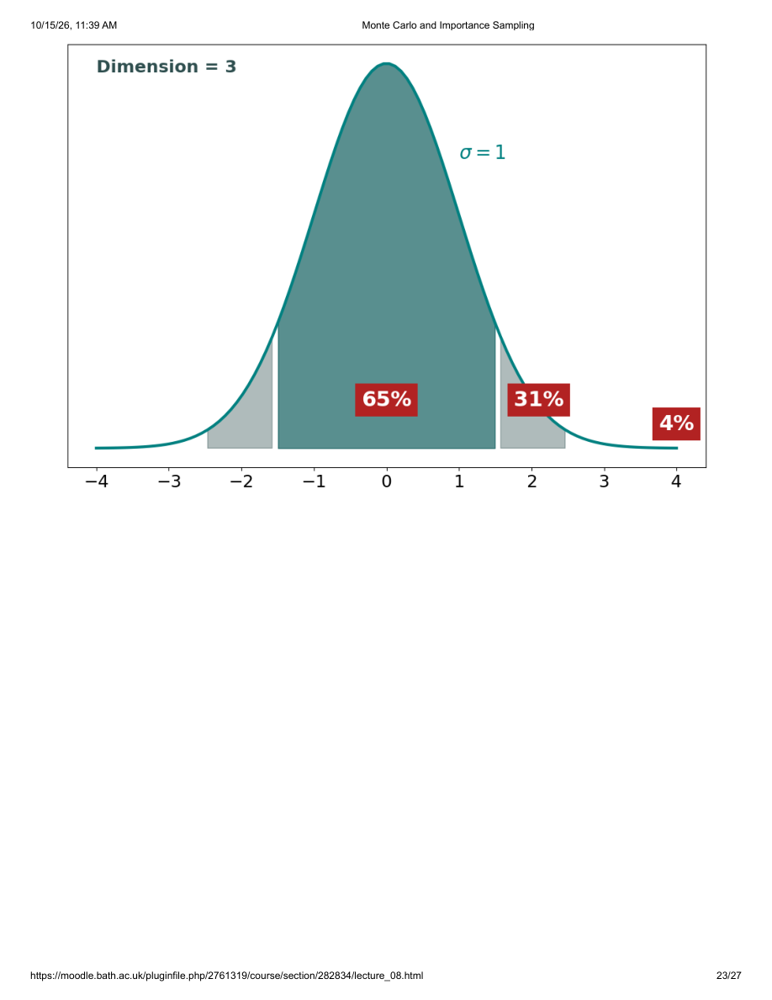

## Page 24

Slide 25 continues: **Dimension = 5**, $\sigma=1$. The labels are **49%**, **45%**, and **6%**.

Original page 24 (figures and equation layout)

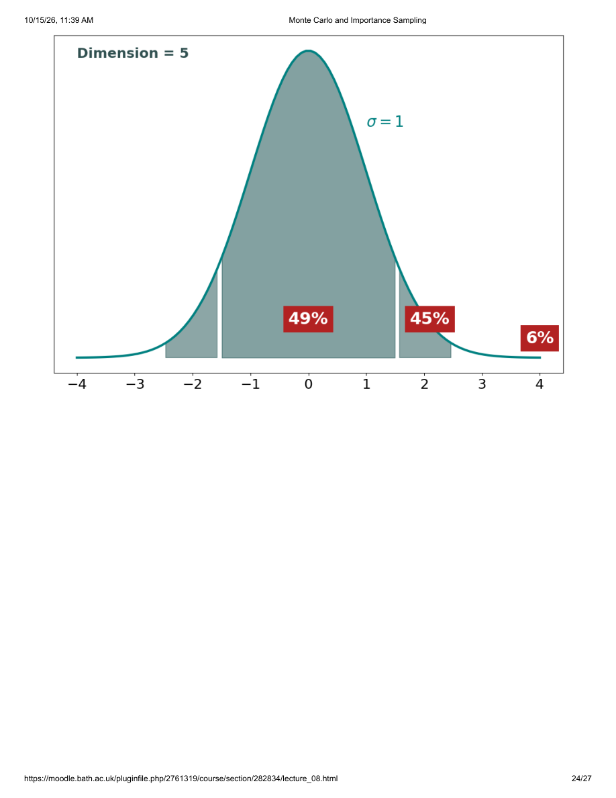

## Page 25

Slide 25 continues: **Dimension = 10**, $\sigma=1$. The labels are **24%**, **64%**, and **12%**.

Original page 25 (figures and equation layout)

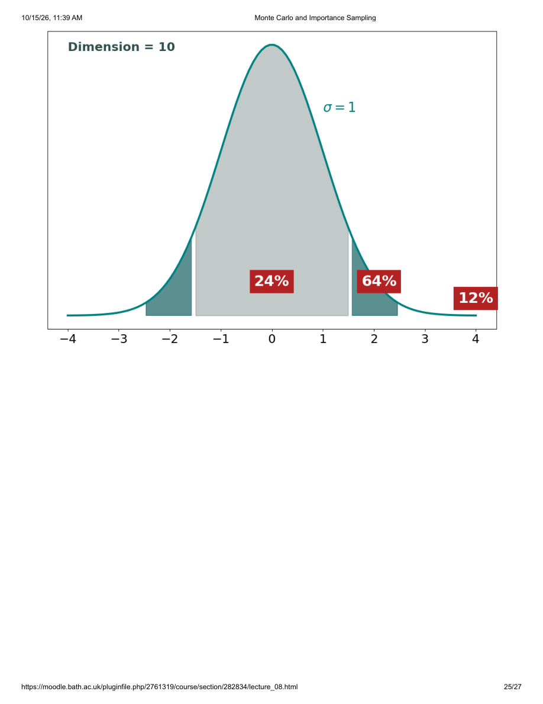

## Page 26

Slide 25 continues: **Dimension = 25**, $\sigma=1$. The labels are **3%**, **70%**, and **27%**.

**Figure limitation:** the PDF supplies no formula or explicit definition of the higher-dimensional shaded regions. These rounded percentages agree with nested axis-aligned Gaussian hypercubes at coordinate cutoffs 1.5 and 2.5; they are not the probabilities for fixed-radius Euclidean balls. This is an explanatory reconstruction, not an extra printed slide claim.

### Slide 26: Markov Chain Monte Carlo (MCMC) — Preview

It is difficult to find a globally close proposal $Q(\boldsymbol\theta)$, especially in high dimensions. MCMC aims to obtain samples from $P(\boldsymbol\theta)$ without requiring such a globally close proposal.

Original page 26 (figures and equation layout)

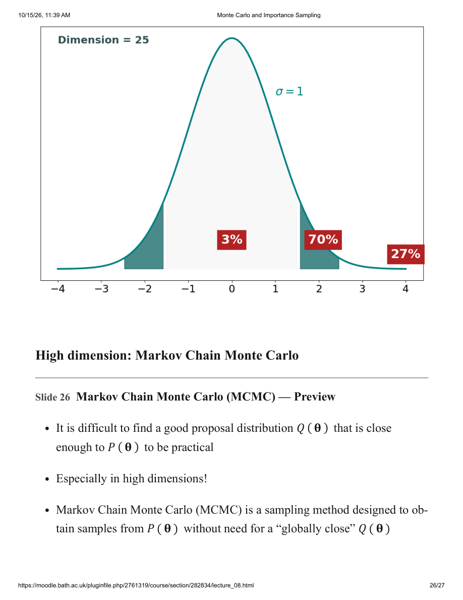

## Page 27

Slide 26 continues: instead use a local proposal

$$Q(\boldsymbol\theta'\mid\boldsymbol\theta^{(t)})$$

which can, in principle, track regions of high probability mass. The method is deferred until next week. This is a preview, not a complete transition algorithm or a statement that the samples are independent.

Original page 27 (figures and equation layout)

