# MCMC & Hamiltonian Monte Carlo

## Cutting-Edge Stochastic Approximation

**Author:** Edward Milsom  
**Date:** 2026-10-15  
**Source:** [Lecture 9 PDF](9.pdf)

Transcription preserves all 26 numbered slides across 34 printed PDF pages, including figure-only continuations. Browser print headers and footers are omitted from the prose but retained in original-page images. Supplemental corrections are labelled; source plots are not newly executed demo output.

## Page 1

### Slide 1: In this Episode ...

- Recap: expectations and Monte Carlo approximation.
- Markov-Chain Monte Carlo (MCMC).
- The Metropolis(-Hastings) method in detail: algorithm, justification and observations, examples and the effect of dimensionality.
- Hamiltonian Monte Carlo (HMC).
- Further reading and Python software libraries for HMC.
- Not covered in this course, but well-known: Gibbs sampling.

Original page 1 (figures and equation layout)

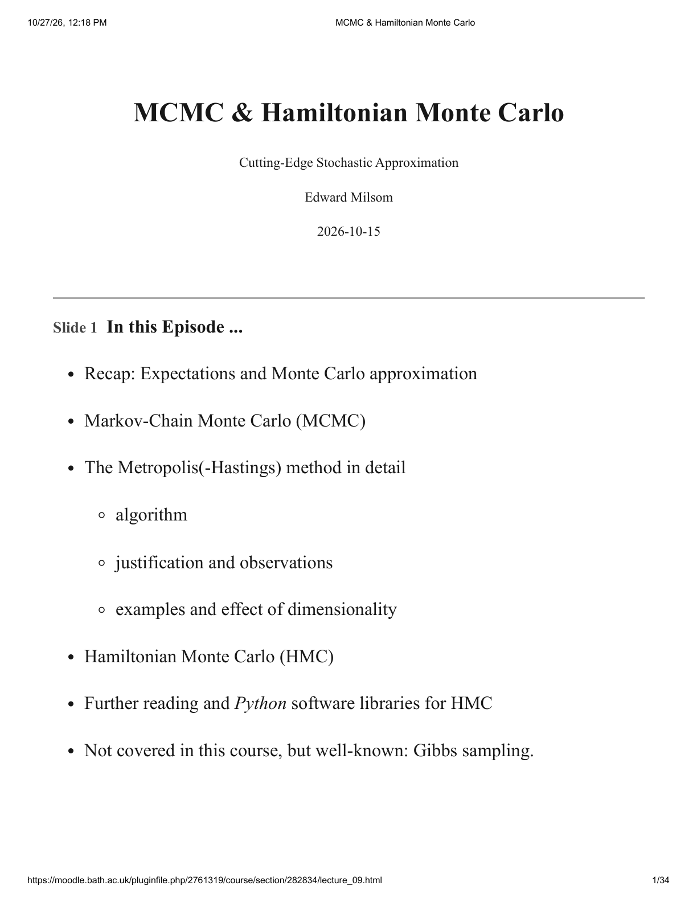

## Page 2

### Slide 2: Recap — Approximating Expectations

Bayesian integrals are often analytically intractable, for example prediction for new data $y_*$ with model $\mathcal M$:

$$p(y_*\mid\mathcal D,\mathcal M)=\int p(y_*\mid\boldsymbol\theta,\mathcal M)p(\boldsymbol\theta\mid\mathcal D,\mathcal M)\,d\boldsymbol\theta.$$

This is an expectation:

$$F=\langle f(\theta)\rangle_{p(\theta)}=\int f(\theta)p(\theta)\,d\theta.$$

It can be approximated by a Monte Carlo average:

$$\widehat F=\frac1R\sum_{r=1}^R f(\boldsymbol\theta^{(r)}),$$

where the recap assumes independent random samples $\boldsymbol\theta^{(r)}$ from $p(\boldsymbol\theta)$.

### Slide 3: Recap — Monte Carlo Approximation

The previous lecture considered obtaining samples using importance sampling. The source then says “in both cases” without a second visible item in this printed list.

Assume $p(\boldsymbol\theta)=P^*(\boldsymbol\theta)/Z$: we can compute $P^*$, but not $Z$. Define a proposal

$$Q(\boldsymbol\theta)=\frac{Q^*(\boldsymbol\theta)}{Z_Q},$$

from which we can generate samples and evaluate $Q^*(\boldsymbol\theta)$.

Original page 2 (figures and equation layout)

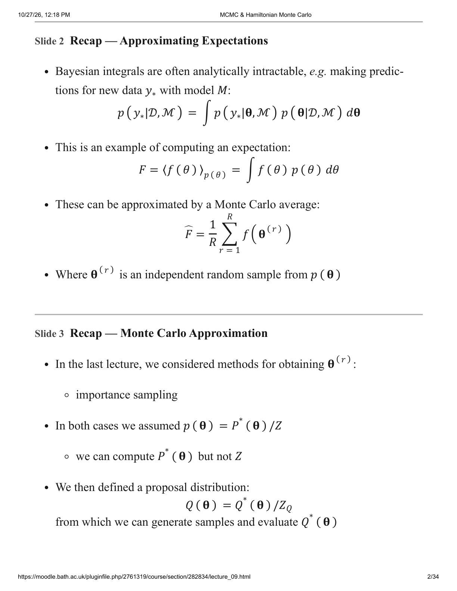

## Page 3

Slide 3 continues: the proposal $Q(\boldsymbol\theta)$ is required to be close to the target $P(\boldsymbol\theta)$.

**Supplemental qualification:** support coverage is a mathematical requirement for general importance sampling; “close” describes practical variance control, not an exact universal distance criterion. The source switches between $P$ and $p$ for the normalised target.

### Slide 4: Markov Chain Monte Carlo (MCMC) — Motivation

Finding a good global proposal close enough to the target to be practical is difficult, especially in high dimensions. MCMC instead uses a local proposal $Q(\boldsymbol\theta'\mid\boldsymbol\theta^{(t)})$, conditional on the current sample or state $\boldsymbol\theta^{(t)}$.

### Slide 5: Markov Chains — Some Definitions

A first-order Markov chain is a sequence of random variables $x^{(1)},\ldots,x^{(T)}$ satisfying the conditional independence property

$$p(x^{(t)}\mid x^{(1)},\ldots,x^{(t-1)})=p(x^{(t)}\mid x^{(t-1)}).$$

**Index qualification:** this expression describes transitions for $t\ge2$; the source prints the range starting at 1. An initial distribution supplies the first state.

Original page 3 (figures and equation layout)

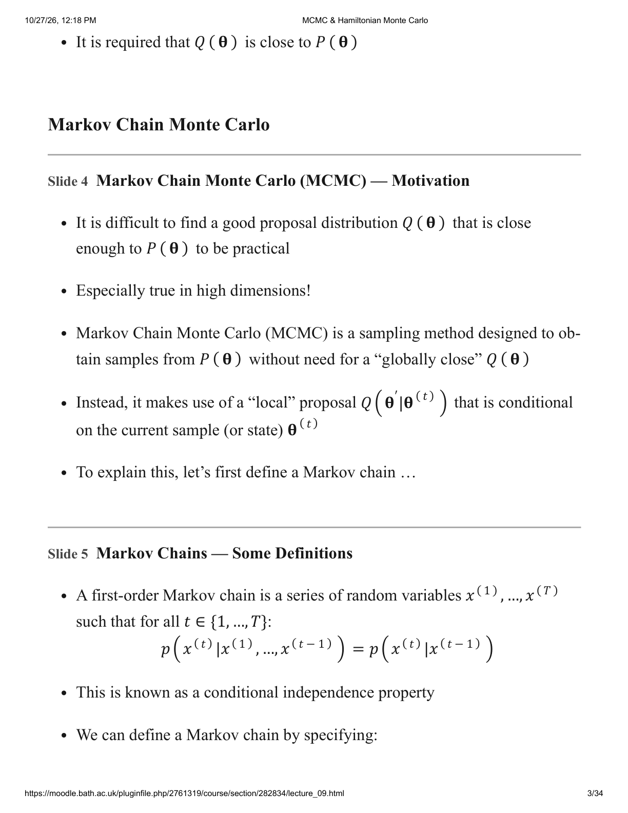

## Page 4

Slide 5 continues. Specify a chain using:

- a state space, for example $x$ or $\boldsymbol\theta$;
- an initial-state distribution $p(x^{(0)})$;
- transition probabilities $T(x'\mid x)$ for moving from $x$ to $x'$.

Given appropriate conditions, the chain converges to a unique equilibrium distribution as $t\to\infty$. Design that equilibrium to be the desired target, for example $p(\alpha,\sigma,r\mid\mathbf y)$.

### Slide 6: Markov Chains — A Simple Illustration

The source introduces a six-state discrete chain, $x\in\{0,\ldots,5\}$, and names its transition matrix $\mathbf T$. **Source limitation:** no numerical matrix entries are visible after the colon in this printed PDF. The illustration continues across pages 5–7; these plots do not supply a complete numerical transition matrix.

Original page 4 (figures and equation layout)

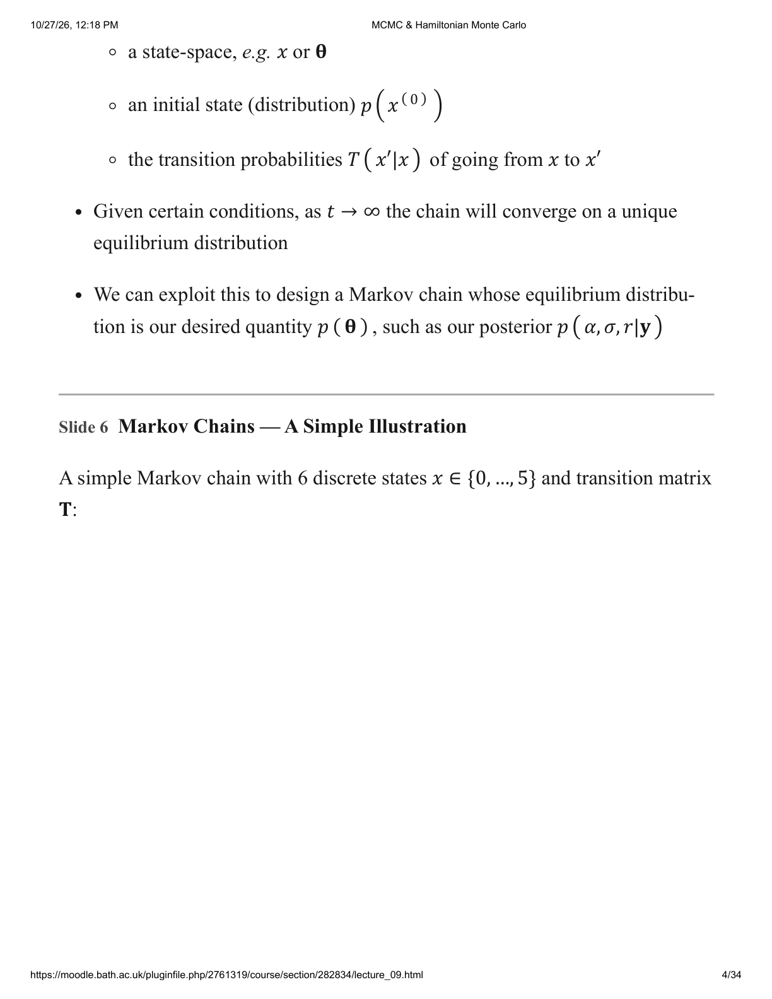

## Page 5

Slide 6 continues: two realised state-versus-time displays. Horizontal axis is time $t$ (approximately 10 and 100 transitions in the two panels); vertical axis is state $x\in\{0,\ldots,5\}$. Black marks indicate realised states. These are trajectories, not a numerical transition matrix.

Original page 5 (figures and equation layout)

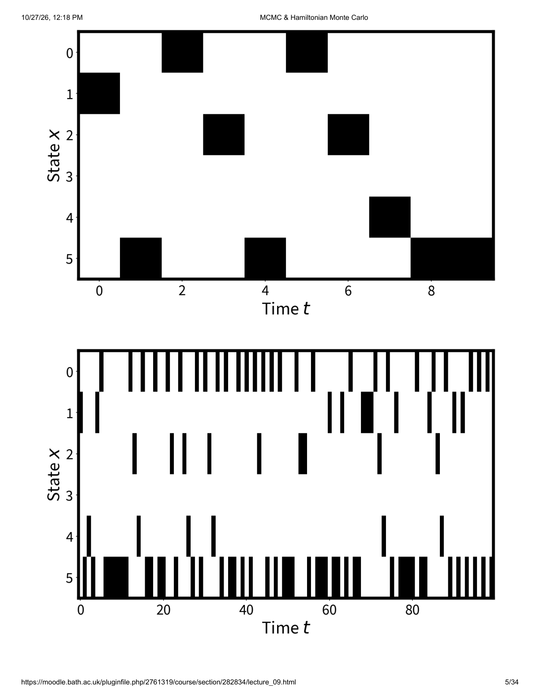

## Page 6

Slide 6 continues: a longer state-versus-time display, extending to about 1000 transitions. Occupation is visibly uneven across the six states; precise equilibrium probabilities are not given by this plot alone.

Original page 6 (figures and equation layout)

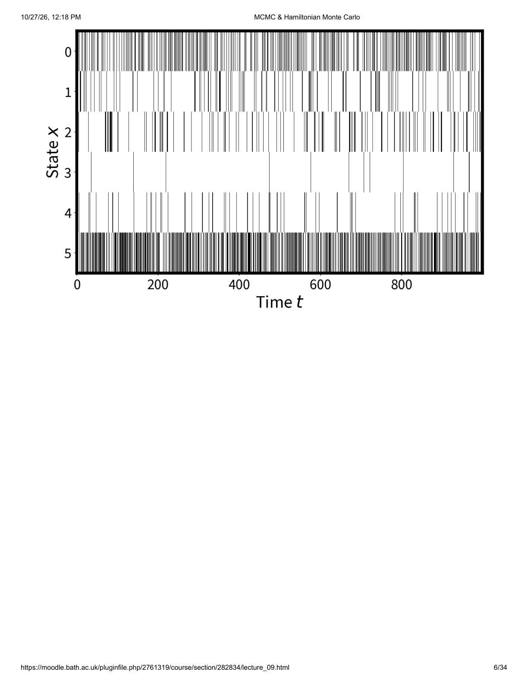

## Page 7

Slide 6 concludes with a heatmap of the evolving state probabilities: horizontal axis time $t$, vertical axis state (labelled probability $p(x)$), colour scale 0 to 1. The initial distribution concentrates at state 1, unlike a trajectory plot that records just one realised state at each time.

### Slide 7: The Metropolis-Hastings Algorithm — Basics

Instead of the fixed global proposal $Q(\theta)$ used previously, propose a candidate $\theta'$ from a density or kernel conditional on the current state:

$$Q(\theta'\mid\theta^{(t)}).$$

This local proposal need not itself represent the global target $p(\theta)$.

Original page 7 (figures and equation layout)

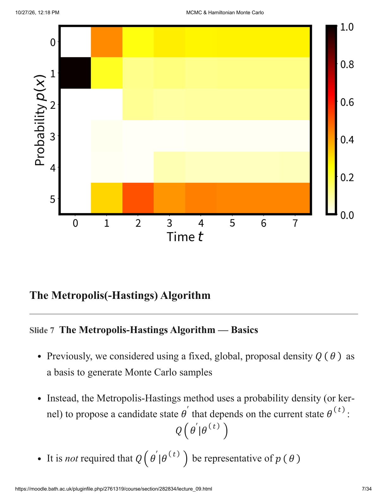

## Page 8

Slide 7 continues: the proposal could be a narrow Gaussian centred on $\theta^{(t)}$. The candidate is accepted or rejected; the resulting chain should approach the distribution of interest.

### Slide 8: The Metropolis-Hastings Algorithm

1. Select a starting point $\theta^{(0)}$.
2. Generate a candidate $\theta'\sim Q(\theta'\mid\theta^{(t)})$.
3. Evaluate $P^*(\theta')$.
4. Compute

$$\kappa=\frac{P^*(\theta')Q(\theta^{(t)}\mid\theta')}{P^*(\theta^{(t)})Q(\theta'\mid\theta^{(t)})}.$$

5. If $\kappa\ge1$, accept the candidate.
6. Otherwise accept with probability $\kappa$.
7. Set $\theta^{(t+1)}=\theta'$ on acceptance; **repeat** $\theta^{(t)}$ on rejection.
8. Repeat the proposal/update cycle.

**Source limitation:** the printed “Return to Step” has a missing step number. Returning to step 2 is the algorithmic interpretation, not an additional printed number.

Original page 8 (figures and equation layout)

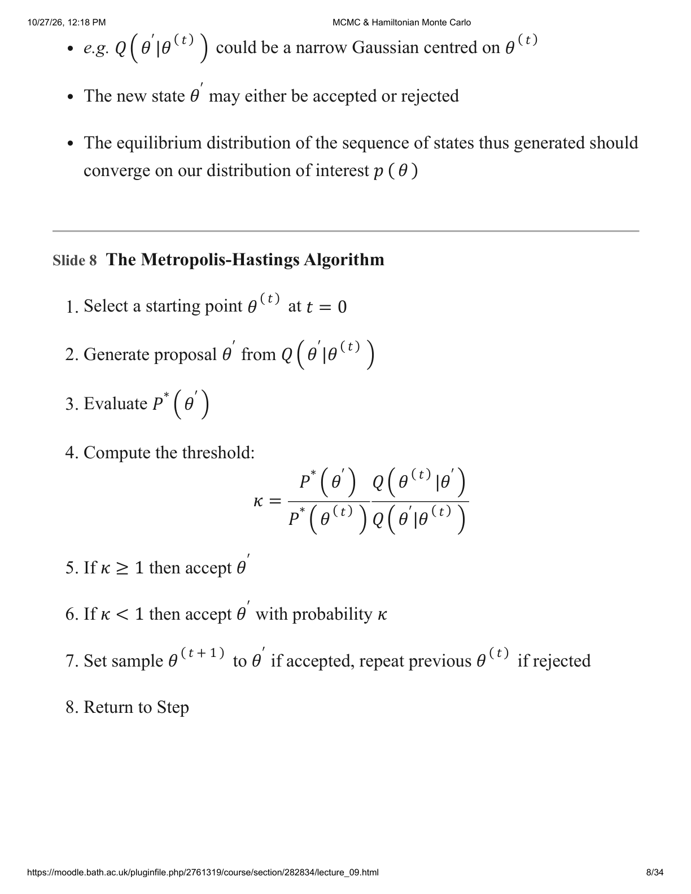

## Page 9

### Slide 9: The Metropolis Algorithm — Example

Original graphical example, continuing onto page 10. The initialisation panel plots unnormalised target $P^*(\theta)$ in blue and dashed local proposal $Q^*(\theta\mid\theta_t,r=0.5)$ in red, centred near the starting point $\theta=-4$. They are not a supplied executable demo or numerical sample table.

Original page 9 (figures and equation layout)

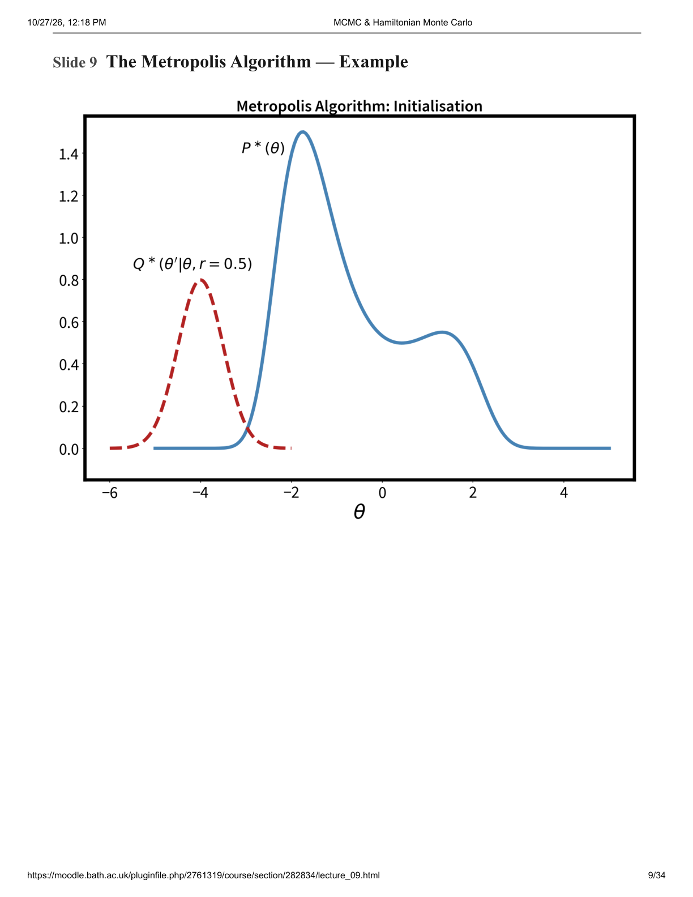

## Page 10

Slide 9 concludes with the same target/proposal display labelled “25 Samples”, including sample markers along the parameter axis. The short run is an illustration, not evidence of full equilibrium exploration.

### Slide 10: The Metropolis Algorithm — Justification

With appropriate requirements, the Metropolis algorithm converges to $p(\boldsymbol\theta)$; the lecture points to MacKay, Chapter 29.6. A key property is detailed balance:

$$T(\boldsymbol\theta_a\mid\boldsymbol\theta_b)p(\boldsymbol\theta_b)=T(\boldsymbol\theta_b\mid\boldsymbol\theta_a)p(\boldsymbol\theta_a)\quad\text{for all }\boldsymbol\theta_a,\boldsymbol\theta_b.$$

The source calls this a necessary condition for convergence and says Metropolis satisfies it.

**Supplemental correction:** detailed balance is a sufficient route to stationarity, not a necessary condition for every convergent MCMC method. Stationarity alone does not prove convergence from an arbitrary start: suitable irreducibility/recurrence and, for usual marginal convergence, aperiodicity conditions matter.

Original page 10 (figures and equation layout)

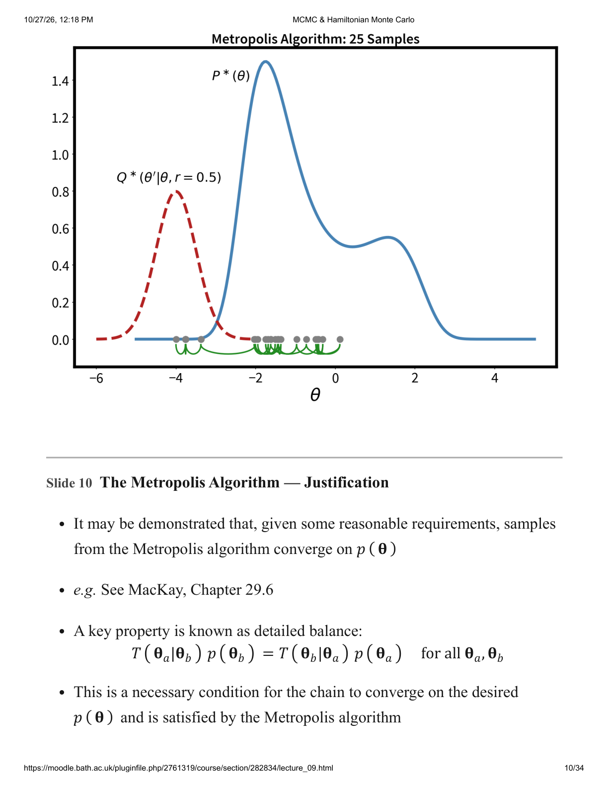

## Page 11

### Slide 11: The Metropolis Algorithm — Comments

- Metropolis assumes a symmetric proposal: $Q(\theta'\mid\theta^{(t)})=Q(\theta^{(t)}\mid\theta')$. Metropolis-Hastings includes the proposal ratio for asymmetry.
- The proposal and its length scale $r$ must still be chosen.
- Allow time to approach equilibrium: the “burn in” period. Assessing convergence is difficult.
- Successive samples are not independent. The lecture suggests retaining every $K$th sample and says how to choose this is not straightforward.

**Supplemental qualification:** the source's statement that discarding samples is necessary is too strong. Correlated samples can estimate expectations through a Markov-chain law of large numbers under appropriate conditions. Routine thinning is not required for validity and does not guarantee independence; assess autocorrelation, effective sample size and Monte Carlo error. Burn-in removes an initial segment, not all dependence or a proof of convergence.

Original page 11 (figures and equation layout)

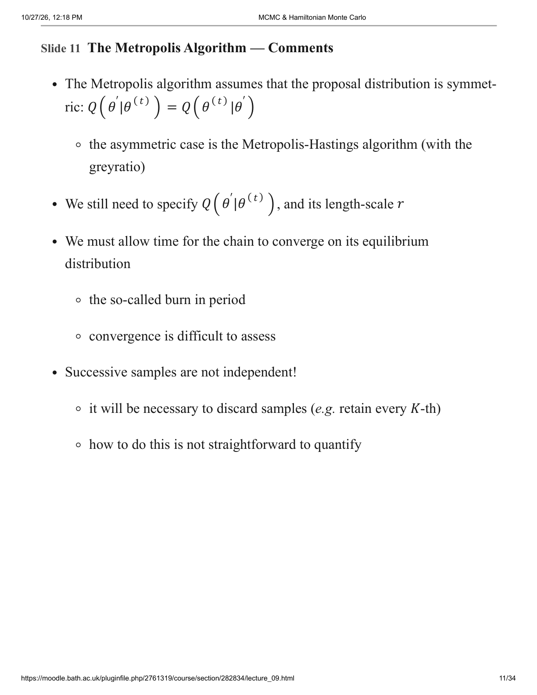

## Page 12

### Slide 12: The Metropolis Algorithm — Example

Original plot labelled “100 Samples”: blue target density $P(\theta)$ and gold empirical histogram above a grey sample trace. The horizontal coordinate is parameter $\theta$; sample order runs down the lower panel. The sequence continues through page 14.

Original page 12 (figures and equation layout)

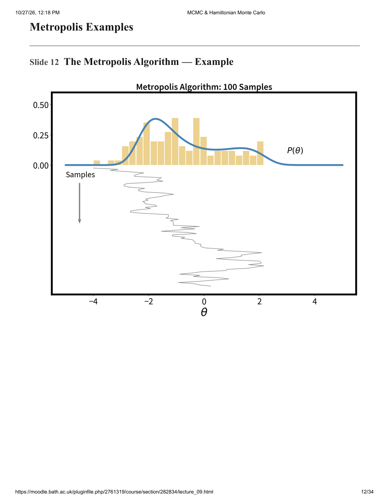

## Page 13

Slide 12 continues with the same target/histogram and sample-trace layout labelled “1,000 Samples”. A similar histogram does not prove sample independence.

Original page 13 (figures and equation layout)

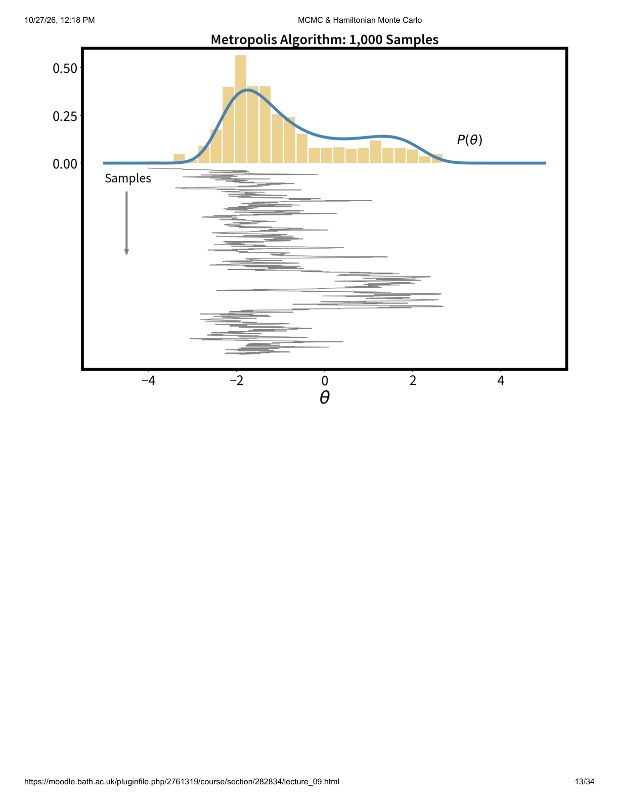

## Page 14

Slide 12 concludes with a plot labelled “100,000 Samples”, again showing a target density, empirical histogram and grey sample trace.

### Slide 13: The Metropolis Algorithm — Higher Dimensions

A correlated target $P^*(\boldsymbol\theta)$ is shown. The example continues with the target and local proposal on pages 15–16.

Original page 14 (figures and equation layout)

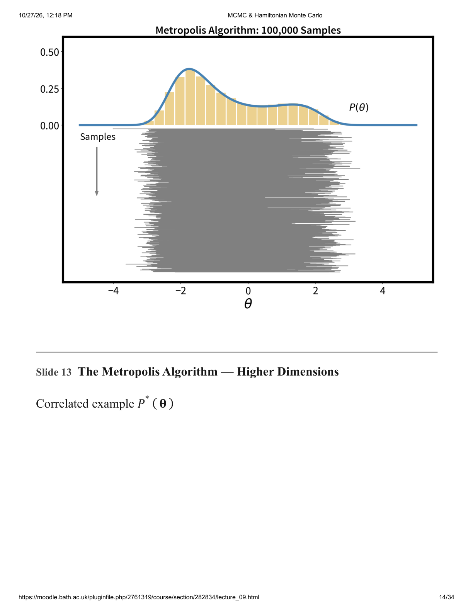

## Page 15

Slide 13 continues: elongated target contours plotted against $\theta_1$ and $\theta_2$. The caption introduces the target with proposal $Q(\theta'\mid\theta^{(t)})$, whose red contours appear on page 16.

Original page 15 (figures and equation layout)

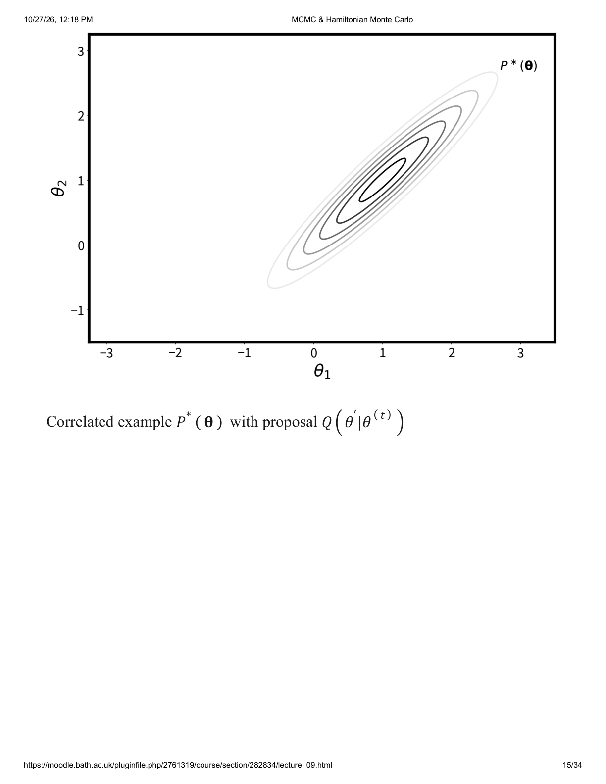

## Page 16

Slide 13 concludes with a narrow red isotropic proposal at the starting point against elongated grey target contours; the proposal annotation gives $r=0.1$.

### Slide 14: The Metropolis Algorithm — Higher Dimensions

Length scale $r$ universally too small: random-walk behaviour. The sequence compares other directional mismatches on pages 17–19.

Original page 16 (figures and equation layout)

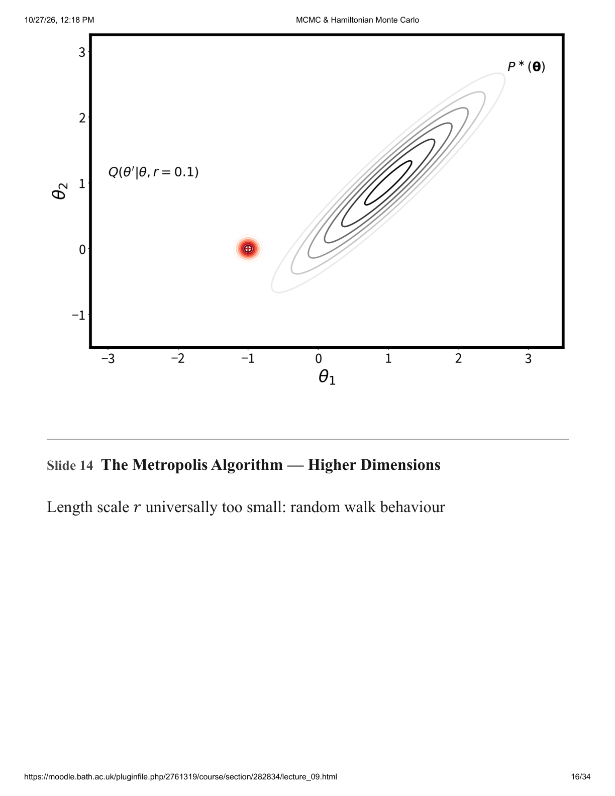

## Page 17

Slide 14 continues: green path and red rejected proposals for $r=0.1$, annotated “10 / 100 rejected”. The next caption describes a length scale too small in one direction, causing random-walk behaviour there.

Original page 17 (figures and equation layout)

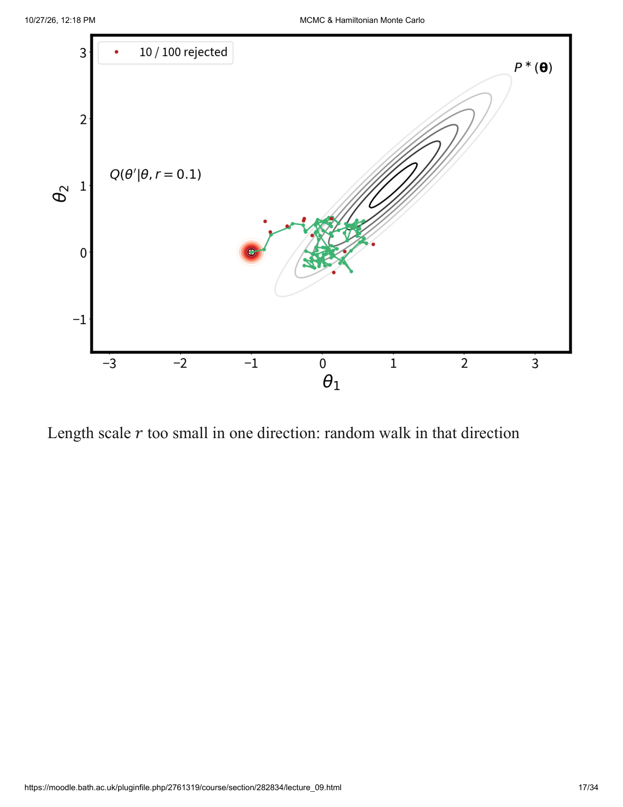

## Page 18

Slide 14 continues: target/proposal and sample path for $r=0.2$, annotated “20 / 100 rejected”. The next caption introduces a length scale too large in one direction, causing many rejected samples; that $r=1.0$ plot appears on page 19.

Original page 18 (figures and equation layout)

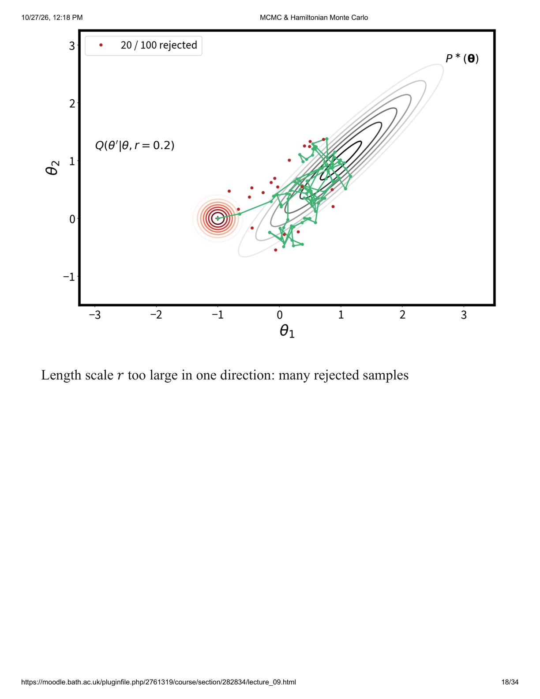

## Page 19

Slide 14 concludes with the $r=1.0$ proposal/trajectory plot, annotated “71 / 100 rejected”. Red proposal contours extend widely across the narrow target direction; green paths and red rejected points illustrate the consequence.

### Slide 15: Metropolis-Hastings: Summary

Convergence is problematic when different directions have significantly different length scales:

- $r$ too small: slow random-walk exploration.
- $r$ too large: many proposals rejected.

The lecture says $r$ must be no greater than $\sigma_{\min}$, the target's smallest length scale, to prevent catastrophic rejection in high dimensions. The step-count expression continues on page 20.

**Supplemental qualification:** this is a heuristic for the illustrated single-scale random-walk proposal, not a universal sharp bound for all targets, dimensions or proposal covariance choices.

Original page 19 (figures and equation layout)

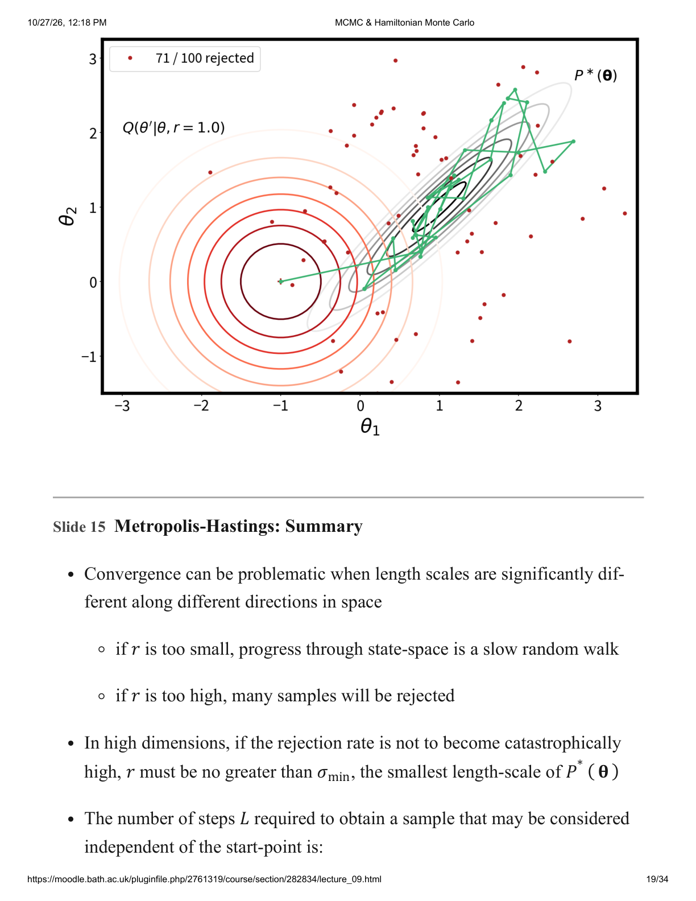

## Page 20

Slide 15 continues. The lecture estimates the number of steps $L$ needed for a sample effectively independent of the start as

$$L\ge\left(\frac{\sigma_{\max}}r\right)^2,$$

where $\sigma_{\max}$ is the largest target length scale. This can take a very long time.

**Supplemental qualification:** the squared-distance argument explains diffusive exploration; it is not a general theorem guaranteeing independence after this many transitions.

### Slide 16: Metropolis-Hastings: Length Scales

Original illustration with proposal length scale $r$ matched to $\sigma_{\min}$; the plotted proposal is labelled $r=0.2$ with “20 / 100 rejected”.

Original page 20 (figures and equation layout)

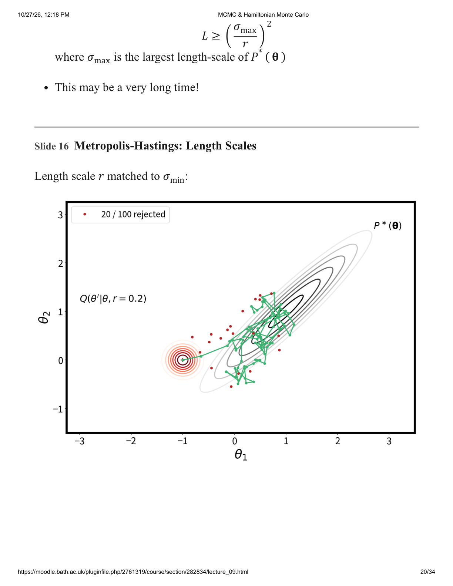

## Page 21

### Slide 17: Distributions in High Dimensions

Where is the Gaussian probability mass? The original outline is labelled $\sigma=1$ and “Dimension = 1”, with central/middle/outer labels 87%, 12%, 1%. The sequence continues over pages 22–25. The PDF does not explicitly define the higher-dimensional regions; do not identify these percentages as Euclidean radial-shell probabilities without qualification.

Original page 21 (figures and equation layout)

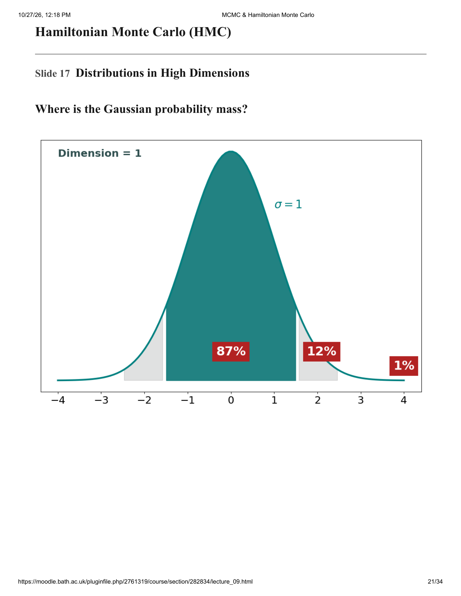

## Page 22

Slide 17 continues: “Dimension = 2”, with central/middle/outer labels 75%, 22%, 2%.

Original page 22 (figures and equation layout)

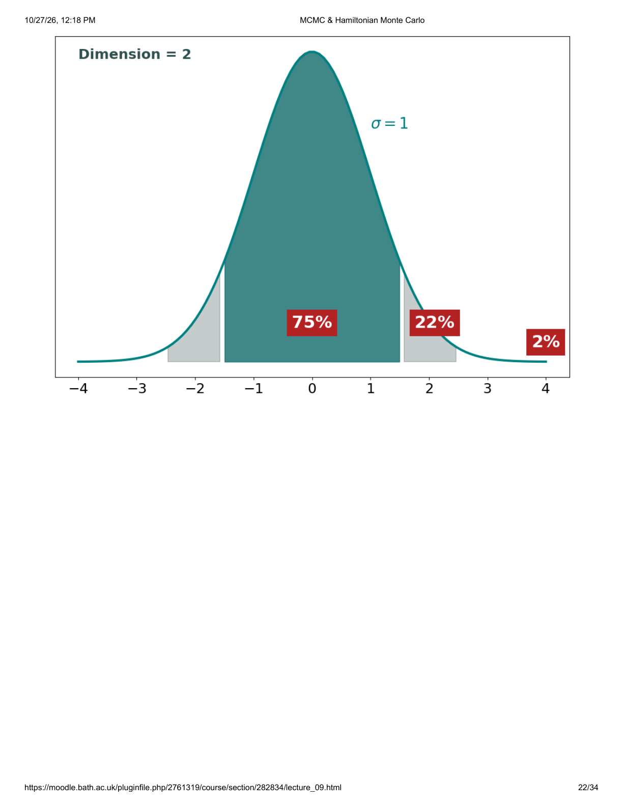

## Page 23

Slide 17 continues: “Dimension = 5”, with central/middle/outer labels 49%, 45%, 6%.

Original page 23 (figures and equation layout)

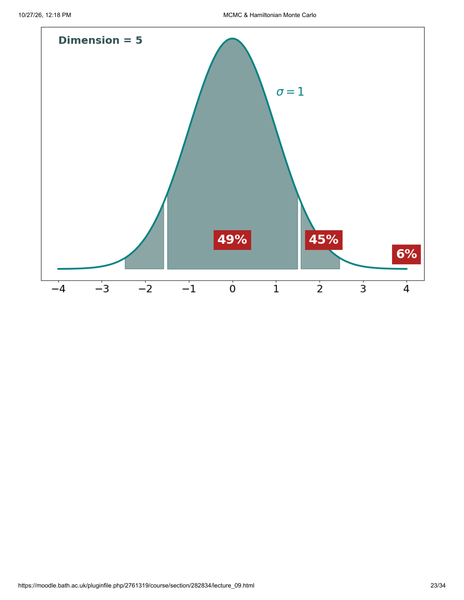

## Page 24

Slide 17 continues: “Dimension = 10”, with central/middle/outer labels 24%, 64%, 12%.

Original page 24 (figures and equation layout)

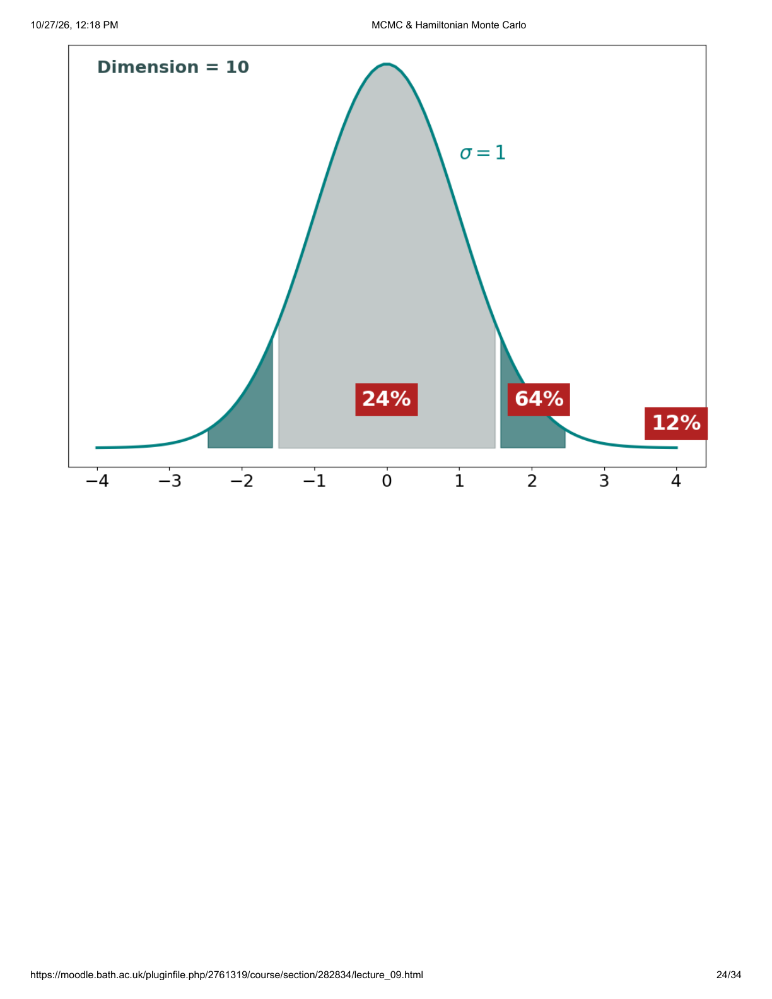

## Page 25

Slide 17 concludes: “Dimension = 25”, with central/middle/outer labels 3%, 70%, 27%. Rounded labels need not sum exactly to 100%. **Supplemental interpretation:** these percentages match independent-coordinate nested hypercubes with cutoffs near 1.5 and 2.5 standard deviations, not fixed-radius spheres; the source does not explicitly state that construction.

### Slide 18: Hamiltonian (or Hybrid) Monte Carlo

The lecture presents HMC as a “state of the art” stochastic approximation method. Intuition: kicking a ball around the $\log P^*(\boldsymbol\theta)$ landscape and simulating its dynamics.

HMC uses gradient information $\partial\log P^*(\boldsymbol\theta)/\partial\boldsymbol\theta$. Introduce momentum variables $\rho_i=\partial\theta_i/\partial t$ and the Hamiltonian

$$H(\boldsymbol\theta,\boldsymbol\rho)=-\log P^*(\boldsymbol\theta)+\frac12\|\boldsymbol\rho\|^2.$$

**Notation qualification:** the momentum/velocity identification assumes the source's identity mass matrix. With this Hamiltonian the potential-energy landscape is $-\log P^*$; it is not maximisation of $\log P^*$ alone.

Original page 25 (figures and equation layout)

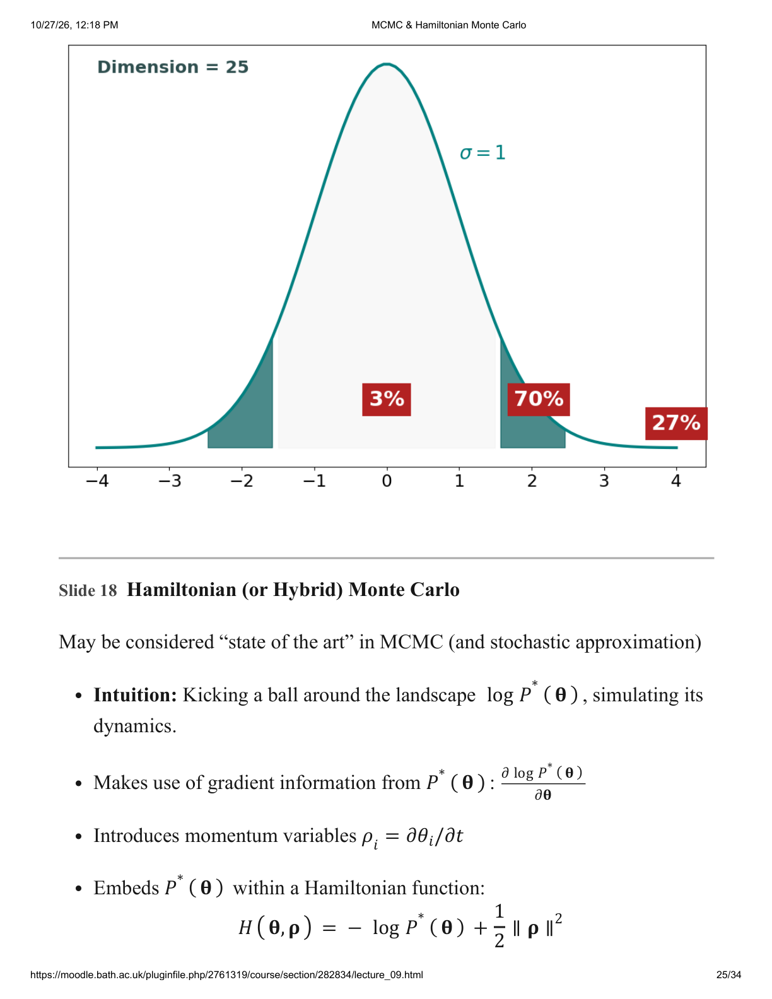

## Page 26

Slide 18 continues. Sample momentum, advance Hamiltonian dynamics numerically for several steps, and apply a Metropolis correction:

$$a=\min\{1,\exp[H(\boldsymbol\theta,\boldsymbol\rho)-H(\boldsymbol\theta',\boldsymbol\rho')]\}.$$

The source says the new state should be independent, with no subsampling.

**Supplemental correction:** HMC can reduce random-walk behaviour and autocorrelation but generally still produces a dependent Markov chain; independence is not guaranteed. Numerical proposals need an appropriate reversible, volume-preserving construction, not an arbitrary ODE solver with this acceptance rule.

### Slide 19: Hamiltonian Monte Carlo — Correlated Example

Original correlated-target plot against $\theta_1$ and $\theta_2$, labelled “Hamiltonian Monte Carlo (100 Samples)” and “1 rejected sample”. Green sample positions spread along elongated target contours; these labels describe this source figure, not a new run or a proof of independence.

Original page 26 (figures and equation layout)

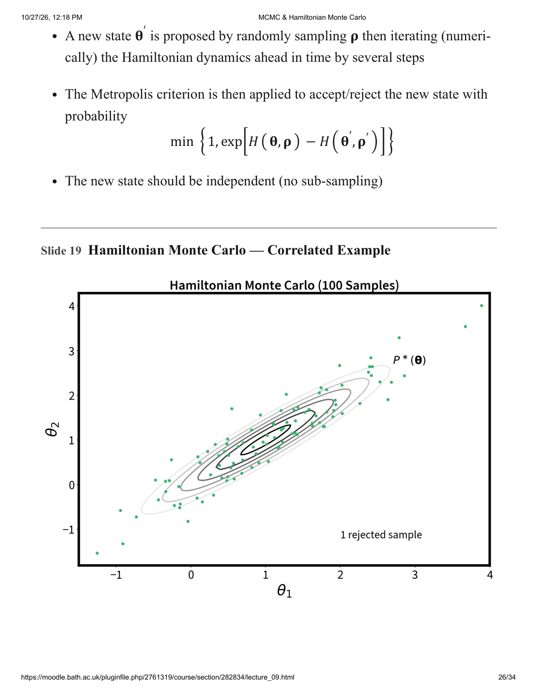

## Page 27

### Slide 20: Hamiltonian Monte Carlo — Linear Regression

Return to the earlier regression model. Use HMC for the posterior over $\alpha$, noise scale and basis width $r$; weights $\mathbf w$ are integrated out analytically:

$$p(\alpha,\sigma^2,r\mid\mathbf y)=\frac{p(\mathbf y\mid\alpha,\sigma^2,r)p(\alpha)p(\sigma^2)p(r)}{p(\mathbf y)}.$$

The numerator defines $P^*$. Here $p(\mathbf y\mid\alpha,\sigma^2,r)$ is marginal likelihood. The source assumes log-uniform priors on the three positive hyperparameters. Approximate

$$p(y_*\mid\mathbf y)=\iiint p(y_*\mid\mathbf y,\alpha,\sigma^2,r)p(\alpha,\sigma^2,r\mid\mathbf y)\,d\alpha\,d\sigma^2\,dr.$$

**Supplemental qualification:** the prose alternates $\sigma$ and $\sigma^2$; the displayed density uses the variance measure $d\sigma^2$. Priors, transformation Jacobians and sampler coordinates must agree. Proper bounded log-uniform priors have raw-coordinate densities proportional to inverse scale on the stated bounds; no finite bounds are supplied here.

### Slide 21: Hamiltonian Monte Carlo — Linear Regression

The mean predictor, averaged over $p(\alpha,\sigma^2,r\mid\mathbf y)$, is shown on page 28.

Original page 27 (figures and equation layout)

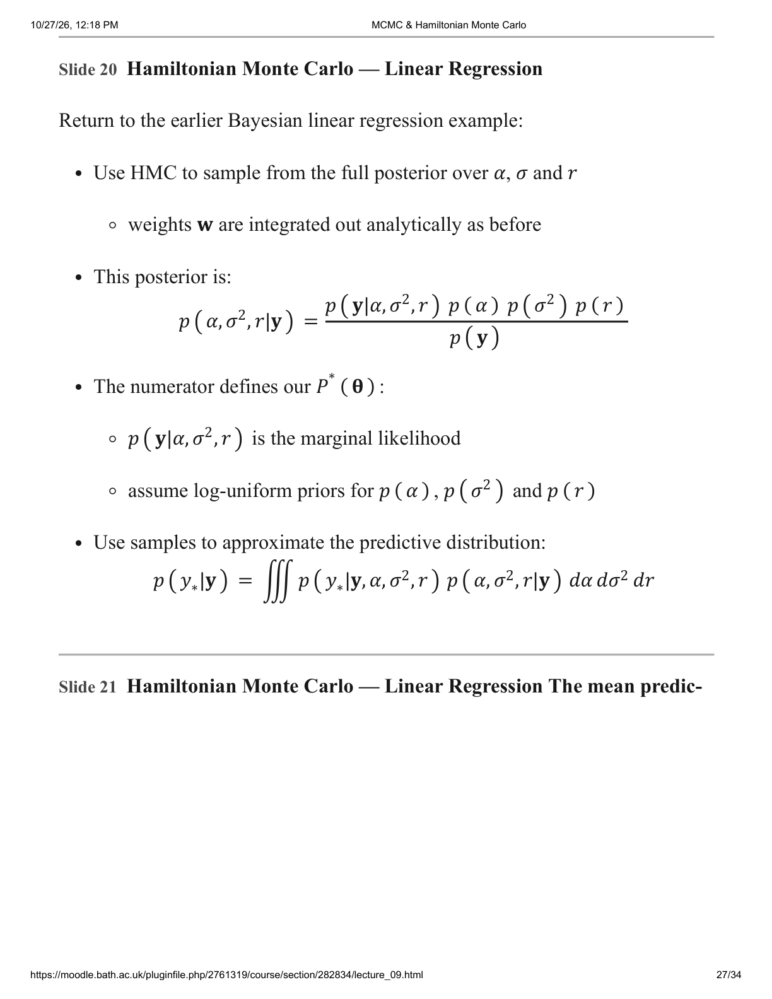

## Page 28

Slide 21 continues: black observed points, red posterior-averaged mean predictor and gold dashed reference curve against input position. A mean curve is not the full predictive distribution or a convergence diagnostic.

### Slide 22: Hamiltonian Monte Carlo — Linear Regression

Histograms of marginal samples, continuing over pages 29–31. The individual marginal histograms do not preserve all dependence among the hyperparameters.

Original page 28 (figures and equation layout)

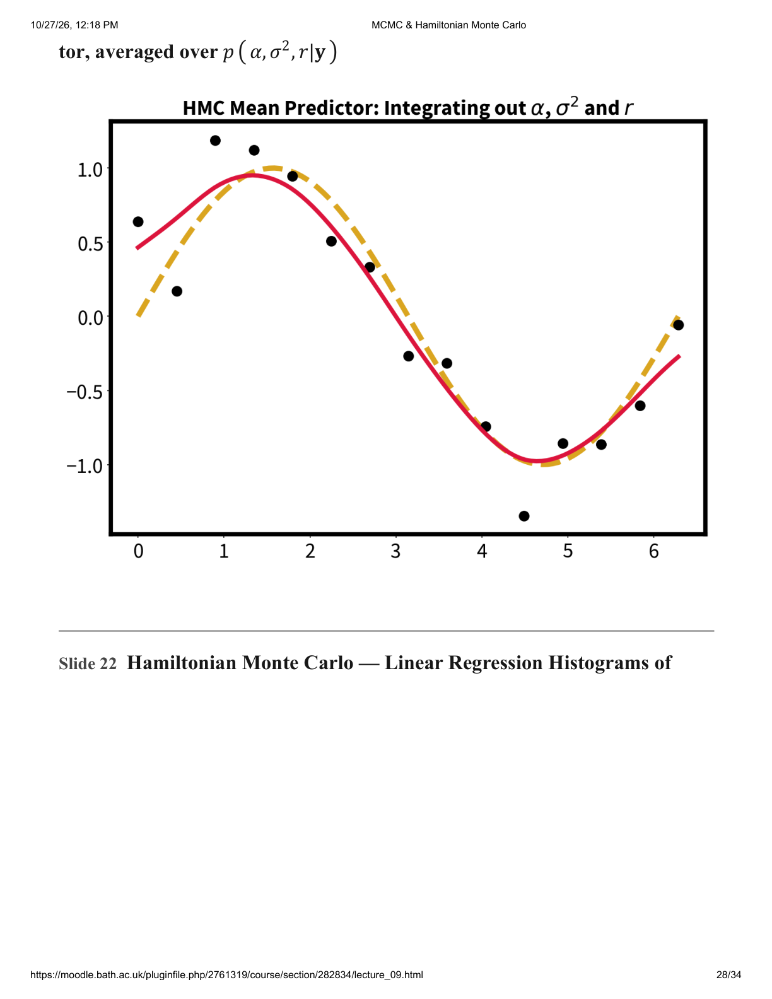

## Page 29

Slide 22 continues: gold histogram labelled “Samples: hyperparameter log α”. Horizontal axis is $\log\alpha$, not raw precision $\alpha$.

Original page 29 (figures and equation layout)

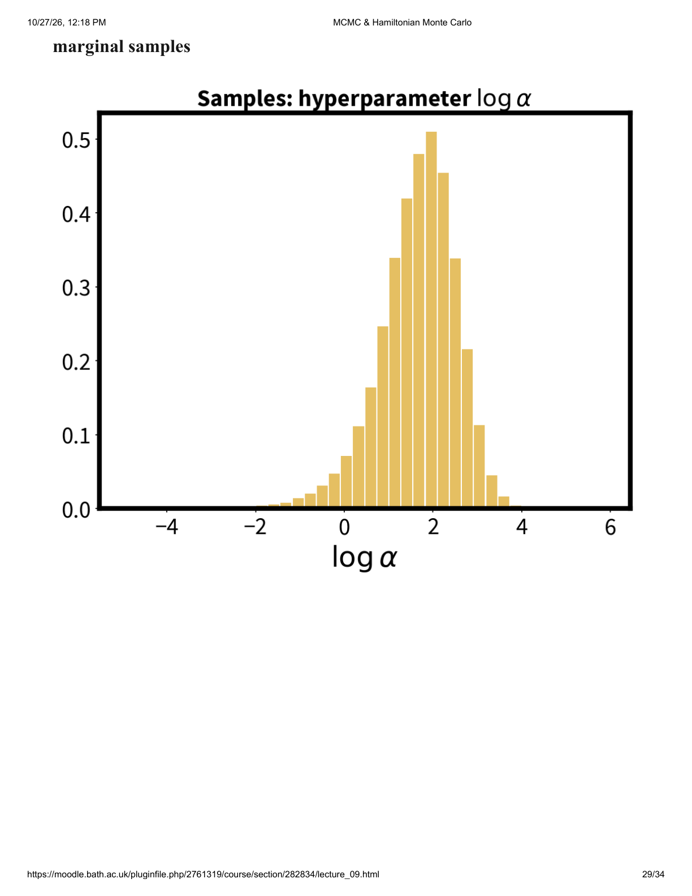

## Page 30

Slide 22 continues: gold histogram labelled “Samples: noise std. dev σ”, with horizontal axis $\sigma$ and dashed “True σ” reference. This is standard deviation, not variance.

Original page 30 (figures and equation layout)

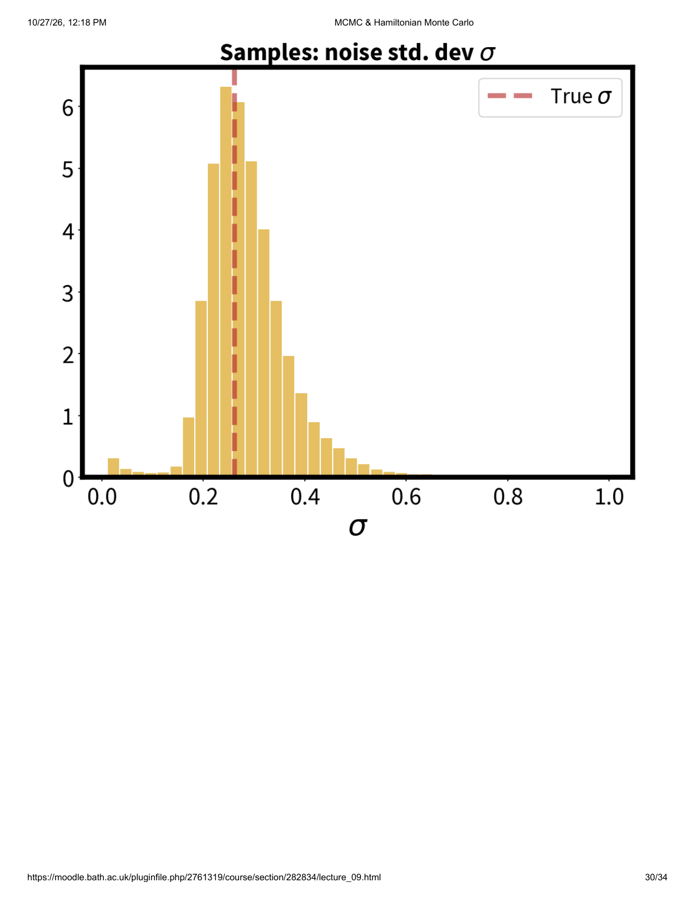

## Page 31

Slide 22 concludes with the gold marginal histogram labelled “Samples: basis width r”, horizontal axis $r$. These are source figures, not newly run sampling output; separate marginal histograms do not determine the joint posterior.

### Slide 23: Hamiltonian Monte Carlo — Summary & Observations

HMC exploits the local shape of $\log P^*(\boldsymbol\theta)$ via gradients to reduce random-walk behaviour. Implementation choices include number of integration steps $L$ and step size $\epsilon$.

Original page 31 (figures and equation layout)

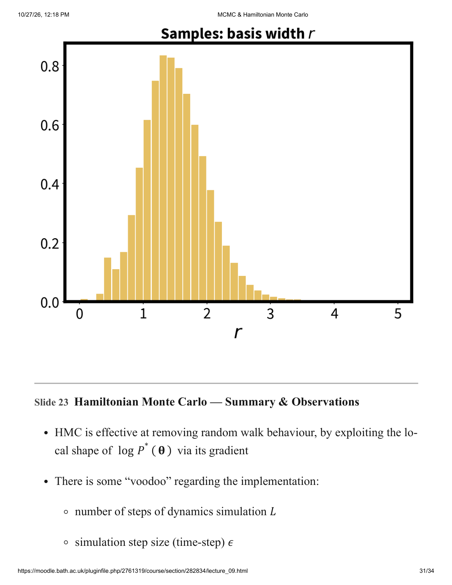

## Page 32

Slide 23 continues. Choices include:

- simulation time $\tau=L\epsilon$, described as distance travelled across the log-density landscape;
- larger $\epsilon$ gives less accurate dynamics and more rejections;
- desired acceptance rate, given as 65%;
- random perturbations to $\epsilon$;
- momentum resampling or momentum persistence;
- random inversion of time direction.

These choices may need tuning. Alternatively use NUTS, the No U-turn Sampler.

**Supplemental qualification:** $\tau$ is integration time, not generally Euclidean distance. The printed acceptance percentage is not universal. NUTS automates trajectory-length selection with a valid sampling construction; warm-up adaptation and diagnostics remain important.

### Slide 24: HMC Demo — Next Lecture

A hand-coded Python HMC implementation is planned for the next lecture. This PDF is not that implementation.

### Slide 25: Papers on How HMC Works

The source recommends introductory papers that retain mathematical detail:

- Radford M. Neal, “MCMC using Hamiltonian Dynamics”: https://arxiv.org/abs/1206.1901.

Original page 32 (figures and equation layout)

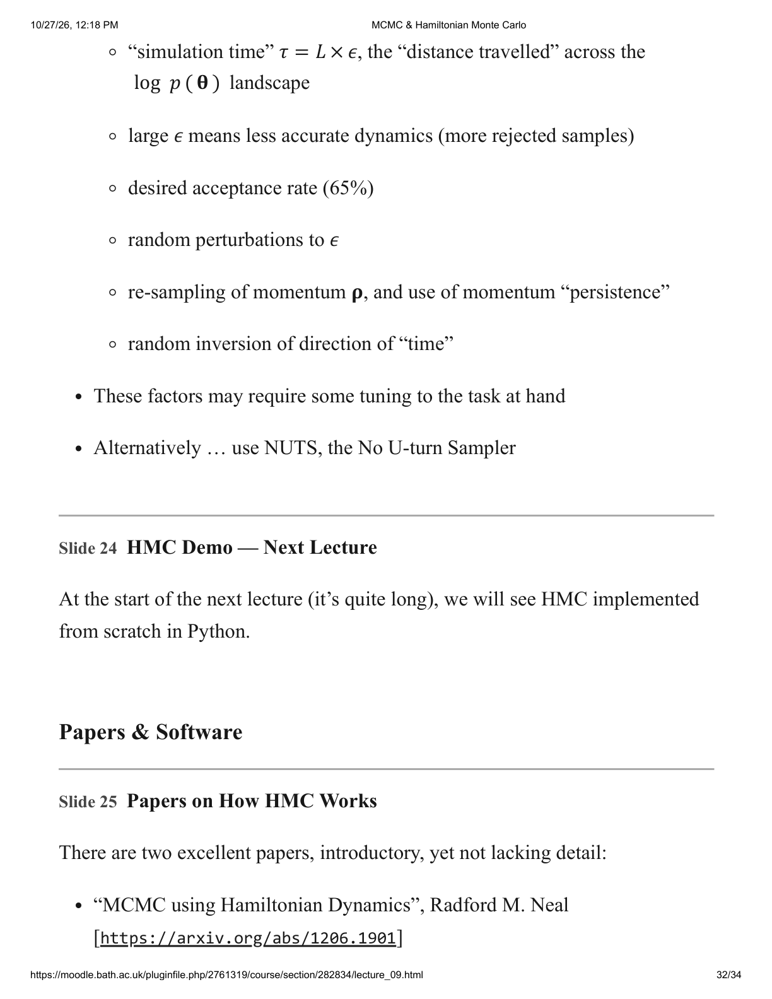

## Page 33

Slide 25 continues:

- Michael Betancourt, “A Conceptual Introduction to Hamiltonian Monte Carlo”: https://arxiv.org/abs/1701.02434.

### Slide 26: Software for Bayesian Inference & MCMC?

The lecture states there is no MCMC software in “standard” Python data-science distributions and lists other libraries:

- Stan, with the Python interface PyStan: https://pystan.readthedocs.io.

**Source boundary:** these are the lecture's software examples and historical packaging claims, not a current comparative recommendation or installation instruction.

Original page 33 (figures and equation layout)

## Page 34

Slide 26 continues with original software screenshots:

- PyMC (native Python): http://pymc.io/.
- NumPyro (native Python): https://num.pyro.ai.

The PDFs do not provide installations, fitted results or a runnable notebook for these software examples.

Original page 34 (figures and equation layout)

